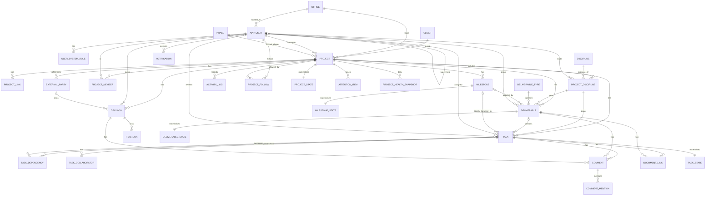
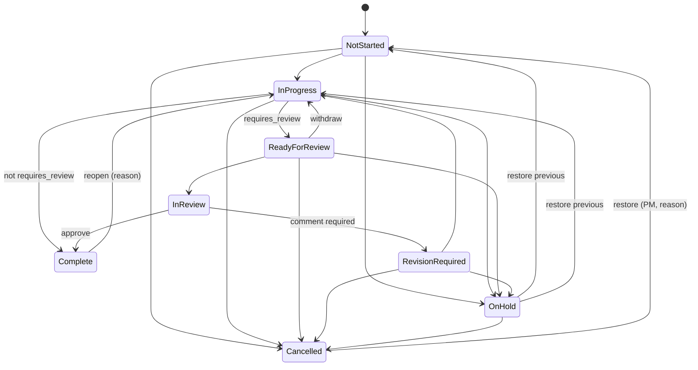
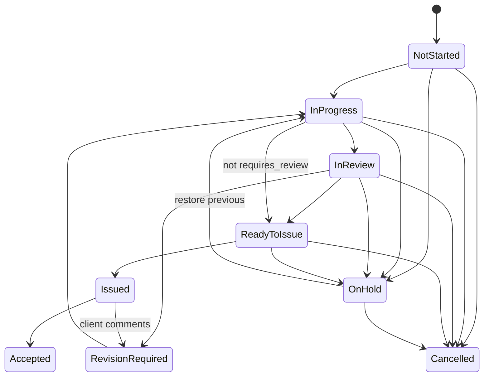

# Engineering Project Coordination Hub

## Product Specification — Version 1.2 (Draft for Review)

| Item | Value |
|---|---|
| Document | Product and Implementation Specification |
| Product | Engineering Project Coordination Hub (working name; "the Hub" in this document; candidate product name **Tuesday**, see Section 34) |
| Version | 1.2 — Draft for stakeholder review |
| Date | 2026-10-09 (v1.0: 2026-09-15) |
| Status | Ready for architecture review, wireframing, and ticket breakdown |
| Audience | Product owner, engineering team, UX design, IT security, pilot project managers |

---

### How to read this document

This specification uses a small set of consistent labels. They matter, because they tell the development team what is a requirement, what is a suggestion, and what still needs a human decision.

| Label | Meaning |
|---|---|
| **[MVP-Required]** | Must be in the first production release. The MVP is not complete without it. |
| **[MVP-Recommended]** | Strongly recommended for MVP because it is cheap relative to its coordination value. Can be cut if the schedule demands it, with the stated consequence. |
| **[Phase 2]** | Planned for the release after MVP. |
| **[Phase 3]** | Later capability. Designed for, not built. |
| **[Out of Scope]** | Will not be built. Listed to protect the product from scope creep. |
| **Recommendation:** | A recommendation by the authors, not a stated requirement. The business may choose otherwise. |
| **Assumption:** | An architectural or business assumption made to keep the specification concrete. Must be validated. |
| **TBD — Business Decision Required** | Information that only the company can provide. The specification is written so that development can proceed around it where possible. |

**Change log**

| Version | Date | Change |
|---|---|---|
| 1.0 | 2026-09-15 | Initial draft. |
| 1.1 | 2026-10-01 | Resource planning promoted from a derived Phase 2 view to an MVP engine owned by managers: weekly person × week allocations, employee- and manager-owned entries, Draft/Published/Confirmed visibility, Confirmed/Expected/Possible confidence, leave, capacity, conflict rules, Manager Home, People area. Sections 1, 8, 9.4, 10, 11.9, 11.13, 12.15, 13.10, 13.11, 13.19, 13.20, 15.13, 23.3, 24.2, 25.7, 27–29, 34 amended. Source: `docs/Tuesday-Consolidated-Product-Scope.md` and `docs/Feature-Gap-Have-vs-Adopt.md`. |
| 1.2 | 2026-10-09 | Connected Team Planner, Vacation & Coverage, and My Week added to MVP: HR-approved leave CSV import with updates/cancellations, office holidays, coverage warnings, copy-last-week preview, project staffing and batched publishing. Personal calendar subscriptions are MVP-Recommended; automatic HR sync, meeting imports and two-way calendar sync remain later work. Permissions, data model, rules and acceptance criteria aligned. |

Canonical status names, role names, and threshold names are defined once in Section 10 (Core Data Model) and used verbatim everywhere else. If a later section appears to contradict Section 10, Section 10 wins and the later section should be corrected.

**Visual-reference boundary.** The user confirmed the six workspace views in §36 and task-hour entry under Time as first-release *functional* requirements. `Coordination Hub v2.dc.html` (preserved in `docs/reference/coordination-hub-v2/`) is the only downloaded UI prototype to use for visual cues. Its appearance, placement, sample content, interactions, and old release badges are illustrative, not a design specification or authority for product behavior. The six-panel image records the confirmed feature scope but does not prescribe the finished design. Requirements and acceptance criteria in this document and the feature packets govern implementation; visual decisions require design review.

---

## Table of Contents

- [1. Executive Summary](#1-executive-summary)
- [2. Problem Statement](#2-problem-statement)
- [3. Product Vision](#3-product-vision)
- [4. Product Principles](#4-product-principles)
- [5. Goals](#5-goals)
- [6. Non-Goals](#6-non-goals)
- [7. User Personas](#7-user-personas)
- [8. Roles and Permissions](#8-roles-and-permissions)
- [9. Information Architecture](#9-information-architecture)
- [10. Core Data Model](#10-core-data-model)
- [11. Functional Requirements](#11-functional-requirements)
- [12. Module Specifications](#12-module-specifications)
- [13. Detailed Screen Specifications](#13-detailed-screen-specifications)
- [14. User Workflows](#14-user-workflows)
- [15. Business Rules](#15-business-rules)
- [16. Project Health Logic](#16-project-health-logic)
- [17. Notification Logic](#17-notification-logic)
- [18. Search and Filtering](#18-search-and-filtering)
- [19. Reporting](#19-reporting)
- [20. Audit Requirements](#20-audit-requirements)
- [21. Security Requirements](#21-security-requirements)
- [22. Non-Functional Requirements](#22-non-functional-requirements)
- [23. Technical Architecture](#23-technical-architecture)
- [24. Database Design](#24-database-design)
- [25. API Design](#25-api-design)
- [26. Integration Architecture](#26-integration-architecture)
- [27. MVP Scope](#27-mvp-scope)
- [28. Phase 2 Scope](#28-phase-2-scope)
- [29. Phase 3 Scope](#29-phase-3-scope)
- [30. Explicitly Out-of-Scope Items](#30-explicitly-out-of-scope-items)
- [31. Acceptance Criteria](#31-acceptance-criteria)
- [32. Edge Cases and Recommended Handling](#32-edge-cases-and-recommended-handling)
- [33. Risks and Technical Considerations](#33-risks-and-technical-considerations)
- [34. Open Decisions / Questions](#34-open-decisions-questions)
- [35. Recommended Development Sequence](#35-recommended-development-sequence)
- [32. Edge Cases and Recommended Handling](#32-edge-cases-and-recommended-handling)
- [33. Risks and Technical Considerations](#33-risks-and-technical-considerations)
- [34. Open Decisions / Questions](#34-open-decisions-questions)
- [35. Recommended Development Sequence](#35-recommended-development-sequence)
- [Decisions We Need to Make Before Development](#decisions-we-need-to-make-before-development)
- [Features That Sound Useful But Should NOT Be Built Yet](#features-that-sound-useful-but-should-not-be-built-yet)
- [Appendix A — Reference Example: Municipal Infrastructure Design template and "DCC Dundurn Roads"](#appendix-a-reference-example-municipal-infrastructure-design-template-and-dcc-dundurn-roads)
- [Appendix B — Glossary](#appendix-b-glossary)
- [Appendix C — Status Transition Diagrams](#appendix-c-status-transition-diagrams)
- [36. Six-View Visual Workspace Requirements](#36-six-view-visual-workspace-requirements)
- [37. Multidisciplinary Coordination Amendment](#37-multidisciplinary-coordination-amendment)
- [38. Design Inputs, Readiness and Location Context](#38-design-inputs-readiness-and-location-context)
- [39. Weekly Planning Layer Amendment](#39-weekly-planning-layer-amendment)
- [40. Staffing Signals and Trustworthy Counts Amendment](#40-staffing-signals-and-trustworthy-counts-amendment)
- [41. Calm Workspace Amendment](#41-calm-workspace-amendment)
- [42. Supervisor Capacity Signals Amendment](#42-supervisor-capacity-signals-amendment)
- [43. Delivery Process Amendment](#43-delivery-process-amendment)
- [44. Typed Contract and Entity Registry Amendment](#44-typed-contract-and-entity-registry-amendment)
- [45. Capacity Figures and Server Values Amendment](#45-capacity-figures-and-server-values-amendment)
- [46. Route Splitting and Live Updates Amendment](#46-route-splitting-and-live-updates-amendment)
- [47. Record Engine Amendment](#47-record-engine-amendment)
- [48. Operations and Security Hardening Amendment](#48-operations-and-security-hardening-amendment)
- [49. Record Recovery and Counts Amendment](#49-record-recovery-and-counts-amendment)
- [50. Task and Timeline Interaction Amendment](#50-task-and-timeline-interaction-amendment)
- [51. Planning, Reporting and Onboarding Amendment](#51-planning-reporting-and-onboarding-amendment)

---

## 1. Executive Summary

The Engineering Project Coordination Hub is an internal web application for coordinating multidisciplinary engineering consulting projects. It exists to answer one question, continuously and without anyone compiling a status report:

> **Who is responsible for what, what is due next, what are we waiting for, and what is preventing the project from moving forward?**

The Hub is not a general-purpose task manager and it is not a scheduling engine. It is a purpose-built coordination layer for engineering projects that are organised by **discipline**, driven by **deliverables**, punctuated by **submission milestones**, and frequently held up by **cross-discipline dependencies** and **unmade decisions**.

The product is built entirely from structured data and deterministic rules. Every status, flag, and "attention required" item can be traced to a stated rule and a stated threshold. There is no AI in the base product and none is assumed.

**What the MVP delivers**

- Projects with disciplines, discipline leads, and project teams.
- Milestones, deliverables, and tasks, in a hierarchy designed for engineering work rather than generic to-do lists.
- Task status workflow with independent technical review built in.
- Task dependencies (Finish-to-Start) with automatic detection of waiting, blocked, and blocking work, and identification of affected milestones.
- A deterministic "PM Attention Required" engine with configurable thresholds.
- A Project Dashboard, a personal My Work page, and a Weekly Coordination view designed to run a multidisciplinary coordination meeting directly from the application.
- A thin Decision Register, because decisions are the most common non-task blocker in design projects. (Recommended for MVP; see Section 27 for the rationale and the fallback if it is cut.)
- Comments with @mentions, document links to SharePoint/Teams/network folders, a full activity log, in-app and email notifications, and corporate single sign-on.
- A **Weekly Resource Planner**: a manager-owned planning layer of person × week allocations that is informed by project data but not controlled by it. Managers and employees record hours against projects and against work that lives outside the Hub (proposals, admin, training, small projects); HR-approved leave reduces availability separately. Allocations carry a visibility state (Private Draft, Published, Confirmed) and a confidence (Confirmed, Expected, Possible). Deterministic rules flag over- and under-allocation, overlapping plans from two managers, leave conflicts and stale plans. A Manager Home exception dashboard answers "where does my team need attention" in about 30 seconds.

The planning workspace connects three views over the same records: **Team Planner** (weekly people and project staffing), **Vacation & Coverage** (a year of approved leave and coverage concerns), and **My Week** (each person’s published plan). HR approves leave; Tuesday imports availability and helps managers arrange coverage. Leave reduces capacity without reducing assigned work or counting the same absence twice. Personal calendar subscriptions can surface dated commitments; weekly hours do not become invented appointments.

**What comes later**

Risk and Issue registers, Meeting Actions, and Project Templates are Phase 2. The Resource/Workload view, Portfolio Dashboard, improved Gantt, and saved views move into the first release under §36. Teams and SharePoint integration, ERP/Vantagepoint integration, and financial or utilisation data are Phase 3.

**Recommended technical approach**

A modular monolith: a React + TypeScript single-page application, an ASP.NET Core Web API (with Node.js/TypeScript as an acceptable alternative if the team's skills favour it), PostgreSQL, Microsoft Entra ID single sign-on, hosted on Azure App Service with Azure Database for PostgreSQL. The system is sized for hundreds of active projects, tens of thousands of tasks, and a few hundred users, and is intended to be maintained by a small internal team.

**What this document enables**

The specification is written so that a development team (or a software-development agent) can design the database (Section 24), produce wireframes (Section 13), establish the architecture (Section 23), create development tickets (Sections 11, 27, 35), implement the MVP, and test it against explicit acceptance criteria (Section 31).

---

## 2. Problem Statement

### 2.1 The coordination gap

A multidisciplinary engineering project — a municipal road reconstruction, for example — involves a project manager and five to eight disciplines, each with its own lead, its own deliverables, and its own internal review process. The disciplines depend on one another in ways that are well understood by experienced staff but rarely written down in a form the whole team can see:

```
Survey base plan
  → Civil preliminary design
    → Utility coordination
    → Geotechnical recommendations
      → Civil detailed design
        → Electrical coordination
          → QA/QC review
            → Client review
              → Final submission
```

Today this knowledge lives in the PM's head, in a spreadsheet, in a Planner board that nobody updates, and in a weekly meeting where the same questions are asked every time: *Is the survey done? Are we waiting on the client for the pavement decision? Who has the stormwater report? When is 60% due again?*

### 2.2 Why existing tools do not fit

[Inference] Tuesday is intended to differentiate through predefined engineering coordination workflows. General work-management platforms can support hierarchy, dependencies, reviews and configurable workflows; differentiation should be evaluated on the built-in discipline, deliverable, submission and decision relationships, not a claim that competitors only offer flat cards. Schedule tools (Primavera P6, Microsoft Project) model dependencies well but are heavyweight, require scheduling expertise, and are not something a design team updates daily. The result is that the coordination question is answered by people compiling status, not by the system.

### 2.3 Concrete pains this product addresses

| Pain | How it shows up today | What the Hub does about it |
|---|---|---|
| Unclear ownership | "I thought Electrical was doing that." | Every task has exactly one accountable assignee and one owning discipline. Every deliverable has an owner. Unowned work is flagged. |
| Invisible dependencies | Civil detailed design starts late because geotech recommendations slipped and nobody connected the two. | Explicit task dependencies; successors are automatically shown as Waiting or Blocked; overdue predecessors are flagged as blocking others. |
| Decisions that stall work | Client has not confirmed the pavement structure; three tasks are quietly idle. | Decision Register with owner, required-by date, and links to the work it holds up; overdue decisions surface on the dashboard and coordination view. |
| Submissions that surprise people | 85% package is due Friday; two disciplines have open tasks. | Milestone status (On Track / At Risk / Overdue) computed from linked deliverables; approaching milestones with incomplete prerequisites are flagged. |
| Status compiled by hand | PM spends Monday morning building a status email. | Project Dashboard and Weekly Coordination view are always current; the meeting is run from the screen. |
| Review bottlenecks | Work sits "done" but unreviewed. | Review is part of the task workflow; stalled reviews are flagged; reviewers see a My Reviews queue. |
| No traceability | "Who moved that date?" | Immutable activity log on assignments, dates, statuses, deletions, and decisions. |

### 2.4 What success looks like

Success is measured by coordination outcomes, not feature counts:

- A PM can open the Weekly Coordination view and run the coordination meeting without any other preparation.
- A discipline lead can see, in under a minute, everything their discipline owes and everything their discipline is waiting on.
- A team member's My Work page is the single list they work from.
- A supervisor can see who is overloaded and who has capacity across projects without asking.
- Every "why is this blocked?" question can be answered by clicking the blocked indicator.

---

## 3. Product Vision

**For** project managers, discipline leads, supervisors, and engineering staff in a multidisciplinary consulting firm,
**who** need to coordinate deliverable-driven work across disciplines and keep design submissions on schedule,
**the Engineering Project Coordination Hub** is an internal coordination platform
**that** makes ownership, due dates, dependencies, blockers, and pending decisions immediately visible at project, personal, and portfolio level.
**Unlike** generic task boards and heavyweight scheduling tools,
**the Hub** is structured around disciplines, deliverables, milestones, reviews, and decisions, and it answers the coordination question through deterministic rules rather than manual status compilation.

### 3.1 What the Hub is

- A **system of record for coordination**: who owns what, when it is due, what it depends on, and what state it is in.
- A **meeting tool**: the Weekly Coordination view is designed to be projected and walked through.
- A **personal work queue**: My Work is designed to be the one list a person opens each morning.
- A **visibility layer for management**: the first-release Portfolio Dashboard and Resource View answer "which projects need help" and "who needs help".

### 3.2 What the Hub is not

- Not a scheduling engine. It does not compute critical paths, level resources, or auto-shift dates.
- Not a document management system. It links to documents; it does not store them.
- Not a payroll timesheet, accounting, or ERP system. The first-release Time view records actual hours against tasks (§36.8), without billing or approval workflows.
- Not a replacement for Teams, email, or the engineering tools in which the actual work is produced.
- Not an AI product. Nothing in the base product depends on or includes AI.

---

## 4. Product Principles

These principles are used to make design decisions throughout the specification and should be used by the development team to resolve ambiguities. Every proposed feature must pass the first principle.

1. **Does this make coordination easier?** If a feature does not help someone answer "who, what, when, what are we waiting for, what is stuck", it does not belong. Administrative burden is a cost, not a neutral.

2. **One accountable owner.** Every task, deliverable, decision, risk, issue, and action has exactly one accountable owner. Others may collaborate, watch, or review, but accountability is never shared. Shared accountability is how work falls through gaps.

3. **Deliverables drive the work.** Tasks exist to produce deliverables; deliverables exist to meet milestones. The hierarchy in the product reflects this, and progress rolls up along it.

4. **Disciplines own their work.** Discipline leads are accountable for their discipline's deliverables and tasks within a project. The product gives them ownership views and permissions to match.

5. **Dependencies are first-class and visible.** Cross-discipline hand-offs are the main source of delay. The system makes them explicit, computes their consequences, and never hides a blocker.

6. **Deterministic and explainable.** Every computed status, flag, or health colour can be explained by a stated rule and a stated threshold. If a user asks "why is this red?", the interface shows the rule that fired.

7. **Review is part of the workflow, not an afterthought.** Engineering work requires independent technical review. The task and deliverable lifecycles model it explicitly.

8. **Decisions are work.** A pending decision is tracked with the same seriousness as a task, because it has the same power to stop a project.

9. **Minimum viable ceremony.** Fields are optional unless a rule genuinely needs them. Warnings and attention flags are preferred over hard validation, except where data integrity requires it.

10. **Information-dense, calm interface.** Desktop-first, table-oriented, low-animation, colour used with redundant text or icons. Professional engineering software, not a consumer app.

11. **Traceable.** Changes to ownership, dates, statuses, and decisions are logged and visible.

12. **Simple enough for a small team to maintain.** Modular monolith, one database, mainstream frameworks, no speculative infrastructure.

---

## 5. Goals

### 5.1 Product goals (MVP)

| ID | Goal | How we will know |
|---|---|---|
| G1 | PMs run weekly coordination meetings from the Hub. | Pilot PMs report the Weekly Coordination view replaces their status spreadsheet/email for the meeting. |
| G2 | Every active project has a current, correct answer to "what is due next and who owns it". | Attention items "task has no owner" and "task has no due date" trend toward zero on pilot projects after 4 weeks. |
| G3 | Blocked work is visible within one day of becoming blocked. | Blocked indicators are computed automatically; PM attention list shows blocked items without manual entry. |
| G4 | Team members use My Work as their daily list. | Pilot users update task status at least weekly in the Hub without being chased. |
| G5 | Milestone risk is visible at least two weeks before a submission. | Milestone At Risk rule fires on configurable lead time; no "surprise" submissions on pilot projects. |
| G6 | The system is adopted with minimal training. | New users complete core actions (update task, add comment, mark ready for review) after a 30-minute walkthrough. |

### 5.2 Technical goals

| ID | Goal |
|---|---|
| T1 | Deterministic rules are implemented as pure, unit-tested functions with near-complete test coverage. |
| T2 | Corporate SSO from day one; no separate passwords. |
| T3 | Maintainable by a team of 2–4 developers after launch. |
| T4 | Deployable to Azure with infrastructure as code and separate dev/test/prod environments. |
| T5 | All ownership, date, status, and deletion changes are captured in an immutable activity log. |

---

## 6. Non-Goals

The following are deliberately not goals of this product, at any phase. See Section 30 for the full out-of-scope list.

- Replacing Primavera P6, Microsoft Project, or any CPM scheduling tool.
- Replacing SharePoint, Teams, OneDrive, or a document management system.
- Tracking billable rates, costs, budgets, invoices, or payroll. Actual task hours are tracked under §36.8.
- Performing or automating engineering calculations or engineering decisions.
- Providing AI assistants, summaries, recommendations, or predictions.
- Serving external clients as system users (external parties are referenced, not logged in, until at least Phase 3).
- Acting as a general-purpose work tool for non-project work (HR, IT tickets, marketing).
- Being a mobile-first product. Mobile is for reading and quick updates only.

---

## 7. User Personas

Personas are composites used to make design decisions. Names are illustrative. Most real employees combine several personas (see Section 8.4).

### 7.1 Priya — Project Manager

- **Role:** Manages 4–8 concurrent municipal infrastructure projects, each with 4–7 disciplines.
- **Goals:** Know what is due this week and next, know what is blocked and why, run a tight coordination meeting, keep clients informed, avoid submission surprises.
- **Frustrations:** Compiling status by hand every Monday. Finding out about a slipped predecessor only when the successor is late. Chasing client decisions by email with no record.
- **Uses:** Project Dashboard daily; Weekly Coordination weekly; Decision Register; Milestone view; Task list filtered by discipline.
- **Devices:** Desktop with two monitors; laptop in meeting rooms; phone for quick checks.

### 7.2 Marc — Discipline Lead (Civil)

- **Role:** Senior civil engineer leading the civil discipline on 6–10 projects, also a PM on 1–2 small ones.
- **Goals:** See everything Civil owes across all projects; know what Civil is waiting on from Survey and Geotech; assign and review Civil work; protect the team's review time.
- **Frustrations:** Being assigned tasks in tools they do not control. Learning about scope changes second-hand. Reviewing work that was "done" without being told.
- **Uses:** My Work (My Reviews); Task list filtered to Civil; Deliverables Register; Kanban for the discipline.

### 7.3 Alex — Project Team Member (Designer / EIT)

- **Role:** Works on 3–5 projects at a time across two disciplines' teams.
- **Goals:** A single list of what to do, in due-date order, with context. Clear hand-off when work is ready for review. Know when a dependency is cleared so work can start.
- **Frustrations:** Being asked for status in meetings. Not knowing a predecessor finished. Ambiguous ownership ("the Civil team").
- **Uses:** My Work almost exclusively; task detail panel; comments and mentions.
- **Devices:** Desktop; occasionally tablet on site.

### 7.4 Diane — Reviewer (Senior Technical)

- **Role:** Senior engineer who performs technical review for several disciplines' deliverables but is not on every project team.
- **Goals:** A clear queue of what needs review and by when; ability to send work back with specific comments; not being the bottleneck by surprise.
- **Uses:** My Work (My Reviews); task detail; deliverable detail.

### 7.5 Sam — Supervisor / Resource Manager (Civil Group)

- **Role:** Manages 12 civil staff across many projects. Not a member of most project teams.
- **Goals:** See each person's load across projects; spot overloaded staff and overlapping deadlines; know who has capacity when a PM asks for help; reassign work when someone is away or leaves.
- **Frustrations:** No cross-project view without asking each PM. Estimates are unreliable but something is better than nothing.
- **Uses:** My Staff for their direct reports (assignments, work, staffing); first-release Resource View; Portfolio Dashboard filtered by discipline; My Work of supervised staff (read).

### 7.6 Lena — Executive / Regional Manager

- **Role:** Responsible for a region or business unit with 40–100 active projects.
- **Goals:** Which projects are at risk this week and why; which PMs need support; upcoming submissions across the portfolio.
- **Frustrations:** Health reported by PMs is optimistic and inconsistent. No single place to see it.
- **Uses:** First-release Portfolio Dashboard; Project Dashboard (read); reports export.

### 7.7 Jordan — System Administrator

- **Role:** IT / applications administrator.
- **Goals:** Manage user access via Entra ID groups; maintain disciplines, deliverable types, offices, clients, templates, and thresholds; deactivate leavers; audit changes.
- **Uses:** Administration screens; activity history; Entra ID.

### 7.8 The Client Contact (non-user)

- **Role:** Client project manager or approving authority. Does **not** log in.
- **Why it matters:** Client decisions and client reviews are frequently the blocker. The Hub represents clients and other external parties as **External Parties** that can own decisions and meeting actions, so "waiting on client" is visible, dated, and tracked, even though no notification is sent outside the organisation in MVP.


## 8. Roles and Permissions

### 8.1 Two-layer role model

The same employee is routinely a Civil supervisor, a discipline lead on one project, the PM on another, and a task assignee on a third. A single flat role cannot express this. The Hub therefore uses two layers:

1. **System roles** — assigned per user for the whole application. They control cross-project visibility and administration. A user has one or more system roles.
2. **Project roles** — assigned per user per project (and, for Discipline Lead, per discipline within the project). They control what the user can do inside that project.

Effective permission for any action = the union of what the user's system roles allow and what their project roles on the relevant project allow, further extended by **ownership** (assignee, reviewer, owner, creator) as defined in 8.6. Permissions are always evaluated server-side. Deny is the default.

**Recommendation:** Keep exactly these roles. Do not add per-field or per-status permissions. Where finer control seems needed, prefer a business rule with a warning over a permission.

### 8.2 System roles

| System role | Purpose | Cross-project visibility | Typical holders |
|---|---|---|---|
| **System Administrator** | Configure the system: users, roles, disciplines, clients, offices, deliverable types, phases, thresholds, templates. Can unarchive projects and perform data corrections. | All projects (read and write) | IT / application admin (2–3 people) |
| **Executive** | Portfolio-level visibility. | Read all projects, portfolio dashboard, reports, resource view | Regional/business unit managers |
| **Supervisor** | Visibility of their staff (direct reports, §8.8): project assignments, work, and workload; staffing them on projects and reassigning their tasks. | Read all projects; My Staff page (§13.19) and first-release Resource View for supervised staff; may add or remove supervised staff on project teams as Team Members and reassign tasks they own | Group/department managers |
| **Project Manager** | May create projects and becomes PM of projects they create. | Read all projects (subject to 8.7); write only where they hold a project role | Staff designated as PMs |
| **Standard User** | Default for every employee. | Read all projects (subject to 8.7); write only where they hold a project role | All staff |
| **Read Only** | View-only account. Cannot comment or edit. | Read all projects (subject to 8.7) | Auditors, temporary staff, contractors (TBD) |

**Recommendation:** "Standard User" is granted automatically to every active user provisioned from Entra ID. Other system roles are mapped from Entra ID security groups (see Section 23.6) or set by a System Administrator in the Hub. **TBD — Business Decision Required:** group-mapped or in-app-assigned system roles (see Section 34).

### 8.3 Project roles

| Project role | Scope | Purpose |
|---|---|---|
| **Project Manager (PM)** | Whole project | Accountable for the project. Full write within the project: project info, team, disciplines, milestones, deliverables, tasks, dependencies, decisions, registers, health override, status changes including Complete. Exactly one *primary* PM per project (the `Project.project_manager_id`); additional users may hold the PM role (e.g., deputy PM). |
| **Discipline Lead (DL)** | One discipline within the project | Accountable for the discipline's work. Full write on deliverables and tasks whose owning discipline matches; may create tasks/deliverables in their discipline; may assign within the project team; may set deliverable status; may add dependencies from/to their discipline's tasks. Read on everything else. Cannot change milestone dates or project info. |
| **Team Member** | Whole project | May create tasks in disciplines they are a member of (Recommendation: allow, with owning discipline defaulting to their discipline); update tasks assigned to them or on which they are collaborators; comment anywhere in the project; add document links; view everything. |
| **Reviewer** | Whole project | A team-member-level role granted automatically when someone outside the team is assigned as reviewer. Can view the project, comment, and act on reviews assigned to them. |
| **Viewer** | Whole project | Read and comment (Recommendation: allow comments; make it configurable per project). For stakeholders who want to follow a project without owning work. |

A user can hold multiple project roles on the same project (e.g., PM and DL of Project Management discipline). A user can be DL for more than one discipline on a project.

### 8.4 Role combinations — worked example

Employee **Marc**:

| Context | Role(s) | What Marc can do |
|---|---|---|
| System | Supervisor (Civil group), Project Manager, Standard User | See all projects; see Resource View for the 12 civil staff; create projects |
| Project 1234 (DCC Dundurn Roads) | Discipline Lead — Civil | Manage all Civil deliverables/tasks on 1234; cannot move 1234's milestones |
| Project 1301 | PM | Everything on 1301 |
| Project 1187 | Team Member (assigned 3 tasks) | Update own tasks, comment |
| Project 1187 | Reviewer on task 1187-T0042 | Review that task |

Marc's My Work aggregates all of these. The Hub never asks Marc to "switch role"; it evaluates effective permissions per action.

### 8.5 Permissions matrix

Legend: **Y** = allowed; **O** = allowed for own items only (see 8.6); **D** = allowed within own discipline only; **—** = not allowed.

#### 8.5.1 System-level actions

| Action | Sys Admin | Executive | Supervisor | Project Manager (sys) | Standard User | Read Only |
|---|---|---|---|---|---|---|
| Sign in and use the application | Y | Y | Y | Y | Y | Y |
| View project list and any project (subject to 8.7) | Y | Y | Y | Y | Y | Y |
| Create a project | Y | — | — | Y | — | — |
| View Portfolio Dashboard | Y | Y | Y | Y (own projects by default; all with filter) | — | — |
| View Weekly Resource Planner (published and confirmed allocations) | Y | Y (all) | Y (all) | Y (members of own projects) | Y (self only, via My Work) | — |
| View Private Draft allocations | Y (data correction only, logged) | — | O (creator only) | — | — | — |
| Create / edit / delete manager allocations for a person | Y | — | Y (supervised staff) | — | — | — |
| Publish / confirm / unpublish a manager allocation | Y | — | O (creator) | — | — | — |
| Create / edit / delete own employee allocations | Y | Y | Y | Y | Y | — |
| Record / correct a manual copy of HR-approved leave (with HR reference) | Y | — | Y (supervised staff) | — | — | — |
| Preview / apply HR-approved leave CSV; configure office holidays | Y | — | — | — | — | — |
| View Vacation & Coverage availability | Y | Y (all) | Y (all) | Y (members of own projects) | Y (own team; availability only) | — |
| Set a person's weekly capacity and working days | Y | — | Y (supervised staff) | — | — | — |
| Reassign tasks across projects for supervised staff | Y | — | Y | — | — | — |
| Add or remove supervised staff on a project team (as Team Member) | Y | — | Y | — | — | — |
| Manage users, system roles, offices, disciplines, clients, deliverable types, phases | Y | — | — | — | — | — |
| Manage project templates | Y | — | — | Y (Recommendation: also allow "Template Editor" as an Admin-granted flag) | — | — |
| Manage organisation thresholds and notification defaults | Y | — | — | — | — | — |
| Unarchive a project | Y | — | — | — | — | — |
| View all activity history | Y | Y | Y | Y | Y (projects they can view) | Y |
| Export reports | Y | Y | Y | Y | Y (own projects) | Y |
| Manage own notification preferences, project follow levels, and saved views | Y | Y | Y | Y | Y | Y |

#### 8.5.2 Project-level actions

| Action | PM | Discipline Lead | Team Member | Reviewer | Viewer |
|---|---|---|---|---|---|
| View project, dashboard, all registers | Y | Y | Y | Y | Y |
| Edit project information (name, client, description, dates, phase, links) | Y | — | — | — | — |
| Change project status (Active, On Hold, Complete, Cancelled) | Y | — | — | — | — |
| Archive project | Y (Complete → Archived) | — | — | — | — |
| Manage project team and roles (Supervisors may also add or remove their direct reports as Team Members, §8.5.1) | Y | — | — | — | — |
| Add/remove disciplines, set Discipline Lead | Y | — | — | — | — |
| Set/clear health override | Y | — | — | — | — |
| Create / edit / delete milestone; change milestone date | Y | — | — | — | — |
| Re-baseline a milestone or deliverable, or return it to its original dates, with a reason (§50.5) | Y | — | — | — | — |
| Mark milestone Complete | Y | — | — | — | — |
| Create deliverable | Y | D | — | — | — |
| Edit deliverable (fields, owner, dates) | Y | D | O (owner) | — | — |
| Change deliverable status | Y | D | O (owner, except Issued/Accepted — Recommendation: PM or DL only) | — | — |
| Delete / cancel deliverable | Y | D (if no completed tasks) | — | — | — |
| Create task | Y | D | Y (in own discipline; Recommendation) | — | — |
| Create / edit / cancel calendar event tied to project | Y | O (event owner) | O (event owner) | O (event owner) | — |
| View task-hour entries | Y (project) | D | O (own entries) | O (own entries) | — |
| Add / edit / delete task-hour entries | Y (correct with reason) | D (own entries) | O (own entries) | O (own entries) | — |
| Edit task fields | Y | D | O (assignee/collaborator/creator) | — | — |
| Assign / reassign task | Y | D | O (creator may assign at creation) | — | — |
| Change task status | Y | D | O (assignee/collaborator: Not Started → In Progress → Ready for Review; On Hold with reason) | O (reviewer: In Review, Revision Required, Complete) | — |
| Set reviewer on a task | Y | D | O (creator at creation) | — | — |
| Add / remove task dependency | Y | D (either end in own discipline) | O (successor is own task) | — | — |
| Set manual block / clear manual block | Y | D | O | — | — |
| Change task due date | Y | D | O (Recommendation: assignee may change with reason; logged; PM notified) | — | — |
| Delete task | Y | D (Recommendation: only if Not Started) | O (creator, only if Not Started and no dependencies) | — | — |
| Cancel task | Y | D | — | — | — |
| Reopen completed task | Y | D | — | O (reviewer) | — |
| Comment, @mention, add document link | Y | Y | Y | Y | Y (comment configurable) |
| Edit / delete own comment (within rules, Section 12.8) | O | O | O | O | O |
| Create / edit decision, risk, issue, meeting, action | Y | Y (Recommendation: DL may raise decisions/risks/issues; owner edits own) | Y (raise only; edit own) | — | — |
| Record a decision outcome | Y | O (decision owner) | O (decision owner) | — | — |
| Run Weekly Coordination in meeting mode (record "reviewed" timestamp) | Y | Y | — | — | — |

**Recommendation:** Treat the matrix as the acceptance test for the authorisation layer. Each row becomes a set of automated tests.

### 8.6 Ownership-based permissions

Ownership extends role permissions on individual items regardless of project role:

- **Assignee** of a task: update status (within assignee transitions), progress, description, estimated effort, document links; add dependencies where their task is the successor; set manual block; propose due-date change (Recommendation: allowed with reason).
- **Collaborator** on a task: same as assignee except cannot reassign or change due date.
- **Reviewer** of a task or deliverable: transition In Review → Revision Required / Complete (task) or In Review → Revision Required / Ready to Issue (deliverable); comment.
- **Owner** of a deliverable, decision, risk, issue, or action: edit the item and change its status (within rules).
- **Creator** of an item: edit it until someone else has acted on it (status change, comment by another user, assignment accepted); delete it if it is Not Started/Pending and has no links.
- **Owner of a task-hour entry**: edit or soft-delete that entry while its project is editable; this does not grant permission to change the task itself. A project PM may correct another person's entry only with a logged reason (§36.8).

### 8.7 Visibility model

**Assumption:** All active employees may view all projects (open-by-default). This is typical in consulting firms, maximises coordination value, and keeps the permission model simple.

**TBD — Business Decision Required:** whether some projects must be **restricted** (e.g., confidential clients, litigation support, M&A due diligence). If yes, the design accommodates a per-project `visibility` flag (`Open` | `Restricted`), where Restricted projects are visible only to project members, System Administrators, and Executives. This is cheap to add at the data-model level and should be included in the schema from day one even if the UI control ships later. Recommendation: include the column and enforce it in the authorisation layer in MVP; expose the toggle only if the business confirms the need.

**Private Draft allocations are an exception to open-by-default.** A manager allocation in `Draft` visibility is visible only to its creator (and to System Administrators for data correction). It is excluded from the employee's My Work, from other managers' planner views, from totals shown to anyone but the creator, and from search. It is **included** in the creator's own totals and in the overlapping-plans conflict rule (RES-10), which reports the conflict to both managers without revealing the other manager's draft details beyond "another manager has planned N h". Enforcement is in the authorisation layer and in every query that aggregates hours, not in the UI.

**Leave privacy and ownership.** HR is the sole approval authority. Imported dates, hours and cancellation state are read-only in Tuesday and change only through a validated HR import. Admins and Supervisors may enter an HR-referenced manual fallback; employees flag discrepancies for correction in HR. Calendar and planner readers see dates, hours and “Unavailable”, never HR reasons, medical details or balances. For this MVP, a team means people with the same `supervisor_id`. Standard Users see their own team’s availability only; PMs see their project members. Project names and coverage details remain project-permission scoped, including notifications, exports and calendar feeds.

### 8.8 How roles are assigned

| Layer | Mechanism |
|---|---|
| System roles | Recommendation: map from Entra ID security groups at sign-in (`HUB-Admins`, `HUB-Executives`, `HUB-Supervisors`, `HUB-ProjectManagers`, `HUB-ReadOnly`), with an in-app override table for exceptions. Standard User is implicit for any authenticated employee. See Section 23.6. |
| Supervisor → staff relationship | Recommendation: `User.supervisor_id` maintained by System Administrators in the Hub (or synchronised from Entra ID `manager` attribute if populated — **TBD**). **Supervised staff** means the supervisor's direct reports: active users whose `supervisor_id` is the supervisor (decided, Q19). This definition applies wherever the specification says "supervised staff" (My Staff, read access to My Work, staffing, reassignment, Resource View). |
| Project roles | Assigned in-app by the PM on the Project Team screen; Supervisors may also add or remove their direct reports as Team Members (§12.18). Creating a project makes the creator its PM. Setting a Discipline Lead grants the DL role for that discipline. Assigning a reviewer who is not on the team grants Reviewer automatically. Every assignment to a project team also makes the person follow the project, so they receive its updates (§12.18). |

### 8.9 Permission principles for implementation

1. Every API endpoint declares the permission it requires; authorisation is evaluated in the application service layer, never only in the UI.
2. The UI hides or disables actions the user cannot perform and explains why on hover ("Only the Project Manager can change milestone dates").
3. Permission checks are pure functions of (user, roles, project memberships, item) and are unit-tested against the matrix above.
4. No "super-user impersonation" in MVP. Administrators act as themselves and their actions are logged.

---

### 8.10 Multidisciplinary coordination permissions

These actions extend the existing matrix for packets 025–033. Existing access/lifecycle checks are applied first, including the Read Only veto and restricted-project membership. A system role does not bypass a project visibility restriction. Scope-qualified ownership is an additional right, never an exception to a refusal.

| Action | Authorised actor after existing write/access gates |
|---|---|
| Create/assign handoff | PM, source/receiving Discipline Lead, or permitted source-work owner within their discipline |
| Submit/respond to handoff | Named sending owner; PM/lead may reassign with reason |
| Accept/incorporate handoff | Named receiving owner; self-review setting governs same-person exception |
| Coordinate review package | PM or responsible Discipline Lead; may assign coordinator |
| Technical review approval | Named discipline reviewer, with independent-review checks |
| Respond to/verify review finding | Resolution owner responds; originator or authorised independent replacement verifies |
| Publish source revision/change | PM, responsible Discipline Lead or source deliverable owner |
| Assess changed input | Named receiving-work owner; PM/lead approves retention of an old revision |
| Issue submission package | PM, after transactional recheck of manifest and mandatory gates |
| Propose allocation | PM or Discipline Lead within the project |
| Confirm allocation/change availability | Supervisor for direct reports, or Admin; no added access to restricted project details |
| Propose design basis/assumption | Project member within their discipline; PM/lead assigns owner |
| Confirm design basis | Responsible Discipline Lead or explicitly assigned independent approver |
| Approve Proceed under Assumption | PM or responsible Discipline Lead, with fixed scope and expiry |
| Propose/verify constraint removal | Named removal owner proposes; affected work owner verifies |
| Commit weekly output | Named performer; meeting chair may propose only |
| Resolve/verify location issue | Existing Issue owner proposes; independent designated verifier verifies |
| View coordination, sources and export | Existing permitted project viewer; source-system access is checked separately when opening external links |

Reassignment is attributed, reasoned and version checked, retains earlier signatures/decisions, and reruns self-review and access invariants. No proxy approval is implied by manager, coordinator or administrator status. Common refusal/notification rules: §37.1.

### 8.11 Weekly planning permissions

These rows extend the matrix for the weekly planning layer (§39, packet 034). Inactive and Read Only accounts cannot write. A linked project's visibility (§8.7) applies to every read, and a Supervisor's staff are their direct reports (§8.8, Q19). Ownership extends a row only where the table says so and is never an exception to a refusal; Private draft privacy is defined in §39.6. Every row becomes an automated test (§8.9).

| Action | The person (own row) | The person's Supervisor | System Administrator | Executive | Project Manager (system role) | Anyone else |
|---|---|---|---|---|---|---|
| Open the Weekly Planner (§13.21) | — (own row on My Work, My Week) | Y (direct reports and own row) | Y (all active people) | Y (all active people) | Y (members of Setup or Active projects they manage, and own row) | — |
| See a person's Self-entered entries, Proposed and Confirmed assignments, approved project allocations, capacity and time away | Y | Y | Y | Y | Y (those members) | — |
| See a Private draft | O (drafts they own) | O (drafts they own) | Only in data-correction mode with a reason; each access is logged | — | — | — |
| Create a self entry | Y | — | — | — | — | — |
| Create a manager entry | — | Y | Y | — | — | — |
| Change, move, extend, mark Still valid or delete an entry; copy creates a new entry and needs the create right for its person | O (own self entries) | O (manager entries they own, while still the Supervisor) | Y (own entries; others' entries only as a data correction with a reason) | — | — | — |
| Change a manager entry's visibility | — | O (manager entries they own) | Y (own entries; others' entries only as a data correction with a reason) | — | — | — |
| Record or clear time away (availability overrides, §39.3) | — | Y | Y | — | — | — |
| Export planner and entry lists; save personal planner views | — | Y | Y | Y | Y | — |
| Change planning settings (§10.9) | — | — | Y | — | — | — |

---

## 9. Information Architecture

### 9.1 Evaluation of the proposed hierarchy

The proposed hierarchy was:

```
Organization → Project → Discipline → Milestone → Deliverable → Task
```

It is a good starting point but it treats two things as containers that are not containers in practice:

| Level | Problem with strict containment | Observation from engineering projects |
|---|---|---|
| Discipline → Milestone | Milestones are almost always **project-wide** (60% Design Submission, IFC, Tender). A few are discipline-specific (Geotechnical Field Investigation), but forcing every milestone under one discipline breaks the common case. | A submission milestone is met by deliverables from several disciplines. |
| Milestone → Deliverable | A deliverable *targets* a milestone; it is not *contained* by it. Some deliverables (e.g., a survey base plan) are prerequisites that do not correspond to a client submission at all. | Deliverables need an optional target milestone, not a mandatory parent. |
| Deliverable → Task | Correct. Tasks are the units of work that produce a deliverable. But some tasks are not deliverable work (arrange kickoff meeting, coordinate utility locates, chase a permit). | Tasks need an optional deliverable parent, with the discipline still mandatory. |
| Organization | Correct as the tenant boundary. The Hub is single-organisation; "Office" is an attribute used for filtering, not a hierarchy level. | — |

### 9.2 Recommended structure

**Recommendation:** Treat *Project* as the root container, *Discipline* as an ownership dimension, *Milestone* as a date-target dimension, and *Deliverable → Task* as the work hierarchy.

```
Organization (single tenant; Offices, Disciplines, Clients, Users, Templates, Settings)
└── Project
    ├── Project Disciplines      (which disciplines are on this project; each with a Discipline Lead)
    ├── Project Team             (members with project roles)
    ├── Milestones               (project-level dated checkpoints; optionally tagged with a discipline)
    ├── Deliverables             (owned by ONE discipline; optionally target ONE milestone)
    │   └── Tasks                (owned by ONE discipline; belong to at most ONE deliverable;
    │                             may alternatively target a milestone directly)
    ├── Dependencies             (task → task, Finish-to-Start, within the project)
    ├── Registers                (Decisions; Phase 2: Risks, Issues, Meetings & Actions)
    ├── Comments, Document Links, Notifications, Activity History (attached to items)
    └── External Parties         (client and third-party contacts referenced by items)
```

Rules of containment:

1. Every Deliverable and every Task belongs to exactly one Project and exactly one owning Discipline (from the project's disciplines).
2. A Task belongs to at most one Deliverable. If it has a Deliverable, it inherits the Deliverable's milestone for roll-up purposes. If it has no Deliverable, it may target a Milestone directly (optional).
3. A Deliverable optionally targets one Milestone. Milestone status is derived from its targeted deliverables and their tasks.
4. A Milestone belongs to the Project and may optionally be tagged with a Discipline for filtering (e.g., "Geotech Field Investigation").
5. Registers (Decisions, Risks, Issues, Meeting Actions) belong to the Project and *link* to any number of Tasks, Deliverables, and Milestones through a generic link table. They are not in the containment tree.
6. Dependencies are edges between Tasks within the same Project. Deliverable-level and milestone-level dependencies are **derived** from task dependencies in MVP (see Section 12.6). Explicit deliverable-to-deliverable dependencies are Phase 2.

### 9.3 Project phase

**Recommendation:** Add **Phase** as a project attribute drawn from a configurable ordered list (default: Proposal/Setup, Kickoff, Field Investigation, Preliminary Design, Detailed Design, IFC, Tender, Construction, Closeout). The PM sets the current phase manually. Milestones may optionally carry a `completes_phase` reference so the Hub can *suggest* advancing the phase when the milestone is completed; it never advances the phase automatically.

### 9.4 Application navigation architecture

Global navigation (persistent left rail or top bar; desktop-first):

| Area | Contents | Audience |
|---|---|---|
| **My Work** (landing page) | My Tasks, My Reviews, My Deliverables, Waiting on Others, Blocking Others, My Projects, Upcoming Milestones | Everyone |
| **Projects** | Project list (search, filter); opens a project workspace | Everyone |
| **People** | People directory and Person Profile (§13.20): role, discipline, skills, manager, capacity, leave, current allocations | Everyone (read; edit per §8.5.1) |
| **Resources** | Team Planner (§13.11: People / Projects views) and Vacation & Coverage (§13.21) | Supervisors, Executives, PMs (members of own projects); employees see their own allocation row and own-team availability |
| **Insights** | Reports (§19) and, in Phase 2, the Portfolio Dashboard and Projects At Risk | Everyone (scoped) |
| **Notifications** | In-app notification centre | Everyone |
| **Admin** | Users & roles, Disciplines, Clients, Offices, Deliverable Types, Phases, Templates, Settings | System Administrators |
| Global search | Always visible search box | Everyone |

For the first-release visual workspace (§36), the shell also presents Home (overview), Boards, Tasks, Calendar, Files, Time, and Team as direct routes into the corresponding permitted views. Workload is a first-release route for authorised users. A navigation item appears only when it has a working destination; Time opens task-hour entry (§36.8).

Project workspace navigation (tabs within a project):

`Dashboard · Weekly Coordination · Tasks (List / Board) · Deliverables · Milestones · Timeline · Decisions · Risks (P2) · Issues (P2) · Meetings & Actions (P2) · Team & Disciplines · Activity · Settings`

The workspace view switcher additionally presents Board/List, Timeline, Workload, Dashboard, Files, and Calendar for the selected permitted project set (§36.1). It preserves that selection across views.

### 9.5 Identifiers

Every user-facing item has a stable, human-readable key in addition to its database primary key:

| Item | Key format | Example |
|---|---|---|
| Project | Business project number (unique, entered or imported) | `1234` or `2026-0417` (format **TBD — Business Decision Required**) |
| Milestone | `{project}-M{nn}` | `1234-M03` |
| Deliverable | `{project}-D{nnn}` | `1234-D012` |
| Task | `{project}-T{nnnn}` | `1234-T0042` |
| Decision | `{project}-DEC{nn}` | `1234-DEC02` |
| Risk / Issue / Action (P2) | `{project}-R{nn}` / `{project}-I{nn}` / `{project}-A{nn}` | `1234-I04` |

Keys are assigned from a per-project sequence at creation and never reused. They appear in search, URLs, notifications, and exports. Renumbering a project does not change item keys (the key stores the project number at creation; Recommendation: display the current project number but keep the stored key stable).

---

## 10. Core Data Model

This section defines the conceptual model and all canonical vocabulary. The physical schema is in Section 24.

### 10.1 Entity overview

| Group | Entities | Notes |
|---|---|---|
| Organisation | `User`, `Office`, `Discipline`, `Client`, `ExternalParty`, `DeliverableType`, `Phase`, `OrgSetting` | Reference data managed by System Administrators |
| Access | `UserSystemRole`, `ProjectMember` (with project role), `ProjectDiscipline` (with lead) | See Section 8 |
| Project | `Project`, `ProjectLink` (important links), `ProjectHealthSnapshot` (daily) | |
| Work | `Milestone`, `Deliverable`, `Task`, `TaskDependency`, `TaskParticipant`, `TaskTimeEntry` | Core hierarchy and first-release actual hours (§36.8) |
| Registers | `Decision` (MVP-thin), `Risk` (P2), `Issue` (P2), `Meeting` (P2), `MeetingAction` (P2), `ItemLink` | `ItemLink` is a generic relation between any two items |
| Collaboration | `Comment`, `Mention`, `DocumentLink` | Polymorphic target (item type + id) |
| Resources | `Allocation`, `Leave`, `OfficeHoliday`, `PersonCapacity`, `ResourceConflict` (materialised) | Manager-owned planning layer; see Section 12.15. `Allocation.project_id` is nullable: planning works for work that is not a Hub project. |
| System | `ActivityLog`, `Notification`, `NotificationPreference`, `AttentionSnooze`, `SavedView` (P2) | |
| Templates | `ProjectTemplate`, `TemplateDiscipline`, `TemplateMilestone`, `TemplateDeliverable`, `TemplateTask`, `TemplateDependency` (P2) | Snapshot-copied into projects |

### 10.2 Canonical statuses

Status names are stored as fixed codes and displayed exactly as below. They are not configurable per project in MVP (custom workflows are [Out of Scope]).

#### Project status

| Status | Meaning | Effect |
|---|---|---|
| **Setup** (Recommendation) | Project is being built out (team, milestones, template items) before going live. | Health = Grey; no digest notifications; excluded from portfolio counts; immediate notifications (assignment) still sent. |
| **Active** | Live project. | Fully evaluated. |
| **On Hold** | Work paused by PM. | Health = Grey; items excluded from overdue/attention/digests; retained in portfolio with "On Hold" indicator. |
| **Complete** | Work finished; closeout done. | Read-mostly; PM may still make corrections (Section 12.1); evaluation stops; retained in searches. |
| **Archived** | Retained for record. | Read-only for everyone; Admin may unarchive; excluded from default lists; searchable with "include archived". |
| **Cancelled** | Project stopped before completion. | Read-only; treated like Archived for visibility. |

Allowed transitions: Setup → Active; Active ↔ On Hold; Active → Complete; Active/On Hold/Setup → Cancelled; Complete → Archived; Complete → Active (reopen, PM, with reason); Archived → Complete (Admin unarchive).

#### Task status (workflow)

| Status | Meaning | Who typically sets it |
|---|---|---|
| **Not Started** | Created, not begun. | System (default) |
| **In Progress** | Being worked. | Assignee |
| **Ready for Review** | Assignee has finished; awaiting reviewer (only if task requires review). | Assignee |
| **In Review** | Reviewer has started reviewing. | Reviewer |
| **Revision Required** | Reviewer returned it with comments. | Reviewer |
| **Complete** | Done (and reviewed, if review required). Terminal unless reopened. | Reviewer (if review required) or Assignee/PM/DL |
| **On Hold** | Deliberately paused; reason required. | Assignee, DL, PM |
| **Cancelled** | Will not be done. Terminal. | PM, DL |

Transitions are defined in Section 15 (rules T-10 to T-14). **Blocked is not a status** — see 10.3 and the insight below.

#### Deliverable status (lifecycle)

| Status | Meaning |
|---|---|
| **Not Started** | Defined, no work begun. |
| **In Progress** | Tasks under way. |
| **In Review** | Internal QA/QC / technical review of the package under way. |
| **Revision Required** | Returned by internal review or by the client with comments. |
| **Ready to Issue** | Reviewed and approved internally; awaiting issue/submission. |
| **Issued** | Issued/submitted (to client, authority, or internally to another discipline). `issued_date` and `revision` recorded. |
| **Accepted** | Recipient accepted / no further action (optional final state; PM decides whether to use it). |
| **On Hold** | Paused; reason required. |
| **Cancelled** | Will not be produced. Terminal. |

#### Milestone status (derived, except Complete/Cancelled)

| Status | Meaning |
|---|---|
| **On Track** | Not complete; date in future; no risk conditions met. |
| **At Risk** | Not complete; a risk rule fired (Section 16.2). |
| **Overdue** | Not complete; date has passed. |
| **Complete** | PM marked complete; `completed_date` recorded. |
| **Cancelled** | Removed from plan but retained for history. |

#### Decision status

| Status | Meaning |
|---|---|
| **Pending** | Raised; owner has not started. |
| **Under Review** | Owner is actively considering / has requested information. |
| **Decided** | Decision recorded with `decision_text` and `decision_date`. Terminal unless reopened. |
| **Deferred** | Owner has explicitly postponed; a new `required_by_date` is mandatory. Justified because it distinguishes a consciously postponed decision from a stale one. |
| **Cancelled** | No longer needed. |

#### Risk status (Phase 2)

`Open` → `Monitoring` → `Closed`; `Realised` (converted into an Issue; link retained).

#### Issue status (Phase 2)

`Open` → `In Progress` → `Resolved`; `Cancelled`.

#### Meeting Action status (Phase 2)

`Open` → `In Progress` → `Complete`; `Cancelled`.

#### Allocation visibility (manager allocations only)

`Draft` → `Published` → `Confirmed`. Employee allocations are always `Confirmed`. Approved leave availability is visible per §8.7; imported HR fields are read-only. Leave is not an allocation visibility or confidence state.

| Status | Meaning |
|---|---|
| **Draft** | Private to the creating manager. Scenario planning, reserving capacity. Not shown to the employee. |
| **Published** | Visible to the employee and to planner readers as a proposed assignment. Still adjustable. |
| **Confirmed** | Part of the employee's normal planned workload. |

Transitions are a single manager action in either direction (no approval workflow). `Confirmed` → `Draft` is allowed but logged and notifies the employee.

#### Allocation confidence

`Confirmed` · `Expected` · `Possible`. Independent of visibility: a manager may publish an `Expected` allocation to warn an employee of likely work. Totals are always shown per band (e.g. 30 h confirmed · 10 h expected · 8 h possible), never as one blended number.

#### Allocation source category

`MajorProject` (linked Hub project) · `OtherProject` (work outside the Hub) · `Proposal` · `BusinessDevelopment` · `Training` · `Admin` · `Supervision` · `InternalInitiative` · `FieldWork` · `Leave` (system-generated from `Leave`) · `Other`. Fixed list in MVP; labels are free text.

#### Leave source and state

`source_kind`: `HRImport` or `ManualHR` (an HR-referenced fallback). `status`: `Approved` or `Cancelled`; legacy records without verified HR approval are `Unverified`. Only HR-approved absence is presented as approved leave. Preserve Unverified records and show affected capacity as provisional until reconciled; never silently assume those people are fully available. No Requested/Denied workflow or leave-balance ledger exists in Tuesday.

#### Project health

`Green` (On Track) · `Yellow` (Attention Required) · `Red` (At Risk / Critical) · `Grey` (Not Evaluated). Computed per Section 16, with optional PM override.

### 10.3 Canonical derived indicators

Indicators are computed, never stored as the primary status (they may be cached). Each has a rule in Section 15 and a visual treatment in Section 13.

| Indicator | Applies to | Plain-language definition |
|---|---|---|
| **Overdue** | Task, Deliverable, Milestone, Decision, Action | Due/required date is before today and the item is not in a terminal or held state. |
| **Due Soon** | Task, Deliverable, Milestone, Decision | Due within the configured lead time and not terminal. |
| **Waiting** | Task | Has at least one incomplete predecessor, but it is not yet a problem (successor not due to start). |
| **Blocked** | Task | Cannot proceed: incomplete predecessor when the task should have started or the predecessor is overdue, **or** a manual block is set, **or** a linked decision is overdue (Recommendation). |
| **Blocking Others** | Task, Decision | Has at least one open successor/linked item that is Waiting or Blocked because of it. |
| **Stale** | Task, Deliverable | In Progress (or Ready for Review/In Review) with no update for longer than the stale threshold. |
| **Unassigned** | Task, Deliverable | No accountable owner while active. |
| **No Due Date** | Task | Active (In Progress or later) without a due date, or Not Started inside a deliverable that has a due date. |
| **Date Inconsistent** | Task, Deliverable | Task due after its deliverable's due date; deliverable due after its milestone date; successor starts before predecessor is due. |
| **Slipped** | Milestone, Deliverable | Current date is later than original (baseline) date; shows days of slip. |
| **Inactive Owner** | Task, Deliverable, Decision | Owner's user account is inactive. |
| **Over-allocated** | Person-week | Confirmed + Expected hours (all visible sources, plus the viewer's own drafts) exceed capacity by more than `allocation_over_pct`. |
| **Under-allocated** | Person-week | Confirmed + Expected + Possible hours are below `allocation_under_pct` of capacity for `allocation_under_weeks` consecutive weeks, and the person has no unestimated open tasks due in those weeks. |
| **Overlapping Plans** | Person-week | Two or more managers have allocations (any visibility) on the same person-week whose sum plus other commitments exceeds capacity. |
| **Leave Conflict** | Person-week | A Published or Confirmed allocation overlaps recorded leave such that remaining capacity is negative. |
| **Coverage Concern** | Person-week | An active task/review or deliverable due date falls on a non-working day for its responsible person due to approved leave or an office holiday. Partial absence is flagged for review, not declared blocked. Links to permitted work items; separate from weekly overload. |
| **Stale Allocation** | Allocation | Not confirmed or edited for longer than `allocation_stale_days` while its weeks are in the future. Displayed as "needs confirmation". |
| **Deliverable Pressure** | Person-week | A deliverable due in the week has an owner or task assignees who are Over-allocated that week. |

> **Design note.** Why "Blocked" is an indicator and not a status: a blocked task is still *In Progress* or *Not Started* from a workflow point of view. If Blocked replaced the workflow status, unblocking it would require guessing which status to restore, and reporting would lose the distinction between "not started because blocked" and "half done and blocked". Modelling Blocked as a computed flag with an explicit list of blockers means it appears and disappears automatically as predecessors complete, and the workflow status is never corrupted. The same reasoning applies to Overdue.

### 10.4 Canonical thresholds (organisation settings)

All thresholds are stored in `OrgSetting`, editable by System Administrators, with the defaults below. Project attention thresholds use calendar days in MVP; working-day thresholds remain Phase 2. Resource availability uses the person’s working days and Admin-configured office holidays in MVP; no statutory calendar is guessed.

| Setting key | Default | Used by |
|---|---|---|
| `task_due_soon_days` | 5 | Due Soon indicator; digest |
| `deliverable_due_soon_days` | 10 | Due Soon; attention rule A-06 |
| `milestone_approaching_days` | 14 | Milestone At Risk rule; attention rule A-05 |
| `decision_due_soon_days` | 5 | Decision Due Soon; digest |
| `task_stale_days` | 10 | Stale indicator; attention rule A-10 |
| `review_stale_days` | 5 | Stalled review; attention rule A-11 |
| `blocked_attention_days` | 0 | Days a task may be Blocked before A-02 fires (0 = immediately) |
| `health_overdue_task_pct_yellow` | 10% | Project health |
| `health_overdue_task_pct_red` | 25% | Project health |
| `health_overdue_task_min_yellow` | 3 | Minimum count to trigger yellow by percentage |
| `health_blocked_days_yellow` | 5 | A task blocked longer than this contributes to Yellow |
| `health_override_expiry_days` | 14 | Manual health override validity |
| `chain_depth_limit` | 10 | Maximum depth for dependency chain display |
| `slip_display_days` | 0 | Smallest slip, in calendar days, that draws a baseline ghost or "Moved n d" label (§50.5); 0 draws every slip, as before |
| `picker_recent_days` | 90 | People removed from a project within this many days still rank as on the project in the person picker (§50.3) |
| `activity_burst_minutes` | 10 | Window for grouping one actor's consecutive changes to one item when "Group changes" is on (§50.6) |
| `route_counter_enabled` | false | Aggregate daily screen-open counts for the pilot (§51.4); Jay turns it on for the pilot only |
| `allow_self_review` | false | Whether assignee may be their own reviewer |
| `complete_project_edit_window_days` | 30 | Days a Complete project stays editable by PM before Archive is suggested |
| `default_weekly_capacity_hours` | 40 | First-release Resource View; **TBD** |
| `org_time_zone` | **TBD** | "Today" for date rules (Recommendation: single organisation time zone in MVP) |
| `digest_send_time_local` | 07:00 | Daily digest |
| `workload_over_pct` | 110 | Workload Over band, Over-assigned (§45.4) |
| `workload_amber_pct` | 90 | Workload Near (amber) band (§45.4) |
| `workload_under_pct` | 40 | Workload Light band, Under-assigned (§45.4) |

### 10.5 Scales

| Scale | Values | Notes |
|---|---|---|
| Task/Deliverable priority | `Low`, `Medium`, `High`, `Critical` | Default Medium. Priority affects sorting and attention severity; it never changes rules. |
| Project priority | `Low`, `Medium`, `High`, `Critical` | Default Medium; PM-set for the Projects board (§36.2). It does not replace project health. |
| Decision impact if delayed | `Low`, `Medium`, `High` | Free-text impact description also required. |
| Risk probability (P2) | 1 Low, 2 Medium, 3 High | |
| Risk impact (P2) | 1 Low, 2 Medium, 3 High | |
| Risk severity (P2) | Probability × Impact → 1–2 Low, 3–4 Medium, 6–9 High | Practical 3×3 grid; see Section 12.10 |
| Issue severity (P2) | `Low`, `Medium`, `High` | Direct selection; no scoring |
| Attention severity | `Critical`, `Warning`, `Info` | Assigned per rule; Section 12.12 |

### 10.6 Date and time conventions

- Due dates, start dates, milestone dates, required-by dates are **calendar dates** (no time component). Stored as `DATE`.
- First-release calendar events (§36.5) have explicit start and end timestamps in the organisation time zone. Date-only deadline projections remain all-day; no time is invented for them.
- Timestamps (created, updated, completed, issued, activity) are stored in UTC (`TIMESTAMPTZ`) and displayed in the user's browser time zone.
- "Today" for rule evaluation is the current date in `org_time_zone`. A project-level time-zone override is a future capability.
- "Within N days" means `date − today ≤ N` and `date ≥ today`.
- **Overdue** means `date < today` (a task due today is not overdue until tomorrow).

### 10.7 Key relationship summary

| Relationship | Cardinality | Notes |
|---|---|---|
| Project — ProjectDiscipline | 1 : many | Discipline appears at most once per project; each has an optional lead |
| Project — ProjectMember | 1 : many | User appears once per project with one or more project roles |
| Project — Milestone | 1 : many | |
| Project — Deliverable | 1 : many | Deliverable → Discipline (required), → Milestone (optional), → owner User (required when not Not Started; Recommendation: required always) |
| Deliverable — Task | 1 : many (optional parent) | Task → Discipline (required), → Deliverable (optional), → Milestone (optional, only when no deliverable) |
| Task — Task (TaskDependency) | many : many, directed | predecessor → successor; same project; acyclic |
| Task — User | assignee (0..1), reviewer (0..1), participants (0..many collaborators/watchers) | Single accountable assignee |
| Decision — Items (ItemLink) | many : many | Decision ↔ Task/Deliverable/Milestone |
| Comment / DocumentLink / ActivityLog — Item | many : 1 polymorphic | `item_type` + `item_id`, plus `project_id` for scoping and permissions |
| Template → Project | snapshot copy | Project records `template_id` and `template_version`; later template changes do not propagate |
| User — User (supervisor) | many : 1 | Drives Supervisor scope: direct reports (§8.8) |
| User — Project (ProjectFollow) | many : many | One row per user per project; created automatically on team assignment (§12.18) |

### 10.8 Multidisciplinary coordination vocabulary and records

This is the canonical extension to §10 for the approved nine-packet amendment (§37, §38). Existing task/deliverable/project states do not change. Readiness, handoff acceptance, review approval and document issue are distinct concepts. This amendment adds metadata and workflow evidence; it does not implement a file-versioning service.

| Record | Canonical states or representation | Key relationships/invariants |
|---|---|---|
| Handoff / receipt | Draft, Submitted, Clarification Requested, Returned, Accepted, Incorporated, Cancelled | One sending owner, one receiving owner per receipt, exact source revision, target work, intended use, criteria, needed/promised dates; revision-specific acceptance |
| Review package | Draft, In Review, Changes Required, Approved, Superseded, Cancelled | One coordinator, immutable round manifest, required discipline assignments |
| Discipline review | Pending, In Review, Changes Required, Approved | One reviewer per discipline and round; approval of exact revisions |
| Review finding | Open, Responded, Verified Closed, Withdrawn | One resolver and separate verification attribution; Blocking or Advisory severity |
| Source revision | Immutable registered snapshot with explicit supersedes link | Existing DeliverableIssue or external source ID/URL/revision, source-check provenance; supersedes graph acyclic |
| Input use | Versioned adoption link | Consumer work, source/basis revision, intended use, adopting actor and time |
| Change notice | Draft, Open, Closed, Cancelled | One owner, old/new references, stated scope; publication moves Draft to Open; closure needs completed assessments; cancellation needs PM/lead reason and preserves impacts |
| Change assessment | Pending Assessment, Unaffected, Update Required, Clarification Needed, Resolved | One affected owner per consumer/change; rationale, correction task and verification; acknowledgement separate |
| Submission | Draft, Checking, Ready, Issued, Superseded, Cancelled | Coordinator, milestone, fixed manifest and issue snapshot; issued record immutable |
| Submission check | Pending, Pass, Fail, Not Applicable | Evidence, responsible checker, applicability reason; mandatory gates cannot be waived |
| Resource allocation | Proposed, Confirmed, Declined, Cancelled, Completed | One person/project, production or review purpose, dates/hours; linked work unique per person/date slice |
| Availability override | Date and available decimal hours | One person/date; replaces default daily capacity; no sensitive leave details |
| Design basis entry/version | Proposed, Confirmed, Superseded, Withdrawn | Criterion or Assumption, scope, value/statement, units, owner, source and affected consumers; confirmed versions immutable |
| Readiness | Needs Assessment, Not Ready, Ready, Proceed under Assumption | Derived from named requirements/constraints; not a task status or permission grant |
| Constraint | Open, Resolution Proposed, Verified Removed, Cancelled | One removal owner, affected work, needed date, source and verifier; existing issue/decision may be linked |
| Weekly output commitment | Proposed, Committed, Met, Not Met, Withdrawn | Performer, immutable original output/criteria/date snapshot and attributed later changes |
| Location-linked issue | Existing Issue status vocabulary (§10.2) | Extend existing Issue; source revision, station/area/asset context and one resolution owner |
| Issue verification | Resolution Proposed, Verified, Rejected | Evidence and independent verifying owner; separate from Issue status |
| Discipline coordination view | Permission-filtered projection | No independent copy of underlying work or workflow status |

Readiness precedence is Needs Assessment for missing/unknown applicable checks, then Not Ready for known unsatisfied required checks; the UI always lists all reasons. Ready requires every applicable check satisfied. Proceed under Assumption is available only when the remaining unsatisfied inputs are covered by valid, scoped, unexpired authorised assumptions and no non-overridable gate is failed. A known failure alongside an unknown check remains visible even when the headline is Needs Assessment.

New records use stable UUIDs and readable per-project keys where they appear as standalone items: Handoff H, Review RV, Change CH, Submission SUB, Basis B, Constraint CT and Commitment WC. Existing Issue keys remain unchanged. Prefixes do not alter existing item sequences; deleted keys are never reused. New records carry project, owner, created/updated attribution, row version and soft-deletion fields as applicable. Immutable published snapshots use append-only superseding records rather than edits or deletes. Source references must remain same-project; use a unique source/version identity and unique change/consumer assignment to deduplicate.

Add `coordination_lookahead_weeks` to organisation settings, default 3 and allowed range 1–12. Existing working-day calendars, weekly capacity and workload warning thresholds continue to apply. Submission checks and readiness constraints are purpose-specific records, not arbitrary checklists inside tasks or a custom workflow builder. Physical tables and migrations are designed in each packet before application implementation.

### 10.9 Weekly planning vocabulary and settings

This is the canonical extension to §10 for the weekly planning layer (§39, packet 034). It adds one record beside the §10.8 resource allocation and availability override, which are unchanged. Planning entries belong to a person, not to a project.

| Term | Canonical values or representation | Key rules |
|---|---|---|
| Planning entry | Person, owner, hours per week, start week, end week, label, source category, optional project and project discipline, confidence, visibility, notes, last validated | One row per block of weekly hours; the owner is the creator; soft-deleted; row-versioned; never a project record |
| Owner kind (derived) | Self (the owner is the person) · Manager (the owner is the person's Supervisor or an Admin) | Displayed as "Self-entered" or "Manager plan" |
| Source category | Major project · Other project · Proposal · Business development · Training · Admin · Supervision · Internal initiative · Field work · Other | Major project if and only if a project is linked; there is no leave category |
| Confidence | Confirmed · Expected · Possible | Displayed as "Confidence: …"; Possible never reduces remaining capacity |
| Visibility | Draft · Published · Confirmed | Manager entries display "Visibility: Private draft", "Visibility: Proposed assignment" or "Visibility: Confirmed assignment"; self entries are stored as Confirmed and display "Visibility: Self-entered" |
| Approved project allocation | Read-only projection of a resource allocation whose status is Confirmed (§10.8) | Displayed with "Approval status: Confirmed"; counted in the Confirmed band; changed only through §37.6 |
| Time away | An availability override (§10.8) with category Unavailable or Reduced | Explains reduced capacity; no separate leave record, reason or leave type |
| Remaining capacity | Capacity − Confidence Confirmed hours − Confidence Expected hours | May be negative; Possible hours are shown separately |
| Planner indicators | Over-planned and Under-planned (person and week) · Stale plan (planning entry) | Distinct from the Workload indicators Over-assigned, Under-assigned and Deadline cluster |

Confirmed has three meanings here — a confidence band, a visibility state and the §37.6 allocation status — and is never displayed without its qualifier (FR-PLN-04).

Planning settings are organisation settings, editable by System Administrators. `default_weekly_capacity_hours` (§10.4, Q18) remains the default capacity for both Workload and the planner.

| Setting key | Default | Allowed | Used by |
|---|---|---|---|
| `planning_horizon_weeks` | 12 | 6–26 | Weeks shown by the Weekly Planner |
| `planning_over_pct` | 105 | 50–300 | Over-planned (PLN-10) |
| `planning_under_pct` | 50 | 0–100 (0 switches it off) | Under-planned (PLN-11) |
| `planning_under_weeks` | 2 | 1–12 | Under-planned (PLN-11) |
| `planning_stale_days` | 28 | 1–365 | Stale plan (PLN-12) |
| `planning_max_hours_per_week` | 80 | 1–168 | Largest hours per week for one planning entry (PLN-02) |


## 11. Functional Requirements

This catalogue is the ticket-level index of what the system does. Each requirement has a stable ID, a classification, and a pointer to the module specification that details it. Development tickets should reference these IDs.

Classification codes: **R** = MVP-Required, **Rec** = MVP-Recommended, **P2** = Phase 2, **P3** = Phase 3.

### 11.1 Authentication, users, and organisation reference data

| ID | Requirement | Class | Detail |
|---|---|---|---|
| FR-AUTH-01 | Users sign in with their corporate Microsoft Entra ID account (OIDC/OAuth 2.0, PKCE). No local passwords. | R | §23.6 |
| FR-AUTH-02 | A user record is created or updated on first sign-in (just-in-time provisioning) with display name, email, Entra object ID, job title, office (if available). | R | §23.6 |
| FR-AUTH-03 | System roles are derived from Entra ID group membership at sign-in and/or assigned in-app by a System Administrator. | R | §8.8, §34 |
| FR-AUTH-04 | Users disabled in Entra ID cannot sign in; a scheduled sync marks them Inactive in the Hub within 24 hours. | R | §23.6, §32 |
| FR-AUTH-05 | Sessions use short-lived access tokens with silent renewal; idle sign-out after a configurable period. | R | §23.6 |
| FR-ORG-01 | System Administrators maintain Disciplines (name, code, colour, active flag, sort order). | R | §12.2 |
| FR-ORG-02 | System Administrators maintain Clients (name, short name, active flag). | R | §12.1 |
| FR-ORG-03 | System Administrators maintain Offices (name, code, time zone). | R | §12.1 |
| FR-ORG-04 | System Administrators maintain Deliverable Types (name, default discipline optional, active). | R | §12.4 |
| FR-ORG-05 | System Administrators maintain the ordered Phase list. | R | §9.3 |
| FR-ORG-06 | System Administrators maintain organisation thresholds (Section 10.4). | R | §10.4 |
| FR-ORG-07 | System Administrators maintain each user's supervisor and active/inactive state. | R | §8.8 |
| FR-ORG-08 | Any user can create External Parties (name, organisation, email, role, is_client) within a project; PMs edit them. | Rec | §12.9 |

### 11.2 Projects, teams, disciplines

| ID | Requirement | Class | Detail |
|---|---|---|---|
| FR-PRJ-01 | Users with the Project Manager system role (or Admin) can create a project with the fields in §12.1; project number is unique. | R | §12.1 |
| FR-PRJ-02 | The creator becomes the primary Project Manager. | R | §12.1 |
| FR-PRJ-03 | PM can edit project information, links, phase, and internal notes. | R | §12.1 |
| FR-PRJ-04 | PM can change project status per the transition rules; status changes are logged and, where relevant, require a reason. | R | §12.1, §15 |
| FR-PRJ-05 | Projects display computed health and, optionally, a PM override with note and expiry. | R | §16 |
| FR-PRJ-06 | Project list and grouped board support search, filters, sorting, column selection, PM owner, priority, target completion due date, and derived progress. | R | §13.2, §36.2 |
| FR-PRJ-07 | Complete projects can be archived; archived projects are read-only and excluded from default lists but remain searchable. | R | §12.1, §35 |
| FR-PRJ-08 | A per-project `visibility` flag (Open/Restricted) exists in the schema and is enforced; UI control shipped only if required. | Rec | §8.7 |
| FR-TEAM-01 | PM manages the project team: add/remove members, set project roles, set a member's primary discipline. | R | §12.2 |
| FR-TEAM-02 | PM adds disciplines to the project and sets one Discipline Lead per discipline. | R | §12.2 |
| FR-TEAM-03 | Assigning a task or review to a non-member automatically adds them as Team Member or Reviewer, with notification to the PM. | R | §12.2 |
| FR-TEAM-04 | Changing the primary PM re-routes attention items and notifications; the previous PM is retained as a member unless removed. | R | §32 |
| FR-TEAM-05 | Per-discipline status summary (open, overdue, blocked, next due) is computed for the project. | R | §12.2 |

### 11.3 Milestones

| ID | Requirement | Class | Detail |
|---|---|---|---|
| FR-MS-01 | PM creates milestones with name, date, type, description, optional discipline tag, optional completes-phase. | R | §12.3 |
| FR-MS-02 | Milestone status (On Track / At Risk / Overdue / Complete / Cancelled) is derived per Section 16.2; Complete and Cancelled are set by PM. | R | §12.3, §16.2 |
| FR-MS-03 | Original date is captured on creation; slip (days) is shown when the current date differs. | Rec | §12.3 |
| FR-MS-04 | Changing a milestone date logs old/new, notifies PM and Discipline Leads, and flags deliverables/tasks that are now date-inconsistent. | R | §12.3 |
| FR-MS-05 | On a milestone date change, the PM may optionally shift linked deliverable due dates by the same delta after a preview. | Rec | §12.3 |
| FR-MS-06 | Milestone view lists linked deliverables with status and prerequisite completeness. | R | §13.7 |
| FR-MS-07 | Marking a milestone Complete while linked deliverables are not Issued/Accepted/Cancelled requires confirmation and is logged. | R | §15 M-05 |

### 11.4 Deliverables

| ID | Requirement | Class | Detail |
|---|---|---|---|
| FR-DEL-01 | PM or DL creates deliverables with the fields in §12.4 (discipline and type required; owner required; milestone optional). | R | §12.4 |
| FR-DEL-02 | Deliverable status follows the lifecycle in §10.2 with the guards in §15. | R | §12.4 |
| FR-DEL-03 | Deliverable progress is derived from its tasks (percentage complete by count; by estimated hours when all tasks have estimates). | R | §12.4 |
| FR-DEL-04 | Issued state records issued date, revision, and issued-to text. | R | §12.4 |
| FR-DEL-05 | Deliverables Register lists all deliverables with filters by discipline, status, milestone, owner, due window, and indicators. | R | §13.6 |
| FR-DEL-06 | Deliverable due date defaults to its milestone's date and is flagged if later than the milestone. | R | §15 DL-03 |
| FR-DEL-07 | Setting a deliverable to Issued with open tasks requires confirmation; open tasks are listed. | R | §15 DL-05 |
| FR-DEL-08 | Issue history (multiple issues/revisions of one deliverable) is recorded as a list. | P2 | §12.4 |

### 11.5 Tasks and review

| ID | Requirement | Class | Detail |
|---|---|---|---|
| FR-TSK-01 | Authorised users create tasks with the fields in §12.5; discipline required, deliverable optional, single assignee, optional reviewer. | R | §12.5 |
| FR-TSK-02 | Task status follows the workflow in §10.2 with the transition rules in §15. | R | §12.5 |
| FR-TSK-03 | Tasks flagged `requires_review` cannot be completed without passing through review. | R | §15 R-01 |
| FR-TSK-04 | Assignee may not be the reviewer unless `allow_self_review` is enabled. | R | §15 R-02 |
| FR-TSK-05 | Progress percentage (0–100 in steps of 10) is editable by assignee/collaborators; Complete forces 100. | R | §12.5 |
| FR-TSK-06 | Tasks show derived indicators (Overdue, Due Soon, Waiting, Blocked, Blocking Others, Stale, Unassigned, No Due Date, Date Inconsistent). | R | §10.3 |
| FR-TSK-07 | Manual block with type and reason can be set and cleared; while set, the task is Blocked. | R | §12.6 |
| FR-TSK-08 | Collaborators and watchers can be added to a task; collaborators may update progress/status; watchers receive notifications only. | Rec | §12.5 |
| FR-TSK-09 | Task list supports filters (status, assignee, reviewer, discipline, deliverable, milestone, priority, due window, indicators), sorting, grouping, column selection, and bulk actions (assign, due date shift, status). | R | §13.3 |
| FR-TSK-10 | Four-lane Kanban across selected projects, with project-labelled cards, swimlanes, counts, add controls, and guarded transitions. | R | §13.4, §36.3 |
| FR-TSK-11 | Tasks are soft-deleted; deletion is logged with a snapshot; dependencies are removed and affected users notified. | R | §12.5 |
| FR-TSK-12 | Completed tasks can be reopened with a reason; successors are re-evaluated. | R | §15 T-14 |
| FR-TSK-13 | Due-date change count is tracked and shown when ≥ 3. | Rec | §12.5 |
| FR-REV-01 | Assignee marks a task Ready for Review; reviewer is notified and the task appears in My Reviews. | R | §12.5 |
| FR-REV-02 | Reviewer moves to In Review, then Complete or Revision Required (comment mandatory). | R | §12.5 |
| FR-REV-03 | Review round counter increments each time Revision Required is set. | R | §12.5 |
| FR-REV-04 | Stalled reviews (Ready for Review or In Review beyond `review_stale_days`) are flagged. | R | §12.12 A-11 |

### 11.6 Dependencies

| ID | Requirement | Class | Detail |
|---|---|---|---|
| FR-DEP-01 | Users can add Finish-to-Start dependencies between tasks in the same project (predecessor blocks successor). | R | §12.6 |
| FR-DEP-02 | The system rejects self-dependencies, duplicates, and cycles, showing the cycle path. | R | §15 D-03 |
| FR-DEP-03 | Successor tasks show Waiting or Blocked per rule D-05/D-06 and list their blocking tasks. | R | §12.6 |
| FR-DEP-04 | Predecessor tasks show "Blocking N tasks" with the list. | R | §12.6 |
| FR-DEP-05 | Completing or cancelling a predecessor automatically clears dependency blocking on successors and notifies their assignees. | R | §15 D-07 |
| FR-DEP-06 | Overdue predecessors are flagged as blocking; affected milestones are identified via the chain. | R | §15 D-13 |
| FR-DEP-07 | Dependency chain view shows transitive predecessors and successors up to `chain_depth_limit`. | R | §13.3 |
| FR-DEP-08 | Deliverable-level dependencies are derived from task dependencies and displayed on the deliverable. | Rec | §12.6 |
| FR-DEP-09 | Explicit deliverable-to-deliverable dependencies. | P2 | §28 |
| FR-DEP-10 | Cross-project dependencies. | P3 | §29 |

### 11.7 Decisions, risks, issues, meeting actions

| ID | Requirement | Class | Detail |
|---|---|---|---|
| FR-DEC-01 | Users raise decisions with subject, description, requested by, owner (internal user or external party), required-by date, impact if delayed, and links to tasks/deliverables/milestones. | Rec | §12.9 |
| FR-DEC-02 | Decision status follows §10.2; Decided requires decision text and date; Deferred requires a new required-by date. | Rec | §12.9 |
| FR-DEC-03 | Overdue decisions are flagged, appear on the dashboard and Weekly Coordination, and mark linked open tasks as Blocked (Recommendation). | Rec | §15 DEC-04 |
| FR-DEC-04 | Decision Register lists decisions with filters and sorting; decision detail shows history. | Rec | §13.8 |
| FR-RSK-01..05 | Risk Register per §12.10. | P2 | §12.10 |
| FR-ISS-01..05 | Issue Register per §12.10. | P2 | §12.10 |
| FR-MTG-01..05 | Meetings and Meeting Actions per §12.11. | P2 | §12.11 |

### 11.8 Collaboration and documents

| ID | Requirement | Class | Detail |
|---|---|---|---|
| FR-COM-01 | Comments on tasks, deliverables, milestones, decisions (and P2 registers) with @mentions, timestamps, and author. | R | §12.8 |
| FR-COM-02 | Authors may edit their comment within 15 minutes and delete their own comment (soft-delete leaves a placeholder); PMs may delete any comment in their project. | R | §12.8 |
| FR-COM-03 | @mention notifies the mentioned user and adds them as a watcher. | R | §12.8 |
| FR-DOC-01 | Document links (URL, title, type) can be added to projects, deliverables, and tasks; the Hub stores no files. | R | §12.7 |
| FR-DOC-02 | Links to SharePoint/OneDrive/Teams/network paths (UNC) are recognised by pattern and shown with an icon; UNC paths are copyable. | R | §12.7 |
| FR-DOC-03 | File upload/storage. | Out of scope | §30 |

### 11.9 Rules engine, attention, health, dashboards

| ID | Requirement | Class | Detail |
|---|---|---|---|
| FR-ATT-01 | A deterministic attention engine evaluates rules A-01…A-18 (§12.12) per project and produces a ranked list with rule name, severity, item link, and "why". | R | §12.12 |
| FR-ATT-02 | Users with PM or DL role may snooze an attention item for N days with a note; snoozes are logged and expire. | Rec | §12.12 |
| FR-ATT-03 | Attention items are visible on the Project Dashboard, Weekly Coordination, My Work (for items the user owns), and Portfolio (counts). | R | §13 |
| FR-HLT-01 | Project health is computed per §16 and recomputed on relevant changes and nightly. | R | §16 |
| FR-HLT-02 | PM may override health with a mandatory note; override expires after `health_override_expiry_days`; both computed and reported health are visible. | R | §16.4 |
| FR-HLT-03 | Daily health snapshots are stored and displayed for the first-release portfolio trend. | R | §16.5, §36.6 |
| FR-DASH-01 | Project Dashboard per §13.1. | R | §13.1 |
| FR-WC-01 | Weekly Coordination view per §13.9 with agenda sections, "since last review" delta, inline updates, and "mark reviewed". | R | §13.9 |
| FR-WC-02 | Export of the coordination summary as text/markdown to clipboard. | Rec | §13.9 |
| FR-MYW-01 | My Work per §13.10 with existing sections plus Today, Upcoming, Overdue, Completed, Inbox, and saved creator/assignee views. | R | §13.10, §36.7 |
| FR-PORT-01 | Portfolio Dashboard per §13.12, plus first-release overview requirements in §36.6. | R | §13.12, §36.6 |
| FR-RES-01 | Resource / Workload View per §12.15 and §13.11, available in the first release. | R | §12.15, §36.8 |

### 11.10 Views, timeline, templates

| ID | Requirement | Class | Detail |
|---|---|---|---|
| FR-VIEW-01 | Timeline showing milestones and deliverables with today line, progress fill, and status colour. | R | §12.16, §36.4 |
| FR-VIEW-02 | Tasks on timeline, dependency arrows, drag-to-reschedule with confirmation. | R | §12.16, §36.4 |
| FR-VIEW-03 | Activity History view per project and per item. | R | §13.14, §20 |
| FR-VIEW-04 | Saved views (personal and project-shared filter/sort/column presets). | R | §18.4, §36.7 |
| FR-TPL-01 | Project Templates with disciplines, milestones, deliverables, tasks, dependencies, and relative date offsets; instantiation with a date wizard; snapshot semantics. | P2 | §12.14 |
| FR-TPL-02 | "Add from template" to append a discipline pack to an existing project. | P2 | §12.14 |

### 11.11 Notifications, search, reporting, audit

| ID | Requirement | Class | Detail |
|---|---|---|---|
| FR-NOT-01 | In-app notification centre with unread count, mark read, and link to item. | R | §17 |
| FR-NOT-02 | Email notifications for immediate events and a daily digest, per §17 defaults. | R | §17 |
| FR-NOT-03 | Per-user notification preferences (per event: in-app, email, off; digest on/off). | R | §17.4 |
| FR-NOT-04 | Microsoft Teams notifications. | P3 | §26 |
| FR-SRCH-01 | Global search across project number/name, client, tasks, deliverables, milestones, decisions, and people; results grouped by type; permission-filtered. | R | §18 |
| FR-SRCH-02 | Direct key lookup (typing `1234-T0042` opens the item). | R | §18 |
| FR-RPT-01 | Deterministic reports per §19 with CSV/XLSX export, including first-release portfolio and workload reports. | R (core, portfolio, workload) / P2 (later registers) | §19, §36 |
| FR-AUD-01 | Immutable activity log for creates, updates (field-level), status changes, assignments, date changes, deletions, decision changes, and health overrides. | R | §20 |
| FR-AUD-02 | Item-level history tab and project-level Activity History with filters. | R | §13.14 |
| FR-AUD-03 | Export of activity log for a project. | Rec | §20 |

### 11.13 Resource planning

| ID | Requirement | Class | Detail |
|---|---|---|---|
| FR-RES-02 | Each person has a weekly capacity (default `default_weekly_capacity_hours`, per-person override) and working days; Supervisors edit for supervised staff. | R | §12.15.2 |
| FR-RES-03 | HR-approved leave is imported as a date range with full-day or hours-per-day; an HR-referenced manual fallback is limited to Admin/Supervisor. Leave and office holidays reduce availability once, leave remains separate from planned work, and imported HR fields are read-only. | R | §12.15.2, §12.18 |
| FR-RES-04 | An allocation records person, hours per week, start week, end week, label, source category, optional project and discipline, confidence, visibility, notes. `project_id` may be null. | R | §12.15.3 |
| FR-RES-05 | Employees create allocations for themselves; they are employee-owned and always Confirmed visibility. | R | §12.15.4 |
| FR-RES-06 | Supervisors create allocations for supervised staff; they are manager-owned and default to Draft visibility and Expected confidence. | R | §12.15.4 |
| FR-RES-07 | Quick add: clicking a person-week cell and typing `<hours> h <label>` then Enter creates a one-week allocation with all other fields defaulted. No other field is required. | R | §12.15.5 |
| FR-RES-08 | An allocation can be extended or shortened by editing `end_week`, repeated across N weeks, copied, and dragged to another week or person (drag = edit `start_week`/`end_week` or `person_id`, respecting permissions). | R | §12.15.6 |
| FR-RES-09 | Visibility transitions Draft ↔ Published ↔ Confirmed are a single action by the creating manager; Published and Confirmed notify the employee. | R | §10.2 |
| FR-RES-10 | Every person-week shows capacity, planned hours per confidence band, remaining capacity, and a drill-down listing every allocation and leave entry contributing to the total, with its source category and owner. | R | §12.15.7 |
| FR-RES-11 | Project-derived demand (remaining task hours per §12.15.8) is shown as a separate context column, never summed into planned hours. | Rec | §12.15.8 |
| FR-RES-12 | Conflict rules RES-08…RES-13 (§15.13) are evaluated per person-week nightly and on any allocation, leave, holiday, capacity or affected work-date/ownership change; results are materialised in `ResourceConflict` and shown as non-blocking warnings. | R | §15.13 |
| FR-RES-13 | Overlapping Plans reports to every manager involved; no manager's allocation is changed automatically. | R | §15.13 |
| FR-RES-14 | Stale allocations are shown as "needs confirmation"; a one-click "still valid" action resets `last_confirmed_at`. | R | §15.13 |
| FR-RES-15 | Allocation, leave and capacity changes are written to the activity log; visibility transitions and conflicts raise notifications per §17.2. | R | §17, §20 |
| FR-RES-16 | Role-level long-term demand ("one civil technologist in January") without a named person. | P2 | §12.15.9 |
| FR-RES-17 | Planned vs actual effort comparison. | P3 | §29 |
| FR-RES-18 | Admin previews and applies an HR-approved leave CSV with stable source keys, exact person mapping, row validation, idempotent updates, explicit cancellations, source time and audit history. Invalid/conflicting batches do not change records; missing rows never imply cancellation. | R | §12.18.2 |
| FR-RES-19 | Vacation & Coverage shows daily approved availability across a selected year, team/discipline/office filters, partial days, overlaps, source freshness and permitted affected work. | R | §13.21 |
| FR-RES-20 | Coverage Concern identifies tasks, deliverables and reviews due during approved absence or an office holiday. Managers use existing reassignment, comments and handover tasks; warnings never change work or assert that a backup is qualified. | R | §12.18.3, RES-19 |
| FR-RES-21 | Copy last week previews the creator’s manager allocations for a target week, defaults new rows to Draft, identifies existing target work and changed availability, and applies only explicitly selected rows without duplicating employee work or leave. | R | §12.15.12 |
| FR-RES-22 | People and Projects staffing views, My Week and staffing reports read the same allocations with the same permissions and totals. Project views do not grant cross-team write rights. | R | §13.11 |
| FR-RES-23 | A manager previews and publishes selected owned Draft allocations as one atomic action; one summary notification per affected employee links to My Week. Later changes remain auditable and visible. | R | §12.15.12 |
| FR-RES-24 | A revocable personal calendar subscription exposes only the user’s approved leave and permitted dated tasks, reviews and milestones. Stable event identities support updates/cancellations; weekly allocations stay in My Week. | Rec | §12.19 |

### 11.12 Administration

| ID | Requirement | Class | Detail |
|---|---|---|---|
| FR-ADM-01 | Admin screens for all reference data in §11.1 with soft-delete/deactivate (never hard-delete referenced data). | R | §13.15 |
| FR-ADM-02 | "Reassign work" tool listing all open items owned by an inactive or departing user, with bulk reassignment. | Rec | §32 |
| FR-ADM-03 | Health and notification settings screen. | R | §13.15 |
| FR-ADM-04 | Template administration. | P2 | §12.14 |

### 11.13 Assignments, following, and staff visibility

| ID | Requirement | Class | Detail |
|---|---|---|---|
| FR-ASG-01 | Adding a user to a project team makes them follow the project: at **All activity** as PM, Discipline Lead, Team Member, or Viewer; at **My items only** when auto-added only as Reviewer. A follow level the user has set themselves is never changed. | R | §12.18 ASG-01 |
| FR-ASG-02 | Users set their own follow level per project (All activity, My items only, Muted) or unfollow, from the project header and My Work → My Projects. Any user who can view a project may follow it. | R | §12.18 |
| FR-ASG-03 | The Notification Centre has a Following tab listing every change by others on projects the user follows at All activity, with unread counts per project. | R | §12.18, §13.17 |
| FR-ASG-04 | The daily digest includes a Project updates section for followed projects. | R | §17.3 |
| FR-ASG-05 | Supervisors have a My Staff page listing their direct reports with project assignments, roles, and work counts; Executives and Admins can widen the scope to all staff. | R | §13.19 |
| FR-ASG-06 | From My Staff, a Supervisor can open a direct report's My Work (read-only), reassign their tasks, and staff them on projects: add them to a project team as Team Member or remove them; the project's PM is notified. | R | §8.5, §12.18 ASG-10 |
| FR-ASG-07 | A person's supervisor is notified (in-app and in the My staff digest section) when someone else adds them to or removes them from a project, or makes them a Discipline Lead. | Rec | §17.2, §17.3 |
| FR-ASG-08 | Staff Assignments report (person, project, role, primary discipline, added on) with CSV/XLSX export, scoped to the user's staff. | Rec | §19 |

### 11.14 Six-view visual workspace

The first-release requirements FR-VIS-01 through FR-VIS-10 and acceptance criteria AC-VIS-01 through AC-VIS-08 are specified in §36. They extend the existing project, task, portfolio, resource, saved-view, and task-hour requirements without replacing their permission or workflow rules.


## 12. Module Specifications

Each module is specified with purpose, users, inputs, outputs, business rules, permissions, UI behaviour, dependencies on other modules, edge cases, and acceptance criteria. Rule IDs refer to Section 15; acceptance criteria IDs refer to Section 31; edge cases refer to Section 32.

### 12.1 Project Management

**Purpose.** Hold the identity, team, status, phase, dates, health, and key links of a project; act as the container and permission boundary for all work.

**Users.** PM (create/edit), all users (view), Executives/Supervisors (portfolio), Admin.

**Inputs — project fields**

| Field | Type | Required | Notes |
|---|---|---|---|
| `project_number` | text, unique | Yes | Format validated by a configurable regular expression (**TBD — Business Decision Required**: numbering scheme and source; MVP is manual entry). |
| `name` | text (200) | Yes | |
| `client_id` | FK Client | Yes | Recommendation: allow "Internal" client for internal projects. |
| `client_reference` | text | No | Client's PO / contract / project reference. |
| `project_manager_id` | FK User | Yes | Primary PM; also granted PM project role. |
| `office_id` | FK Office | Yes | Lead office; used for portfolio filtering and time zone (future). |
| `project_type_id` | FK ProjectType | Recommended | E.g., Municipal Infrastructure, Building, Environmental Assessment. Drives template suggestions and portfolio filters. |
| `description` | text (long) | No | Scope summary. |
| `location` | text | No | Free text (municipality, address, or site name). Recommendation: no map integration in MVP. |
| `status` | enum (§10.2) | Yes | Default `Setup` if that status is adopted, otherwise `Active`. |
| `phase_id` | FK Phase | No | Current phase; PM-set. |
| `start_date` | date | Recommended | |
| `target_completion_date` | date | Recommended | |
| `priority` | enum Low/Medium/High/Critical | Yes | Default Medium; primary PM may change it for the project board (§36.2). |
| `visibility` | enum Open/Restricted | Yes (default Open) | §8.7 |
| `internal_notes` | text (long) | No | Not shown on portfolio; visible to project members and management. |
| `coordination_day` | weekday | No | Day the weekly coordination meeting is held; drives the "this week" window (Recommendation). |
| `health_override`, `health_override_note`, `health_override_by`, `health_override_at`, `health_override_expires_at` | see §16.4 | No | |
| `created_from_template_id`, `template_version` | FK / int | No | Set on template instantiation. |
| `important_links` | child rows (`ProjectLink`: title, url, link_type) | No | SharePoint site, Teams channel, network folder, client portal. |
| Derived | `health_computed`, `progress_pct`, `next_milestone`, `next_submission_milestone`, task/deliverable/decision counts, discipline summaries, `last_coordination_reviewed_at` | — | Project progress is Complete tasks / non-Cancelled tasks, or unknown when there are none (§36.2). |

**Outputs.** Project header (used on every project screen), project card in list, portfolio row, dashboard metrics, activity log entries.

**Business rules.** P-01 unique project number; P-02 status transitions (§10.2); P-03 status change to On Hold/Cancelled/Complete requires reason; P-04 Complete requires closeout checklist confirmation (open tasks, deliverables not Issued/Accepted/Cancelled, pending decisions are listed; PM confirms and items are auto-cancelled or left as-is at PM's choice, all logged); P-05 Complete projects remain editable by PM for `complete_project_edit_window_days`, after which the dashboard suggests Archive; P-06 Archived projects are read-only; P-07 project number change is Admin-only and logged; P-08 primary PM must hold the PM project role (enforced automatically).

**Permissions.** §8.5.1 create; §8.5.2 edit/status/archive.

**UI behaviour.** Create-project dialog is a two-step form (identity → team & disciplines) with an option "Start from template" (P2). Project header shows key, name, client, PM, phase, status pill, health pill (with "why" popover), next milestone with countdown, quick links, and the user's follow control (§12.18). Status change opens a confirmation dialog with reason field and consequence text ("Putting this project on hold will stop overdue and attention evaluation for 42 open tasks.").

**Dependencies.** Users/Org reference data; Teams & Disciplines; Health (§16).

**Edge cases.** E-02 PM change; E-05 project on hold; E-11 completed project needs correction; E-13 duplicate project numbers.

**Acceptance criteria.** AC-PRJ-01 … AC-PRJ-06.

---

### 12.2 Project Team and Disciplines

**Purpose.** Define which disciplines are active on a project, who leads each, and who is on the team with what project role. Provide per-discipline status roll-ups.

**Users.** PM (manage), DL (view own discipline summary), everyone (view).

**Inputs**

| Entity | Fields |
|---|---|
| `ProjectDiscipline` | `project_id`, `discipline_id`, `lead_user_id` (nullable during setup; flagged if null on Active project), `sort_order`, `is_active` |
| `ProjectMember` | `project_id`, `user_id`, `roles[]` (PM, Team Member, Reviewer, Viewer), `primary_discipline_id` (optional), `added_by`, `added_at`, `removed_at` (soft) |

Discipline Lead is not stored on `ProjectMember`; it is derived from `ProjectDiscipline.lead_user_id`. The lead is auto-added as a member.

**Outputs.** Team list; discipline chips with lead; discipline summary table: per discipline → open tasks, overdue, blocked, waiting, deliverables due in next 14 days, next due item, DL name, and a discipline status colour derived by the same rules as project health but scoped to the discipline's items (§16.6).

**Business rules.** TM-01 a user appears once per project; TM-02 a discipline appears once per project; TM-03 the primary PM cannot be removed from the team (change the PM first); TM-04 removing a member who owns open items prompts for reassignment (bulk reassign dialog) or leaves items assigned with an "Inactive on project" indicator (choice of the PM, or of the Supervisor removing their direct report; logged); TM-05 removing a discipline is only allowed if it has no non-cancelled deliverables or tasks (otherwise deactivate: hidden from pickers, existing items retained); TM-06 assigning work to a non-member auto-adds them as Team Member (task) or Reviewer (review) and notifies the PM (in-app).

**Permissions.** PM for all changes; Supervisors may add or remove their direct reports as Team Members (§12.18 ASG-10).

**UI behaviour.** Team tab with two panels: Disciplines (with lead picker) and Members (with role checkboxes and primary discipline). People picker searches active users by name/email; shows office and job title. Adding a lead who is not on the team adds them in one action.

**Dependencies.** Users; Disciplines reference data.

**Edge cases.** E-01 employee leaves; E-02 PM change; E-06 task in multiple disciplines (single owning discipline; collaborators from other disciplines).

**Acceptance criteria.** AC-TEAM-01 … AC-TEAM-04.

---

### 12.3 Milestones

**Purpose.** Represent dated checkpoints — especially design submissions — and roll up whether the work targeting them is on track.

**Users.** PM (create/edit/complete), everyone (view), Executives (portfolio next milestone).

**Inputs**

| Field | Type | Required | Notes |
|---|---|---|---|
| `key` | generated | — | `1234-M03` |
| `name` | text | Yes | e.g., "60% Design Submission" |
| `milestone_type` | enum: Kickoff, Field Work, Design Submission, Client Workshop, Permit Submission, Tender, Construction, IFC, Record Drawings, Closeout, Other | Yes | `Design Submission`, `Permit Submission`, `Tender`, `IFC` are treated as **submissions** for "Next Submission" logic. |
| `date` | date | Yes | Current planned date. |
| `original_date` | date | auto | Set to `date` on creation; never changes afterwards. Slip = `date − original_date`. |
| `baseline_date` | date | No | Set only by a PM re-baseline with a reason, and cleared by "Use original dates" (§50.5). It never changes `original_date` or slip; it adds a separate "since re-baseline" figure (`date − baseline_date`). |
| `description` | text | No | |
| `discipline_id` | FK | No | Tag for discipline-specific milestones. |
| `completes_phase_id` | FK Phase | No | Suggests phase advance on completion. |
| `is_client_facing` | bool | No | Shown on portfolio "upcoming submissions" when true or type is a submission. |
| `status` | derived + `is_complete`, `completed_date`, `is_cancelled` | — | §16.2 |

**Outputs.** Milestone list and timeline; status pill with "why" (rule fired); linked deliverables with status; prerequisite completeness (% of linked deliverables Issued/Accepted, % of tasks under them Complete); days remaining / days overdue; slip.

**Business rules.** M-01 date required; M-02 date change logs old/new and notifies PM and all DLs (in-app) with the delta; M-03 after a date change, deliverables targeting the milestone with `due_date > milestone.date` are flagged Date Inconsistent; M-04 optional cascade: PM may shift the due dates of all deliverables (and, P2, their tasks) targeting the milestone by the same delta after a preview list — each shifted date is logged individually; M-05 Complete with un-issued deliverables requires confirmation; M-06 Complete sets `completed_date` = today by default (editable to a past date, not future); M-07 Cancelled milestones keep links but are excluded from status evaluation; deliverables that targeted them are flagged "Milestone cancelled — retarget"; M-08 "Next Milestone" = earliest non-complete, non-cancelled milestone by date; "Next Submission" = the same restricted to submission types.

**Permissions.** PM for all changes. DLs may comment.

**UI behaviour.** Milestone view (§13.7) has a horizontal strip at the top of the Project Dashboard showing the next 5 milestones as diamonds with status colour and countdown. Date edits show slip after save. Completing a milestone with `completes_phase_id` shows: "Advance project phase to Detailed Design?" (Yes/No; never automatic).

**Dependencies.** Deliverables (for status roll-up), Phases.

**Edge cases.** E-09 milestone moves; cancelled milestone with linked deliverables.

**Acceptance criteria.** AC-MS-01 … AC-MS-06.

---

### 12.4 Engineering Deliverables Register

**Purpose.** Track the engineering products the project must produce — drawings, reports, calculations, estimates, packages — separately from the tasks that produce them, through a lifecycle that includes internal review and issue.

**Users.** DL (create/manage within discipline), PM (all), deliverable owner (update), reviewers, everyone (view).

**Inputs**

| Field | Type | Required | Notes |
|---|---|---|---|
| `key` | generated | — | `1234-D012` |
| `name` | text | Yes | e.g., "85% Civil Drawing Package" |
| `discipline_id` | FK ProjectDiscipline | Yes | Owning discipline. |
| `deliverable_type_id` | FK DeliverableType | Yes | Drawing Package, Report, Specification, Calculation, Cost Estimate, Quantity Estimate, Permit Submission, Tender Package, IFC Package, Record Drawings, Certification, Memo, Model/Base Plan, Other (Admin-managed). |
| `description` | text | No | |
| `owner_id` | FK User | Yes | Accountable person; defaults to DL. |
| `reviewer_id` | FK User | No | Default reviewer for the package-level review. |
| `milestone_id` | FK Milestone | No | Target milestone. |
| `start_date` | date | No | |
| `due_date` | date | Recommended | Defaults to milestone date when a milestone is chosen and due date is blank. |
| `priority` | enum | Yes (default Medium) | |
| `status` | enum §10.2 | Yes | |
| `revision` | text | No | e.g., "Rev A", "Rev 0", "Rev 2". Free text; conventions vary by client. |
| `issued_date`, `issued_to` | date, text | On Issued | |
| `accepted_date` | date | On Accepted | |
| `on_hold_reason`, `cancelled_reason` | text | Conditional | |
| `requires_review` | bool | default true | Whether the package must pass In Review before Ready to Issue. |
| Derived | `progress_pct`, `task_counts` (total/complete/open/overdue/blocked), `estimated_hours_total`, `remaining_hours`, indicators (Overdue, Due Soon, Unassigned, Stale, Date Inconsistent, Slipped), derived predecessors/successors (§12.6) | — | |

**Outputs.** Deliverables Register (§13.6), deliverable detail with task list, milestone roll-up, dashboard counts (Upcoming, At Risk, Complete), reports.

**Progress derivation (DL-07).** If the deliverable has tasks: `progress_pct = complete_tasks / (total_tasks − cancelled_tasks) × 100`, rounded down to the nearest 5. If every non-cancelled task has `estimated_hours`, weight by hours instead. If no tasks exist, progress is shown as "—" and the status alone conveys state. Progress is never manually entered on a deliverable; this keeps deliverable progress honest.

**Deliverable "At Risk" indicator (DL-08).** A deliverable is At Risk when it is not Issued/Accepted/Cancelled/On Hold and any of: it is Overdue; it is due within `deliverable_due_soon_days` and has open tasks that are Overdue or Blocked; it is due within `deliverable_due_soon_days` and progress < 50%; its milestone is Overdue. This indicator feeds the dashboard "Deliverables: At Risk" count.

**Business rules.** DL-01 discipline, type, owner required; DL-02 status transitions: Not Started → In Progress (auto when first task moves to In Progress — Recommendation) → In Review → (Revision Required → In Progress) | Ready to Issue → Issued → Accepted; any non-terminal → On Hold (reason) → back to previous; any → Cancelled (PM/DL, reason); DL-03 due after milestone date → Date Inconsistent warning (not blocked); DL-04 In Review requires a reviewer; if `requires_review` is true, Ready to Issue is reachable only from In Review; DL-05 Issued with open tasks → confirmation listing open tasks; PM/DL may proceed; open tasks remain open and are flagged "Deliverable issued with task open"; DL-06 Issued requires `issued_date` (default today) and `revision` (default from previous +1 is not attempted; free text); DL-07 progress derivation above; DL-08 At Risk indicator above; DL-09 deleting a deliverable that has tasks is not allowed — cancel it, or move its tasks first; DL-10 changing a deliverable's discipline moves its tasks' owning discipline with confirmation.

**Permissions.** §8.5.2.

**UI behaviour.** Register is a dense table grouped by discipline (default) or milestone, with status pills, progress bar (with fraction "6/8 tasks"), due date with indicator, owner avatar, and an expand chevron that reveals the deliverable's tasks inline. Detail is a side panel with tabs: Overview, Tasks, Dependencies (derived), Links, Comments, History. "Issue deliverable" is an explicit action button opening a small dialog (date, revision, issued to, note).

**Dependencies.** Disciplines, Milestones, Tasks, Deliverable Types.

**Edge cases.** Deliverable issued then task reopened (flag, do not revert status automatically); deliverable with no tasks; owner leaves.

**Acceptance criteria.** AC-DEL-01 … AC-DEL-07.

---

### 12.5 Task Management (including Review)

**Purpose.** Track the units of work: who does them, when they are due, what they depend on, whether they are reviewed, and what state they are in.

**Users.** Everyone.

**Inputs**

| Field | Type | Required | Notes |
|---|---|---|---|
| `key` | generated | — | `1234-T0042` |
| `name` | text (200) | Yes | Imperative phrasing encouraged by placeholder text ("Update grading plan for 60%"). |
| `description` | text (long, lightweight markdown: bold, lists, links) | No | |
| `project_id` | FK | Yes | |
| `discipline_id` | FK ProjectDiscipline | Yes | Defaults from deliverable, else from creator's primary discipline. |
| `deliverable_id` | FK | No | Parent deliverable. |
| `milestone_id` | FK | No | Only when `deliverable_id` is null; otherwise derived from deliverable. |
| `assignee_id` | FK User | Recommended | Single accountable person. Null allowed (flagged Unassigned). |
| `reviewer_id` | FK User | Conditional | Required before Ready for Review when `requires_review`. |
| `requires_review` | bool | default false (default true when created from a template task marked review) | |
| `priority` | enum | default Medium | |
| `start_date` | date | No | Used for Blocked evaluation and timeline. |
| `due_date` | date | Recommended | |
| `status` | enum §10.2 | Yes | default Not Started |
| `progress_pct` | int 0–100 step 10 | Yes | default 0 |
| `estimated_hours` | decimal | No | Used by deliverable weighting and Resource View. |
| `manual_block_type` | enum: Client, External Party, Internal, Decision, Information, Other | No | |
| `manual_block_reason` | text | Required when type set | |
| `manual_block_set_at` | timestamp | auto | Drives "blocked for N days". |
| `on_hold_reason`, `cancelled_reason` | text | Conditional | |
| `review_round` | int | auto | Increments on each Revision Required. |
| `due_date_change_count` | int | auto | |
| `last_activity_at` | timestamp | auto | Any field change, status change, or comment. |
| `completed_at` | timestamp | auto | |
| `created_by`, `created_at`, `updated_by`, `updated_at`, `row_version` | audit | auto | |
| `sort_order` | int | auto | Manual ordering within a deliverable. |
| Children | `TaskParticipant` (collaborator/watcher), `TaskDependency`, `Comment`, `DocumentLink`, `ItemLink` (to decisions) | | |
| Derived | indicators (§10.3), `blocked_by[]` (tasks, decisions, manual reason), `blocking[]`, `affected_milestones[]`, `days_overdue`, `days_blocked` | | |

**Outputs.** Task list, Kanban card, task detail panel, My Work rows, dashboard counts, attention items, notifications, activity log.

**Status transitions (T-10 to T-14, summarised)**

| From | To | Allowed for | Conditions |
|---|---|---|---|
| Not Started | In Progress | Assignee, Collaborator, DL, PM | Warning (not block) if task is Blocked: "This task is blocked by 1234-T0031. Start anyway?" |
| In Progress | Ready for Review | Assignee, Collaborator, DL, PM | Only if `requires_review`; reviewer must be set (prompt to set one). |
| In Progress | Complete | Assignee, Collaborator, DL, PM | Only if `requires_review` is false. |
| Ready for Review | In Review | Reviewer, DL, PM | |
| Ready for Review | In Progress | Assignee, DL, PM | Withdraw from review. |
| In Review | Complete | Reviewer, DL, PM | Reviewer approves. Optional comment. |
| In Review | Revision Required | Reviewer, DL, PM | Comment mandatory. `review_round++`. |
| Revision Required | In Progress | Assignee, Collaborator, DL, PM | |
| Any non-terminal | On Hold | Assignee, DL, PM | Reason mandatory. Previous status stored. |
| On Hold | previous status | Assignee, DL, PM | |
| Any non-terminal | Cancelled | DL, PM | Reason mandatory. |
| Complete | In Progress (reopen) | DL, PM, Reviewer | Reason mandatory. Clears `completed_at`; progress set to 90 (Recommendation) so the reopen is visible. Successors re-evaluated. |
| Cancelled | Not Started (restore) | PM | Reason mandatory. |

Setting progress to 100 prompts completion (or Ready for Review if review required). Setting progress > 0 on a Not Started task prompts In Progress. Complete forces progress to 100.

**Business rules.** T-01 single assignee; T-02 discipline required; T-03 due date not required but flagged (A-09) when In Progress or when parent deliverable has a due date; T-04 task due after deliverable due → Date Inconsistent; T-05 Overdue definition (§15 G-01); T-06 On Hold excluded from Overdue counts but shown in a "Held past due date" list; T-07 `last_activity_at` drives Stale; T-08 soft delete only; deleting a task with dependencies removes them and notifies affected assignees and the PM; T-09 cancel preferred over delete once any progress/comments exist (UI offers Cancel first); T-10 – T-14 transitions above; T-15 collaborators may change status/progress but not assignee/due date; T-16 due-date changes by anyone other than PM/DL require a reason (Recommendation) and always notify assignee and reviewer if changed by someone else; T-17 changing deliverable moves the task's milestone context; T-18 task cannot be moved to a deliverable in another project.

**Review rules.** R-01 `requires_review` tasks cannot go In Progress → Complete; R-02 reviewer ≠ assignee unless `allow_self_review`; R-03 Revision Required requires a comment, which is posted as a comment tagged "Review — Round n"; R-04 reviewer change while Ready for Review/In Review notifies both old and new reviewer; R-05 review stalled when Ready for Review or In Review for more than `review_stale_days` (A-11).

**Permissions.** §8.5.2 and §8.6.

**UI behaviour.**
- Task detail opens as a **right-side panel** over the list/board so context is kept; full-page view available via the key link (deep-linkable URL `/projects/1234/tasks/1234-T0042`).
- Header: key, name (inline edit), status pill with transition menu (only allowed transitions shown; disallowed shown greyed with reason on hover), indicators row (Overdue 3d · Blocked · Review round 2).
- "Blocked" indicator is clickable and lists blockers: predecessor tasks (with their assignee, status, due), linked overdue decisions, and manual block reason, each with a link. "Blocking others" likewise.
- Fields in a two-column grid; dates via date picker; people via picker.
- Dependencies section: "Depends on" and "Blocks" lists with add/remove; add uses a search box scoped to the project (excluding tasks that would create a cycle, which are shown disabled with "would create a cycle").
- Comments with @mention; History tab shows field-level changes.
- Quick actions on list rows and cards: change status, reassign, change due date, add comment.
- Bulk actions on the list: assign, set due date / shift by N days, set priority, set deliverable, cancel. Bulk actions respect permissions per row and report "12 updated, 2 skipped (no permission)".

**Dependencies.** Deliverables, Disciplines, Users, Dependencies module, Decisions (for decision blocks), Notifications, Activity Log.

**Edge cases.** E-03 due date changed; E-04 predecessor deleted; E-06 multiple disciplines; E-07 multiple collaborators; E-08 reviewer is assignee; E-10 task reopened; E-01 assignee leaves.

**Acceptance criteria.** AC-TSK-01 … AC-TSK-12; AC-REV-01 … AC-REV-05.

> **Design note.** Two small fields carry disproportionate coordination value: `requires_review` and `due_date_change_count`. The first makes QA/QC a structural part of the workflow instead of a convention, so "done" can never silently mean "done but unreviewed". The second is a deterministic slippage signal: a task whose due date has moved three times is telling you something a single overdue flag cannot. Both cost one column each.

---

### 12.6 Dependencies

**Purpose.** Make cross-discipline hand-offs explicit and compute their consequences: which tasks are waiting, which are blocked, which are blocking others, and which milestones are exposed.

**Users.** PM, DL, assignees (add dependencies for own tasks), everyone (view).

**Inputs**

| Field | Type | Notes |
|---|---|---|
| `predecessor_task_id` | FK Task | The task that must finish first ("blocks"). |
| `successor_task_id` | FK Task | The task that waits ("blocked by"). |
| `dependency_type` | enum | MVP: `FinishToStart` only. Column exists so other types can be added later without migration. |
| `note` | text | Optional: "Need approved base plan, not draft." |
| `created_by`, `created_at` | audit | |

Lag/lead days: **[Phase 2]**. In MVP, represent a waiting period (e.g., client review time) as a task.

**Semantics and derived states**

| Rule | Definition |
|---|---|
| D-01 | A dependency is directed: predecessor → successor. It means "the successor should not be worked until the predecessor is Complete (or Cancelled)". It is advisory for starting work (a warning, not a lock) and authoritative for indicators. |
| D-02 | Both tasks must be in the same project. |
| D-03 | Self-dependencies, duplicate edges, and cycles are rejected at save with the offending path displayed ("T0042 → T0057 → T0061 → T0042"). |
| D-04 | A predecessor is **satisfied** when its status is Complete or Cancelled. A Cancelled predecessor satisfies the dependency but the successor shows an info note "Predecessor cancelled". |
| D-05 | **Waiting**: successor is not terminal/On Hold and has ≥ 1 unsatisfied predecessor, and none of the Blocked conditions in D-06 hold. Waiting is normal and is shown quietly. |
| D-06 | **Blocked (by dependency)**: successor is not terminal/On Hold and has ≥ 1 unsatisfied predecessor P, and at least one of: (a) `successor.start_date ≤ today`; (b) `P` is Overdue; (c) `successor.due_date − today ≤ task_due_soon_days`; (d) successor status is In Progress or later (someone is trying to work it). |
| D-07 | When a predecessor becomes satisfied, all successors are re-evaluated immediately; any that are no longer Waiting/Blocked trigger an "unblocked — you can start" notification to their assignee. |
| D-08 | When a Complete predecessor is reopened, successors are re-evaluated and re-blocked as applicable; assignees and PM are notified. |
| D-09 | Deleting a task removes its dependency edges; successors are re-evaluated; the deletion is logged with the list of removed edges; successor assignees and the PM are notified. |
| D-10 | Deleting a dependency edge is allowed by PM, DL (either end in own discipline), or the successor's assignee, and is logged. |
| D-11 | **Blocking Others**: a task is Blocking Others when ≥ 1 of its successors is Waiting or Blocked because of it. The count and list are shown. Blocking Others plus Overdue on the same task is the highest-severity task condition in the attention engine (A-03). |
| D-12 | **Date inconsistency**: if `successor.start_date < predecessor.due_date` (both set), or `successor.due_date < predecessor.due_date`, the successor is flagged Date Inconsistent with the specific pair shown. This is a warning only. |
| D-13 | **Affected milestones**: for a task X, affected milestones = the milestone of X's deliverable (or X's direct milestone) ∪ the milestones of all transitive successors' deliverables, up to `chain_depth_limit`. Shown when X is Overdue or Blocked. |
| D-14 | **Manual block**: setting `manual_block_type` + reason marks the task Blocked regardless of dependencies until cleared. Manual blocks appear in the blockers list with type and reason and "blocked for N days". |
| D-15 | **Decision block** (Recommended; requires thin Decision Register): a task linked to a Decision (via ItemLink with relation `blocked_by_decision`) whose status is Pending/Under Review/Deferred and whose `required_by_date` < today is Blocked with the decision listed as blocker. A linked decision that is not yet overdue shows as Waiting. |
| D-16 | Adding a dependency where the predecessor is already Complete is allowed (documents the relationship) and has no effect. |
| D-17 | Adding a dependency to a successor that is already Complete is allowed with a warning. |
| D-18 | **Derived deliverable dependency** (Recommended): Deliverable B "depends on" Deliverable A if any task in B has a predecessor in A (A ≠ B). Shown read-only on both deliverables and on the first-release Timeline arrows (§36.4). |

**Outputs.** Blockers list on task; "Blocking N" chip; chain view (predecessors up, successors down); affected milestones; dashboard "Blocked" count; attention items A-02, A-03; notifications.

**Permissions.** §8.5.2 "Add / remove task dependency".

**UI behaviour.** In the task panel, "Depends on" lists predecessors with status pill, assignee, due date, and a red/amber marker when unsatisfied. "Blocks" lists successors. A "Show chain" button opens a compact tree (indent per level, up to depth limit) with the current task highlighted. On the Task List, filter "Blocked" and "Blocking others" are one click. On Kanban cards, a small chain icon with count.

**Dependencies.** Tasks, Notifications, Decisions (for D-15).

**Edge cases.** E-04 predecessor deleted; cycle attempted through bulk edit; predecessor moved to another deliverable (edge unaffected); predecessor put On Hold (still unsatisfied; successor indicators unchanged; PM sees On Hold predecessor in blockers list).

**Acceptance criteria.** AC-DEP-01 … AC-DEP-09.


### 12.7 Documents and Links

**Purpose.** Connect work items to where the documents actually live, without storing files.

**Recommended approach.** The Hub is a *pointer* system. Every project, deliverable, and task can hold any number of `DocumentLink` rows: `title`, `url`, `link_type` (SharePoint, OneDrive, Teams, Network Folder, External DMS, Other — auto-detected by URL pattern, overridable), `added_by`, `added_at`. Network paths are stored as UNC (`\\server\share\project\...`) and rendered with a "Copy path" button because browsers cannot open UNC links directly. No files are uploaded, no content is indexed, no permissions are mirrored; if a user cannot open the target, that is governed by the target system.

**Why this is the right approach.** Document control in an engineering firm already lives in SharePoint/DMS with its own versioning, permissions, and retention. Duplicating any of it creates two sources of truth and a compliance problem. The coordination value is knowing *where* the current package is and *who* is working on it, which a link provides.

**Business rules.** DOC-01 URL must be http(s) or a UNC path; DOC-02 link title defaults to the last path segment; DOC-03 links are soft-deleted and logged; DOC-04 links on a deliverable are shown on its tasks (inherited, read-only) so the package folder is one click from any task.

**Future capability [Phase 3].** SharePoint integration: browse a project library from within the Hub and pick a document (Microsoft Graph). Still no storage in the Hub.

**Acceptance criteria.** AC-DOC-01 … AC-DOC-03.

---

### 12.8 Comments and Collaboration

**Purpose.** Capture item-specific discussion and hand-off notes where the work is tracked, without becoming a chat tool.

**Inputs.** `Comment`: `item_type`, `item_id`, `project_id`, `author_id`, `body` (lightweight markdown: bold, italic, lists, links, inline code; no images), `mentions[]` (user IDs parsed from `@Name` tokens at save), `comment_kind` (General, Review, Status Note, System), `created_at`, `edited_at`, `deleted_at`.

**Rules.** C-01 comments allowed on tasks, deliverables, milestones, decisions (and P2 registers) by any project member and Viewer if project allows; C-02 author may edit within 15 minutes of posting (shows "edited"); after that, edits are not allowed — post a follow-up; C-03 author may delete own comment at any time; deletion leaves a "Comment deleted by author" placeholder and the body is retained in the database for audit (visible to Admin only); C-04 PM may delete any comment in their project (placeholder shows "removed by PM"); C-05 @mention resolves against project members first, then all active users; mentioning a non-member adds them as a Viewer on the project? **Recommendation:** No — mentioned non-members receive the notification and can open the item (read) but are not added to the team; PM sees "mentioned non-member" in activity; C-06 mentioned users are added as watchers on the item; C-07 review outcomes (Revision Required) are posted as comments of kind Review with the round number; C-08 system events are not comments (they live in the activity log), except an optional "status note" the user types when changing status, which is posted as a Status Note comment.

**UI behaviour.** Comment box at the bottom of the item panel; newest at the bottom; `@` triggers a people autocomplete; Enter adds a line, Ctrl+Enter posts. Comments and history are separate tabs (comments are conversation; history is facts).

**What is deliberately not built.** Threads/replies, reactions, chat channels, file attachments in comments, read receipts. Use Teams for discussion; link back to the item by key.

**Acceptance criteria.** AC-COM-01 … AC-COM-05.

---

### 12.9 Decision Register (thin version recommended for MVP)

**Purpose.** Track decisions that must be made — by the client, an authority, management, or the team — with an owner and a date, and connect them to the work they hold up.

**Users.** Anyone raises; owner decides; PM manages; everyone views.

**Inputs**

| Field | Type | Required | Notes |
|---|---|---|---|
| `key` | generated | — | `1234-DEC02` |
| `subject` | text | Yes | "Confirm pavement structure for Dundurn St" |
| `description` | text | Yes | What must be decided and the options if known. |
| `requested_by_id` | FK User | Yes | Default current user. |
| `owner_user_id` **or** `owner_external_party_id` | FK | Exactly one | Internal or external decision owner. |
| `date_requested` | date | Yes | Default today. |
| `required_by_date` | date | Yes | |
| `impact_if_delayed` | enum Low/Medium/High + text | Yes | |
| `status` | enum §10.2 | Yes | |
| `decision_text`, `decision_date`, `decided_by_id` | text, date, FK | On Decided | |
| `deferral_reason` | text | On Deferred | |
| Links | `ItemLink` to Tasks (relation `blocked_by_decision` or `related`), Deliverables, Milestones | No | |
| Derived | Overdue, Due Soon, `blocking_count`, `days_overdue` | | |

**Rules.** DEC-01 owner required (internal or external); DEC-02 Decided requires decision text and date; DEC-03 Deferred requires a new `required_by_date` later than today and a reason; the previous date is kept in history; DEC-04 an Overdue decision (`required_by_date < today`, status Pending/Under Review/Deferred) blocks linked tasks with relation `blocked_by_decision` (D-15) and appears in attention rule A-04; DEC-05 a decision with `impact_if_delayed = High` that is Due Soon appears in attention (A-04 Warning); DEC-06 decisions owned by external parties generate no external notifications in MVP; the requester and PM receive the digest/attention items instead; DEC-07 reopening a Decided decision (PM) requires a reason and re-blocks linked tasks if overdue.

**Additional statuses considered.** "Approved/Rejected" — not needed; the decision text records the outcome. "Escalated" — not needed; use a comment and change the owner. "Superseded" — not needed; Cancel with reason and raise a new decision.

**External Parties.** `ExternalParty`: `project_id` (nullable for shared parties such as a municipality — Recommendation: project-scoped in MVP), `name`, `organisation`, `email`, `role`, `is_client`, `notes`. Used as owner of decisions and (P2) meeting actions, and as `manual_block_type = Client/External Party` reference on tasks.

**Fallback if the Decision Register is cut from MVP.** Decisions are represented as tasks with `manual_block_type = Decision` on the blocked work and a task named "DECISION: …" owned by the PM. This loses the external owner, the required-by semantics, and the register view, and is the reason the thin register is recommended.

**Acceptance criteria.** AC-DEC-01 … AC-DEC-06.

---

### 12.10 Risk and Issue Registers [Phase 2]

**Distinction.** A **risk** is something that *may* happen and would hurt the project ("Environmental approval may delay fieldwork"). An **issue** is something that *has* happened and needs resolution ("Survey crew cannot access site — gate locked, owner unresponsive"). A realised risk becomes an issue (linked).

**Risk fields.** `key`, `title`, `description`, `owner_id`, `probability` (1–3), `impact` (1–3), `severity` (derived = P × I, banded Low 1–2 / Medium 3–4 / High 6–9), `mitigation` (text), `trigger_indicator` (text: how we will know it is happening), `review_date` (date the risk should be re-assessed), `status` (Open, Monitoring, Closed, Realised), `realised_issue_id`, links to tasks/deliverables/milestones.

**Issue fields.** `key`, `title`, `description`, `raised_by_id`, `owner_id`, `severity` (Low/Medium/High, directly selected), `date_raised`, `target_resolution_date`, `resolution` (text), `resolved_date`, `status` (Open, In Progress, Resolved, Cancelled), links to tasks/deliverables/milestones, `origin_risk_id`.

**Scoring approach.** A 3×3 grid is sufficient for coordination purposes. Probability and impact are chosen from three labelled levels with plain-language anchors (e.g., Impact High = "would move a submission milestone or require re-work of an issued deliverable"). Severity is displayed as a colour band and a number. No expected monetary value, no Monte Carlo, no risk appetite matrices.

**Rules.** RSK-01 High severity Open risks appear on the dashboard and Weekly Coordination; RSK-02 a risk past its `review_date` is flagged "Review overdue"; RSK-03 Realised requires creating or linking an Issue; ISS-01 High severity Open/In Progress issues fire attention rule A-07 (Critical) and contribute Red to project health; ISS-02 Resolved requires resolution text; ISS-03 an issue past `target_resolution_date` is Overdue.

**Views.** Register tables with filters (status, severity, owner, discipline), sort by severity then date, detail panels with links and comments.

---

### 12.11 Meeting Action Register [Phase 2]

**Purpose.** Capture actions arising from project meetings and assign them to people, disciplines, clients, or external parties, without building a meeting-management product.

**Meeting fields.** `id`, `project_id`, `title` ("Weekly Coordination — 2026-09-14", "Client Progress Meeting #4"), `meeting_date`, `meeting_type` (Coordination, Client, Design Review, Site, Other), `notes_link` (URL to minutes in SharePoint/Teams), `created_by`.

**Action fields.** `key` (`1234-A07`), `meeting_id`, `action` (text), `owner_type` (User, Discipline, External Party), `owner_user_id` / `owner_discipline_id` / `owner_external_party_id`, `due_date`, `status` (Open, In Progress, Complete, Cancelled), `related_task_id`, `related_decision_id`, `comments`.

**Rules.** MTG-01 an action owned by a Discipline is routed to that discipline's lead for attention and appears in the DL's My Work; MTG-02 external-party actions generate no external notification; they appear in Weekly Coordination "Waiting on client / external"; MTG-03 "Convert to task" creates a task pre-filled from the action and links them; the action then tracks the task's completion; MTG-04 Weekly Coordination in meeting mode can create actions inline against the current meeting record.

**Not built.** Agendas, minutes authoring, attendance, automatic calendar synchronisation, recurring meeting series. A meeting may link to a first-release calendar event (§36.5).

---

### 12.12 "PM Attention Required" Engine

**Purpose.** Continuously identify items that need a human to intervene, using stated rules and thresholds, and route them to the right people.

**Users.** PM (primary), DL (own discipline), assignees (own items), Supervisors/Executives (counts).

**Design.**
- Rules are pure functions over the project's current data and organisation thresholds. They are evaluated on demand for dashboards (cached briefly) and on a 15-minute schedule for change detection and notifications (§23.5).
- Each firing produces an **attention item**: `rule_id`, `severity`, `item` (type, key, name, link), `route_to` (set of users), `why` (rendered message with the specific values: "Due 2026-09-10 — 5 days overdue; blocking 1234-T0057 and 1234-T0061"), `first_detected_at`.
- Items are ranked by severity, then days overdue/blocked, then priority, then due date.
- **Snooze** (Recommended): a PM or DL may snooze an item for 1–30 days with a note. Snoozed items are hidden from the default list, shown under "Snoozed (3)", logged, and reappear on expiry or if the severity increases.
- Items are never manually "dismissed"; they disappear when the underlying condition clears.

**Rules**

| ID | Rule | Condition (all: item not terminal; project Active) | Severity | Routed to |
|---|---|---|---|---|
| A-01 | Task overdue | Task Overdue (G-01) | Warning; Critical if `days_overdue > 5` or priority Critical | Assignee, DL, PM |
| A-02 | Task blocked | Task Blocked (D-06/D-14/D-15) for ≥ `blocked_attention_days` | Warning; Critical if Blocked and Due Soon or Overdue | Assignee, DL, PM |
| A-03 | Overdue predecessor blocking others | Task Overdue **and** Blocking Others | Critical | Predecessor assignee, both DLs, PM |
| A-04 | Decision overdue / at risk | Decision Overdue; or Due Soon with impact High | Critical (overdue) / Warning (due soon High) | Requester, owner (if internal), PM |
| A-05 | Milestone approaching with incomplete prerequisites | Milestone within `milestone_approaching_days`, not complete, and any targeted deliverable not Issued/Accepted/Cancelled with progress < 100 or any task under it Overdue/Blocked | Warning; Critical within 5 days | PM, DLs of affected deliverables |
| A-06 | Deliverable due soon with open work | Deliverable due within `deliverable_due_soon_days` and (open tasks Overdue/Blocked **or** progress < 50%) | Warning | Owner, DL, PM |
| A-07 | High-severity open issue [P2] | Issue severity High, status Open/In Progress | Critical | Owner, PM |
| A-08 | Task has no owner | Task Unassigned and (In Progress or later, **or** `start_date ≤ today`, **or** Due Soon) | Warning | DL, PM |
| A-09 | Task has no due date | Task with no due date and (In Progress or later, **or** parent deliverable has a due date) | Info | Assignee, DL |
| A-10 | Stale work | Task In Progress with `today − last_activity_at > task_stale_days` | Info; Warning if also Due Soon | Assignee, DL |
| A-11 | Review stalled | Task Ready for Review or In Review for > `review_stale_days` | Warning | Reviewer, DL, PM |
| A-12 | Milestone without deliverables | Active milestone of a submission type with zero targeted deliverables | Info | PM |
| A-13 | Deliverable without owner | Deliverable Unassigned and status ≠ Not Started, or due within `deliverable_due_soon_days` | Warning | DL, PM |
| A-14 | Milestone overdue | Milestone Overdue | Critical | PM, all DLs |
| A-15 | Health override expired | Override past `health_override_expires_at` | Info | PM |
| A-16 | Task date inconsistent with deliverable | Task `due_date > deliverable.due_date` | Info | Assignee, DL |
| A-17 | Deliverable date inconsistent with milestone | Deliverable `due_date > milestone.date` | Warning | DL, PM |
| A-18 | Work assigned to inactive user | Assignee/owner/reviewer is Inactive | Critical | DL, PM, Supervisor of the inactive user |
| A-19 | Task held past due | Task On Hold with `due_date < today` for > 10 days | Info | DL, PM |
| A-20 | Repeated due-date slips | `due_date_change_count ≥ 3` and task not Complete | Info | DL, PM |

**Configuration.** Each rule has `enabled` (bool) and, where noted, the thresholds in §10.4. Severity mappings are fixed in MVP. Adding rules requires code; the rule set is small and stable by design. Per-project overrides of thresholds are **[Phase 3]**.

**Outputs.** Dashboard "PM Attention" panel (top 10 with "show all"); Weekly Coordination "Items requiring PM attention" section; My Work "Needs my attention" strip for items routed to the user; Portfolio counts (Critical/Warning per project); digest email sections.

**Acceptance criteria.** AC-ATT-01 … AC-ATT-08.

---

### 12.13 Weekly Coordination (module logic)

The screen layout is in §13.9. This section defines the data behind each agenda section so it is computed identically everywhere.

**Time window.** "This week" = the 7 days starting from the project's `coordination_day` of the current week (or Monday if not set) through the day before the next; "next week" = the following 7 days. **Since last review** = changes since `project.last_coordination_reviewed_at` (or the last 7 days if never reviewed).

| Agenda section | Definition | Default sort |
|---|---|---|
| 1. Headline | Health (computed + reported), next milestone with countdown, next submission, counts: overdue tasks, blocked tasks, decisions overdue, deliverables at risk | — |
| 2. PM attention | Attention items severity ≥ Warning, not snoozed | Rank (§12.12) |
| 3. Milestones approaching | Milestones within `milestone_approaching_days` or Overdue, with status and prerequisite completeness | Date |
| 4. Deliverables due | Deliverables due this week or next week, or Overdue, not Issued/Accepted/Cancelled; grouped by discipline | Due date |
| 5. Decisions required | Decisions Pending/Under Review/Deferred that are Overdue or Due Soon, or that block any task | Required-by |
| 6. Blocked work | Tasks Blocked, grouped by blocker (predecessor task / decision / manual reason) so the meeting discusses the *cause* once | Days blocked desc |
| 7. Overdue work | Tasks Overdue grouped by discipline | Days overdue desc |
| 8. Due this week | Tasks due this week, not overdue, grouped by discipline | Due date |
| 9. Discipline round | For each project discipline: DL, status colour, open / overdue / blocked counts, deliverables due next 14 days, top 3 items; the meeting walks discipline by discipline | Discipline sort order |
| 10. Open issues / high risks [P2] | Issues Open/In Progress; risks High | Severity |
| 11. Recently completed | Tasks and deliverables completed/issued since last review; decisions Decided | Completed desc |
| 12. Upcoming | Tasks due next week; deliverables due within 14 days beyond this week | Due date |
| 13. Held items | Tasks and deliverables On Hold with reason and days held | Days held desc |

**Meeting mode.** Toggling meeting mode: enlarges type; hides filters; allows stepping through sections with keyboard arrows; enables inline actions on each row (change status, change due date with reason, reassign, add comment, set manual block, create task, P2: create meeting action); shows a running "Changes made in this meeting" tray. "Mark as reviewed" sets `last_coordination_reviewed_at = now` (logged), which resets the "since last review" delta. A "Copy summary" action produces a plain-text/markdown digest of sections 1, 3, 5, 6, 7 for pasting into meeting notes.

**Per-discipline view.** A DL can open Weekly Coordination filtered to their discipline before the meeting; the same sections apply, scoped.

**Acceptance criteria.** AC-WC-01 … AC-WC-07.

---

### 12.14 Project Templates [Phase 2]

**Purpose.** Let a PM create a fully structured project — disciplines, milestones, deliverables, tasks, dependencies, review flags — in minutes, from a curated template such as "Municipal Infrastructure Design".

**Template structure**

| Entity | Fields |
|---|---|
| `ProjectTemplate` | `name`, `description`, `project_type_id`, `version` (int, incremented on publish), `status` (Draft, Published, Retired), `offset_day_kind` (CalendarDays, the default, or WorkingDays; §49.4), `created_by`, `published_at` |
| `TemplateDiscipline` | `template_id`, `discipline_id`, `sort_order`, `is_default_included` (PM can untick at instantiation) |
| `TemplateMilestone` | `template_id`, `name`, `milestone_type`, `sort_order`, `offset_days_from_anchor` (nullable), `anchor` (ProjectStart | PreviousMilestone | None), `completes_phase_id`, `is_client_facing` |
| `TemplateDeliverable` | `template_id`, `template_discipline_id`, `name`, `deliverable_type_id`, `template_milestone_id` (target), `due_offset_days` (relative to target milestone; negative = before), `requires_review`, `sort_order`, `description` |
| `TemplateTask` | `template_id`, `template_deliverable_id` (nullable), `template_discipline_id`, `name`, `description`, `requires_review`, `priority`, `estimated_hours`, `due_offset_days` (relative to deliverable due; negative = before), `assign_to_role` (DisciplineLead | PM | Unassigned), `sort_order` |
| `TemplateDependency` | `predecessor_template_task_id`, `successor_template_task_id` |
| `TemplateRole` | `template_id`, `template_discipline_id` (nullable), `role_label`, `from_template_milestone_id`, `from_offset_days`, `through_template_milestone_id`, `through_offset_days`, `planned_hours`, `note`, `sort_order`; created as open roles at instantiation (§51.5) |

**Instantiation algorithm**

1. PM chooses a template; the wizard shows disciplines (tick/untick), milestones (with a date column), and a summary count.
2. PM enters the project start date and either (a) accepts offsets to compute milestone dates, or (b) types actual milestone dates (common — submission dates are usually contractual). Milestones with no date remain undated and are flagged.
3. Deliverable due dates = milestone date + `due_offset_days` (blank if milestone undated). Task due dates = deliverable due + task offset. Tasks without a deliverable and without an offset are undated. Offsets count calendar days unless the template's `offset_day_kind` is WorkingDays; then every non-zero offset in steps 2 and 3 counts working days of the project office's calendar, and typed dates are never moved (§49.4).
4. `assign_to_role` resolves: DisciplineLead → the lead chosen in the wizard for that discipline; PM → the creating PM; Unassigned → null.
5. All items are **copied** into the project with `template_*_id` origin references and the project records `created_from_template_id` and `template_version`.
6. Dependencies are copied between the corresponding tasks; any dependency whose tasks belong to an unticked discipline is dropped.
7. The project is created in `Setup` status; the PM adjusts and then activates. No digest notifications fire during Setup.

**Editing after creation.** Everything is ordinary project data and fully editable. Later template changes never propagate to existing projects (snapshot semantics). "Add from template" lets a PM append a single discipline pack or deliverable set from any published template to an existing project, using the same date logic anchored to the project's existing milestones by name match (PM confirms mapping).

**Template governance.** Admins and users with the Template Editor flag can create/edit Draft templates; publishing increments the version; Retired templates are hidden from the wizard but remain referenced by projects.

**Reference example.** Appendix A specifies the "Municipal Infrastructure Design" template and how the DCC Dundurn Roads project instantiates it.

---

### 12.15 Resource / Workload View [First release under §36]

**Purpose.** Give supervisors and PMs a defensible, cross-project view of who is carrying how much, who has capacity, and where deadlines collide — without pretending estimates are precise.

**Calculation (transparent and stated on the screen)**

1. For each open task (not Complete/Cancelled/On Hold) with an assignee:
   - `remaining_hours = estimated_hours × (1 − progress_pct/100)` if `estimated_hours` is set; otherwise the task is counted in an "unestimated" bucket and contributes no hours.
   - Window = from `max(start_date, today)` to `due_date`. If `due_date < today` (overdue), the entire remainder lands in the current week. If `due_date` is null, remaining hours are shown in a "no due date" bucket and not spread.
   - Spread `remaining_hours` evenly across working days (Mon–Fri) in the window; sum per ISO week.
2. Per user per week: `assigned_hours`, `capacity_hours` (user override or `default_weekly_capacity_hours`), `load_pct = assigned / capacity`, `unestimated_task_count`, `overdue_count`, `task_count`, `project_count`.
3. Indicators: **Over-assigned** when `load_pct > workload_over_pct` (default 110 %) in the current or next week; **Under-assigned** when `load_pct < workload_under_pct` (default 40 %) for the next 2 weeks *and* `unestimated_task_count = 0` (never call someone under-assigned when their work is unestimated); **Deadline cluster** when ≥ 3 tasks across ≥ 2 projects are due within any 3-day window in the next 14 days. Each person-week also has a load band (Over, Near, Within or Light) computed on the server; Near, the amber band, is above `workload_amber_pct` (default 90 %) (§45.4).
4. The screen always shows the unestimated count next to the hours so the reader can judge reliability, and states the method in a help popover.

**What it deliberately does not do.** The first-release workload calculation does not subtract logged actual task hours from estimates or treat them as an approved timesheet (§36.8). It also does not use leave/holiday calendars (Phase 3, or import from HR), utilisation targets, resource levelling, forecasts beyond 8 weeks, or capacity planning by role.

#### 12.15.2 Capacity and leave

- Each person has `weekly_capacity_hours` (default `default_weekly_capacity_hours` = 37.5) and `working_days` (default Mon–Fri). Stored in `PersonCapacity` with `effective_from` so a change to part-time does not rewrite history.
- `Leave` is a date range per person with full-day or hours-per-day, copied from HR-approved leave (§12.18). Admin imports it; an Admin/Supervisor may record an HR-referenced manual fallback. Employees do not approve or edit imported leave in Tuesday.
- Resource availability is calculated per working date using the effective capacity/schedule on that date, then summed into ISO weeks. Daily hours are weekly capacity divided by the number of working days (equal-length working days in MVP), unless the person's schedule sets per-weekday hours (§51.10). Approved leave is capped to those daily hours; office holidays make that date unavailable. Overlapping leave and holidays reduce the day at most once. A Leave row explains the reduction but is never added to planned hours. Changes preserve existing allocation hours and dates and raise warnings.

#### 12.15.3 Allocation

One row = one block of recurring weekly hours for one person.

| Field | Notes |
|---|---|
| `person_id` | Required. |
| `created_by_id`, `owner_kind` | `Employee` (self-created) or `Manager`. Determines edit rights (§8.6). |
| `hours_per_week` | Required. 0.5 h steps. Warning above capacity; hard stop above `allocation_max_hours_per_week`. |
| `start_week`, `end_week` | ISO week (Monday date). Quick add sets both to the clicked week. |
| `label` | Required free text ("proposal support", "Hwy 7 small project"). |
| `source_category` | §10.2 list. Quick add defaults to `OtherProject` unless a project is linked. |
| `project_id`, `project_discipline_id` | Optional. Linking a project sets `MajorProject` and lets the Project Dashboard show staffing. |
| `confidence` | Confirmed / Expected / Possible. Employee entries default Confirmed; manager entries default Expected. |
| `visibility` | Draft / Published / Confirmed (manager entries only). Employee entries are always Confirmed. |
| `notes` | Optional. |
| `last_confirmed_at` | Set on create, on edit, and by "still valid". Drives Stale Allocation. |

#### 12.15.4 Two owners, one grid

- **Employee-added work.** Any employee adds entries to their own row: "10 h proposal support", "3 h admin", "6 h small project". Employee-owned; a Supervisor sees them but cannot edit them.
- **Manager planning.** A Supervisor adds entries to supervised staff. Default is a Private Draft so the manager can scenario-plan without creating expectations. Publish when the work is likely; Confirm when it is real. Manager-owned; the employee can comment but not edit.

Neither owner overwrites the other. Both appear in the same weekly total, each labelled with its owner and source.

#### 12.15.5 Quick add

1. Click a person-week cell (or press Enter on a focused cell).
2. Type `8 h proposal support` (also accepts `8h`, `8 — proposal support`, `~8 h upcoming review`; a leading `~` sets confidence Possible).
3. Press Enter.

Result: a one-week allocation with defaults from 12.15.3. Nothing else is asked. Everything else lives in the optional side panel (§13.11): visibility, confidence, start/end week, repeat, category, project link, notes, move to another person, convert to a task assignment.

#### 12.15.6 Repeat, extend, drag

An allocation spanning weeks is one row, not N copies. Extend or shorten by dragging the block's edge or editing `end_week`. Drag the block to another week to shift both dates; drag to another person to change `person_id` (permission-checked). "Repeat for N weeks" sets `end_week`. Copy creates a new row with the same fields.

#### 12.15.7 Explainable totals

Per person-week the planner shows capacity, planned hours by confidence band, remaining capacity (`capacity − confirmed − expected`), and an indicator. Clicking the total lists every contributing row: owner, label, source, hours, confidence, visibility. A viewer never sees a number they cannot decompose. Private Drafts appear only in their creator's view and totals (§8.7).

#### 12.15.8 Project-derived demand (context, not load) [MVP-Recommended]

The v1.0 calculation is retained as a **context column**: for each open task with `estimated_hours`, spread remaining hours over working days between `max(start_date, today)` and `due_date`, sum per ISO week per assignee; overdue remainder lands in the current week; unestimated tasks are counted, not spread. Show it beside planned hours as "task estimates: 14 h (3 unestimated)". It is never added to planned hours. It exists to prompt the manager ("the Hub thinks this person has 14 h of task work next week and you have planned 0 h against that project").

#### 12.15.9 Horizon and precision

Near term (0–6 weeks): person-level hours. Mid term (6–12 weeks): same model, Expected/Possible dominate. Beyond the horizon the planner does not pretend to know; **role-level demand** ("one civil technologist in January") is Phase 2 (FR-RES-16).

#### 12.15.10 Conflicts

Rules RES-08…RES-13 (§15.13) run nightly and on change. Results are warnings in the grid and on Manager Home. Nothing is blocked. Overlapping Plans tells each manager "another manager has planned N h on this person in week W" and leaves resolution to them.

#### 12.15.11 Connected workflows

| Trigger elsewhere in the Hub | Effect in the planner |
|---|---|
| PM moves a deliverable earlier | Deliverable Pressure may fire for the week; manager decides whether to re-plan. Nothing moves automatically. |
| Approved HR leave is imported, updated or cancelled | Capacity and coverage warnings recompute; existing allocation hours/dates stay unchanged. |
| Supervisor reassigns a task | No allocation change (tasks are not load). The context column updates. |
| Manager publishes an allocation linked to a project | Project Dashboard discipline summary shows planned staffing hours for the week. |
| Allocation references a project not in the Hub | Nothing; that is the point. Label and `OtherProject` carry it. |

---

#### 12.15.12 Weekly planning and publishing

The manager starts from current allocations or **Copy last week**. Copy previews only their own manager rows active in the source week; each selected row becomes a one-week Draft in the target week with its label, hours, category, confidence and permitted project link retained. Existing target allocations, employee entries, leave and other managers’ work are displayed as context, never copied or overwritten. Warn about potential duplicates and changed capacity before applying; every preview item can be skipped. Applying the preview is atomic, version-checked and idempotent so a retry creates no duplicate rows; stale previews require refresh. Inactive people and archived project links must be resolved before applying.

**Publish selected** previews the resulting employee plans and warnings, then transitions only the creator’s selected Drafts to Published in one version-checked transaction. It preserves confidence independently of visibility and sends one summary per affected employee. It does not publish other managers’ drafts or create a separate weekly-plan store. My Week, project staffing and reports update from those same allocations. Export uses the current visible view and labels possible work and private drafts explicitly.

### 12.16 Gantt / Timeline

**Purpose.** A visual sense of sequence and proximity — what is coming, in what order, and how deliverables relate to milestones. First-release manual date changes are permitted with confirmation (§36.4); the view is not an automatic scheduling engine.

**Supported [MVP-Required]**
- Horizontal time axis with week and month zoom; today line; project start/target dates.
- Milestones as diamonds on a top lane, coloured by status, labelled with name and date; slip shown as a hollow diamond at the original date when it differs by more than `slip_display_days` (§50.5); a set PM re-baseline adds a second hollow diamond at the baseline date (§50.5).
- Deliverables as bars from `start_date` (or `created_at` if no start) to `due_date`, grouped by discipline (collapsible), with progress fill and status colour; Overdue bars extend to today with a hatched segment.
- Click any element to open its detail panel.
- Filters: discipline, milestone, status, show/hide completed.
- Print-friendly rendering (browser print CSS).

**Supported [MVP-Required under §36]**
- Tasks as thin bars under their deliverable (collapsible).
- Dependency arrows between tasks (and derived deliverable dependencies), highlighted when unsatisfied and overdue.
- Drag a bar or diamond to change dates, with a confirmation dialog showing the change and (for milestones) the optional cascade (M-04). Dates are the only thing that changes; nothing else is recalculated.
- Baseline (original) dates shown as ghost bars, drawn when they differ by more than `slip_display_days` (§50.5); a set PM re-baseline adds a second ghost bar at the baseline dates (§50.5).
- A selected set of permitted projects appears as expandable project groups, each with tasks, deliverables, and milestones; date navigation preserves that scope. Cross-project dependencies are not inferred or created.

**Not supported [Out of Scope]**
- Automatic scheduling, critical path, float/slack, resource levelling, calendars/working-time, lag/lead (P2 at most), constraint types beyond Finish-to-Start, cost or earned value, import/export of MS Project or P6 files.

**Implementation note.** Render with a purpose-built SVG/Canvas component or a lightweight library; avoid heavyweight commercial Gantt components whose feature surface would tempt scope creep and whose licensing is a business decision.

---

### 12.17 Dashboards and My Work

Module-level behaviour for the Project Dashboard, Portfolio Dashboard, and My Work is fully specified in their screen specifications (§13.1, §13.12, §13.10) because they are composed entirely of the modules above. The shared principle: every number on a dashboard is a link to the filtered list that produced it, and every colour has a visible reason.


### 12.18 Vacation & Coverage [MVP-Required]

#### 12.18.1 Authority and calendar

HR approves leave and owns balances, accruals, reasons and cancellations. Tuesday stores only availability and source provenance. The year calendar (§13.21) shows approved full/partial days and office holidays alongside coverage concerns. Admin-configured `OfficeHoliday` dates apply to the person’s office and working schedule; changing a holiday re-evaluates capacity. Project date thresholds still use calendar days. Legacy Unverified leave remains visible as provisional availability pending HR reconciliation.

#### 12.18.2 HR-approved leave CSV import

The first version accepts one documented CSV contract: `source_system`, `external_id`, `person_key`, `status` (Approved/Cancelled), `start_date`, `end_date`, `hours_per_day` (blank = full working day), and `source_updated_at`. Admin maintains the exact `(source_system, person_key)` → User mapping using the User’s HR identity fields. Agree it from a real HR export before implementation; never match by display name. Unmapped rows reject the batch. Uniform partial hours apply to each working day in the range; varying daily hours require explicit source mapping without averaging. No leave reasons, medical information or balance columns are imported or retained. Dates and positive hours must be valid for the mapped schedule; ambiguous overlapping partial-day rows require reconciliation rather than a guessed total.

Admin previews new/changed/cancelled/unchanged rows, affected people/weeks, duplicate keys, invalid dates/hours, unmapped people and manual-fallback matches. Reject invalid or conflicting batches without changing leave or allocations. Deduplicate identical rows; reject contradictory repeated keys and source timestamps older than the stored record. Preview records expected versions; apply is atomic and rejects concurrent/stale changes. Reimporting unchanged source rows is a no-op. Upsert by `(source_system, external_id)`; reconcile matching ManualHR records in place, retaining their audit history. A missing row never cancels leave: require an explicit Cancelled source row. Preserve cancellations and historical records, recompute availability and warnings, and log the import actor and source time. Show the last successful import time separately from the HR export’s source time; failed imports leave the previous data intact and visibly dated. Do not retain raw uploaded files.

A Supervisor/Admin may manually copy already-approved leave with the same stable HR reference when an export is unavailable. This is labelled ManualHR and dated; it is not approval in Tuesday and does not promise elimination of duplicate entry. Automatic HR API/calendar sync is later work after source-system discovery.

#### 12.18.3 Coverage planning

Coverage Concern (RES-19) lists the absence dates, responsible person, permitted affected task/deliverable/review and relevant submission. Detect a dated concern separately from weekly Leave Conflict: a team may fit within weekly capacity while its reviewer is away on the due date. A partial absence is shown for review without asserting that work cannot occur during the remaining hours. Weekly allocations have no daily timing, so the system must not invent a day-specific collision from weekly hours alone. Unknown work dates are shown as needing a date, not proven covered.

Managers and authorised PMs/DLs use existing task/reviewer reassignment, comments and linked handover tasks to record coverage. Reassignment preserves qualification/independent-review rules and requires the existing permissions; no automatic staffing occurs. A handover note alone does not resolve a warning while the original dated condition still holds. Leave changes do not alter project deadlines, statuses or planned effort.

### 12.19 Personal calendar subscription [MVP-Recommended]

Offer an individual read-only ICS subscription for the user’s approved leave, assigned dated tasks, dated reviews (using the work item’s due date) and permitted project milestones. No start/end time is inferred from weekly allocations: use all-day date events and link to My Week for hours. Label dates as commitments, not booked appointments. Feed subscription is read-only and is refreshed by the calendar client; do not promise instant updates or treat the feed as an availability source.

Use stable event UIDs for each item, updated sequence/timestamps, and cancellation events with the same UID when an item is cancelled, reassigned away or loses visibility. Previously emitted cancellations retain only the UID and cancellation metadata, no restricted content. Recheck account state and permissions on every fetch. The subscription uses a revocable per-user capability token, stored hashed and excluded from logs/audit/export content; rotation or account deactivation invalidates the old URL. Render no other managers’ drafts, HR reasons, balances or restricted project details. Outlook is the first intended client; validate update/cancellation handling in supported clients before claiming compatibility. Subscription access and permitted data destination require the organisation’s existing IT policy.

Inbound meeting/free-busy import and two-way Outlook/Google calendar sync are Phase 3, pending actual APIs and consent. Calendar edits never approve leave, change HR records or automatically overwrite staffing allocations. Any future inbound feed must reconcile source event identities and avoid double-counting HR leave, holidays and already-planned administration/meetings.

### 12.20 Project Assignments, Following, and My Staff

**Purpose.** Make project assignment do two things without anyone configuring it: everyone assigned to a project receives all of that project's updates, and every manager can see their direct reports — which projects each person is on, in what role, and what they are carrying, waiting on, and holding up — and staff them on projects.

**Users.** Everyone (following); Supervisors (their supervised staff, §8.8); Executives and System Administrators (all staff).

**Definitions**

- **Project assignment** is membership of the project team (`ProjectMember`, any project role), including Discipline Leads and reviewers auto-added under TM-06. There is no separate assignment entity: the project team is the assignment list.
- **Following** is a per-user, per-project subscription with one of three levels:

| Level | What the user receives for that project |
|---|---|
| **All activity** | Everything in *My items only*, plus every logged change on the project made by someone else (creates, status changes, assignments, date changes, dependency changes, deliverable issues, decisions, milestone changes, comments), shown in the Following feed and summarised in the daily digest. |
| **My items only** | The standard notifications of §17.2 for items the user is assigned, reviews, owns, or watches, and @mentions. This is also the behaviour for users who do not follow the project. |
| **Muted** | Only direct assignments to the user (task, review, decision ownership) and @mentions. |

- **Supervised staff** means the supervisor's direct reports (§8.8).

**Inputs.** `ProjectFollow`: `user_id`, `project_id`, `level` (AllActivity, MyItemsOnly, Muted), `source` (Assignment = set by the system on team assignment; Manual = set or changed by the user), `last_seen_at` (Following feed read marker), `created_at`, `updated_at`. One row per user per project.

**Outputs.** Follow control in the project header; Following tab in the Notification Centre (§13.17); Project updates and My staff digest sections (§17.3); My Staff page (§13.19); Staff Assignments report (§19).

**Business rules**

- ASG-01 **Assignment turns following on.** When a user is added to a project team as PM, Discipline Lead, Team Member, or Viewer, a follow is created at **All activity** with source Assignment. A user auto-added only as Reviewer (TM-06) gets **My items only**, because they are there for one review. An existing follow with source Assignment is raised to All activity when the user gains a role other than Reviewer; a follow with source Manual is never changed by the system.
- ASG-02 **The user's choice sticks.** Users may change their level or unfollow at any time; any change sets source to Manual. Nobody can set another user's follow level (PMs cannot force following, §17.1).
- ASG-03 **Manual following.** Any user who can view a project may follow it (source Manual), for example an Executive tracking a key project. Restricted projects (§8.7) can only be followed by users who can view them.
- ASG-04 **Leaving a team.** When a user is removed from a project team, a follow with source Assignment is deleted; a Manual follow is kept while the user can still view the project. Losing view access deletes any follow.
- ASG-05 **Feed contents.** The Following feed is the Activity History (§13.14) of the user's followed projects at All activity, excluding the user's own actions and filtered by current permissions at read time. It is read from `activity_log`; the Hub does not write a `Notification` row per change per follower. Entries sharing a `correlation_id` (bulk actions, cascades, template instantiation; G-10) collapse into one entry with a count. Unread means after the project's `last_seen_at`; unread counts use the notification centre's polling (§17.6).
- ASG-06 **No duplicates.** An event that already produced a personal notification for the user (§17.2) is shown in the feed with a "notified" marker but is not counted again as unread or repeated in the Project updates digest section.
- ASG-07 **Project status.** Setup: changes are recorded but produce no unread counts or digest content, and on activation every follower's `last_seen_at` is set to the activation time so set-up work does not arrive as a flood. On Hold: the feed continues; the digest section is suppressed (§17.3). Archived and Cancelled: follows are kept but produce nothing.
- ASG-08 **Staff scope.** A Supervisor's staff is their direct reports: active users whose `supervisor_id` is the supervisor, read at request time with no hierarchy traversal. Inactive users are hidden from My Staff by default ("show inactive" toggle); their open work is still flagged by A-18.
- ASG-09 **What managers see.** For each person in scope: their permitted project assignments (project, roles, primary discipline, date added), their permitted My Work read-only (§13.10), and counts from permitted materialised state rows — open tasks, overdue, blocked, blocking others, reviews waiting on them, owned deliverables due within 14 days, last activity. Work on Restricted projects the manager cannot view is excluded from the list and counts (§36.1).
- ASG-10 **What managers can do.** Reassign tasks owned by their direct reports (§8.5.1), and staff them on projects: add a direct report to the team of any project the supervisor can view (Setup, Active, or On Hold) as Team Member with a primary discipline, or remove them from it (the TM-04 reassignment prompt applies to their open items). Each staffing change notifies the project's PM in-app and is logged with the supervisor as actor. Everything else about the team — other roles, Discipline Leads, and people who are not the supervisor's direct reports — stays with the PM (§12.2), who can also remove anyone a supervisor added.
- ASG-11 **Staff assignment notices.** When someone else adds a person to or removes them from a project, or makes them a Discipline Lead, the person's supervisor receives an in-app notification and sees the change in the next digest's My staff section. Supervisors do not receive every change on their staff's work; the person's row in My Staff is the drill-down.

**Permissions.** Follow, unfollow, and change level: any user, for their own follows on projects they can view. My Staff: Supervisors (supervised staff); Executives and System Administrators (any scope, including all staff). Staffing: Supervisors add or remove their direct reports as Team Members (ASG-10); all other team changes remain PM-only. Project Managers without the Supervisor role see their project members through the Team tab as today.

**UI behaviour.** The project header shows a follow control ("Following: All activity ▾") with the tooltip "You follow this project because you are on the team." The "Added to a project" notification says the user now follows the project and how to change the level. My Work → My Projects shows each project's follow level with inline change. The Following tab and the My Staff page are specified in §13.17 and §13.19.

**Dependencies.** Project Team (§12.2), Activity Log (§20), Notifications (§17), My Work (§13.10), supervisor data (§8.8, §23.6).

**Edge cases.** E-25 to E-29.

**Acceptance criteria.** AC-ASG-01 … AC-ASG-09.

> **Design note.** "Everyone on the project gets all updates" is implemented as a feed over the activity log rather than as notifications, because the log is already written in the same transaction as every change (§20.3). All updates therefore cost one table and one query instead of a notification row per member per change, and immediate email stays reserved for events that need a response (§17.1). Assignment switches following on because being on the team is the strongest signal of interest; the three levels exist because a discipline lead on ten projects will want All activity on two of them and Muted on the rest.


## 13. Detailed Screen Specifications

### 13.0 Global UI conventions

These conventions apply to every screen and should be implemented once as a design system.

**Layout.** Persistent left navigation rail (collapsible to icons) with: Home, My Work, Boards, Projects, Tasks, Calendar, Files, Time, Reports, Team, Portfolio, Resources, Notifications, Admin, filtered by role as in §36.1; More holds permitted lower-frequency routes. Top bar: global search, permission-filtered quick-create (Project, Task, Decision, Event), notification bell with unread count, user menu. Content area max-width unconstrained on desktop (tables benefit from width). Project screens show a **project header** (key, name, client, PM, phase, status pill, health pill, next milestone countdown, links, follow control) and project tabs beneath it. Time opens the task-hour view (§13.20, §36.8).

**Density.** Tables default to compact rows (32–36 px), with a user toggle for comfortable rows. Typography: a single sans-serif system stack; 13–14 px table text; 16 px body. No decorative imagery.

**Status colour language (with redundant text and icon; never colour alone)**

| Meaning | Colour token | Icon | Used for |
|---|---|---|---|
| On Track / Normal | Green | ● | Milestone On Track, health Green |
| Attention / Warning | Amber | ▲ | Milestone At Risk, health Yellow, Due Soon, Waiting, Warning attention items |
| Critical / Blocked / Overdue | Red | ■ | Overdue, Blocked, health Red, Critical attention items |
| Not Started / Inactive / Not Evaluated | Grey | ○ | Not Started, On Hold, health Grey, Cancelled |
| Complete / Issued | Blue | ✓ | Complete, Issued, Accepted |
| In Progress / In Review | Neutral dark / Indigo outline | ◐ | Workflow statuses that are neither good nor bad |

Status pills always contain the status text. Indicators are small chips with an icon and short text ("Overdue 3d", "Blocked", "Waiting", "Review r2", "Stale 12d"). Colour contrast meets WCAG 2.1 AA; a high-contrast mode inherits from the OS setting.

**Interaction.** Detail views open as a right-side panel (approximately 560 px) over lists and boards, with a "open full page" control; URL updates so panels are deep-linkable. Inline edit on click for text fields and dropdowns in detail panels; explicit Save is not required except in multi-field dialogs (create forms, status changes with reason). Every destructive or consequential action (delete, cancel, status change with side-effects, milestone date change with cascade) uses a confirmation dialog that states the consequence in numbers. Undo toast for reassign and status changes for 10 seconds where the change has no side-effects on other users' notifications (Recommendation: skip undo in MVP if it complicates notifications).

**Filters.** Filter bar above every list with: quick chips (Mine, Overdue, Blocked, Due this week, Unassigned), a "+ Filter" menu for all fields, active filters shown as removable tokens, and "Clear". Filter state is encoded in the URL. Saved views are first-release requirements (§36.7).

**Sorting and grouping.** Click column headers to sort (with secondary sort by due date, then key). "Group by" control on lists (Discipline, Deliverable, Milestone, Assignee, Status, Due bucket).

**Empty states.** Every empty list explains what would appear there and offers the primary action ("No tasks are blocked. Blocked tasks appear here when a predecessor is incomplete or a manual block is set.").

**Loading and errors.** Skeleton rows while loading; inline error banners with a retry; optimistic concurrency conflicts show "This item was changed by Marc 2 minutes ago" with a reload-and-compare option.

**Keyboard.** `/` focuses search; `c` quick-create task on project screens; `j`/`k` move selection in lists; `Enter` opens the panel; `Esc` closes; in Weekly Coordination meeting mode, `→`/`←` move sections.

**Responsive.** ≥ 1280 px: full layout. 768–1279 px (tablet): navigation collapses to icons; tables hide low-priority columns (configurable per table via column chooser defaults); panels become full-width overlays. < 768 px (phone): navigation becomes a bottom bar with My Work, Search, Notifications; lists become cards; supported actions are read, change status, update progress, comment, and view blockers. Creating projects, editing milestones, templates, admin, resource and portfolio views are desktop/tablet only and display a notice on phones.

**Accessibility.** All interactive elements keyboard-reachable with visible focus; ARIA roles on tables, tabs, dialogs, and live regions for toasts; colour never the sole carrier of meaning; form fields with labels and error text; reduced-motion respected (there is little motion to begin with).

**Time display.** Dates as `2026-09-15` (ISO) or `15 Sep 2026` (**TBD — Business Decision Required**: date format); relative helpers alongside ("in 4 days", "3 days ago"); timestamps in local time with tooltip showing full value.

---

### 13.1 Project Dashboard

**Purpose.** Answer "how is this project doing and what needs attention right now" in one screen without scrolling on a 1080p display.

**Intended users.** PM (daily), DLs, team members, Executives/Supervisors (drill-in from portfolio).

**Information displayed (layout top to bottom)**

1. **Project header** (shared component).
2. **Milestone strip**: next 5 non-complete milestones as diamonds on a mini timeline with name, date, countdown, status colour; overdue ones first; "View all".
3. **Headline tiles** (each a link): Health (computed; reported override if any, with note preview); Next Milestone (name, date, days); Next Submission (name, date, days); Phase.
4. **Counts row** (each number links to the filtered list):
   - Tasks: Total · Complete · In Progress · Ready/In Review · Overdue · Blocked · Waiting · Unassigned
   - Deliverables: Upcoming (due ≤ 14 d) · At Risk · Issued/Accepted · Total
   - Decisions: Pending · Overdue
   - (P2) Issues: Open · High
   - (P2) Risks: High
5. **PM Attention** panel: top 10 attention items with severity icon, item key/name, "why", owner, age, and quick actions (open, snooze). "Show all (23)".
6. **Discipline progress** table: Discipline · Lead · Status colour · Open · Overdue · Blocked · Deliverables due ≤ 14 d · Next due item. Rows link to Task List filtered by discipline.
7. **Due this week / Blocked** two-column lists (top 8 each) with links.
8. **Recent activity**: last 15 activity entries (who did what to which item, when) with filter to "important only" (status, assignment, date, deletion).

**Primary actions.** Quick-create task; Open Weekly Coordination; Change health override (PM); Change status (PM); Edit project (PM).

**Filters.** None on the dashboard itself except "Discipline" scope chip (view the dashboard for one discipline), which filters sections 4–8.

**Sorting.** Fixed per section (attention rank; due date; recency).

**Navigation.** Every count and row deep-links into the corresponding list with filters applied and the item panel opened where relevant.

**Key UX considerations.** Numbers must reconcile with the lists they link to (same rules, same code path). Health pill has a "Why?" popover listing the exact indicators that fired (§16). Avoid charts for their own sake; the only visuals are the milestone strip, the progress bars in the discipline table and each discipline row's deliverable status bar (§49.5). Dashboard for a `Setup` or `On Hold` project shows a banner explaining why evaluation is paused.

---

### 13.2 Project List

**Purpose.** Find and open projects; give PMs and DLs a compact view of their projects' state.

**Users.** Everyone.

**Information.** Table: Project number · Name · Client · PM · Office · Phase · Status · Health · Priority · Target completion/due · Progress · Next milestone (name, date) · Overdue tasks · Blocked tasks · My role (for current user) · Last activity. The first-release compact board presentation groups Active and Upcoming/Planning with counts and shows Owner (PM), status, priority, due, and progress (§36.2). Default filter: Status in (Active, Setup, On Hold) and "My projects" for users who have project roles; "All projects" toggle.

**Primary actions.** Create project (PM system role/Admin); open project; star/favourite (Recommendation) for personal ordering.

**Filters.** Status, PM, client, office, phase, discipline (projects having the discipline), health, project type, "include archived".

**Sorting.** Default: health severity (Red, Yellow, Green, Grey) then next milestone date. Any column sortable.

**Navigation.** Row → Project Dashboard. Health cell → dashboard with the "Why?" popover open.

**UX.** Project number is monospace and copyable. Health has text label in the cell.

---

### 13.3 Task List

**Purpose.** The working table for a project's tasks; the destination for every dashboard count.

**Users.** Everyone on the project; DLs use it grouped by deliverable within their discipline.

**Information.** Columns (default): Key · Name · Deliverable · Discipline · Assignee · Reviewer · Status · Indicators · Priority · Start · Due · Progress · Est. hrs · Last activity. Column chooser adds: Milestone, Created, Completed, Blocking count, Review round, Due changes. Indicators cell shows chips (Overdue, Blocked, Waiting, Blocking n, Stale, Review rn, Date inconsistent).

**Primary actions.** Create task (inline "add row" under a deliverable group or button); open panel; inline edit of status, assignee, due date, priority, progress from the row; multi-select with bulk actions (assign, set/shift due date, set priority, set deliverable, mark On Hold with reason, cancel); export CSV/XLSX of the filtered view.

**Filters.** Quick chips: Mine · Overdue · Blocked · Blocking others · Due this week · Unassigned · Ready for review. Full: status (multi), assignee, reviewer, discipline, deliverable, milestone, priority, due range, start range, indicators, requires review, has dependencies, created by, text search within project. A PM also has Show deleted, which lists the project's deleted tasks with Restore (§49.2).

**Sorting.** Any column; default due date ascending with nulls last, then priority.

**Grouping.** Deliverable (default), Discipline, Milestone, Assignee, Status, Due bucket (Overdue, Today, This week, Next week, Later, No date). Group headers show counts and, for deliverables, the deliverable's status pill and progress.

**Navigation.** Key → panel; deliverable name → deliverable panel; assignee → My Work of that user (read) for PM/DL/Supervisor.

**UX.** Virtualised rows for large projects (1,000+ tasks). Sticky header and group headers. Row hover reveals quick actions. Keyboard navigation per §13.0. Blocked chip click opens the blockers popover without opening the whole panel.

#### 13.3.1 Task Detail Panel

**Sections (top to bottom).** Header (key, name, status pill/menu, indicator chips, "open full page", close). Blockers box (only when Waiting/Blocked): list of blockers with links and "Start anyway" note; affected milestones. Fields grid: Assignee, Reviewer, Requires review, Priority, Discipline, Deliverable, Milestone (derived or direct), Start, Due (with change count when ≥ 3), Progress slider (10% steps), Estimated hours, Actual hours total with Add Time (§36.8). Description. Dependencies: Depends on / Blocks lists with add/remove and "Show chain". Manual block: set/clear with type and reason. Collaborators and watchers. Document links (own and inherited from deliverable). Tabs: Comments · History.

**Behaviour.** Autosave per field with subtle confirmation; status transitions through the pill menu with reason dialogs where required; review outcomes through explicit "Approve" and "Request revision" buttons visible to the reviewer when In Review.

---

### 13.4 Kanban Board

**Purpose.** A visual flow view for a discipline, deliverable, project, or selected set of permitted projects; useful for DLs and teams who think in columns.

**Users.** DLs, team members.

**Information.** Default visible lanes = To Do · In Progress · Review · Done, mapping to the canonical statuses in §36.3; the exact canonical status remains visible on review cards. On Hold and Cancelled are accessible through filters/side columns. Card: key, name, project chip when multiple projects are selected, assignee initials, due date (coloured if overdue/due soon), indicator icons (blocked chain, review, stale, comments), deliverable chip, priority marker. Column header shows count.

**Primary actions.** Drag between columns (transition rules enforced; invalid drop shows why and snaps back; transitions needing a reason open the dialog on drop); create card in a column; open panel; swimlane toggle.

**Filters.** Same as Task List; board is typically scoped by Discipline or Deliverable via filter.

**Sorting.** Within a column: due date (default), priority, or manual; manual order persists per project or named workspace in the first release (§36.3).

**Swimlanes.** None (default), Discipline, Deliverable, Assignee.

**Navigation.** Card → panel. Deliverable chip → deliverable panel.

**UX.** No WIP limits, no card colours by custom label, no automation. Board and List share the same filter and project scope so switching views keeps context. Manual card ordering is required for the first release (§36.3).

---

### 13.5 Timeline (Gantt)

**Purpose.** See tasks, milestones, and deliverables across the selected permitted projects in time; spot crowding before submissions.

**Users.** PM, DLs, Executives.

**Information.** Per §12.16 and §36.4: project groups, milestone diamonds, discipline/deliverable hierarchy, task bars with progress, dependency arrows, today line, and an Unscheduled list.

**Primary actions.** Zoom (week/month/quarter); expand/collapse projects and disciplines; click to open panel; print; authorised drag to reschedule with preview and confirmation.

**Filters.** Discipline, milestone, status, hide completed, date range.

**Sorting.** Disciplines by project sort order; deliverables by due date.

**Navigation.** Elements → panels; milestone → Milestone view.

**UX.** Today line always visible; labels never overlap (truncate with tooltip); overdue segments hatched; legend visible. Date changes follow the guards in §36.4.

---

### 13.6 Deliverables Register

**Purpose.** The discipline lead's and PM's control list of what the project must produce.

**Users.** DLs, PM, owners, reviewers.

**Information.** Columns: Key · Deliverable · Type · Discipline · Owner · Reviewer · Milestone · Due · Status · Progress (bar + n/m tasks) · Indicators (Overdue, At Risk, Due soon, Unassigned, Date inconsistent, Slipped) · Revision · Issued date. Expand row → tasks inline (key, name, assignee, status, due).

**Primary actions.** Create deliverable (PM/DL); open panel; change status (with guards); Issue deliverable (dialog); add task under deliverable; bulk: set milestone, shift due dates, set owner.

**Filters.** Discipline, status, milestone, owner, type, due range, indicators, requires review. A PM also has Show deleted, which lists the project's deleted deliverables with Restore (§49.2).

**Sorting.** Default: due date asc; also status, discipline, milestone, progress.

**Grouping.** Discipline (default), Milestone, Status, Owner.

**Navigation.** Milestone → Milestone view; owner → filtered Task List; task rows → task panel.

**UX.** Status guard messages are explicit ("Cannot set Ready to Issue: this deliverable requires review and has not been In Review"). Issue dialog captures date, revision, issued to, and an optional link to the transmittal. The register is the natural home for a DL's weekly check.

#### 13.6.1 Deliverable Detail Panel

Header (key, name, status pill/menu, indicators). Fields grid (Type, Discipline, Owner, Reviewer, Milestone, Start, Due, Priority, Requires review, Revision, Issued date/to, Accepted date). Progress with task breakdown. Tabs: Tasks (mini list with add) · Dependencies (derived from tasks, read-only; P2 explicit) · Links · Comments · History. "Issue deliverable" button when Ready to Issue (or with confirmation from other states for PM/DL).

---

### 13.7 Milestone View

**Purpose.** Make submission dates and their readiness prominent.

**Users.** PM, DLs, Executives.

**Information.** Two presentations: **Strip/Timeline** (all milestones on a horizontal axis with today marker; diamonds coloured by status; hollow ghost at original date when slipped (drawn when the slip exceeds `slip_display_days`, §50.5; a set PM re-baseline adds a second ghost at the baseline date and a "Since re-baseline: n d" figure beside the slip, §50.5)) and **Table**: Key · Milestone · Type · Date · Original date · Slip (d) · Status (with "why") · Days remaining · Deliverables (n Issued / m total) · Tasks under them (complete/total, overdue, blocked) · Discipline tag · Client-facing. Expand row → targeted deliverables with status, owner, due, progress; and under each, counts of open/overdue/blocked tasks.

**Primary actions.** Create milestone (PM); edit date (PM; dialog shows slip and cascade option per M-04); mark Complete (PM; confirmation per M-05 and phase suggestion per M-06); cancel milestone (PM).

**Filters.** Type, status, discipline, show completed.

**Sorting.** Date asc (default).

**Navigation.** Deliverable → panel; "what's outstanding" → Task List filtered to open tasks under the milestone.

**UX.** Status "why" popover lists the rule that fired ("At Risk: 2 of 5 deliverables not issued with 9 days remaining; 1234-T0042 overdue"). Completing a milestone is a deliberate PM action, celebrated only by a blue tick.

---

### 13.8 Decision Register

**Purpose.** Show what decisions are outstanding, who owns them, when they are needed, and what they are holding up.

**Users.** PM, DLs, requesters, everyone (view).

**Information.** Columns: Key · Subject · Owner (internal user or external party with organisation) · Requested by · Requested · Required by · Days to/overdue · Impact · Status · Blocking (n tasks) · Linked deliverables/milestones. Row expand → linked items.

**Primary actions.** Raise decision; record decision (owner/PM; dialog with decision text and date); defer (new date and reason); cancel; link items; comment.

**Filters.** Status, owner, owner type (internal/external/client), impact, required-by range, "blocking work".

**Sorting.** Default: overdue first, then required-by asc, then impact.

**Navigation.** Blocking count → Task List filtered to blocked-by-decision; linked items → panels.

**UX.** The register reads as an agenda for the client call: "Decisions we need from you, with dates." External owners are visually distinct (organisation shown). "Record decision" is one dialog with the text, date, and a "notify linked task assignees" checkbox (default on).

---

### 13.9 Weekly Coordination

**Purpose.** Run the coordination meeting from the screen. The single most important PM screen.

**Users.** PM (runs), DLs (present their discipline), team (follow along), Executives (occasionally).

**Information.** Agenda sections 1–13 as defined in §12.13, rendered as collapsible cards in order, each with a count in the header and a "jump to" side index. Section content is table-like rows with the same status pills, indicators, owners, and due dates used elsewhere. A "since last review" marker (`last_coordination_reviewed_at`) is shown at the top with the date.

**Primary actions.**
- **Meeting mode** toggle (§12.13): larger type, keyboard stepping, inline actions, "changes made in this meeting" tray.
- Inline: change status, change due date (with reason), reassign, add comment, set/clear manual block, create task, record decision, (P2) create meeting action.
- **Mark as reviewed** (PM/DL): stamps the review time.
- **Copy summary**: plain-text digest to clipboard.
- **Print** view.

**Filters.** Discipline scope (one or all); "hide items already discussed" toggle in meeting mode (items acted on in this session collapse).

**Sorting.** Fixed per section (§12.13).

**Navigation.** Every row opens its panel without leaving the view; the panel closes back to the same scroll position.

**Key UX considerations.** The screen is designed to be projected: high contrast, no dense side panels in meeting mode, section headers readable from across a room. Grouping blocked work by *blocker* means the meeting talks about the cause once rather than per task. The "Discipline round" section has a fixed rhythm (DL, status, counts, top items) so the meeting has the same shape every week. "Recently completed" gives the team visible progress. Nothing on this screen requires data entry that is not also useful outside the meeting.

---

### 13.10 My Work

**Purpose.** The one page a person opens each morning. Everything assigned to, waiting on, or blocked by them, across all projects.

**Users.** Everyone. Supervisors and PMs may view another user's My Work read-only (Supervisors: supervised staff; PMs: their project members' tasks within their projects only).

**Information (sections/tabs, each with count)**

| Section | Definition |
|---|---|
| Needs my attention | Attention items routed to me (A-01…A-20) |
| My Tasks | Tasks where I am assignee or collaborator, not terminal; default grouped by due bucket (Overdue, Today, This week, Next week, Later, No date) |
| My Reviews | Tasks where I am reviewer and status is Ready for Review or In Review; deliverables where I am reviewer and status In Review |
| My Deliverables | Deliverables I own, not Issued/Accepted/Cancelled |
| Waiting on Others | My tasks that are Waiting or Blocked, with the blocker and its owner |
| Blocking Others | My tasks that are Blocking Others, with the successors and their owners |
| My Decisions | Decisions I own or requested that are open |
| My Projects | Projects where I hold any role or that I follow, with my role(s), follow level (changeable inline, §12.18), health, next milestone |
| Upcoming Milestones | Milestones in my projects within 30 days |
| My Week | Published weekly plan plus a capacity strip for the next 6 weeks (§12.15): priorities, dated tasks/reviews, approved leave, office holidays, available hours, planned hours by source/confidence and remaining. Shows my entries and Published/Confirmed manager allocations from the same records as Team Planner, with the latest publish/change time; quick add for my entries and comments to flag conflicts. Private Drafts are never shown here. |
| Recently completed by me | Last 14 days (collapsed) |

**Primary actions.** Change status/progress inline; open panel; add comment; start review; quick-create task (into a chosen project).

**Filters.** Project, discipline, status, priority, due range, "hide waiting".

**Sorting.** Due date (default), priority, project, last activity.

**Navigation.** Rows → panels; project → dashboard; blocker owner → (for PM/DL/Supervisor) their My Work.

**UX.** Overdue and due-today items are visually first. The page works well at tablet width because most actions are status and progress changes. On phones, My Tasks and My Reviews are the primary tabs.

The first-release personal presentation adds Today, Upcoming, Overdue, Completed, Inbox, and saved views My Tasks, Assigned to Me, and Created by Me, with task/project/due/priority columns and guarded completion controls (§36.7). It retains the sections above.

---

### 13.11 Weekly Resource Planner (Team Planner)

**Purpose.** The Supervisor’s working surface for §12.15. See capacity, add what you need, adjust in place. People and Projects views are two presentations of the same allocations, not separate plans.

**Users.** Supervisors, Executives, PMs (their members).

**Information.** Grid: rows = people (grouped by supervisor or discipline), columns = next 8 weeks; cell = assigned hours / capacity with heat shading by the server's load band (§45.4) and the number; row summary: projects, open tasks, unestimated tasks, overdue, deadline cluster flag, indicator (Over/OK/Under). Expand row → Project → tasks (key, name, due, est., remaining).

**Primary actions.** Quick add in any cell (FR-RES-07). Drag block edge to extend/shorten; drag block to another week or person. Click block → Allocation side panel: hours, label, source, project link, discipline, start/end week, repeat for N weeks, confidence, visibility (Draft / Publish / Confirm as one segmented control), notes, "still valid", move to person, copy, convert to task assignment (creates a task in the linked project and keeps the allocation), delete. Click a cell total → contribution list (§12.15.7). Copy last week → preview (§12.15.12). Publish selected → preview and one summary per employee. Open Vacation & Coverage. Set capacity. Export the visible People or Projects view to CSV.

**Filters.** Supervisor, discipline, office, project, indicator, date range.

**Projects view.** Group the same permitted allocations by project → discipline → person and ISO week; keep non-project commitments under their source labels. Show project staffing beside due deliverables/reviews, with links to the project dashboard. Reuse the same write permissions; a PM gains visibility, not control over another manager’s people. Row/cell totals agree with People view for the same filters and visibility.

**Sorting.** Remaining capacity ascending in the selected week (default), name, conflicts.

**UX.** Method popover explains the calculation and its limits in plain language; unestimated counts sit beside hours so nobody over-reads the numbers.

---

### 13.12 Portfolio Dashboard [First release under §36]

**Purpose.** Which projects need help this week, and why.

**Users.** Executives, Supervisors, PMs (own projects).

**Information.** Table: Project · PM · Client · Office · Phase · Health (computed and reported, with "why") · Next milestone (name, date, status) · Next submission · Overdue tasks · Blocked tasks · Overdue deliverables (§49.6) · Decisions overdue · High issues · Attention (Critical/Warning counts) · Health trend (sparkline from daily snapshots, last 8 weeks). Summary tiles: Active projects; Red/Yellow/Green counts; submissions in next 14 days; total overdue decisions.

**Primary actions.** Open project dashboard; open project's Weekly Coordination; export.

**Filters.** PM, discipline, client, office, status, phase, health, project type, submission within N days.

**Sorting.** Default health severity then next submission date.

**Grouping.** None by default; Client, Office or Project type, with per-group counts and sums only (§49.6).

**UX.** Health "why" is always available; reported health that differs from computed is shown as two pills ("Computed: Yellow · Reported: Green — note by PM, 3 days ago") so optimism is visible, not hidden.

Home also provides the first-release overview dashboard in §36.6: five headline metrics, two task charts, Upcoming Deadlines, a date-range control, and a personal Edit Dashboard layout control. This overview does not replace the project dashboard's attention sections.

---

### 13.13 Risk Register, Issue Register, Meetings & Actions [Phase 2]

Standard register tables with panels, per §12.10 and §12.11. Risk Register default sort: severity desc then review date; Issue Register: severity desc then target resolution date; Actions: due date asc grouped by meeting. Each register has a "raise from here" action available from task/deliverable panels (pre-links the item).

---

### 13.14 Activity History

**Purpose.** Answer "who changed what, when".

**Users.** Everyone (project scope); Admin (global).

**Information.** Reverse-chronological list: timestamp · actor (or "System") · action verb · item (key + name) · change detail (field: old → new) · source (UI/API/System). Item-level history tab shows the same, scoped.

**Primary actions.** Export CSV (Rec); open item.

**Filters.** Date range, actor, item type, action type (status change, assignment, date change, deletion, creation, comment, decision, health override, dependency), discipline, "important only".

**Sorting.** Time desc only.

**UX.** Deletions show a snapshot summary of the deleted item. The log is read-only; nothing here can be edited or removed by any user.

---

### 13.15 Administration Screens

**Users & Roles.** List of users (from sign-in provisioning and sync) with system roles, supervisor, office, active state, last sign-in; edit system roles (if in-app assignment is used), supervisor, capacity (P2); "Reassign work" tool for a user (lists all open items across projects with bulk reassignment, Rec).

**Reference data.** Disciplines, Clients, Offices, Deliverable Types, Phases, Project Types, Milestone types are fixed enum (no admin). Each list: add, edit, deactivate (never hard-delete when referenced), reorder.

**Settings.** Organisation thresholds (§10.4) with defaults and descriptions; notification defaults; project-number format regex; `allow_self_review`; org time zone; date format.

**Templates [P2].** Template list; template editor with tabs for disciplines, milestones, deliverables, tasks, dependencies; publish/retire; preview instantiation.

**UX.** Admin screens are plain forms and tables; changes are logged to the activity log with actor.

---

### 13.16 Project Team & Settings

**Team tab.** Per §12.2: disciplines with leads; members with roles and primary discipline; add/remove; reassign prompt on removal.

**Settings tab (PM).** Edit project information; important links; coordination day; visibility (if enabled); status change; health override; archive; danger zone (cancel project).

---

### 13.17 Notification Centre

**Purpose.** In-app list of notifications with unread state.

**Information.** Two tabs. **Notifications** (personal): grouped by day; each: icon by type, text ("Marc assigned you 1234-T0042 Update grading plan"), project, time; unread dot. Filter: unread, type, project. Actions: mark read, mark all read, open item, open preferences. **Following**: changes by others on projects the user follows at All activity (§12.18), grouped by project then day and rendered like Activity History ("Marc changed 1234-T0042 due date 2026-09-10 → 2026-09-17 — client extension"), with an unread count per project, "mark project as read", and an "important only" filter (status, assignment, date, deletion, decision, milestone).

**Preferences page.** Per event type: In-app / Email / Off; daily digest on/off and time; per-project follow level (All activity / My items only / Muted, §12.18).

---

### 13.18 Reports

**Purpose.** Run the deterministic reports in §19 with filters and export.

**Information.** Report catalogue with description; parameter form; results table (same components as lists); export CSV/XLSX; "open as filtered list" where the report maps to a list.

---

### 13.19 My Staff

**Purpose.** Show a manager their direct reports on one page — who is assigned to which projects in what role, and who is overloaded, blocked, or holding up others — and let them staff people on projects without going through each PM.

**Intended users.** Supervisors (their direct reports, §8.8); Executives and System Administrators (can switch the scope to all staff).

**Information displayed (top to bottom)**

| Card | Content |
|---|---|
| People needing attention | Over-allocated (with the two or three largest contributors named), significantly Under-allocated, returning from leave this week, Leave Conflicts, Coverage Concerns |
| Planning conflicts | Overlapping Plans: person, week, managers involved, hours each |
| Upcoming pressure | Weeks within the horizon where team confirmed + expected hours exceed team capacity; Deliverable Pressure items |
| Needs confirmation | Stale allocations (mine) and Published allocations older than `allocation_stale_days` |
| Projects needing attention | For projects where supervised staff are members: disciplines with stale updates (A-10 / §16.6), major deliverables due within `milestone_approaching_days` |
| My Work | Collapsed; the user's own §13.10 sections |

**Primary actions.** Assign to project and remove from project (Supervisor, direct reports, ASG-10); open the person's My Work (read-only); open a project; reassign a task (Supervisor, direct reports); export via the Staff Assignments report (§19).

**Primary actions.** Open Vacation & Coverage; open planner at the person-week; "still valid"; publish/confirm from the stale list; snooze a conflict for N days with a note (same mechanism as attention snooze, ATT-03).

**Navigation.** Person → their My Work (read-only); project → Project Dashboard; counts → filtered lists. Scope and filters are encoded in the URL.

**Key UX considerations.** Counts only, no hours on this screen: hours and capacity belong to the first-release Resource View, which reuses this page's scope and adds the week grid. §42 adds the one exception: a "This week" column with the Weekly Planner's remaining capacity and time away for each person (FR-SUP-01). Work on Restricted projects the viewer cannot see is excluded (ASG-09, §36.1). Counts come from the same permitted materialised state as My Work, so a person's row reconciles with their permitted My Work. On phones the table becomes a read-only card list.

---

### 13.20 Time / Task Hours [First release]

**Purpose.** Record actual effort against tasks without turning the Hub into a billing or payroll timesheet (§36.8).

**Users.** Project members enter their own hours. PMs and Discipline Leads review permitted project/discipline entries; Supervisors review direct reports within projects they may view.

**Information.** A Today/This week summary above a dated list: Work date · Project · Task key/name · Hours · Note · Entered by. Daily and weekly totals are sums of non-deleted entries, not estimates. Filters cover project, task, person (for authorised reviewers), and date range. Task and project totals are visible from their details.

**Primary actions.** Add Time against a permitted task; edit or soft-delete own entry; PM correction with a required reason; export the filtered list. The form defaults the work date to today and never substitutes another user's identity. An invalid or over-24-hour day shows a field error. Entries on Completed tasks are allowed while the project remains editable; Archived and Cancelled projects are read-only.

**Navigation.** Task → task panel; project → project dashboard; Time remains a direct global route. The responsive view preserves the same fields and permission rules.

---

### 13.21 Weekly Planner [Approved under §39]

**Purpose.** A Supervisor's weekly planning surface: each person's capacity, what is already planned and with what confidence, and adding or adjusting planning entries in one or two interactions (§39). Workload (§13.11) remains the task-forecast and allocation-commitment view; the two screens link to each other and keep their own indicators.

**Users.** Supervisors (plan their direct reports), System Administrators (all people; data correction), Executives (read all), Project Managers with the system role (read members of the projects they manage). Everyone sees their own row in My Work, My Week (§13.10). Permissions: §8.11.

**Information.**

1. **Header**: title; previous, this and next week; week picker; horizon (`planning_horizon_weeks`, default 12); Grid or List; Export; saved views; "Show my private drafts" (on by default); the partial-view note when it applies.
2. **Filter bar** (§13.0): Supervisor, discipline, office, person, project, source category, confidence, visibility, indicator (Over-planned, Under-planned, Stale plan) and text. Entry filters select people and highlight entries; they never change totals.
3. **Grid**: a sticky 240 px person column (name, Supervisor, weekly capacity, indicator chips, partial chip) grouped by Supervisor; one column of at least 144 px per ISO week with a sticky header ("W42 · 12 Oct"), the current week first and highlighted; deliberate horizontal scrolling inside the grid with a visible scrollbar. Each cell shows remaining capacity prominently (for example "−3.0 h"), planned hours against capacity in smaller text, a stacked confidence bar (Confirmed, Expected, Possible, each labelled in the legend and the cell's accessible name; Possible dotted), time away ("Time away 16 h") and indicator chips with text. A team footer row gives band totals and the number of Over-planned people per week.
4. **Expanded row**: one sub-row per visible planning entry spanning its weeks (source tint, label, hours per week, Confidence and Visibility labels, lock, hatch and the words Private draft for a draft, dotted outline and the word Possible for possible work, Stale plan and other warnings); one sub-row per approved project allocation (project, hours, link icon, "Approval status: Confirmed", read-only); a Time away sub-row; and a "Task estimates (context)" sub-row ("14 h · 3 unestimated") that is never added to totals.
5. **List view**: a paged table of visible planning entries — person, owner, label, source category, project, hours per week, start and end week, Confidence, Visibility, last validated, warnings — with the same filters and export.

**Primary actions.** Quick add in an editable cell (Enter or click, type "8 h proposal support", Enter saves, Esc cancels). The entry side panel (560 px): hours, label, source category, project and project discipline, start and end week, Repeat for N weeks, person, Confidence, Visibility (a segmented control of Private draft, Proposed assignment and Confirmed assignment, shown to the owner of a manager entry), notes, Still valid, Copy, Delete and history. A contribution list on any cell total (§39.4). Record or clear time away for a date range (Supervisor or Admin). Open Workload or a project.

**Users.** Everyone (read subject to §8.7 availability/allocation scope); Supervisors edit capacity, HR-referenced manual leave and owned manager allocations for supervised staff; the person edits their own skills and employee allocations. Imported leave is read-only; System Administrators manage imports and source corrections.

**Responsive.** At 1280 px and wider the planner is editable. From 768 px to 1279 px it is read-only: no quick add, side panels read-only, contribution lists available. Below 768 px it shows the §13.0 notice that the planner is available on desktop and tablet.

**Person Profile.** Header: name, job title, discipline, office, supervisor, system roles, capacity and working days, skills (free-text tags). Sections: **My Week strip** for the horizon (same component as §13.10 My Week; shows Drafts only to their creator); **Allocations** list (filterable by source, confidence, visibility); **Leave** (read-only approved availability, source freshness and a link to HR for discrepancies; manual fallback only for authorised users); **Project roles** (projects, roles, disciplines); **Open work** (tasks and deliverables, read-only summary linking to My Work).

**Primary actions.** Quick add allocation (self, or Supervisor for supervised staff); open Vacation & Coverage; copy HR-approved leave manually only as Supervisor/Admin; set capacity (Supervisor/Admin); edit skills (self/Admin).

**UX.** No performance data, no history of utilisation, no comparison between people. Skills are tags for search in Phase 2 (skills-based resource search); in MVP they are display only.


### 13.21 Vacation & Coverage

**Purpose.** Plan team coverage from HR-approved leave without a separate vacation spreadsheet.

**Users.** Per §8.5.1 and §8.7. Standard Users see own-team availability; PMs see project members and only permitted work details. Nobody approves leave here.

**Information.** Select a year; show month/day availability by person with full/partial approved leave, office holidays, source/last successful import time, HR source time, and a visibly provisional label for Unverified legacy records. Team overlaps prompt coverage review, not a claim that staffing is insufficient. An adjacent list shows dated Coverage Concerns and weekly Leave Conflicts with links to permitted work/planner cells. Unknown work dates remain explicitly unknown. Filters: team/supervisor, discipline, office, person, date range and concerns only. Imported leave reasons and balances never appear.

**Actions.** Open My Week/Team Planner; open an affected task/review; record a coverage comment or linked handover task; use existing reassignment with the same permissions. Admin has Import approved leave → validate/preview → apply and a successful-import summary. Admin/Supervisor may enter a labelled HR-referenced manual fallback. Export only the visible availability and permitted coverage details.

**UX.** Full-day, partial-day, holiday and provisional states use labels/patterns as well as colour. Offer an accessible chronological list alongside the year calendar and keyboard access to the same actions. No HR approval or balance controls. A Personal calendar subscription action in My Week is MVP-Recommended (§12.19); it provides subscribe/revoke controls and explains client refresh and dated events versus weekly hours.


## 14. User Workflows

Each workflow states the actor, trigger, steps, system response, exceptions, and result. Rule IDs refer to Section 15; screen references to Section 13.

### Workflow 1 — PM creates a new project (without template)

**Actor.** Project Manager (system role). **Trigger.** New project awarded or internal project approved.

**Steps.**
1. From Projects, click **Create project**.
2. Step 1 of 2 — Identity: enter project number (validated against format and uniqueness), name, client (search or "request new client" note to Admin), office, project type, description, location, start date, target completion date, client reference. Choose "Start blank" (template path is Workflow 2).
3. Step 2 of 2 — Team & disciplines: tick disciplines (from the organisation list); for each, choose a Discipline Lead (optional now, flagged later); add members with roles.
4. Click **Create**.
5. On the new Project Dashboard, add milestones (Milestone view), then deliverables per discipline (or delegate to DLs), then tasks.
6. When ready, change status from `Setup` to `Active`.

**System response.** Creates `Project` in `Setup`; adds creator as primary PM and member; creates `ProjectDiscipline` rows and adds leads as members; logs creation; sends in-app notifications to leads and members ("You were added to 1234 DCC Dundurn Roads as Civil Discipline Lead"). Dashboard shows a Setup banner with a checklist (milestones ≥ 1, each discipline has a lead, each submission milestone has ≥ 1 deliverable) that is advisory only.

**Exceptions.** Duplicate project number → inline error with link to the existing project (E-13). User lacks PM system role → Create button hidden; Admin can grant. Client does not exist → allow save with client blank? No: client is required; provide "Internal / TBD" client option managed by Admin.

**Result.** A project exists with team and disciplines; evaluation begins when Active.

---

### Workflow 2 — PM creates a project from a template [Phase 2]

**Actor.** PM. **Trigger.** Standard project type (e.g., municipal infrastructure design).

**Steps.**
1. Create project → Step 1 identity as in Workflow 1 → choose **Start from template** → pick "Municipal Infrastructure Design v3".
2. Wizard page A — Disciplines: pre-ticked per template; untick those not in scope (e.g., Environmental); choose a lead per discipline.
3. Wizard page B — Milestones: table of template milestones with computed dates from offsets and the entered start date; PM overtypes contractual dates (e.g., 60% Design Submission = 2027-01-29); milestones left blank stay undated.
4. Wizard page C — Summary: counts of deliverables and tasks to be created, dependency count, warnings (e.g., "3 deliverables will be undated because 'Tender' has no date").
5. Click **Create project**.
6. Review the generated deliverables and tasks; delete or edit what does not apply; activate.

**System response.** Instantiates per §12.14; stamps `created_from_template_id`/`template_version`; resolves `assign_to_role`; drops dependencies referencing unticked disciplines; project is in `Setup`; logs one "Created from template" entry plus item creation entries; no digests until Active.

**Exceptions.** Template retired mid-wizard → refuse with message. Milestone name collisions with manual entries → keyed uniquely, no collision possible. Dates produce task due dates in the past → allowed but flagged Overdue only after activation.

**Result.** A structured project with 6 disciplines, 11 milestones, ~40 deliverables, and ~150 tasks created in minutes; PM edits rather than builds.

---

### Workflow 3 — Discipline Lead creates deliverables

**Actor.** Discipline Lead (Civil). **Trigger.** Project activated or scope confirmed; DL defines what Civil will produce for each submission.

**Steps.**
1. Open project → Deliverables tab → filter Discipline = Civil (defaulted for a DL).
2. Click **Create deliverable**: name "60% Civil Drawing Package", type Drawing Package, owner (self or senior designer), reviewer (senior engineer), milestone "60% Design Submission", due date defaults to the milestone date; DL sets due to 3 days earlier for internal buffer; requires review = on.
3. Repeat for Stormwater Management Report, Preliminary Cost Estimate, etc.
4. Optionally expand a deliverable and add tasks inline ("Update grading", "Update pipe network", "CAD QA", "Technical review", "PM review", "Issue package") assigning people and due dates, marking "Technical review" and "PM review" as requiring review, and adding dependencies (Update grading → CAD QA → Technical review → PM review → Issue package).

**System response.** Creates deliverables with keys; validates DL-01; sets Not Started; if due date > milestone date, flags Date Inconsistent (A-17) but saves; notifies owner ("You own 1234-D012"); logs.

**Exceptions.** DL tries to create a deliverable in another discipline → permission error with hint ("Ask the PM or the Electrical lead"). Milestone missing → allowed; deliverable has no roll-up to milestone until linked (A-12 will flag the milestone if it is a submission with no deliverables).

**Result.** The Civil scope for the submission is visible on the register and the milestone view immediately shows readiness (0/5 issued).

---

### Workflow 4 — PM assigns a task

**Actor.** PM (or DL). **Trigger.** Work identified in coordination meeting or during planning.

**Steps.**
1. From Task List (or Weekly Coordination in meeting mode), click **Create task** or `c`.
2. Enter name "Coordinate hydro pole relocation with utility", discipline Electrical, deliverable (optional) "Utility Coordination Plan", assignee (people picker), reviewer (optional), due date, priority, estimated hours, requires review.
3. Optionally add "Depends on" 1234-T0031 "Civil preliminary alignment".
4. Save.

**System response.** Creates task with key; if assignee is not a member, adds them as Team Member and notifies PM (TM-06); sends assignment notification (immediate: in-app + email per defaults) to assignee and, if set, reviewer ("You are reviewer for…"); computes indicators — if predecessor is incomplete, task shows Waiting; logs.

**Exceptions.** Assignee is Inactive → picker excludes inactive users; existing tasks with inactive assignees are flagged A-18. Reviewer = assignee with `allow_self_review` false → validation error (R-02). Dependency would create a cycle → rejected with path (D-03).

**Result.** The task appears on the assignee's My Work under the right due bucket, with its blocker visible if any.

---

### Workflow 5 — Employee updates assigned work

**Actor.** Team member. **Trigger.** Daily work; Monday planning; before coordination meeting.

**Steps.**
1. Open My Work → My Tasks (due bucket grouping).
2. For a task not yet started: change status to In Progress (or set progress 10%, which prompts In Progress).
3. Update progress to 60%; add a comment "Grading updated for 60%; waiting on survey topo for the east limit" and set a manual block if truly waiting (type Internal, reason "Survey topo east limit", or add a dependency on the survey task if one exists).
4. When finished: if the task requires review, set Ready for Review (system asks for reviewer if missing); otherwise set Complete.

**System response.** Each change autosaves, updates `last_activity_at` (clearing Stale), logs field changes, and notifies watchers/PM per preferences (in-app). Ready for Review notifies the reviewer immediately and moves the task into their My Reviews. Manual block marks the task Blocked and surfaces it in the project's blocked list with the reason. Complete sets `completed_at`, progress 100, re-evaluates successors and, if any become unblocked, notifies their assignees ("1234-T0031 is complete — 1234-T0042 is no longer waiting").

**Exceptions.** Task is Blocked and user sets In Progress → warning, allowed (D-01). Task requires review but user tries Complete → transition not offered; hint shown. Concurrent edit by PM → conflict message with reload.

**Result.** Status is current without a status meeting; the PM sees changes on the dashboard and in "Recently completed".

---

### Workflow 6 — Task becomes blocked by another task

**Actor.** System (rules), with PM/DL/assignee responding. **Trigger.** A predecessor slips or a successor's start date arrives while the predecessor is incomplete.

**Steps (system).**
1. Nightly and on each relevant change, evaluate D-05/D-06 for all successors.
2. Successor 1234-T0042 "Civil detailed grading" has predecessor 1234-T0031 "Geotechnical pavement recommendations" (due 2026-09-10, In Progress). On 2026-09-11 the predecessor becomes Overdue → successor becomes Blocked (D-06 b) and predecessor becomes Blocking Others (D-11) and fires A-03 (Critical).
3. Notifications: successor assignee ("Your task 1234-T0042 is blocked by 1234-T0031, overdue, owned by Sam"), predecessor assignee ("1234-T0031 is overdue and blocking 1 task"), both DLs and PM (in-app; digest).
4. Dashboard: Blocked count +1; PM Attention shows A-03 at the top; affected milestone "60% Design Submission" listed on both tasks.

**Steps (people).**
5. PM opens the attention item; sees the chain; talks to the Geotech lead; the predecessor's due date is moved with reason, or resources are added.
6. When 1234-T0031 is Complete, the system clears the block (D-07) and notifies the successor's assignee that they can start.

**Exceptions.** Predecessor put On Hold → remains unsatisfied; successor stays Blocked with "predecessor on hold" shown. Predecessor Cancelled → dependency satisfied with info note (D-04). Predecessor deleted → edge removed, successor unblocked, PM and assignee notified (D-09).

**Result.** The blocker is visible and attributed within one evaluation cycle, and nothing needs to be typed to make it so.

---

### Workflow 7 — Task is submitted for review

**Actor.** Assignee, then Reviewer. **Trigger.** Work complete on a task with `requires_review`.

**Steps.**
1. Assignee sets Ready for Review; adds a comment summarising what to review and where the files are (document link to the SharePoint folder).
2. Reviewer sees the task in My Reviews with the deliverable's due date and priority; opens it; sets In Review.
3. Reviewer approves → Complete.

**System response.** Ready for Review → immediate notification to reviewer; In Review → in-app notification to assignee; if the task stays Ready for Review beyond `review_stale_days`, A-11 fires to reviewer, DL, PM. Complete → `completed_at`, successors re-evaluated, deliverable progress recalculated; if all tasks of the deliverable are Complete, the deliverable panel suggests moving the deliverable to In Review (never automatic).

**Exceptions.** Reviewer unavailable → PM/DL changes reviewer; both notified (R-04). Reviewer is also the assignee → prevented at assignment (R-02). Assignee withdraws (found an error) → Ready for Review → In Progress allowed.

**Result.** Review is visible work with an owner and an age, not an invisible queue.

---

### Workflow 8 — Reviewer requests revisions

**Actor.** Reviewer. **Trigger.** Review finds issues.

**Steps.**
1. In Review → click **Request revision**; comment mandatory ("Profile stationing does not match plan; update sheets C-201 to C-205").
2. Save.

**System response.** Status → Revision Required; `review_round` increments (r2); a Review comment with the round number is posted; assignee notified immediately; DL notified in-app; deliverable progress unchanged; if the task is now Overdue or Due Soon, indicators show. When the assignee resubmits (Revision Required → In Progress → Ready for Review), the reviewer is notified with "Round 2".

**Exceptions.** Reviewer tries to request revision without comment → blocked (R-03). Task reaches round ≥ 3 → shown as a chip; no rule fires (Recommendation: keep it informational).

**Result.** Revision cycles are counted and visible; PM can see a package that is bouncing.

---

### Workflow 9 — PM runs the weekly coordination meeting

**Actor.** PM with DLs. **Trigger.** Scheduled weekly meeting.

**Steps.**
1. Open project → Weekly Coordination → toggle **Meeting mode**; project the screen.
2. Section 1 Headline: state health and next submission.
3. Section 2 PM attention: address Critical items; snooze with a note where a plan exists; reassign or re-date inline.
4. Section 3 Milestones approaching: confirm readiness; for "At Risk", open the "why" and agree actions.
5. Section 5 Decisions required: confirm who is chasing the client; record any decisions received; defer with new dates where the client has committed to a date.
6. Section 6 Blocked work (grouped by blocker): agree the unblock action for each blocker once.
7. Section 7–8 Overdue and Due this week: DLs commit to new dates (with reason) or confirm.
8. Section 9 Discipline round: each DL speaks to their card; create tasks or decisions inline as needed.
9. Section 11 Recently completed: acknowledge.
10. Click **Mark as reviewed**; **Copy summary** into the Teams meeting chat.

**System response.** Every inline change is a normal change (logged, notified) and appears in the meeting tray; "Mark as reviewed" stamps `last_coordination_reviewed_at`; the summary text lists headline, milestones, decisions, blocked, and overdue with keys.

**Exceptions.** Two people edit the same task during the meeting → second save gets a conflict prompt. Meeting runs on a different day than `coordination_day` → the "this week" window still uses the configured day; the PM can change the day in settings.

**Result.** The meeting is run from live data; decisions and re-dates are captured as they are made; the following week's "since last review" is accurate.

---

### Workflow 10 — Supervisor reviews staff workload [First release under §36]

**Actor.** Supervisor (Civil group). **Trigger.** Weekly resourcing check or PM request for help.

**Steps.**
1. Open Home → Manager Home shows: 1 Over-allocated (Alex, W42, 46 h / 37.5 h, two deliverables due), 1 Under-allocated (Jill, W42–W43, 12 h), 1 Overlapping Plans (Sam, W44: me 16 h, Environmental manager 16 h, 20 h confirmed), 2 allocations need confirmation.
2. Click Alex W42 → planner opens on that cell; the contribution list shows 30 h Confirmed (project 1234, DL-published), 8 h Expected (my Draft "proposal support"), 8 h employee-added "small client project". Drag my 8 h Draft block from Alex to Jill (same week). Totals recompute; Alex's warning clears; Jill shows 20 h.
3. In Jill's W42 cell type `12 h Hwy 7 review support` and Enter; set "Repeat for 3 weeks" in the side panel; Publish. Jill is notified.
4. Open the Sam W44 conflict → see "Environmental manager has planned 16 h". Message them outside the Hub; they drop to 8 h. Conflict clears on their save.
5. Click "still valid" on the two stale allocations.
6. For next week, use Copy last week → inspect selected owned rows, existing work and changed leave/holiday capacity → apply as Drafts; skip rows that already have continuing allocations. Use Publish selected after resolving or acknowledging warnings; each affected person gets one summary linking to My Week. Check Projects view for the same staffing totals.

**System response.** Reassignment notifies both people and the PM; workload grid recomputes; the change is logged with actor Supervisor.

**Exceptions.** Task belongs to a Restricted project the supervisor cannot see → its row and hours are excluded from this supervisor's grid and export; reassignment must be done by a PM who can see the project. Person on leave → not modelled in the first release or Phase 2 (Phase 3 or manual capacity override).

**Result.** The team's next six weeks are realistic, every total is traceable to its rows, and no manager overwrote another's plan. Time spent: a few minutes, no spreadsheet.

---

### Workflow 10b — Employee records non-project work; HR leave informs the plan

**Actor.** Team member; System Administrator for import. **Trigger.** Proposal support and a week of leave already approved in HR.

**Steps.**

1. Employee opens My Work › My Week, adds `10 h proposal support` for each of two weeks; these remain employee-owned allocations.
2. Admin imports an HR export containing the approved leave, previews person/source-key mapping and changes, then applies the valid batch.
3. My Week and Vacation & Coverage show the approved dates; a full five-day absence in a normal five-day week leaves 0 h available. The Supervisor sees the same data in Team Planner.
4. If a published assignment or dated review conflicts, its manager/authorised lead records a handover or reassigns the work. The employee reports incorrect dates to HR; imported leave cannot be edited in Tuesday.

**System response.** Capacity, Leave Conflict and Coverage Concern recompute without changing allocations or deadlines. Unchanged reimports produce no duplicate leave or notifications. Explicit HR cancellation restores availability after a successful import.

**Exceptions.** Failed imports preserve previous data and show its age; missing rows do not cancel leave. Where an export is unavailable, Supervisor/Admin records a labelled ManualHR copy with its HR reference. Other staff see “Unavailable”, never private HR reasons.

**Result.** Employee work, published staffing and HR-approved availability share one planning picture.

---

### Workflow 11 — Decision becomes overdue and blocks work

**Actor.** System; PM; decision owner (client, external). **Trigger.** `required_by_date` passes with status Pending/Under Review.

**Steps.**
1. Decision 1234-DEC02 "Confirm pavement structure" owned by external party (Client PM), required by 2026-09-12, linked with relation `blocked_by_decision` to tasks 1234-T0042 and 1234-T0043.
2. On 2026-09-13 the decision is Overdue → A-04 Critical fires to requester and PM; linked tasks become Blocked with the decision as blocker (D-15); their assignees are notified; dashboard Decisions: Overdue = 1; Blocked = 2; affected milestone 60% shown.
3. PM contacts the client; client commits to 2026-09-19 → PM sets status Deferred with new date and reason; blocks clear to Waiting (still linked, no longer overdue); A-04 clears.
4. Client decides → PM records Decided with text and date; tasks' decision link becomes satisfied; assignees notified ("Decision recorded: …").

**System response.** As above, all logged; the decision's history shows Pending → Deferred (date change) → Decided.

**Exceptions.** Decision owner is internal and inactive → A-18 for the decision; PM reassigns owner. Decision is Cancelled → linked tasks unblocked with an info note.

**Result.** A client delay is dated, attributed, visible on the dashboard, and its impact (two blocked tasks and a submission) is explicit.

---

### Workflow 12 — Project reaches a design submission milestone

**Actor.** PM, DLs, deliverable owners. **Trigger.** Milestone "60% Design Submission" within `milestone_approaching_days`.

**Steps.**
1. 14 days out: milestone becomes At Risk if any targeted deliverable is not on course (H rules) → A-05 Warning to PM and affected DLs; Weekly Coordination section 3 lists it with readiness (2/5 issued).
2. DLs drive their deliverables through In Review → Ready to Issue; owners click **Issue deliverable** with date, revision "Rev A", issued to "City of X — via transmittal T-014", link to the transmittal.
3. On submission day, all 5 deliverables are Issued; PM marks the milestone **Complete**; system offers "Advance phase to Detailed Design?" → PM accepts.
4. PM records the client review period as a task or a decision ("Client 60% comments") owned by the external party, required by the contractual date, linked to the 90% deliverables so they show Waiting.

**System response.** Milestone → Complete with date; phase advanced (logged); dashboard Next Milestone rolls to "90% Design Submission"; portfolio "upcoming submissions" updates; deliverables' Issued dates recorded.

**Exceptions.** One deliverable not issued on the day → PM may still mark the milestone Complete with confirmation (M-05) and the deliverable stays Overdue with an "issued after milestone" indicator when eventually issued; or PM moves the milestone (M-02/M-04) with slip recorded. Deliverable issued with an open task ("File record copy") → confirmation, task flagged (DL-05).

**Result.** The submission is recorded with dates, revisions, and slippage, and the next cycle starts with the client's review visible as a dated wait.

---

### Workflow 13 — Project is closed and archived

**Actor.** PM; Admin for unarchive. **Trigger.** Record drawings issued; closeout complete.

**Steps.**
1. PM opens Settings → **Mark project Complete**.
2. Closeout checklist dialog lists: open tasks (n), deliverables not Issued/Accepted/Cancelled (n), open decisions (n), (P2) open issues/risks/actions. For each group the PM chooses: cancel all with reason, or leave open (they will be shown as "open at completion"). Reason for completion required.
3. Confirm. Project → Complete. Dashboard shows a Complete banner with the edit window countdown (`complete_project_edit_window_days`).
4. After the window (or immediately), PM clicks **Archive** → confirmation.

**System response.** Complete: evaluation stops; digests stop; health frozen as last computed; items remain editable by PM for corrections within the window; logs. Archive: project becomes read-only for everyone; removed from default lists; search includes it only with "include archived"; comments disabled; export of the project (CSV per entity plus activity log) offered for download at archive time (Rec).

**Exceptions.** A correction is needed after archive (E-11) → Admin unarchives (→ Complete), PM edits with reasons, PM re-archives; all logged. Project Cancelled instead → same read-only behaviour with Cancelled status.

**Result.** History is preserved, searchable, and immutable; the portfolio only shows live work.

---

### Workflow 14 — Manager assigns a direct report to a project

**Actor.** Supervisor (Sam, Alex's manager); team member (Alex); PM of project 1234 (Priya). **Trigger.** Priya asks Sam for a civil designer on 1234.

**Steps.**
1. Sam opens My Staff, sees Alex has room (3 projects, nothing overdue), clicks **Assign to project**, and picks 1234 with primary discipline Civil. (Priya could do the same from the project's Team tab.)
2. Alex opens the "Added to 1234 DCC Dundurn Roads" notification, which says they now follow the project at All activity.
3. During the week, every change others make on 1234 appears in Alex's Following tab. The next morning's digest summarises it under Project updates ("1234: 6 status changes, 2 due-date changes, 1 deliverable issued").
4. A month later, Alex, now on six projects, sets 1234 to My items only from the project header.
5. Sam opens My Staff: Alex shows 6 projects, 2 overdue, 1 blocked. Sam expands Alex's row to see the assignments, opens Alex's My Work (read-only), sees the blocked task and its blocker, and reassigns one overdue task to Jill.

**System response.** Step 1 creates the team membership (logged with Sam as actor) and a follow at All activity with source Assignment (ASG-01); Alex receives the "Added to a project" notification and Priya an in-app notice "Sam added Alex to 1234 as Team Member" (ASG-10); Sam gets no notice for his own action. Step 4 sets Alex's follow to My items only with source Manual, so later role changes on 1234 never reset it (ASG-02). Step 5's reassignment notifies Alex, Jill, and the PM and is logged with Sam as actor.

**Exceptions.** Alex had already set a follow level on 1234 → it is unchanged (ASG-01). Priya later removes Alex from 1234 → the Assignment follow is deleted (ASG-04) and Sam is notified (ASG-11). Sam tries to make Alex the Civil Discipline Lead → not offered; Discipline Leads are set by the PM (ASG-10). 1234 is Restricted and Sam is not a member → Sam cannot pick it in Assign to project; if Alex is already on it, Sam sees Alex's counts with the project shown as "Restricted project" (ASG-09).

**Result.** Managers staff and oversee their direct reports without going through each PM, PMs are told about every change to their team, and being assigned to a project is the subscription to its updates.


## 15. Business Rules

All rules are deterministic, evaluated server-side, and unit-tested. Rules referenced in earlier sections are consolidated here with their IDs. Where a rule has a threshold, the threshold key from §10.4 is named.

### 15.1 General and date rules (G)

| ID | Rule |
|---|---|
| G-01 | **Overdue**: an item is Overdue when `due_date < today` (or `date` / `required_by_date` for milestones/decisions) **and** its status is not terminal (Complete, Cancelled, Issued, Accepted, Decided) **and** not On Hold **and** its project is Active. |
| G-02 | **Due Soon**: `today ≤ due_date ≤ today + N` where N is the item type's due-soon threshold, and the item is not terminal/On Hold. |
| G-03 | **Today** is the current date in `org_time_zone`. All date comparisons use calendar dates. |
| G-04 | **Terminal statuses**: Task — Complete, Cancelled; Deliverable — Issued (when `Accepted` is not used), Accepted, Cancelled; Milestone — Complete, Cancelled; Decision — Decided, Cancelled; Project — Complete, Archived, Cancelled. |
| G-05 | Items in a project whose status is Setup, On Hold, Complete, Archived, or Cancelled are **not evaluated** for Overdue, Due Soon, Blocked, Stale, attention rules, or health. They retain their stored data and show a banner explaining why. |
| G-06 | All deletions of work items (tasks, deliverables, milestones, decisions, comments, links, dependencies) are **soft deletes** (`deleted_at`, `deleted_by`) with a logged snapshot. Hard deletion is an Admin database operation outside the application, if ever. |
| G-07 | Every mutable entity carries `row_version`; updates must present the version they read; a mismatch is rejected with a conflict (§25.8). |
| G-08 | Item keys (`1234-T0042`) are immutable once assigned and never reused. |
| G-09 | The following changes **require a reason** (free text, ≥ 5 characters, stored in the activity log): project status change; task/deliverable On Hold or Cancelled; task reopen; milestone date change (Rec); due date change by a non-PM/DL (Rec); health override; decision deferral or cancellation; comment deletion by PM; bulk date shift. |
| G-10 | System-generated changes (rules engine, template instantiation, cascades) are logged with actor = System and a `correlation_id` linking them to the triggering user action. |
| G-11 | Users flagged Inactive cannot be assigned or selected as owner/reviewer; existing references are retained and flagged (A-18). |

### 15.2 Project rules (P)

| ID | Rule |
|---|---|
| P-01 | `project_number` is unique (case-insensitive, trimmed) and must match the configured format. |
| P-02 | Status transitions follow §10.2. Any other transition is rejected. |
| P-03 | Transition to On Hold, Cancelled, or Complete requires a reason. |
| P-04 | Transition to Complete presents the closeout checklist (open tasks, un-issued deliverables, open decisions, P2 registers); the PM chooses per group to cancel all (with reason) or leave open; the choice is logged. |
| P-05 | A Complete project remains editable by PM for `complete_project_edit_window_days`; after that the dashboard recommends Archive. Editing after the window is still permitted (with reasons) until Archived. |
| P-06 | Archived and Cancelled projects are read-only for all users; Admin may Unarchive (→ Complete). |
| P-07 | Changing `project_number` is Admin-only; item keys retain the original number (display uses the current number with the original in a tooltip). |
| P-08 | The user in `project_manager_id` always holds the PM project role and cannot be removed from the team. |
| P-09 | Setup → Active requires at least one milestone **or** one task (Recommendation: advisory warning only, not a hard rule). |

### 15.3 Team rules (TM)

TM-01 to TM-06 as in §12.2. Additionally:

| ID | Rule |
|---|---|
| TM-07 | A Discipline Lead must be an active user; when a lead becomes Inactive, A-18 fires for the discipline. |
| TM-08 | A user's project roles are removed when they are removed from the team; their historical references remain. |

### 15.4 Milestone rules (M)

M-01 to M-08 as in §12.3. Additionally:

| ID | Rule |
|---|---|
| M-09 | A milestone may be marked Complete only if `date ≤ today + 7` (Recommendation: prevents accidental early completion of far-future milestones; PM can move the date first). |
| M-10 | Reopening a Complete milestone (PM, reason) clears `completed_date` and restores derived status. |

### 15.5 Deliverable rules (DL)

DL-01 to DL-10 as in §12.4. Additionally:

| ID | Rule |
|---|---|
| DL-11 | Deliverable Overdue per G-01 uses `due_date` and terminal statuses Issued/Accepted/Cancelled. |
| DL-12 | If a task under an Issued deliverable is reopened or created, the deliverable shows "Issued with open work"; status is not changed automatically. |
| DL-13 | Deliverable `start_date` must be ≤ `due_date` when both set. |

### 15.6 Task rules (T)

T-01 to T-18 as in §12.5. Additionally:

| ID | Rule |
|---|---|
| T-19 | `start_date ≤ due_date` when both set (validation). |
| T-20 | Progress is stored as an integer 0–100 in steps of 10; Complete forces 100; reopen sets 90 (Recommendation). |
| T-21 | A task moved to another deliverable keeps its dependencies; its milestone context changes to the new deliverable's milestone. |
| T-22 | A task's `discipline_id` must be one of the project's active disciplines. |
| T-23 | Bulk actions apply row-by-row with per-row permission checks and produce a summary; a failed row never blocks others. |

### 15.7 Review rules (R)

R-01 to R-05 as in §12.5.

### 15.8 Dependency rules (D)

D-01 to D-18 as in §12.6.

### 15.9 Decision rules (DEC)

DEC-01 to DEC-07 as in §12.9.

### 15.10 Comment and document rules (C, DOC)

C-01 to C-08 as in §12.8; DOC-01 to DOC-04 as in §12.7.

### 15.11 Attention engine rules (ATT)

| ID | Rule |
|---|---|
| ATT-01 | Rules A-01…A-20 (§12.12) are evaluated only for Active projects. |
| ATT-02 | An attention item is uniquely identified by (`rule_id`, `item_type`, `item_id`); it persists (with `first_detected_at`) while its condition holds and disappears when it clears. |
| ATT-03 | Snooze (PM/DL) hides an item for 1–30 days with a mandatory note; it is logged; the item reappears at expiry or if its severity increases. |
| ATT-04 | Ranking: severity (Critical > Warning > Info), then `days_overdue`/`days_blocked` descending, then priority, then due date ascending. |
| ATT-05 | Routing sets are computed from current roles at evaluation time (a new PM inherits the items). |

### 15.12 Worked examples

**Example 1 — Overdue predecessor.** Task T0031 (Geotech recommendations) due 2026-09-10, In Progress. Task T0042 (Civil detailed grading) start 2026-09-15, due 2026-09-30, depends on T0031. On 2026-09-11: T0031 Overdue (G-01). T0042: unsatisfied predecessor and predecessor Overdue → Blocked (D-06 b). T0031: Blocking Others (D-11). Attention: A-01 for T0031 (Warning), A-03 for T0031 (Critical), A-02 for T0042 (Warning). Affected milestone for both: 60% Design Submission (D-13).

**Example 2 — Normal waiting.** Same tasks on 2026-09-05: T0031 not overdue; T0042 start in future; not In Progress; due not soon → T0042 is **Waiting**, not Blocked; no attention item.

**Example 3 — Due-soon override.** T0042 due 2026-09-17, today 2026-09-14, T0031 incomplete but not overdue (due 2026-09-16). `due − today = 3 ≤ task_due_soon_days (5)` → T0042 Blocked (D-06 c) even though the predecessor is not yet overdue; this is the "you will not make it" signal.

### 15.13 Assignment and following rules (ASG)

| ID | Rule |
|---|---|
| RES-01 | A week is identified by its ISO Monday date. `start_week ≤ end_week`. An allocation contributes `hours_per_week` to every week in its range. |
| RES-02 | `hours_per_week` is a multiple of 0.5, greater than 0, and at most `allocation_max_hours_per_week`. Values above the person's capacity are accepted with a warning. |
| RES-03 | Calculate capacity per working date with the schedule effective that date, then sum into ISO weeks. Baseline daily hours = weekly capacity ÷ working-day count. An office holiday removes that day’s baseline; otherwise subtract approved leave hours capped at baseline. Ignore non-working dates; union overlapping absence so each daily hour is removed once. Show Leave/Holiday reductions separately; they never add to planned hours. Unverified legacy absence conservatively reduces availability with a provisional label pending reconciliation. |
| RES-04 | Employee-owned allocations have `visibility = Confirmed` and `owner_kind = Employee`; only the person may edit or delete them. Manager-owned allocations may be edited, deleted or re-scoped only by their creator (plus Sys Admin, logged). |
| RES-05 | Visibility transitions are single actions by the creator. `Draft → Published`, `Published → Confirmed`, `Confirmed → Published`, `Published → Draft`, `Confirmed → Draft`. Transitions out of Draft notify the person; `→ Draft` from a visible state notifies the person that a planned assignment was withdrawn. |
| RES-06 | A Draft allocation is returned only to its creator and System Administrators. It is excluded from everyone else's totals, lists, search and notifications, except as stated in RES-10. |
| RES-07 | Planned hours per person-week are reported per confidence band. `remaining = capacity − confirmed − expected`. Possible hours are shown but not subtracted. For the viewer, their own Draft allocations are included in these figures; other managers' Drafts are not. |
| RES-08 | **Over-allocated** when `(confirmed + expected) > capacity × allocation_over_pct`, using visibility rules from RES-07 for the viewer. Severity Warning; Critical when more than 1.5 × capacity. |
| RES-09 | **Under-allocated** when `(confirmed + expected + possible) < capacity × allocation_under_pct` for `allocation_under_weeks` consecutive weeks starting at or after the current week, **and** the person has no open task without `estimated_hours` due in those weeks. Severity Info. Never fires for weeks with leave covering 50 % or more of capacity. |
| RES-10 | **Overlapping Plans** when manager allocations from two or more distinct creators (any visibility) exist on the same person-week and `Σ all allocations (any visibility) > capacity` (capacity is already net of leave/holidays). Reported to every creator involved, naming the other managers and their hours but not their labels or notes. Not reported to the person unless all involved allocations are Published or Confirmed. No allocation is changed. |
| RES-11 | **Leave Conflict** when leave hours in a week > 0 and `(confirmed + expected, Published or Confirmed only) > capacity` for that week. Reported to the person and to creators of the involved allocations. |
| RES-12 | **Stale Allocation** when `end_week ≥ current week` and `now − last_confirmed_at > allocation_stale_days`. Any edit, visibility change, or "still valid" resets `last_confirmed_at`. Shown as "needs confirmation"; totals still include it. |
| RES-13 | **Deliverable Pressure** when a deliverable not Issued/Accepted/Cancelled is due in week W and its owner, or any assignee of its open tasks, is Over-allocated in W. Reported to the deliverable's PM and the person's Supervisor. |
| RES-14 | Conflicts, including RES-19 Coverage Concern, are materialised in `resource_conflict` keyed by (`rule_id`, `person_id`, `week`); they persist while the condition holds and disappear when it clears. Snooze follows ATT-03. |
| RES-15 | Evaluation runs on every allocation, leave, office holiday or capacity write and affected task/deliverable/review due-date or ownership change, plus nightly. Recompute affected person-weeks, including both old and new ranges after moves/cancellations. Coverage/calendar queries also evaluate dates outside the weekly planner horizon. |
| RES-16 | Project workflows never create, modify or delete allocations. Deleting or archiving a project sets `project_id` to null on its allocations and keeps the label; the source becomes `OtherProject`. Deactivating a user keeps their allocations read-only and lists them in the Reassign Work tool (FR-ADM-02). |
| RES-17 | Task `estimated_hours` are never added to planned hours. They feed the context column only (§12.15.8). |
| RES-18 | HR alone approves/cancels leave. Imported fields are read-only; preview/apply obey §12.18.2 source identity, validation, timestamp, concurrency and idempotency rules. Rejected imports and missing rows never alter availability. Leave/holiday changes never alter assigned work or project deadlines. |
| RES-19 | **Coverage Concern** when an active task/deliverable’s assignee/owner or required reviewer has approved absence or an office holiday on that item’s due date. Full-day absence is a warning; partial absence is a review prompt with remaining daily hours. Weekly allocation hours alone do not prove a dated conflict. Aggregate affected permitted items per person-week, route to Supervisor and relevant PM/DL, and preserve the flag while the condition holds even if a handover note exists. |
| RES-20 | Copy-last-week and Publish-selected operate on explicitly selected creator-owned manager rows only, with preview, expected versions and atomic/idempotent apply. Copy creates target-week Drafts; publishing changes visibility, never confidence or employee-owned work. |

---

## 16. Project Health Logic

### 16.1 Principles

1. Health is a **summary of indicators**, not a prediction. The interface never says "likely to be late"; it says "2 overdue deliverables; milestone at risk".
2. Health is computed from a small set of stated inputs. Every input is visible in the "Why?" popover.
3. The PM may **override** the reported health with a note, for a bounded time. Both values are always visible where health is shown to management.
4. Health is only computed for Active projects; everything else is Grey.

### 16.2 Milestone status rules

Evaluated for each milestone that is not Complete or Cancelled, in a project that is Active. Let D = milestone `date`; T = today; A = `milestone_approaching_days`.

| Status | Condition (first match wins) |
|---|---|
| **Overdue** | `D < T` |
| **At Risk** | `D ≥ T` and any of: (a) any targeted deliverable is Overdue; (b) any task under a targeted deliverable (or directly targeting the milestone) is Overdue or Blocked; (c) `D − T ≤ A` and any targeted deliverable is not Issued/Accepted/Cancelled and has `progress_pct < 100`; (d) `D − T ≤ A` and the milestone is a submission type with zero targeted deliverables (nothing planned to meet it); (e) any targeted deliverable has `due_date > D` (planned to be late). |
| **On Track** | Otherwise. |

Milestones with no targeted deliverables and no tasks (e.g., "Kickoff") are On Track until Overdue, except for (d).

### 16.3 Project health computation

Inputs (all counts consider only non-terminal, non-On-Hold items in an Active project):

| Input | Definition |
|---|---|
| `ms_overdue` | Number of milestones Overdue |
| `ms_at_risk` | Number of milestones At Risk |
| `del_overdue` | Number of deliverables Overdue |
| `del_overdue_5` | Deliverables Overdue by more than 5 days |
| `open_tasks` | Tasks not Complete/Cancelled/On Hold |
| `task_overdue` | Tasks Overdue |
| `task_overdue_pct` | `task_overdue / open_tasks` (0 if `open_tasks` = 0) |
| `task_blocked_long` | Tasks Blocked for more than `health_blocked_days_yellow` days |
| `dec_overdue` | Decisions Overdue |
| `dec_overdue_blocking` | Decisions Overdue that block ≥ 1 task |
| `issue_high` [P2] | Issues Open/In Progress with severity High |
| `inactive_owner` | Items with Inactive owner/assignee (A-18 count) |

Rules (evaluate Red first, then Yellow, else Green):

| Colour | Condition |
|---|---|
| **Grey** | Project not Active, **or** (`open_tasks` = 0 and no non-complete milestones) — nothing to evaluate |
| **Red** | `ms_overdue ≥ 1` **or** `del_overdue_5 ≥ 1` **or** (`task_overdue_pct ≥ health_overdue_task_pct_red` and `task_overdue ≥ health_overdue_task_min_yellow`) **or** `dec_overdue_blocking ≥ 1` **or** `issue_high ≥ 1` [P2] |
| **Yellow** | `ms_at_risk ≥ 1` **or** `del_overdue ≥ 1` **or** (`task_overdue_pct ≥ health_overdue_task_pct_yellow` and `task_overdue ≥ health_overdue_task_min_yellow`) **or** `task_blocked_long ≥ 1` **or** `dec_overdue ≥ 1` **or** `inactive_owner ≥ 1` |
| **Green** | Otherwise |

The "Why?" popover lists each input that is non-zero with its value and the colour it contributes ("Milestone at risk: 60% Design Submission (9 days, 2/5 deliverables issued) → Yellow"; "Overdue tasks: 7 of 41 (17%) → Yellow").

### 16.4 Manual override

- PM may set `health_override` ∈ {Green, Yellow, Red} with a mandatory `health_override_note` (≥ 20 characters recommended by placeholder: "Client has agreed a two-week extension to 60%; revised dates being entered").
- `health_override_expires_at = now + health_override_expiry_days`. On expiry, the override is removed automatically (logged by System) and A-15 informs the PM.
- Override cannot set Grey.
- Wherever health is shown to anyone other than project members (Portfolio, Project List, reports), **both** are shown when they differ: "Computed Yellow · Reported Green (PM note, 3 days ago)". On the Project Dashboard, reported is primary with computed beside it.
- Setting, changing, and clearing overrides is logged.

**Evaluation of the override.** An override is useful because computed health lags reality (the extension is agreed before dates are re-entered) and because context matters (one overdue low-value deliverable should not paint a project red for a month). It is dangerous if it can hide problems indefinitely, which is why it expires and why computed health is never hidden from management. Recommendation: include it in MVP as specified.

### 16.5 Health snapshots

Nightly, for every Active project, store `ProjectHealthSnapshot` (`project_id`, `date`, `computed_health`, `reported_health`, the input values). This enables the first-release Portfolio trend sparkline and "how long has this been red" without recomputing history. Storing and display are required for the first release under §36.

### 16.6 Discipline status

The same rules as 16.3 are applied to the subset of items owned by a discipline within a project (milestones considered are those whose targeted deliverables include the discipline's deliverables). Result shown on the dashboard discipline table and in the Weekly Coordination discipline round. No override at discipline level.

### 16.7 Recalculation triggers

Health and milestone status are recomputed (a) on demand when a dashboard/portfolio/list requests them (cached for up to 60 seconds per project), (b) after any write to tasks, deliverables, milestones, decisions, dependencies, or project status in that project (invalidating the cache), and (c) nightly for snapshots and date-driven changes (things become overdue at midnight without anyone touching them). See §23.5.

---

## 17. Notification Logic

### 17.1 Principles

- Notify people about **their** work and about **changes others made** to things they own or watch. Never notify a user about their own actions.
- Prefer **one daily digest** for date-driven conditions (due soon, overdue, stale) over per-item emails.
- **Immediate** notifications are reserved for events that require a response or unblock someone.
- Every notification links to the item and states the project.
- Users can turn any channel off per event type; PMs cannot force notifications on others.
- Nothing is sent to external parties in MVP.
- **Following is how "all updates" works.** Being assigned to a project follows it (§12.18). Following at All activity delivers every change others make on the project to the in-app Following feed and the daily digest, never as one email per change.

### 17.2 Event catalogue and defaults

Channels: **App** = in-app notification centre; **Email** = immediate email; **Digest** = included in the daily email digest.

| Event | Recipients | App | Email | Digest |
|---|---|---|---|---|
| Task assigned to you / reassigned to you | Assignee | ● | ● | |
| You were set as reviewer | Reviewer | ● | ● | |
| Review requested (task Ready for Review) | Reviewer | ● | ● | |
| Review outcome (Complete / Revision Required) | Assignee | ● | ● | |
| Your task became Blocked (dependency, decision, or manual block set by someone else) | Assignee | ● | | ● |
| Your task became unblocked ("you can start") | Assignee | ● | ● | |
| Your task is blocking others and is overdue (A-03) | Predecessor assignee | ● | ● (once, on first detection) | ● |
| Due date changed on your task (by someone else) | Assignee, Reviewer | ● | | ● |
| Task approaching due date (Due Soon) | Assignee | | | ● |
| Task overdue | Assignee | | | ● (daily while overdue) |
| Deliverable you own approaching due / overdue | Owner | | | ● |
| Comment on an item you own/watch | Owner, watchers | ● | | |
| @mention | Mentioned user | ● | ● | |
| Decision assigned to you (internal owner) | Owner | ● | ● | |
| Decision you requested/own approaching or overdue | Requester, owner, PM | ● (overdue only) | | ● |
| Decision recorded (Decided) on a decision linked to your task | Linked task assignees, requester | ● | ● | |
| Milestone approaching (within `milestone_approaching_days`) | PM, DLs with targeted deliverables | | | ● |
| Milestone At Risk / Overdue (status change) | PM, DLs | ● | | ● |
| Milestone date changed | PM, all DLs | ● | | ● |
| Added to a project / role changed | User | ● | ● | |
| You became Discipline Lead | User | ● | ● | |
| Project status changed (On Hold, Active, Complete) | All members | ● | | |
| Attention items routed to you (any new Critical) | Routed users | ● | | ● |
| Health override set/expired | PM | ● | | |
| Work reassigned away from you | Previous assignee | ● | | |
| Predecessor of your task was deleted / dependency removed | Successor assignee | ● | | |
| Manager allocation published or confirmed for you | Person | ● | | ● |
| Manager allocation withdrawn (visible → Draft) or deleted | Person | ● | | |
| HR-approved leave changed, cancelled or manually copied | Person, Supervisor | ● (one summary per import/person) | | ● |
| Coverage Concern (RES-19) | Supervisor, relevant PM/DL | ● | | ● |
| Overlapping Plans on someone you supervise (RES-10) | Managers involved | ● | | ● |
| Over-allocated / Leave Conflict on someone you supervise (RES-08, RES-11) | Supervisor | ● | | ● |
| Deliverable Pressure (RES-13) | PM, Supervisor | ● | | ● |
| Your allocation needs confirmation (RES-12) | Creator | | | ● |

### 17.3 Daily digest

One email per user per day at `digest_send_time_local` (default 07:00), only if there is content. Sections, each capped at 10 rows with "and n more" linking to My Work: Overdue (mine) · Due in the next N days (mine) · Blocked (mine) with blockers · Reviews waiting on me · Decisions I own/requested due or overdue · For PMs and DLs: attention items Critical/Warning per project · Milestones approaching in my projects · **Project updates**: for each project followed at All activity, counts of changes by type since the last digest and the five most important (status, assignment, date, deliverable issued, decision), linking to the Following tab · **For Supervisors — My staff**: direct reports with overdue or blocked work or reviews waiting beyond `review_stale_days`, and assignment changes made by others since the last digest. Subject line: "Hub digest — 3 overdue, 2 reviews, 1 blocked" (plus "· 14 project updates" when that section has content). No digest for projects in Setup/On Hold. Weekend digests are suppressed by default (Recommendation). A digest is also held on a working day on which the person has no availability (§42.3, FR-DIG-01).

### 17.4 Preferences

Per user: each event type → App / Email / Off (Digest is a single on/off with time). Per project follow level (§12.18): All activity, My items only, or Muted (App and Email off for that project except direct assignments and mentions). Defaults are set by Admin (Settings) and applied to new users; changes to defaults do not overwrite existing user choices.

### 17.5 Suppression and de-duplication

- No self-notifications.
- Collapse: multiple changes to the same item by the same actor within 5 minutes produce one in-app notification ("Marc updated 1234-T0042 (3 changes)").
- Digest de-dup: an item appears once per digest in its most severe section.
- Following de-dup: an event that already produced a personal notification for the user is not counted again in the Following feed's unread count or the Project updates digest section (ASG-06).
- Immediate emails for the same event on the same item to the same user are not repeated within 24 hours (e.g., A-03 first detection only).
- Bulk actions produce one notification per recipient summarising the affected items, not one per item.
- Template instantiation in Setup status sends assignment notifications only when the project is activated (batched per user: "You were assigned 12 tasks on 1234").

### 17.6 Delivery

- In-app: `Notification` rows (§24) read by the notification centre. The unread count is read again whenever a cheap pulse, polled every 4 seconds while the tab is visible, changes (packet 020). Where `flag.live_events` is on, change events (§46.6) also refresh it; the pulse stays as the fallback and as the behaviour with the flag off.
- Email: sent by a background worker via an outbound email provider. **TBD — Business Decision Required:** Microsoft Graph `sendMail` from a service mailbox (keeps mail in Exchange Online, respects corporate mail policies) vs. Azure Communication Services Email vs. SMTP relay. Recommendation: Graph with an application permission scoped to a single shared mailbox, subject to IT approval.
- Emails are plain, branded minimally, with the item key in the subject and deep links. No reply-by-email.

### 17.7 Future: Microsoft Teams [Phase 3]

Per-user Teams chat notifications (Graph) or per-project channel posts via Incoming Webhook/Workflows for the digest and Critical attention items. Designed for by keeping notification rendering separate from channel delivery (`NotificationRenderer` → `Channel` adapters).

---

## 18. Search and Filtering

### 18.1 Global search

- Single search box in the top bar; results in a dropdown grouped by type (Projects, Tasks, Deliverables, Milestones, Decisions, People, P2 registers) with the top 5 per group and "See all results" opening a results page with type tabs.
- Scope: project number, project name, client name, task key/name, deliverable key/name, milestone key/name, decision key/subject, user display name/email; **not** comment bodies or descriptions in MVP (Recommendation: add description/comment search in P2 if requested; keeps the index small and results predictable).
- Permission-filtered: only items in projects the user can view (matters if Restricted is enabled).
- Default excludes Archived/Cancelled projects; toggle "include archived".
- **Key lookup**: input matching an item key pattern (`\d+-(T|D|M|DEC|R|I|A)\d+`) opens that item directly on Enter.
- Ranking: exact key match; then project number prefix; then name prefix; then full-text rank; recency as a tiebreaker. Active projects ranked above others.

### 18.2 Technical approach

PostgreSQL full-text search (`tsvector` columns maintained by trigger or application code, GIN indexed) plus `pg_trgm` for prefix/substring matching on names and keys. No external search service in MVP; revisit only if latency exceeds targets at scale (§22).

### 18.3 List filtering model

Every list endpoint accepts filters as query parameters (§25.5). The UI's filter bar maps one-to-one to these parameters so URLs are shareable and reproducible. Filter operators: equals / in-list (enums, IDs), date range (`dueFrom`, `dueTo`), boolean indicators (`overdue=true`, `blocked=true`), text `q` within the list. Filters combine with AND; multi-value fields are OR within the field.

### 18.4 Saved views [First release under §36]

`SavedView`: `owner_id`, `scope` (Personal | Project), `project_id` (nullable), `list_type` (Tasks, Deliverables, Decisions, Projects…), `name`, `filters` (JSON), `sort`, `columns`, `group_by`, `is_default`. Personal views appear in the user's view switcher; Project views (created by PM/DL) appear for all project members. Views store filter definitions, not results.

---

## 19. Reporting

All reports are deterministic queries over current data (or snapshots where noted), presented as tables with the same components as lists, and exportable to CSV and XLSX. Reports respect permissions. A report that maps to a list offers "Open as filtered list".

| Report | Parameters | Columns (abridged) | Scope | Phase |
|---|---|---|---|---|
| Tasks Due This Week | project(s), discipline, assignee, week | Key, task, project, deliverable, discipline, assignee, due, status, indicators | Project / My / All | MVP |
| Overdue Tasks | project(s), discipline, assignee, min days overdue | + days overdue, blocking count, affected milestone | Project / All | MVP |
| Blocked Tasks | project(s), discipline, blocker type | Key, task, assignee, blocked since, days, blockers (task/decision/manual), affected milestones | Project / All | MVP |
| Tasks Blocking Others | project(s) | Key, task, assignee, due, status, successors count, successors' milestones | Project / All | MVP |
| Upcoming Deliverables | project(s), discipline, days ahead | Key, deliverable, discipline, owner, milestone, due, status, progress, indicators | Project / All | MVP |
| Deliverable Status by Project | project(s), discipline | Deliverable rows grouped by project with status, due, issued date, revision | All | MVP |
| Upcoming Milestones | project(s), days ahead, type | Project, milestone, type, date, status, slip, deliverables issued/total, open tasks | All | MVP |
| Open Decisions | project(s), owner type, overdue only | Key, subject, owner, requested, required by, days, impact, blocking count | Project / All | MVP (if register in MVP) |
| Review Queue | reviewer, project(s) | Key, task/deliverable, assignee, ready since, days waiting, round | My / All | MVP |
| Stale Work | project(s), days | Key, task, assignee, last activity, days | Project / All | MVP |
| Project Activity Log | project, date range, action types | Timestamp, actor, action, item, change | Project | MVP (Rec) |
| Staff Assignments | scope (direct reports / all staff), discipline, office, project, role | Person, project, project status, role(s), primary discipline, added on, added by, open and overdue tasks on the project | Staff | MVP (Rec) |
| Projects At Risk | office, PM, health | Project, PM, computed/reported health, why, next submission | Portfolio | First release (§36) |
| Open Issues / High Risks | project(s), severity | Register rows | Project / All | P2 |
| Meeting Actions Outstanding | project, owner type | Action rows | Project | P2 |
| Workload by Person | supervisor, discipline, weeks, include possible | Person, week columns (confirmed / expected / possible / capacity / remaining), leave, conflicts; Drafts only for the caller | Resources | MVP |
| Team Capacity | supervisor or discipline, weeks | Week columns: capacity, confirmed, expected, possible, remaining, people over, people under | Resources | MVP |
| Allocations by Source | supervisor, discipline, weeks, source category | Hours per source category per week; lists allocations with no linked project | Resources | MVP |
| Vacation & Coverage | supervisor/team, office, year/date range | Person, unavailable dates/hours, holidays, permitted affected work, source freshness; no HR reasons/balances | Availability per §8.7 | MVP |
| Project Staffing | project(s), discipline, weeks | Project, discipline, person, allocation hours/confidence, capacity context; same records as Team Planner | Project and Resources intersection | MVP |
| Workload by Discipline | office, weeks | Discipline, week columns aggregated | Resources | P2 |
| Health History | project(s), date range | Date, computed, reported (from snapshots) | Portfolio | P2 |
| Attention Items Export | project(s), severity | Rule, severity, item, why, owner, age | Project / All | P2 |

**Export rules.** CSV is UTF-8 with BOM (Excel-friendly); XLSX has a header row, frozen pane, date-typed columns, and a "Parameters" sheet recording filters and generation time. Exports are limited to 50,000 rows per request (larger runs split by project). Exports are logged (who exported which report when) but not their content.

**Not built.** Custom report builder, pivot tables, scheduled report emails (P3 if requested), charts beyond the milestone strip, the sparkline and the fixed deliverable status bar of §49.5.

---

## 20. Audit Requirements

### 20.1 What is logged

| Category | Events |
|---|---|
| Lifecycle | Create, soft-delete, restore of any work item, register item, comment, link, dependency, project, membership |
| Ownership | Assignee, reviewer, owner, Discipline Lead, PM, project membership and role changes |
| Dates | Due, start, milestone date, required-by, issued date, completed date changes (old → new; for milestones also slip) |
| Status | Every status transition (old → new, reason if given) for tasks, deliverables, milestones, decisions, projects, P2 registers |
| Structure | Task moved between deliverables/disciplines; deliverable retargeted to another milestone; dependency added/removed; template instantiation |
| Decisions | Raised, deferred (date change), decided (text), reopened, cancelled |
| Health | Override set/changed/cleared/expired; nightly computed value (via snapshot) |
| Attention | Snooze set/expired |
| Admin | Reference data changes; threshold changes; system role changes; user activation/deactivation |
| Access (minimal) | Sign-in events (success), export events |
| Resource planning | Allocation create/edit/delete, visibility changes, weekly-copy/publish actions, capacity/holiday changes, HR-referenced leave updates/cancellations and import summaries (source/actor/time/counts, no raw CSV or HR reasons) |
| Calendar subscription | Create/revoke/rotate capability; metadata only, never the token or subscription URL |
| Not logged | Views/reads of items; comment body edits within the 15-minute window (only "edited" flag); search queries. While the organisation setting `route_counter_enabled` is on, §51.4 keeps aggregate daily open counts per screen with no user, item or text; they are not activity-log entries |

### 20.2 Structure

`ActivityLog`: `id`, `occurred_at`, `actor_user_id` (nullable for System), `actor_type` (User | System | Admin), `project_id` (nullable for org-level), `item_type`, `item_id`, `item_key`, `action` (enum), `changes` (JSONB array of `{field, old, new}`), `reason` (text), `correlation_id`, `source` (UI | API | Job | Migration), `snapshot` (JSONB, on delete only), `ip_hash` (optional, Recommendation: omit).

### 20.3 Properties

- **Append-only.** No application code path updates or deletes rows; the database role used by the application has INSERT and SELECT only on the table (Recommendation).
- **Same transaction.** Log rows are written in the same database transaction as the change they describe, so a logged change always happened and a change is never unlogged.
- **Human-readable.** The UI renders `changes` as "Due date: 2026-09-10 → 2026-09-17" and uses display names resolved at render time (IDs stored).
- **Retention.** Same as the project (indefinite by default; **TBD — Business Decision Required**: retention policy).
- **Access.** Project members and management see project logs; Admin sees org-level logs; nobody can edit.
- **Export.** CSV export per project (Rec).

### 20.4 Implementation approach

Logging is performed in the application service layer (a single `ActivityLogger` invoked by every command handler with the before/after entity state), not by database triggers, so that reasons, correlation IDs, actor context, and human-meaningful action names are available. Field-level diffs are computed generically from the entity's tracked properties with an explicit allow-list per entity (to avoid logging noise such as `updated_at`). Unit tests assert that each command produces the expected log entries.


## 21. Security Requirements

The Hub is an internal line-of-business application holding internal-confidential project coordination and employee availability data (names, work identities, approved absence dates/hours; no HR reasons or balances). Security is proportionate: standard enterprise controls, no over-engineering.

| Area | Requirement | Class |
|---|---|---|
| Transport | HTTPS only; TLS 1.2+; HSTS; HTTP redirects to HTTPS. | MVP |
| Authentication | Microsoft Entra ID via OpenID Connect / OAuth 2.0 with PKCE for the SPA; API accepts only bearer tokens issued for the Hub API audience; the optional read-only ICS endpoint uses a revocable personal capability (§12.19) as its sole exception. No local accounts or passwords stored. | MVP |
| Authorisation | Role-based access control per Section 8 enforced in the application service layer for every command and query; deny by default; permission tests derived from the matrix. | MVP |
| Least privilege | App Service uses a system-assigned managed identity to reach Key Vault and (if Graph is used) Graph with the minimum application permissions (`User.Read.All` for sync; `Mail.Send` restricted to one mailbox via an Application Access Policy). Database role for the app has only the needed DML; `activity_log` INSERT/SELECT only (Rec). | MVP |
| Secret management | No secrets in code or config files; connection strings and client secrets in Azure Key Vault referenced by App Service; rotate on schedule (TBD). Prefer Entra-authenticated PostgreSQL (managed identity) to avoid database passwords entirely. | MVP |
| Audit logging | Section 20; plus sign-in and export events. | MVP |
| Backups | Azure Database for PostgreSQL automated backups with point-in-time restore (7–35 days; **TBD**); restore tested before go-live and quarterly (Rec). | MVP |
| Database security | Private networking (VNet integration + private endpoint) or at minimum firewall restricted to App Service outbound IPs; TLS enforced; encryption at rest (platform default); no public admin access; separate credentials per environment. | MVP (private endpoint Rec) |
| Secure coding | Input validation on all API inputs (schema validation); parameterised queries via the ORM; output encoding in the SPA (React default); markdown rendering through a sanitising renderer with an allow-list; CSRF not applicable to bearer-token APIs but SameSite cookies if any are used; Content Security Policy, X-Content-Type-Options, Referrer-Policy, frame-ancestors headers. | MVP |
| Dependency management | Automated dependency vulnerability scanning (Dependabot/Renovate or equivalent) with monthly update cadence and immediate action on critical CVEs; lockfiles committed; container/base image scanning if containers are used. | MVP |
| Logging | Structured application logs with correlation IDs; no secrets, tokens, or comment bodies in logs; user identifiers as IDs not emails where possible; log retention 30–90 days (TBD). | MVP |
| Environment separation | Separate Azure resource groups (and ideally subscriptions) for dev, test/UAT, prod; separate Entra app registrations per environment; no production data in dev; anonymised copy for test if needed (TBD). | MVP |
| Rate limiting | Basic per-user request rate limit on the API (e.g., 600 requests/minute) to protect against runaway clients. | Rec |
| Data classification | All project data treated as internal-confidential; Restricted projects (if enabled) additionally limited to members. | MVP |
| Leave and calendar privacy | Enforce §8.7 in queries, reports, notifications and feeds. Do not retain raw HR CSV files or private reasons. Calendar capability tokens are hashed, revocable and never logged; feed access rechecks account state and permissions. | MVP (calendar if shipped) |
| Security review | Threat-model walkthrough before pilot; automated OWASP dependency and static analysis in CI; penetration test before organisation-wide rollout (**TBD**). | Rec |
| Not in scope | Customer-facing security certifications, DLP integration, field-level encryption, bring-your-own-key. | — |

---

## 22. Non-Functional Requirements

Targets are realistic for an internal business application. Items marked TBD need a company decision; none are contractual SLAs.

| Area | Requirement | Target | Notes |
|---|---|---|---|
| Performance — page load | Time to interactive for My Work, Project Dashboard, Task List (≤ 500 tasks) on the corporate network | ≤ 2 s p95 | Measured with App Insights browser SDK |
| Performance — API | List endpoints (page of 100) and item reads | ≤ 500 ms p95 at 100 concurrent users | |
| Performance — evaluation | Re-evaluation of one project's derived states after a write | ≤ 2 s for a project with 2,000 tasks; asynchronous, never blocks the user's save | §23.5 |
| Performance — nightly job | Full re-evaluation + snapshots for all Active projects | ≤ 30 minutes for 500 projects / 100,000 tasks | Assumption on scale |
| Scale (assumption) | 300–500 users; 300–600 Active projects; 100,000 open tasks; 2,000,000 activity rows/year | Single PostgreSQL instance is sufficient | **TBD** actual numbers |
| Availability | Business hours across the organisation's time zones | 99.5% monthly (≈ 3.5 h downtime) | Single-region; no HA database in MVP unless required (**TBD**) |
| Reliability | No data loss on failure; jobs idempotent and resumable; notifications at-least-once with de-dup | RPO ≤ 15 min (PITR); RTO ≤ 8 h (**TBD**) | |
| Maintainability | Modular monolith; ADRs for decisions; automated tests: rules engine ≥ 95% branch coverage, services ≥ 70%, critical UI flows end-to-end; CI on every PR | — | |
| Scalability | Scale App Service plan vertically/horizontally; database tier upgrade; no architectural change needed up to 5× assumed scale | — | |
| Accessibility | WCAG 2.1 AA for all MVP screens | — | Automated checks in CI + manual audit before GA |
| Browser support | Current and previous major versions of Microsoft Edge and Google Chrome; Safari on iPadOS (current); Firefox current (Rec) | — | **TBD** official list |
| Responsiveness | Desktop primary (≥ 1280), tablet usable (768–1279), phone: My Work, task updates, notifications, search | — | §13.0 |
| Backup/recovery | Automated daily backups + PITR; quarterly restore drill; infrastructure re-creatable from IaC in < 1 day | — | |
| Monitoring | App Insights: availability test on `/health`, request/dependency telemetry, exceptions, job durations, queue depths; alerts on error rate, job failure, digest not sent | — | |
| Logging | Structured JSON logs to App Insights/Log Analytics; 30–90 day retention (**TBD**) | — | |
| Localisation | UI strings externalised from day one; English at launch; second language (e.g., French) if required (**TBD — Business Decision Required**) | — | Retrofitting i18n is expensive; externalising strings is cheap |
| Data export | Every list exportable; full project export at archive | — | Avoids lock-in |
| Documentation | Admin guide, user quick guide, API reference (OpenAPI), runbook for jobs and restores | — | |

---

## 23. Technical Architecture

### 23.1 Recommendation in one paragraph

**Recommendation:** Build a **modular monolith**: a React + TypeScript single-page application talking to a single **ASP.NET Core (.NET 8 LTS) Web API** backed by **PostgreSQL**, with background jobs hosted in the same application, authenticated by **Microsoft Entra ID**, deployed to **Azure App Service (Linux)** with **Azure Database for PostgreSQL Flexible Server**, **Key Vault**, and **Application Insights**, provisioned with **Bicep**, delivered via CI/CD. Node.js/TypeScript (NestJS + Prisma or Drizzle) is an acceptable alternative backend if the team's skills favour it; the rest of the architecture is unchanged.

### 23.2 Option evaluation

**Backend**

| Criterion | ASP.NET Core (.NET 8) | Node.js / TypeScript (NestJS or Fastify) |
|---|---|---|
| Entra ID integration | First-class (`Microsoft.Identity.Web`), Graph SDK mature | Good (`@azure/msal-node`, `passport-azure-ad`, Graph SDK) |
| Type safety / domain modelling | Strong; records, enums, pattern matching suit a rules engine | Good with strict TS; runtime validation needed (zod) |
| ORM / migrations | EF Core with Npgsql; mature migrations | Prisma (excellent DX) or Drizzle; mature |
| Background jobs in-process | Hosted services + Quartz.NET or Hangfire | BullMQ needs Redis; node-cron simple but not durable |
| Team skills | **TBD** — likely Microsoft-oriented in an engineering consulting firm | **TBD** — one language across front and back |
| Hosting on App Service | Native | Native |
| Recommendation | **Preferred** for a Microsoft-ecosystem organisation and for durable in-process scheduling without extra infrastructure | Choose if the team is stronger in TypeScript |

**Frontend**

| Criterion | React + Vite SPA (TypeScript) | Next.js |
|---|---|---|
| Fit | Internal app behind SSO; no SEO; heavy tables and panels | SSR/ISR add complexity without benefit here |
| Auth | MSAL.js in browser | MSAL with server components adds complexity |
| Hosting | Static files served by App Service or Azure Static Web Apps | Requires Node runtime |
| Recommendation | **Preferred** | Acceptable if team already standardised on it |

**Hosting**

| Criterion | Azure App Service (Linux) | Azure Container Apps | AKS |
|---|---|---|---|
| Operational simplicity | Highest | Medium | Low |
| Fit for one API + jobs | Excellent (WebJobs or in-process hosted services) | Good (scale-to-zero not needed) | Over-engineered |
| Recommendation | **Preferred** for MVP | Revisit if containerised workloads multiply | Not recommended |

**Supporting libraries (Recommendation, not mandatory)**: UI kit — Fluent UI React v9 (Microsoft look, accessible) or a headless kit with in-house styling; tables — TanStack Table with virtualisation; data fetching — TanStack Query; forms — React Hook Form + Zod; routing — React Router; charts — accessible SVG milestone strip, sparkline, and first-release overview task charts (§36.6); timeline — in-house SVG or a small MIT-licensed Gantt component; backend validation — FluentValidation; OpenAPI — Swashbuckle/NSwag with generated TypeScript client.

### 23.3 Modular monolith structure

One deployable API with clear internal module boundaries (separate projects/assemblies or folders with enforced dependency rules):

| Module | Responsibilities |
|---|---|
| `Identity` | Token validation, user provisioning, system roles, Graph sync |
| `Organisation` | Offices, disciplines, clients, project types, phases, deliverable types, settings |
| `Projects` | Project, links, members, project disciplines, status lifecycle, health override |
| `Work` | Milestones, deliverables, tasks, dependencies, collaborators, task-hour entries, keys/sequences |
| `Workspace` | Named project selections, cross-project board and timeline queries, dashboard layout, calendar events and deadline projections (§36) |
| `Registers` | Decisions, external parties; P2 risks, issues, meetings, actions; item links |
| `Collaboration` | Comments, mentions, watchers, document links |
| `Resources` | Capacity, leave, allocations, visibility filtering (Draft is enforced here, not in the UI), HR-approved leave import, office holidays, weekly copy/publish, conflict rules RES-08…13/RES-19 and `resource_conflict` materialisation |
| `Evaluation` | Pure rules (indicators, milestone status, health, attention) + state materialisation + change detection |
| `Notifications` | Event → notification mapping, preferences, in-app store, email rendering and sending, digest |
| `Templates` (P2) | Template CRUD and instantiation |
| `Reporting` | Report queries, exports, first-release portfolio and workload views |
| `Audit` | Activity logging, history queries |
| `Search` | FTS indexing and query |

Layering inside each module: API endpoints (thin) → application services / command and query handlers (authorisation, transactions, logging) → domain (entities, state machines, pure rule functions) → persistence (EF Core). Modules communicate through in-process domain events (e.g., `TaskStatusChanged`) handled synchronously for logging and asynchronously (outbox) for evaluation and notifications.

### 23.4 Frontend architecture

- SPA with route-based code splitting per area (My Work, Project, Admin).
- Generated typed API client from OpenAPI; server state via TanStack Query with per-project cache keys and invalidation on mutations.
- Shared component library: status pill, indicator chip, people picker, date picker, data table (virtualised, column chooser, group-by), side panel, filter bar, confirmation dialog with consequence text, "Why?" popover.
- Filter/sort/group state encoded in the URL; panels deep-linkable.
- Feature flags as organisation settings (§43.4) so unreleased additions can merge dark; an existing feature is never put behind a flag.
- Strings externalised (i18n-ready) from the first component.

### 23.5 Rules evaluation and background processing

**Strategy: compute on change, materialise, and re-run nightly.**

1. All rule logic lives in the `Evaluation` module as pure functions over in-memory snapshots of a project's tasks, dependencies, deliverables, milestones, decisions, and settings. They are exhaustively unit-tested (the worked examples in §15.12 are test cases).
2. After any write in a project that can affect derived state (task/deliverable/milestone/decision/dependency/project status), the transaction commits and publishes a `ProjectChanged(project_id)` event through a transactional **outbox** table. A background worker consumes it (debounced per project for ~2 seconds) and re-evaluates the whole project, writing results to `task_state`, `deliverable_state`, `milestone_state`, and `project_state` tables and upserting `attention_item` rows. Whole-project evaluation is simple and fast at the expected scale (thousands of tasks), and avoids incremental-graph bugs.
3. The worker **diffs** new state against previous state to detect transitions (became Blocked, became unblocked, milestone became At Risk, new Critical attention item) and emits notification events for exactly those transitions — this is how "notify when something *becomes* overdue" works without spamming.
4. A **nightly job** (after midnight in `org_time_zone`) re-evaluates every Active project (date rollovers), writes health snapshots, expires health overrides and snoozes, and queues the daily digest for `digest_send_time_local`.
5. A **15-minute job** re-evaluates projects whose outbox processing failed and retries email sends. An outbox event that fails 10 times is dead-lettered and waits for an Admin to retry it on Admin > Operations (§48.4); the nightly job still re-evaluates every Active project. A **daily** Graph user sync marks leavers inactive (§23.6).
6. Reads (dashboards, lists, My Work, portfolio) query the materialised state tables with ordinary SQL — fast filtering and sorting by indicator, no rule logic in SQL.

> **Design note.** This hybrid avoids the two classic failure modes. Pure compute-on-read puts rule logic in SQL views and again in application code for notifications, and the two drift. Pure nightly batch leaves a task showing "not blocked" all day after its predecessor slipped. Evaluating the whole project on every change through one pure function, then diffing against the last result, gives a single source of truth, near-real-time indicators, and transition-based notifications from the same code path. Whole-project recomputation sounds wasteful but a project rarely exceeds a few thousand tasks, and simplicity wins.

Scheduling implementation: Quartz.NET (or Hangfire) hosted in the API process with a single-instance lock (database-based) so scaling out App Service instances does not duplicate jobs; job runs recorded in `job_run`. If the team prefers, jobs can run in a separate App Service WebJob using the same codebase — same deployable, different entry point.

### 23.6 Authentication and SSO

- **App registrations**: one for the SPA (public client, redirect URIs per environment), one for the API (exposes scope `access_as_user`, defines **App Roles**: `Hub.Admin`, `Hub.Executive`, `Hub.Supervisor`, `Hub.ProjectManager`, `Hub.ReadOnly`). Recommendation: use App Roles assigned to Entra security groups (via the Enterprise Application) rather than raw group claims, which suffer from group-overage limits and leak group IDs into tokens.
- **Sign-in**: MSAL.js authorization code flow with PKCE; access token for the API scope; silent renewal; token lifetime per tenant policy (~1 h). API validates issuer, audience, signature, and expiry with `Microsoft.Identity.Web`. Conditional Access and MFA are Entra concerns and apply automatically.
- **Provisioning**: on first successful call, the API creates `app_user` from token claims (`oid`, `preferred_username`, `name`) and grants Standard User; app-role claims populate system roles on every sign-in (source = Group); Admin-assigned roles (source = Manual) are additive.
- **Directory sync** (Recommendation): nightly Graph query of users in the organisation (or in the licensed groups) to update `is_active` from `accountEnabled`, `job_title`, `office_location`, and `manager` → `supervisor_id`. Requires `User.Read.All` application permission (**TBD — IT approval**). Fallback without Graph: users who fail sign-in due to a disabled account are marked inactive on the next attempted token use (weak), plus an Admin "deactivate" action.
- **Disabled accounts**: cannot obtain tokens (Entra); marked Inactive by sync; A-18 flags their work; the "Reassign work" tool lists everything they own.
- **Security groups**: five groups mapped to app roles, managed by IT; membership changes take effect at next token issuance.
- **Session management**: Entra bearer-token authentication is stateless. SPA sign-out clears MSAL cache and redirects to Entra logout. Individual local-password review sign-in uses eight-hour, non-sliding PostgreSQL-backed session tickets; sign-out removes the current ticket, so copied cookies are refused across API instances and restarts. Existing stateless review cookies require a fresh sign-in after activation. Idle timeout in the SPA (e.g., 8 h) forces re-authentication (**TBD**). No refresh tokens stored server-side.
- **Service-to-service**: none in MVP other than the API's managed identity to Key Vault/Graph/PostgreSQL.

### 23.7 Environments, CI/CD, IaC

- Environments: `dev` (shared, auto-deployed from main), `test` (UAT, deployed on release candidates), `prod` (approval-gated). Each has its own resource group, database, Key Vault, app registrations, and Entra groups.
- IaC: Bicep modules for App Service plan and app, PostgreSQL Flexible Server (with private endpoint/VNet integration), Key Vault, App Insights/Log Analytics, and (if used) Static Web App. Parameter files per environment.
- CI: build, unit tests, rules-engine tests, lint, dependency scan, OpenAPI generation, SPA build, accessibility checks on key pages; PR required for main.
- CD: GitHub Actions or Azure DevOps Pipelines (**TBD** by existing tooling); database migrations run as a deployment step with backup-before-migrate in prod; blue/green via App Service deployment slots (Rec).
- Configuration: environment variables from App Service settings referencing Key Vault; feature flags as organisation settings (§43.4).

### 23.8 Observability

Application Insights (browser + server): requests, dependencies, exceptions, custom events (evaluation duration per project, attention items count, digest sent count, emails failed, and, while the organisation setting `route_counter_enabled` is on, aggregate daily screen-open counts and load-time bands per route with no user, item or text under §51.4), availability test on `/health` (checks database and outbox lag; dead-lettered outbox events are left out of the lag, §48.4). Dashboards and alerts: error rate > 2% for 10 min; outbox lag > 10 min; any dead-lettered outbox event (§48.4); nightly job failed; digest not sent by 08:00; database CPU > 80% sustained. Browser errors also reach the application log through the log-only client-error endpoint (§48.5).

### 23.9 Azure services and sizing (assumptions)

| Service | Purpose | Initial size (Assumption) |
|---|---|---|
| App Service (Linux) — P1v3 or P2v3 | API + static SPA + in-process jobs | 1–2 instances |
| Azure Database for PostgreSQL Flexible Server | Primary database | General Purpose 2–4 vCores, 128 GB, PITR 14 days; zone-redundant HA **TBD** |
| Azure Key Vault | Secrets and certificates | Standard |
| Application Insights + Log Analytics | Telemetry and logs | Pay-as-you-go, 30–90 day retention |
| Azure Static Web Apps (optional) | SPA hosting with CDN | Standard; alternatively serve SPA from App Service |
| Microsoft Graph | User sync, mail send | No cost; permissions approval |
| Azure Communication Services Email (alternative) | Outbound email | If Graph mail is not approved |
| Azure Storage | Not required (no files); optional for export staging | — |

### 23.10 Architecture diagram

```mermaid
flowchart LR
  subgraph Browser
    SPA[React + TypeScript SPA<br/>MSAL.js]
  end
  subgraph Entra[Microsoft Entra ID]
    IDP[(OIDC / OAuth2<br/>App Roles from Groups)]
  end
  subgraph Azure[Azure — App Service (Linux)]
    API[ASP.NET Core Web API<br/>Modules: Identity · Organisation · Projects · Work · Registers · Collaboration · Evaluation · Notifications · Reporting · Audit · Search]
    JOBS[In-process jobs<br/>Outbox consumer · Nightly evaluation · Digest · Graph sync]
    API --- JOBS
  end
  PG[(Azure Database for PostgreSQL<br/>core tables · state tables · outbox · activity_log · FTS)]
  KV[(Key Vault)]
  AI[(Application Insights)]
  GRAPH[Microsoft Graph<br/>Users · Mail.Send]
  SPA -- bearer token --> API
  SPA -. sign-in .-> IDP
  API -. validate token .-> IDP
  API --> PG
  JOBS --> PG
  API --> KV
  API --> AI
  SPA --> AI
  JOBS --> GRAPH
```

---

## 24. Database Design

### 24.1 Conventions

- PostgreSQL 15+; schema `hub`; `snake_case` identifiers.
- Primary keys: `uuid` (UUIDv7 generated in the application for index locality). Human keys (`1234-T0042`) stored separately and unique per project.
- Statuses and enums: `text` columns with `CHECK` constraints (easy to evolve); admin-managed lists are tables.
- Audit columns on mutable entities: `created_at timestamptz`, `created_by uuid`, `updated_at`, `updated_by`, `row_version integer` (incremented by the application on every update; used for optimistic concurrency).
- Soft delete on work items: `deleted_at timestamptz`, `deleted_by uuid`; partial indexes `WHERE deleted_at IS NULL`.
- Dates `date`; timestamps `timestamptz`; money never stored.
- Foreign keys always declared; `ON DELETE RESTRICT` by default (soft delete makes cascades unnecessary), `ON DELETE CASCADE` only for pure child rows (links, mentions, state tables).
- `project_id` denormalised onto every project-scoped row (tasks, comments, links, logs, state) for permission filtering and partition-friendly queries.

### 24.2 Entities

Only the important fields are listed; standard audit columns are implied.

#### Organisation

| Entity | Purpose | Key fields | PK | FKs / relationships |
|---|---|---|---|---|
| `app_user` | Employees who can use the Hub | `entra_object_id` (unique), `email` (unique), `hr_source_system`, `hr_person_key` (nullable pair, Admin-mapped; unique together), `display_name`, `job_title`, `office_id`, `supervisor_id`, `discipline_id`, `skills` (text[]), `is_active`, `last_sign_in_at` | `id` | `office_id → office`; `supervisor_id → app_user` (self); `discipline_id → discipline`. Capacity lives in `person_capacity`. |
| `user_system_role` | System roles per user | `user_id`, `role` (Admin, Executive, Supervisor, ProjectManager, ReadOnly), `source` (Group, Manual), `granted_by`, `granted_at` | `id`; unique(`user_id`,`role`) | `user_id → app_user` |
| `office` | Offices | `name`, `code`, `time_zone`, `is_active` | `id` | — |
| `discipline` | Organisation discipline list | `name`, `code`, `colour`, `sort_order`, `is_active` | `id` | — |
| `client` | Clients | `name`, `short_name`, `is_active` | `id` | — |
| `project_type` | Project categories | `name`, `is_active` | `id` | — |
| `phase` | Ordered phases | `name`, `sort_order`, `is_active` | `id` | — |
| `deliverable_type` | Deliverable categories | `name`, `sort_order`, `is_active` | `id` | — |
| `org_setting` | Thresholds and settings | `key`, `value` (jsonb), `description`, `updated_by`, `updated_at` | `key` | — |
| `user_setting` | Per-user preferences | `user_id`, `digest_enabled`, `digest_time_local`, `date_format`, `dense_rows` | `user_id` | → `app_user` |

#### Project

| Entity | Purpose | Key fields | PK | FKs / relationships |
|---|---|---|---|---|
| `project` | Project master | `project_number` (unique, citext), `name`, `client_id`, `client_reference`, `project_manager_id`, `office_id`, `project_type_id`, `description`, `location`, `status`, `phase_id`, `start_date`, `target_completion_date`, `visibility`, `internal_notes`, `coordination_day`, `health_override`, `health_override_note`, `health_override_by`, `health_override_at`, `health_override_expires_at`, `created_from_template_id`, `template_version`, `last_coordination_reviewed_at`, `last_coordination_reviewed_by`, `status_changed_at`, `completed_at`, `archived_at`, `next_task_seq`, `next_deliverable_seq`, `next_milestone_seq`, `next_decision_seq`, `next_risk_seq`, `next_issue_seq`, `next_action_seq`, `search_vector` | `id` | `client_id → client`; `project_manager_id → app_user`; `office_id → office`; `project_type_id`; `phase_id`; `created_from_template_id → project_template` |
| `project_link` | Important links | `project_id`, `title`, `url`, `link_type`, `sort_order` | `id` | → `project` (cascade) |
| `project_discipline` | Disciplines active on a project with lead | `project_id`, `discipline_id`, `lead_user_id`, `sort_order`, `is_active` | `id`; unique(`project_id`,`discipline_id`) | → `project`, `discipline`, `app_user` |
| `project_member` | Team membership and project roles | `project_id`, `user_id`, `roles` (text[]: PM, TeamMember, Reviewer, Viewer), `primary_discipline_id`, `added_by`, `added_at`, `removed_at` | `id`; unique(`project_id`,`user_id`) where `removed_at is null` | → `project`, `app_user`, `project_discipline` |
| `external_party` | Client and third-party contacts (no login) | `project_id`, `name`, `organisation`, `email`, `role`, `is_client`, `notes`, `is_active` | `id` | → `project` |
| `project_health_snapshot` | Daily health history | `project_id`, `snapshot_date`, `computed_health`, `reported_health`, `inputs` (jsonb) | `id`; unique(`project_id`,`snapshot_date`) | → `project` |

The first-release Projects board (§36.2) adds `priority` (Low/Medium/High/Critical, default Medium) to `project`. `progress_pct` is derived at read time or materialised by the existing rules engine from Complete / non-Cancelled tasks; it is nullable when the denominator is zero. It is never stored as a PM-entered project status.

#### Work

| Entity | Purpose | Key fields | PK | FKs / relationships |
|---|---|---|---|---|
| `milestone` | Dated checkpoints | `project_id`, `key`, `seq`, `name`, `milestone_type`, `date`, `original_date`, `description`, `project_discipline_id`, `completes_phase_id`, `is_client_facing`, `is_complete`, `completed_date`, `is_cancelled`, `cancelled_reason`, `sort_order`, `search_vector`, soft-delete | `id`; unique(`project_id`,`seq`) | → `project`, `project_discipline`, `phase` |
| `deliverable` | Engineering deliverables | `project_id`, `key`, `seq`, `name`, `project_discipline_id`, `deliverable_type_id`, `description`, `owner_id`, `reviewer_id`, `milestone_id`, `start_date`, `due_date`, `priority`, `status`, `previous_status`, `revision`, `issued_date`, `issued_to`, `accepted_date`, `on_hold_reason`, `cancelled_reason`, `requires_review`, `template_deliverable_id`, `last_activity_at`, `search_vector`, soft-delete, `row_version` | `id`; unique(`project_id`,`seq`) | → `project`, `project_discipline`, `deliverable_type`, `app_user` (owner, reviewer), `milestone` |
| `task` | Units of work | `project_id`, `key`, `seq`, `name`, `description`, `project_discipline_id`, `deliverable_id`, `milestone_id`, `assignee_id`, `reviewer_id`, `requires_review`, `priority`, `start_date`, `due_date`, `status`, `previous_status`, `progress_pct`, `estimated_hours`, `manual_block_type`, `manual_block_reason`, `manual_block_set_at`, `manual_block_set_by`, `on_hold_reason`, `cancelled_reason`, `review_round`, `due_date_change_count`, `last_activity_at`, `completed_at`, `sort_order`, `template_task_id`, `search_vector`, soft-delete, `row_version` | `id`; unique(`project_id`,`seq`) | → `project`, `project_discipline`, `deliverable`, `milestone`, `app_user` (assignee, reviewer). CHECK: `milestone_id IS NULL OR deliverable_id IS NULL`; CHECK `progress_pct IN (0,10,…,100)`; CHECK `start_date <= due_date` |
| `task_time_entry` | Actual hours recorded against one task | `project_id`, `task_id`, `user_id`, `work_date`, `hours` (positive decimal, ≤ 24), `note`, `created_at`, `updated_at`, `deleted_at`, `row_version` | `id` | → `project`, `task`, `app_user`; daily total ≤ 24 enforced transactionally across a user's non-deleted entries |
| `task_dependency` | Finish-to-Start edges | `project_id`, `predecessor_task_id`, `successor_task_id`, `dependency_type` (FinishToStart), `note`, `created_by`, `created_at` | `id`; unique(`predecessor_task_id`,`successor_task_id`) | → `task` ×2 (cascade on task hard-delete only); CHECK `predecessor_task_id <> successor_task_id`. Acyclicity enforced in application (graph check inside the transaction with the project's edges locked). |
| `task_collaborator` | Additional contributors | `task_id`, `user_id`, `added_at` | `id`; unique(`task_id`,`user_id`) | → `task` (cascade), `app_user` |
| `item_watcher` | Users following an item | `project_id`, `item_type`, `item_id`, `user_id`, `source` (Mention, Manual, Assignment) | `id`; unique(`item_type`,`item_id`,`user_id`) | → `app_user`; polymorphic item |

#### Visual workspace and calendar (first release, §36)

| Entity | Purpose | Key fields | PK | FKs / relationships |
|---|---|---|---|---|
| `workspace` | User-owned named project scope | `name`, `owner_id`, `created_at` | `id` | → `app_user`; selections show only currently permitted projects |
| `workspace_project` | Project selection | `workspace_id`, `project_id`, `sort_order` | `id`; unique(`workspace_id`,`project_id`) | → `workspace`, `project` |
| `calendar_event` | Meeting, Site Work, or Internal Task event | `project_id` (nullable for Internal Task), `type`, `title`, `start_at`, `end_at`, `org_time_zone`, `owner_id`, `location`, `description`, `visibility`, `cancelled_at`, `row_version` | `id` | → `project`, `app_user`; CHECK `end_at > start_at` |
| `dashboard_layout` | Personal order and visibility of fixed widgets | `user_id`, `widget_ids_and_order` (jsonb), `updated_at` | `user_id` | → `app_user` |

Deadline calendar entries are projections from tasks, deliverables, and milestones, not copied event rows. The four board lanes are projections of canonical task status, and their counts use the same permission-filtered query as the task lists.
The first-release Created by Me view (§36.7) requires `task.created_by_id`, retained independently of assignment changes and linked to `app_user`.

#### Registers

| Entity | Purpose | Key fields | PK | FKs / relationships |
|---|---|---|---|---|
| `decision` | Decision register | `project_id`, `key`, `seq`, `subject`, `description`, `requested_by_id`, `owner_user_id`, `owner_external_party_id`, `date_requested`, `required_by_date`, `original_required_by_date`, `impact_level`, `impact_description`, `status`, `decision_text`, `decision_date`, `decided_by_id`, `deferral_reason`, `cancelled_reason`, `search_vector`, soft-delete, `row_version` | `id`; unique(`project_id`,`seq`) | → `project`, `app_user`, `external_party`. CHECK exactly one of `owner_user_id`, `owner_external_party_id` not null |
| `item_link` | Generic relation between items | `project_id`, `source_type`, `source_id`, `target_type`, `target_id`, `relation` (blocked_by_decision, related, realised_as, converted_to_task), `created_by`, `created_at` | `id`; unique(all five) | polymorphic; indexes on (`source_type`,`source_id`) and (`target_type`,`target_id`) |
| `risk` [P2] | Risk register | `project_id`, `key`, `seq`, `title`, `description`, `owner_id`, `probability`, `impact`, `severity` (generated), `mitigation`, `trigger_indicator`, `review_date`, `status`, `realised_issue_id` | `id` | → `project`, `app_user`, `issue` |
| `issue` [P2] | Issue register | `project_id`, `key`, `seq`, `title`, `description`, `raised_by_id`, `owner_id`, `severity`, `date_raised`, `target_resolution_date`, `resolution`, `resolved_date`, `status`, `origin_risk_id` | `id` | → `project`, `app_user`, `risk` |
| `meeting` [P2] | Meeting record | `project_id`, `title`, `meeting_date`, `meeting_type`, `notes_link`, `created_by` | `id` | → `project` |
| `meeting_action` [P2] | Actions from meetings | `project_id`, `key`, `seq`, `meeting_id`, `action`, `owner_type`, `owner_user_id`, `owner_discipline_id`, `owner_external_party_id`, `due_date`, `status`, `related_task_id`, `related_decision_id` | `id` | → `meeting`, `app_user`, `project_discipline`, `external_party`, `task`, `decision` |

#### Collaboration

| Entity | Purpose | Key fields | PK | FKs / relationships |
|---|---|---|---|---|
| `comment` | Comments on items | `project_id`, `item_type`, `item_id`, `author_id`, `body`, `comment_kind`, `review_round`, `created_at`, `edited_at`, `deleted_at`, `deleted_by` | `id` | → `project`, `app_user`; polymorphic item; index (`item_type`,`item_id`,`created_at`) |
| `comment_mention` | Users mentioned in a comment | `comment_id`, `user_id` | `id`; unique | → `comment` (cascade), `app_user` |
| `document_link` | Links to documents | `project_id`, `item_type` (Project, Deliverable, Task), `item_id`, `title`, `url`, `link_type`, `added_by`, `added_at`, `deleted_at` | `id` | polymorphic item |

#### Resources

| Table | Purpose | Key columns | PK / uniqueness | FKs and constraints |
|---|---|---|---|---|
| `person_capacity` | Weekly capacity history | `user_id`, `effective_from` (date), `weekly_capacity_hours` (numeric(4,1)), `working_days` (smallint[] 1–7), `set_by`, `set_at` | `id`; unique(`user_id`,`effective_from`) | → `app_user`; require non-empty distinct working days and non-negative weekly capacity. Replaces the single `app_user.weekly_capacity_hours` column from v1.0 (drop it). |
| `leave` | Copy of HR-approved absence | `user_id`, `start_date`, `end_date`, `hours_per_day` (null = full working day), `source_kind` (HRImport/ManualHR), `status` (Approved/Cancelled/Unverified), `source_system`, `external_id`, `source_updated_at`, `imported_at`, `created_by`, `created_at`, `updated_at`, `row_version` | `id`; unique(`source_system`,`external_id`) when verified | → `app_user`; CHECK `start_date <= end_date`; CHECK `hours_per_day IS NULL OR hours_per_day > 0`. Source keys required for verified leave; cancellations retained, imported fields read-only. No HR reason/balance column. |
| `office_holiday` | Office-specific non-working date | `office_id`, `date`, `name`, `created_by`, `updated_at`, `row_version` | `id`; unique(`office_id`,`date`) | → `office`; administered dates, not an assumed statutory calendar. |
| `allocation` | Planning layer rows | `user_id`, `created_by`, `owner_kind` (Employee, Manager), `hours_per_week` (numeric(4,1)), `start_week` (date, Monday), `end_week` (date, Monday), `label`, `source_category`, `project_id` (nullable), `project_discipline_id` (nullable), `confidence` (Confirmed, Expected, Possible), `visibility` (Draft, Published, Confirmed), `notes`, `last_confirmed_at`, `created_at`, `updated_at`, `deleted_at`, `row_version` | `id` | → `app_user` ×2, `project`, `project_discipline` (both `ON DELETE SET NULL`). CHECK `start_week <= end_week`; CHECK `extract(isodow from start_week) = 1`; CHECK `hours_per_week > 0 AND hours_per_week = round(hours_per_week*2)/2`; CHECK `(owner_kind = 'Employee') = (visibility = 'Confirmed' AND created_by = user_id) OR owner_kind = 'Manager'`. Index (`user_id`,`start_week`,`end_week`); index (`created_by`) where `visibility = 'Draft'`. |
| `allocation_week` | Materialised expansion of allocations to weeks for fast aggregation (rebuilt per allocation on write) | `allocation_id`, `user_id`, `week`, `hours`, `confidence`, `visibility`, `created_by`, `source_category` | PK(`allocation_id`,`week`) | → `allocation` (cascade). Index (`user_id`,`week`). Every totals query reads this table with a visibility predicate: `visibility <> 'Draft' OR created_by = :viewer`. |
| `person_week_state` | Materialised per person-week figures | `user_id`, `week`, `capacity_hours`, `leave_hours`, `holiday_hours`, `confirmed_hours`, `expected_hours`, `possible_hours`, `task_estimate_hours`, `unestimated_task_count`, `evaluated_at` | PK(`user_id`,`week`) | → `app_user`. Excludes Draft hours; viewers add their own drafts at read time from `allocation_week`. |
| `resource_conflict` | Current conflicts (RES-08…13, RES-19) | `rule_id`, `user_id`, `week`, `severity`, `message`, `route_to_user_ids` (uuid[]), `involved_allocation_ids` (uuid[]), `involved_work_items` (jsonb: item type/id/project for permission-filtered coverage links), `first_detected_at`, `last_evaluated_at` | `id`; unique(`rule_id`,`user_id`,`week`) | → `app_user`. Snoozes reuse `attention_snooze` with `project_id` null and `item_type = 'PersonWeek'`. |

Calendar subscription storage (if shipped): one per-user hashed capability with created/revoked times, plus emitted event UID/sequence metadata needed for cancellation tombstones; no duplicate staffing or leave store. Import history and last successful import/source time use the existing ActivityLog.

#### System

| Entity | Purpose | Key fields | PK | FKs / relationships |
|---|---|---|---|---|
| `activity_log` | Immutable audit | per §20.2 | `id` (uuid v7, time-ordered) | indexes (`project_id`,`occurred_at desc`), (`item_type`,`item_id`,`occurred_at desc`), (`actor_user_id`,`occurred_at desc`) |
| `notification` | In-app notifications | `user_id`, `event_type`, `project_id`, `item_type`, `item_id`, `item_key`, `title`, `body`, `link_path`, `collapse_key`, `created_at`, `read_at`, `emailed_at`, `digest_included_at` | `id` | → `app_user`; index (`user_id`,`read_at`,`created_at desc`) |
| `notification_preference` | Per-user, per-event channels | `user_id`, `event_type`, `in_app`, `email` | `id`; unique(`user_id`,`event_type`) | → `app_user` |
| `project_follow` | Per-user project following; the Muted level replaces a separate mute table (§12.18) | `user_id`, `project_id`, `level` (AllActivity, MyItemsOnly, Muted), `source` (Assignment, Manual), `last_seen_at` (Following feed read marker), `created_at`, `updated_at` | `id`; unique(`user_id`,`project_id`) | → `app_user`, `project` (cascade) |
| `outbox_event` | Transactional outbox | `id`, `event_type`, `payload` (jsonb), `created_at`, `processed_at`, `attempts`, `last_error`, `dead_lettered_at` (§48.4) | `id` | index on (`processed_at`) where null |
| `task_state` | Materialised derived state | `task_id`, `project_id`, `is_overdue`, `days_overdue`, `is_due_soon`, `is_waiting`, `is_blocked`, `blocked_since`, `blocked_by` (jsonb: tasks/decisions/manual), `is_blocking`, `blocking_count`, `is_stale`, `is_unassigned`, `is_missing_due_date`, `is_date_inconsistent`, `inconsistency_detail`, `affected_milestone_ids` (uuid[]), `evaluated_at` | `task_id` | → `task` (cascade) |
| `deliverable_state` | Materialised derived state | `deliverable_id`, `project_id`, `progress_pct`, `task_total`, `task_complete`, `task_open`, `task_overdue`, `task_blocked`, `estimated_hours_total`, `remaining_hours`, `is_overdue`, `is_due_soon`, `is_at_risk`, `is_unassigned`, `is_date_inconsistent`, `slip_days`, `derived_predecessor_ids`, `derived_successor_ids`, `evaluated_at` | `deliverable_id` | → `deliverable` (cascade) |
| `milestone_state` | Materialised status | `milestone_id`, `project_id`, `status`, `status_reasons` (jsonb), `days_remaining`, `slip_days`, `deliverable_total`, `deliverable_issued`, `task_open`, `task_overdue`, `task_blocked`, `evaluated_at` | `milestone_id` | → `milestone` (cascade) |
| `project_state` | Materialised health and counts | `project_id`, `computed_health`, `health_reasons` (jsonb), `inputs` (jsonb per §16.3), `counts` (jsonb), `discipline_states` (jsonb), `next_milestone_id`, `next_submission_milestone_id`, `evaluated_at` | `project_id` | → `project` (cascade) |
| `attention_item` | Current attention items | `project_id`, `rule_id`, `item_type`, `item_id`, `item_key`, `severity`, `message`, `route_to_user_ids` (uuid[]), `first_detected_at`, `last_evaluated_at`, `sort_key` | `id`; unique(`rule_id`,`item_type`,`item_id`) | → `project` |
| `attention_snooze` | Snoozes | `project_id`, `rule_id`, `item_type`, `item_id`, `snoozed_by`, `snoozed_until`, `note`, `created_at` | `id` | → `project`, `app_user` |
| `job_run` | Background job history | `job_name`, `started_at`, `finished_at`, `status`, `details` (jsonb) | `id` | — |
| `saved_view` | First-release saved list configurations | `owner_id`, `scope`, `project_id`, `list_type`, `name`, `filters` (jsonb), `sort`, `columns`, `group_by`, `is_default` | `id` | → `app_user`, `project` |

#### Templates [P2]

| Entity | Key fields | PK | FKs |
|---|---|---|---|
| `project_template` | `name`, `description`, `project_type_id`, `version`, `status`, `offset_day_kind` (CalendarDays or WorkingDays, default CalendarDays, CHECK), `published_at`, `created_by` | `id` | → `project_type` |
| `template_discipline` | `template_id`, `discipline_id`, `sort_order`, `is_default_included` | `id` | → `project_template`, `discipline` |
| `template_milestone` | `template_id`, `name`, `milestone_type`, `sort_order`, `anchor`, `offset_days_from_anchor`, `completes_phase_id`, `is_client_facing` | `id` | → `project_template`, `phase` |
| `template_deliverable` | `template_id`, `template_discipline_id`, `name`, `deliverable_type_id`, `template_milestone_id`, `due_offset_days`, `requires_review`, `sort_order`, `description` | `id` | → template tables, `deliverable_type` |
| `template_task` | `template_id`, `template_deliverable_id`, `template_discipline_id`, `name`, `description`, `requires_review`, `priority`, `estimated_hours`, `due_offset_days`, `assign_to_role`, `sort_order` | `id` | → template tables |
| `template_dependency` | `predecessor_template_task_id`, `successor_template_task_id` | `id`; unique | → `template_task` ×2 |

### 24.3 ERD (core MVP entities)



### 24.4 Key indexes

- `task (project_id, status) WHERE deleted_at IS NULL`; `task (assignee_id, status) WHERE deleted_at IS NULL`; `task (reviewer_id, status)`; `task (deliverable_id)`; `task (due_date) WHERE deleted_at IS NULL AND status NOT IN ('Complete','Cancelled')`.
- `task_state (project_id, is_blocked)`, `(project_id, is_overdue)`, `(is_blocking)`; My Work queries join `task` with `task_state` by `task_id`.
- `task_dependency (successor_task_id)`, `(predecessor_task_id)`.
- `task_time_entry (user_id, work_date) WHERE deleted_at IS NULL`, `(project_id, work_date) WHERE deleted_at IS NULL`, `(task_id, work_date) WHERE deleted_at IS NULL`.
- `deliverable (project_id, status)`, `(milestone_id)`, `(owner_id, status)`.
- `milestone (project_id, date)`.
- `decision (project_id, status)`, `(required_by_date) WHERE status IN ('Pending','Under Review','Deferred')`.
- `comment (item_type, item_id, created_at)`; `document_link (item_type, item_id)`; `item_link` both directions.
- `activity_log (project_id, occurred_at DESC)`, `(item_type, item_id, occurred_at DESC)`.
- `notification (user_id, read_at, created_at DESC)`.
- `project_follow (user_id)`, `(project_id, level)`; `app_user (supervisor_id)` for My Staff's direct-report lookup.
- `workspace (owner_id, name)` unique per user; `workspace_project (workspace_id, sort_order)`; `calendar_event (project_id, start_at)`, `(owner_id, start_at)` for scoped calendar queries.
- GIN on `search_vector` columns; `pg_trgm` GIN on `project.project_number`, `project.name`, `task.name`, `deliverable.name`.

### 24.5 Constraints worth stating

- Exactly one owner on `decision` (CHECK).
- `task.milestone_id` only when `deliverable_id` is null (CHECK).
- `project_member.roles` non-empty and within allowed values (CHECK).
- `task_dependency` acyclicity: application-enforced with `SELECT … FOR UPDATE` on the project row to serialise edge insertions per project, then a DFS over the project's edges.
- Per-project sequence counters (`next_*_seq`) incremented under the same project row lock, guaranteeing gap-free, unique keys without a global sequence per project.
- A user cannot be their own supervisor: CHECK `supervisor_id <> id`.

### 24.6 Migrations and data volume

- EF Core migrations (or equivalent) versioned in the repository; every migration reversible or accompanied by a documented rollback.
- Estimated volumes (assumption): `task` 200k rows/year; `activity_log` 2–3M rows/year; `notification` 1M rows/year (purge read notifications after 180 days — Rec); state tables one row per work item. All comfortably within a single mid-tier PostgreSQL instance for years.

---

## 25. API Design

### 25.1 Conventions

- REST over HTTPS; JSON (camelCase); base path `/api/v1`. Versioning by path; breaking changes require a new major version.
- Resources are nouns; project-scoped collections are nested one level (`/projects/{projectId}/tasks`); individual items also have canonical top-level routes (`/tasks/{taskId}`) so panels can deep-link by ID.
- Human keys are accepted wherever IDs are (`/tasks/1234-T0042`), resolved server-side.
- `GET` is safe and cacheable per user for short periods; `POST` creates; `PATCH` partially updates (JSON merge semantics on provided fields); `PUT` is not used; `DELETE` soft-deletes; explicit **actions** use `POST /…/{id}:action` (e.g., `:transition`, `:issue`, `:complete`, `:snooze`) so state machines are not smuggled through PATCH.
- All list responses share an envelope; all errors share a problem-details shape.
- OpenAPI 3 document generated from code and published at `/api/v1/openapi.json`; TypeScript client generated from it.

### 25.2 Authentication and authorisation

- `Authorization: Bearer <access token>` issued by Entra ID for the API’s audience. Missing/invalid → `401`. The optional `/calendar/{token}.ics` endpoint instead verifies its personal capability, active user and current permissions; it exposes no general API access. Subscription management still requires Entra authentication.
- Every endpoint declares its required permission (e.g., `Task.Update`) and scope resolution (project from route or body). The authorisation service resolves the caller's system roles (from app-role claims + manual grants) and project roles (from `project_member`, `project_discipline`, `project.project_manager_id`) and ownership, and evaluates the matrix (§8.5). Denied → `403` with a problem detail explaining the missing role in plain language (used by the UI for hover text).
- List endpoints apply visibility filtering server-side (Restricted projects).

### 25.3 Pagination

Offset pagination is sufficient for an internal app: `?page=1&pageSize=50` (max 200). Response envelope:

```json
{
  "items": [ /* … */ ],
  "page": 1,
  "pageSize": 50,
  "totalCount": 1234,
  "sort": "dueDate:asc,key:asc",
  "filters": { "status": ["In Progress","Ready for Review"], "blocked": true }
}
```

Exports bypass pagination through dedicated `/export` endpoints that stream CSV/XLSX.

### 25.4 Sorting

`?sort=field:dir[,field:dir]` with an allow-list of sortable fields per resource; unknown field → `400`. Default sorts documented per list (§13). Nulls last for dates.

### 25.5 Filtering

Query parameters named after fields; multiple values comma-separated (OR within field); ranges via `From`/`To` suffixes; boolean indicators as flags; free text `q`.

Examples: `GET /projects/{id}/tasks?status=In Progress,Ready for Review&assigneeId=…&dueTo=2026-09-21&blocked=true&sort=dueDate:asc`; `GET /me/tasks?overdue=true`; `GET /portfolio?health=Red,Yellow&officeId=…&submissionWithinDays=14`.

### 25.6 Error handling

RFC 9457 problem details, `Content-Type: application/problem+json`:

```json
{
  "type": "https://hub.example/errors/validation",
  "title": "Validation failed",
  "status": 400,
  "detail": "One or more fields are invalid.",
  "traceId": "00-4bf9…",
  "errors": {
    "reviewerId": ["Reviewer cannot be the same as the assignee (allow_self_review is off)."],
    "dueDate": ["Due date is later than the deliverable due date 2026-10-02 (warning)."]
  },
  "warnings": ["Task is blocked by 1234-T0031; saved anyway."]
}
```

Status codes: `400` validation; `401`/`403` auth; `404` not found or not visible (indistinguishable by design); `409` conflict (concurrency, cycle, duplicate key, illegal transition — with `code` such as `dependency_cycle` and `cyclePath`); `422` business rule violation that is not a field error (e.g., cannot Complete: review outstanding), with `code`; `429` rate limited; `500` unexpected (no internals leaked; `traceId` for support).

Warnings (non-blocking rule outcomes) are returned alongside successful responses in a `warnings` array so the UI can show them as toasts.

### 25.7 Representative endpoints

| Method & path | Purpose | Permission |
|---|---|---|
| `GET /me` | Current user, system roles, preferences | any |
| `GET /me/work` | My Work aggregate (sections with counts and top rows) | any |
| `GET /me/tasks`, `/me/reviews`, `/me/deliverables`, `/me/decisions`, `/me/attention` | Section lists with filters | any |
| `GET /me/notifications`, `POST /me/notifications:markRead`, `PATCH /me/preferences` | Notification centre and preferences | any |
| `GET /me/week?from=&weeks=` | My Week strip (own row, Drafts excluded) | any |
| `GET /manager/home?supervisorId=&weeks=` | Manager Home cards | Resources.ViewTeam |
| `GET /people`, `GET /people/{id}` | People list and profile | any |
| `GET/POST /people/{id}/capacity` | Capacity history | Resources.EditPerson (Supervisor/Admin) |
| `GET /people/{id}/leave`, `POST/PATCH /people/{id}/leave[/{leaveId}]` | Scoped availability; manual HR-referenced fallback only. Reject writes to imported HR fields; cancellation requires HR evidence. | Leave.View / Leave.RecordManualHR (Supervisor/Admin) |
| `POST /resources/leave-import:preview`, `POST /resources/leave-import:apply` | Validated CSV preview; atomic version-checked/idempotent apply with explicit Approved/Cancelled rows | Admin |
| `GET /resources/vacation?year=&supervisorId=&officeId=` | Scoped daily availability, coverage concerns and import/source times | Leave.View |
| `GET/POST/PATCH/DELETE /admin/office-holidays[/{id}]` | Office holiday configuration with expected versions; recompute old/new dates on changes | Admin |
| `GET /resources/planner?view=people-or-projects&supervisorId=&disciplineId=&from=&weeks=&includeDrafts=` | Grid payload: people × weeks with per-band hours, remaining, indicators; Drafts only for the caller | Resources.View |
| `GET /resources/planner/{userId}/{week}` | Contribution list for one cell | Resources.View |
| `POST /allocations` | Create (quick add sends `{ userId, week, text }`; full form sends all fields) | Allocation.Create (self or supervised) |
| `PATCH /allocations/{id}`, `DELETE /allocations/{id}` | Edit / delete (creator only) | Allocation.Edit |
| `POST /allocations/{id}:transition` | `{ toVisibility }` | Allocation.Edit (Manager-owned only) |
| `POST /allocations/{id}:confirmStillValid`, `:copy`, `:move` | Reset staleness; copy; `{ userId?, startWeek?, endWeek? }` | Allocation.Edit |
| `POST /resources/allocations:copyWeekPreview`, `:copyWeekApply` | Source/target weeks and selected creator-owned rows; preview then atomic version-checked/idempotent Draft copies | Allocation.Create (Manager) |
| `POST /resources/allocations:publishPreview`, `:publishApply` | Selected creator-owned Drafts; atomic version-checked transition and batched notifications | Allocation.Edit (Manager) |
| `POST/DELETE /me/calendar-subscription` [MVP-Recommended] | Create/rotate or revoke personal capability; URL returned only to the owner | any active user |
| `GET /calendar/{token}.ics` [MVP-Recommended] | Read-only dated events, stable UIDs and sanitised cancellation tombstones; permissions rechecked per fetch | Revocable personal capability |
| `GET /resources/conflicts?supervisorId=&from=&weeks=`, `POST /resources/conflicts/{id}:snooze` | Conflict list and snooze | Resources.View |
| `GET /projects` | Project list with filters/sort | any (visibility-filtered) |
| `POST /projects` | Create project | Project.Create |
| `GET /projects/{id}` | Project header and summary (includes `state`) | Project.View |
| `PATCH /projects/{id}` | Edit project fields | Project.Edit |
| `POST /projects/{id}:transition` | `{ toStatus, reason, closeout: {…} }` | Project.ChangeStatus |
| `POST /projects/{id}:healthOverride`, `DELETE …` | Set/clear override | Project.Edit |
| `POST /projects/{id}:follow` `{ level }`, `POST /projects/{id}:unfollow` | Set own follow level; unfollow | Project.View |
| `GET /projects/{id}/dashboard` | Dashboard payload (state, counts, attention top-10, discipline table, recent activity) | Project.View |
| `GET /projects/{id}/coordination?asOf=…` | Weekly Coordination sections | Project.View |
| `POST /projects/{id}/coordination:markReviewed` | Stamp review | Coordination.Run |
| `GET/POST/PATCH/DELETE /projects/{id}/members[/{memberId}]` | Team | Project.ManageTeam; Staff.Assign for POST/DELETE of a Supervisor's direct report as Team Member |
| `GET/POST/PATCH /projects/{id}/disciplines[/{pdId}]` | Project disciplines and leads | Project.ManageTeam |
| `GET/POST /projects/{id}/milestones`, `GET/PATCH/DELETE /milestones/{id}` | Milestones | Milestone.* |
| `POST /milestones/{id}:changeDate` | `{ newDate, reason, cascadeDeliverables: bool }` returns preview if `dryRun=true` | Milestone.Edit |
| `POST /milestones/{id}:complete`, `:reopen`, `:cancel` | Lifecycle | Milestone.Edit |
| `GET/POST /projects/{id}/deliverables`, `GET/PATCH/DELETE /deliverables/{id}` | Deliverables (list includes `state`) | Deliverable.* |
| `POST /deliverables/{id}:transition` | `{ toStatus, reason }` | Deliverable.ChangeStatus |
| `POST /deliverables/{id}:issue` | `{ issuedDate, revision, issuedTo, note, confirmOpenTasks }` | Deliverable.ChangeStatus |
| `GET /projects/{id}/deleted?type={type}`, `GET /projects/{id}/deleted/export`, `POST /tasks/{id}/restore`, `POST /deliverables/{id}/restore`, `POST /milestones/{id}/restore` | Show deleted and Restore for tasks, deliverables and milestones; `If-Match` checked when sent (§49.2) | Project.PM |
| `GET/POST /projects/{id}/tasks`, `GET/PATCH/DELETE /tasks/{id}` | Tasks (list includes `state`) | Task.* |
| `POST /tasks/{id}:transition` | `{ toStatus, reason, comment }` | Task.ChangeStatus (role/ownership evaluated per transition) |
| `POST /tasks/{id}:assign` | `{ assigneeId, reviewerId }` | Task.Assign |
| `POST /tasks/{id}:setBlock`, `:clearBlock` | Manual block | Task.Update |
| `GET /tasks/{id}/dependencies`, `POST …`, `DELETE /dependencies/{depId}` | Dependencies | Dependency.Manage |
| `GET /tasks/{id}/chain?depth=10` | Transitive predecessors/successors with states | Task.View |
| `POST /projects/{id}/tasks:bulk` | `{ taskIds[], operation: assign \| shiftDueDates \| setPriority \| setDeliverable \| transition, params, reason }` → per-row results | per row |
| `GET/POST /time/entries`, `GET/PATCH/DELETE /time/entries/{id}` | Own task-hour entries and permitted project/staff review; filtered totals and soft deletion (§36.8) | Time.Own / Project.PM / Discipline.Lead / Staff.View |
| `GET /tasks/{id}/time`, `GET /projects/{id}/time` | Permission-filtered actual-hour totals and entries; export uses the Task Hours report | Task.View / Project.View with time-entry scope |
| `GET/POST /projects/{id}/decisions`, `GET/PATCH /decisions/{id}`, `POST /decisions/{id}:decide`, `:defer`, `:cancel`, `:reopen` | Decisions | Decision.* |
| `GET/POST /projects/{id}/externalParties` | External parties | Project.View / Project.Edit |
| `GET/POST /items/{type}/{id}/comments`, `PATCH/DELETE /comments/{id}` | Comments | Comment.* |
| `GET/POST /items/{type}/{id}/links`, `DELETE /links/{id}` | Document links | Link.* |
| `GET/POST/DELETE /items/{type}/{id}/watchers` | Watchers | any member |
| `GET /projects/{id}/attention`, `POST /attention/{id}:snooze` | Attention items | Project.View / Attention.Snooze |
| `GET /projects/{id}/activity`, `GET /items/{type}/{id}/activity` | Activity history | Project.View |
| `GET /projects/{id}/timeline` | Timeline payload (milestones, deliverables, tasks, and edges) | Project.View |
| `GET /search?q=…&types=…&includeArchived=false` | Global search | any |
| `GET /portfolio`, `GET /resources/workload` | First-release cross-project views | Portfolio.View / Workload.View |
| `GET/POST /workspaces`, `GET/PATCH/DELETE /workspaces/{id}` | User-owned named project selections; read filters inaccessible projects | Workspace.Own |
| `GET /workspaces/{id}/board`, `/timeline`, `/dashboard` | Permission-filtered cross-project views (§36) | Project.View per included project |
| `GET /calendar`, `GET/POST /calendar/events`, `GET/PATCH/DELETE /calendar/events/{id}` | Week/Month/Agenda entries and owned calendar events (§36.5) | Calendar.View / Event.Own / Project.PM |
| `GET /staff?scope=direct\|all` | My Staff rows with assignments and work counts | Staff.View (Supervisor; `all` for Executive/Admin) |
| `GET /users/{id}/assignments`, `GET /users/{id}/work` | A staff member's project assignments and My Work (read-only) | Staff.View (person in scope) |
| `GET /reports`, `GET /reports/{name}?…`, `GET /reports/{name}/export?format=csv\|xlsx` | Reports | scoped |
| `GET/POST/PATCH /admin/users`, `/admin/disciplines`, `/admin/clients`, `/admin/offices`, `/admin/deliverableTypes`, `/admin/phases`, `/admin/projectTypes`, `/admin/settings` | Administration | Admin |
| `GET /admin/users/{id}/openWork`, `POST /admin/users/{id}:reassignAll` | Reassign work tool | Admin / Supervisor (scoped) |
| `GET /health` | Liveness/readiness (DB, outbox lag) | anonymous (network-restricted) |

### 25.8 Optimistic concurrency

Every mutable resource returns `rowVersion`. `PATCH`, `DELETE` and action endpoints require `If-Match: "<rowVersion>"` (or `rowVersion` in the body); a mismatch returns `409` with `code: "concurrency_conflict"`, the current representation, and the conflicting fields when determinable, so the UI can show "changed by Marc 2 minutes ago" and offer reload. This includes project memberships, project disciplines, named workspaces and editable document links. Document-link edits and soft deletion remain permitted by §12.7 and use this version protection. Comments retain their explicit author/time-window edit and soft-deletion rules in §12.6; these operations remain exempt. Immutable published records use append-only superseding records. Bulk operations check each row.

### 25.9 Representative payload — task

```json
{
  "id": "0192f1c2-…",
  "key": "1234-T0042",
  "projectId": "0192f0aa-…",
  "name": "Civil detailed grading — 60%",
  "description": "…",
  "discipline": { "id": "…", "code": "CIV", "name": "Civil" },
  "deliverable": { "id": "…", "key": "1234-D012", "name": "60% Civil Drawing Package", "dueDate": "2027-01-26" },
  "milestone": { "id": "…", "key": "1234-M04", "name": "60% Design Submission", "date": "2027-01-29", "derived": true },
  "assignee": { "id": "…", "displayName": "Alex Chen" },
  "reviewer": { "id": "…", "displayName": "Diane Roy" },
  "requiresReview": true,
  "priority": "High",
  "startDate": "2026-09-15",
  "dueDate": "2026-09-30",
  "status": "In Progress",
  "progressPct": 40,
  "estimatedHours": 24,
  "manualBlock": null,
  "reviewRound": 0,
  "dueDateChangeCount": 1,
  "lastActivityAt": "2026-09-14T15:02:11Z",
  "state": {
    "overdue": false, "daysOverdue": 0, "dueSoon": false,
    "waiting": false, "blocked": true, "blockedSince": "2026-09-11",
    "blockedBy": [
      { "type": "task", "id": "…", "key": "1234-T0031", "name": "Geotechnical pavement recommendations",
        "status": "In Progress", "dueDate": "2026-09-10", "overdue": true,
        "assignee": { "id": "…", "displayName": "Sam Patel" } }
    ],
    "blocking": false, "blockingCount": 0,
    "stale": false, "unassigned": false, "missingDueDate": false,
    "dateInconsistent": false,
    "affectedMilestones": [ { "id": "…", "key": "1234-M04", "name": "60% Design Submission", "date": "2027-01-29" } ],
    "evaluatedAt": "2026-09-15T06:05:00Z"
  },
  "permissions": { "canEdit": true, "canAssign": false, "canChangeDueDate": false, "allowedTransitions": ["Ready for Review", "On Hold"] },
  "rowVersion": 7,
  "createdAt": "2026-08-20T13:00:00Z", "createdBy": { "id": "…", "displayName": "Priya Nair" },
  "updatedAt": "2026-09-14T15:02:11Z"
}
```

Including `permissions.allowedTransitions` lets the UI render only valid actions without duplicating the state machine client-side.

### 25.10 Rate limits and idempotency

Per-user rate limit (e.g., 600 requests/minute) returning `429` with `Retry-After`. Create endpoints accept an optional `Idempotency-Key` header (Rec) to make retries safe on flaky connections; not required for MVP. The server claims the key before it runs the request, so two identical requests sent together create one item: the second gets the first response or `409` with `code: "idempotency_in_progress"` (§48.7).

---

## 26. Integration Architecture

### 26.1 Principles

- MVP uses **Microsoft Entra ID** (plus Microsoft Graph for user sync and, if approved, mail) and a validated, Admin-applied HR-approved leave CSV import. No live HR API is assumed. A personal read-only ICS subscription is MVP-Recommended; other integrations remain links/exports or later phases.
- Integrations are **adapters** behind interfaces (`IUserDirectory`, `IEmailSender`, `IChatNotifier`, `IProjectMasterSource`) so they can be swapped or stubbed in dev/test.
- The Hub never writes to systems of record it does not own (no writes to ERP, SharePoint, Exchange beyond sending mail).
- No inbound webhooks or public API for third parties in MVP–P2.

### 26.2 Integration inventory

| System | Direction | Purpose | Mechanism | Phase |
|---|---|---|---|---|
| Microsoft Entra ID | Inbound (auth) | SSO, app roles | OIDC/OAuth 2.0 | MVP |
| Microsoft Graph — Users | Inbound (sync) | Active state, title, office, manager | Nightly job; `User.Read.All` application permission (**TBD approval**) | MVP (Rec) |
| Microsoft Graph — Mail / ACS Email | Outbound | Notification emails and digests | `Mail.Send` scoped to one mailbox, or ACS | MVP (**TBD** provider) |
| SharePoint / OneDrive / Teams | Link only | Document links | URLs stored | MVP |
| Microsoft Teams | Outbound | Chat/channel notifications | Graph chat messages or Workflows webhook | P3 |
| SharePoint (Graph) | Read | Browse/pick documents from a project library | Graph Sites/Drives | P3 |
| ERP / Vantagepoint | Inbound (sync) | Project master data (number, name, client, PM, office, status) | Nightly import via vendor API or file drop; Hub fields marked "managed by ERP" become read-only | P3 (**TBD** capabilities and licensing — not assumed) |
| Excel | Outbound | Report and list exports | CSV/XLSX download | MVP |
| Calendar (ICS) | Outbound | Personal approved leave and permitted dated commitments; no weekly-hour appointments | Revocable per-user subscription, stable UIDs/cancellations (§12.19) | MVP-Recommended |
| HR / leave export | Inbound | Approved leave availability, changes and explicit cancellations | Validated Admin CSV import (§12.18.2); source mapping TBD | MVP |
| HR live API/calendar sync | Inbound | Automate the same availability import | TBD actual system, API/export capability, identity mapping and consent; no write-back | P3 |
| Outlook / other calendar service | Inbound / bidirectional (later) | Meeting/free-busy context and optional two-way dated-event sync | TBD provider APIs/consent; reconcile identities and prevent double counting; HR remains leave authority | P3 |

### 26.3 Design for the Phase 3 ERP integration (so MVP does not preclude it)

- `project.project_number` is the natural join key; keep it unique and stable.
- Add `project.external_source` and `external_id` columns in MVP (nullable) so an import can claim existing projects.
- Field-level "managed by" metadata is a simple JSON column listing which fields the import owns; the UI disables those fields when set.
- Import is idempotent and logged to `activity_log` with actor System and source `Migration/Import`.


## 27. MVP Scope

**2026-09-26 amendment:** The existing first-release set below is the 24-packet implementation baseline. Jay has also approved all nine coordination additions in §37–§38 (packets 025–033). They are specified, not built. Release in accepted increments within the 50-person pilot; do not claim completion of the expanded scope based on the older packet status. §38.4 defines the dependency order.

**2026-10-03 amendment:** Jay also approved the weekly planning layer (§39, packet 034) as a separate record beside the §37.6 allocations. It is specified, not built, follows the same staged-acceptance rule, and depends on packet 029.

**2026-10-11 amendment:** Jay also approved staffing signals and trustworthy counts (§40, packet 036) and the calm workspace layout rules (§41, packet 037). Both are specified, not built, and follow the same staged-acceptance rule. Open roles in §40 cover project-scoped, dated role demand only; the "Role-level long-term demand" row of §27.3 still applies to longer-term forecasting.

### 27.1 Critical evaluation of the candidate MVP list

| Candidate | Decision | Rationale |
|---|---|---|
| Projects, project teams, disciplines | **MVP-Required** | Container and permission boundary for everything. |
| Tasks, assignments, task status | **MVP-Required** | Core unit of coordination. |
| Task review workflow (Ready for Review → In Review → Complete/Revision Required) | **MVP-Required** | Review is structural in engineering; without it "Complete" is ambiguous. Cheap because it is a few extra states. |
| Dependencies (Finish-to-Start) with Waiting/Blocked/Blocking indicators | **MVP-Required** | The core differentiator; answers "what are we waiting for". |
| Milestones with derived status | **MVP-Required** | Submissions are how engineering projects are judged. |
| Deliverables register with lifecycle and derived progress | **MVP-Required** | Deliverable-driven work; roll-up to milestones depends on it. |
| Comments with @mentions; document links | **MVP-Required** | Minimum collaboration; keeps context with the work. |
| Project Dashboard | **MVP-Required** | PM's daily view. |
| My Work | **MVP-Required** | Individual adoption depends on it. |
| Weekly Coordination | **MVP-Required** | The reason the product exists; drives meeting adoption. |
| PM Attention engine (rules A-01…A-20 excluding P2 registers) | **MVP-Required** | Makes the dashboard actionable; deterministic. |
| Project health with override | **MVP-Required** | Needed for the dashboard and later portfolio; simple rules. |
| Basic notifications (in-app + email + daily digest) | **MVP-Required** | Without notifications nobody returns to the tool. Digest prevents fatigue. |
| Basic roles/permissions (two-layer model) | **MVP-Required** | Security and clarity of ownership. |
| SSO (Entra ID) | **MVP-Required** | No local passwords; frictionless adoption. Feasible with standard libraries. |
| Activity history | **MVP-Required** | Engineering traceability; cheap when built in from the start, painful to retrofit. |
| Global search + list filtering | **MVP-Required** | Basic usability at 100+ projects. |
| Kanban board | **MVP-Required** | Four visible lanes across selected projects with project-labelled cards and guarded transitions (§36.3). |
| Thin Decision Register + External Parties | **MVP-Recommended** | Decisions are the top non-task blocker in design projects and the register is one entity. Fallback documented in §12.9. |
| Timeline (milestones, deliverables, tasks, and dependencies) | **MVP-Required** | The user-confirmed §36 scope includes the cross-project Gantt and guarded date dragging in the first release. |
| Milestone original date / slip; due-date change count | **MVP-Recommended** | Two columns each; strong deterministic signals. |
| Health snapshots and portfolio trend | **MVP-Required** | One row/project/day; the first-release Portfolio view requires the trend. |
| Attention snooze | **MVP-Recommended** | Prevents the attention list from being ignored because it is cluttered by known items. |
| Restricted project visibility (schema + enforcement) | **MVP-Recommended** | Cheap now, expensive later; UI toggle only if the business confirms. |
| Core reports with CSV/XLSX export | **MVP-Required (core set)** | People will ask for Excel on day one. |
| Reassign-work tool for leavers | **MVP-Recommended** | Turnover is certain; the alternative is manual reassignment task by task. |
| Project following on assignment (Following feed, Project updates digest) | **MVP-Required** | Requested by the business: being assigned to a project means receiving all of its updates. Cheap because the feed reads the activity log that is already written. |
| My Staff page (direct reports, with staffing) | **MVP-Required** | Managers see their direct reports' assignments and work and staff them on projects without going through each PM. Hours-based load is in the first-release Resource View. |
| Project templates | **Phase 2** | High value but the template editor is a significant UI; MVP projects can be set up manually or by cloning a project (**Recommendation: include "clone project structure" as a cheap MVP stopgap** — copies disciplines, milestones (undated), deliverables, tasks (unassigned), and dependencies from an existing project). |
| Risk / Issue registers, Meeting Actions | **Phase 2** | Valuable but not needed to answer the core question; can be represented in MVP by tasks and comments. |
| Weekly Resource Planner | **MVP-Required** | Changed in v1.1. The v1.0 view derived load from task estimates and so had to wait for estimates to be populated. The planner now takes manually entered allocations as the source of load, so it is useful from day one and is the feature most likely to retire the managers' spreadsheets. Task estimates remain a context column. |
| Vacation & Coverage with HR-approved leave CSV | **MVP-Required** | Replaces a separate vacation/coverage tracker and makes weekly capacity credible. HR owns approval; office holidays and dated coverage concerns share the planner records. |
| Personal calendar subscription | **MVP-Recommended** | Dated commitments and approved personal leave can appear in Outlook/other clients without a second maintained list. Client refresh and cancellation behavior must be verified. |
| Portfolio dashboard | **Phase 2** | Requires enough Active projects in the system to be meaningful; the Project List with health column covers the interim. |
| Saved views | **Phase 2** | URL-encoded filters cover MVP. |
| Tasks/dependencies on the timeline, drag to reschedule | **Phase 2** | Scheduling-adjacent; risk of scope creep. |

### 27.2 MVP feature list

**Required**
1. Entra ID SSO; user provisioning; system roles; supervisor field; inactive handling.
2. Admin reference data: disciplines, clients, offices, project types, phases, deliverable types, thresholds, notification defaults.
3. Projects: create/edit; statuses (Setup, Active, On Hold, Complete, Archived, Cancelled); links; phase; closeout checklist; archive.
4. Team and disciplines: members with project roles; discipline leads; auto-add on assignment; discipline summaries.
5. Milestones: CRUD; types; derived status; complete/cancel; date change logging and inconsistency flags.
6. Deliverables: CRUD; lifecycle with guards; issue dialog; derived progress; At Risk indicator.
7. Tasks: CRUD; workflow with review; single assignee; collaborators/watchers; progress; manual block; soft delete; reopen; bulk actions.
8. Dependencies: Finish-to-Start; cycle prevention; Waiting/Blocked/Blocking; chain view; affected milestones; auto-unblock notifications.
9. Rules engine and materialised state; attention engine; project and discipline health; overrides.
10. Screens: Project List and grouped Projects Board, Project Dashboard, Overview Dashboard, Task List, cross-project Kanban and Gantt, Team Calendar, Files link library, Task Panel, Deliverables Register, Milestone View, Weekly Coordination (with meeting mode and mark reviewed), My Work, My Staff, Portfolio, Resource/Workload, Activity History, Notification Centre (with Following tab), Admin, Team & Settings, Reports (§36).
11. Comments, mentions, watchers, document links.
12. Notifications: in-app, immediate email, daily digest, preferences.
13. Global search, list filters, sorting, grouping, column chooser, exports.
14. Activity log on all specified changes; item and project history.
15. Core reports (§19 MVP rows), plus the Workload by Person and Team Capacity reports.
16. Resource planning, as built and approved (this row was rewritten on 2026-10-12; the v1.1 wording it replaces is kept in the history): dated resource allocations with proposal and confirmation (§37.6, packet 029); availability overrides, HR-approved leave import, HR-referenced manual records, office holidays and Vacation & Coverage (§12.18, packet 035); weekly planning entries with source category, confidence and visibility, server-side Private draft filtering, quick add, repeat, extend and copy, explainable per-band totals and the Over-planned, Under-planned and Stale plan indicators (§39, packet 034); open roles, capacity grouping and capacity in the person picker (§40, packet 036); capacity on My Staff and the digest hold (§42, packet 038). The v1.1 `PersonCapacity`, `Leave` and `Allocation` model of §12.15 and its rules RES-08…RES-13 were not adopted in that form (§39): Over-assigned, Under-assigned and Deadline cluster are Workload's rules (§12.15), the planner's equivalents are PLN-10 to PLN-12, and time away replaces the day's capacity (FR-PLN-09) with the affected work listed in Vacation & Coverage (FR-RES-19) instead of a separate Leave Conflict or Coverage Concern rule. Overlapping Plans, Deliverable Pressure, copy-last-week preview, batched publish and connected People/Projects staffing stay deferred (§39.12).
17. Screens, as built and approved: Weekly Planner and the My Week strip on My Work (§13.21, §13.10, packet 034); Vacation & Coverage (§13.21, packet 035); My Staff with the §42 capacity column (§13.19, packet 038). The v1.1 Manager Home and People/Person Profile screens were not adopted (§39) and their exception cards stay deferred (§39.12); §13.20 is Time / Task Hours.
18. Thin Decision Register (§12.9) — promoted from Recommended; the product scope lists decisions in every role's view.
19. HR-approved leave CSV import with validation/preview, stable source identity, update/cancellation handling, freshness and audit; office holidays; read-only HR fields and privacy (§12.18).

**Recommended (ship if schedule allows; each independently cuttable)**
Personal calendar subscription (§12.19); External Parties; project-derived demand context column (§12.15.8); Deliverable Pressure rule RES-13; thin Risk and Issue registers (same pattern as Decisions); read-only Timeline; slip and due-change tracking; health snapshots; attention snooze; Restricted visibility enforcement; reassign-work tool; clone project structure; "Copy summary" on Weekly Coordination; milestone date cascade to deliverables.

### 27.3 Explicitly not in MVP (and the consequence)

| Not in MVP | Consequence during MVP |
|---|---|
| Templates | Projects built manually or cloned from a reference project. |
| Risks, Issues, Meeting Actions | Tracked as tasks/comments or outside the Hub. |
| Portfolio Dashboard | Executives use Project List sorted by health plus Projects At Risk report (P2) — interim: Project List. |
| Role-level long-term demand | Managers plan named people only; beyond 12 weeks they plan outside the Hub. |
| Live HR API/calendar sync | Admin applies a validated approved-leave CSV; Supervisor/Admin may use a labelled HR-referenced manual fallback. No automated sync is claimed. |
| Inbound meetings / two-way calendar sync | Personal subscription is read-only if shipped; calendar changes do not write back to HR or staffing. |
| Tasks on the timeline; drag scheduling | Dates edited in lists/panels. |
| Saved views | Bookmark URLs. |
| Teams notifications | Email and in-app only. |

---

## 28. Phase 2 Scope

Original item numbers are retained for historical packet citations. Items marked moved are first-release scope under §27 and §36, not Phase 2 work.

1. **Project Templates** (§12.14) — depends on stable MVP data model; replaces "clone project". Includes "Add from template".
2. **Decision Register enhancements** (if thin register shipped): decision history view, bulk link, client-facing export of open decisions.
3. **Risk Register and Issue Register** (§12.10) — adds attention rule A-07 and Red health input.
4. **Meeting Actions** (§12.11) — integrates with Weekly Coordination meeting mode (create actions inline; "Convert to task").
5. **Moved to first release:** Portfolio Dashboard (§13.12, §36.6).
6. **Moved to first release:** Resource / Workload View (§12.15, §13.11, §36.8).
7. **Moved to first release:** Improved Timeline with tasks, arrows, guarded dragging, and baseline ghosts (§36.4).
8. **Moved to first release:** Saved views (§18.4, §36.7).
9. **Advanced notifications**: weekly PM summary email; digest content preferences; live unread counts. (Per-project mute ships in MVP as the Muted follow level, §12.18.) Live unread counts are built with a 4-second pulse (packet 020); server-sent change events are added by §46 behind `flag.live_events`, and the pulse stays.
10. **Explicit deliverable-to-deliverable dependencies**; dependency lag days.
11. **Working-day calendars** for thresholds (statutory holidays by office).
12. **Search over descriptions and comments**.
13. **Moved to first release:** Kanban manual ordering (§36.3).

---

## 29. Phase 3 Scope

1. **Microsoft Teams integration** — per-user chat notifications and per-project channel digests; deep links back into the Hub.
2. **SharePoint integration** — browse and pick documents from the project library (Graph); still no storage in the Hub.
3. **ERP / Vantagepoint integration** — inbound project master data sync (**TBD**: capabilities, licensing, ownership of fields). Nothing is assumed about ERP capabilities in this specification.
4. **Project financial information (read-only display)** — only if sourced from ERP; the Hub never becomes a financial system.
5. **Resource planning integrations** — automatic HR API/calendar availability sync after source discovery (validated CSV is already MVP); planned vs actual effort from timesheet data (FR-RES-17), for planning improvement only, never individual performance tracking; still not levelling or timesheets in the Hub.
6. **Client / external actions** — optional read-only external access or emailed action lists to external parties (security review required).
7. **Advanced portfolio reporting** — cross-office comparisons, discipline throughput, submission on-time rates from snapshots.
8. **Advanced administration** — per-project threshold overrides; template analytics; bulk data tools.
9. **Inbound meeting/free-busy and two-way calendar sync** — after the personal ICS subscription is verified; actual provider APIs, permissions and event identity reconciliation required. Calendar edits never approve leave or automatically overwrite allocations.
10. **Localisation** into a second language if not done in MVP (**TBD**).

No AI features are planned in any phase of this specification.

---

## 30. Explicitly Out-of-Scope Items

| Exclusion | Reason |
|---|---|
| AI assistants, LLM features, automated summaries, AI task extraction, recommendations, predictions, "smart" scheduling | Product constraint; the product must be fully deterministic and explainable. |
| Accounting, invoicing, budgets, cost tracking, earned value | Financial systems of record exist; the Hub coordinates work, not money. |
| Payroll, sensitive HR records, leave approval/balances/accruals | HR remains authoritative; importing approved availability and planning coverage are in scope. |
| Timesheets or time tracking of any kind | Duplicates ERP/timesheet systems; poisons task estimates with compliance behaviour. |
| Full ERP or CRM functionality | — |
| CPM scheduling, critical path, float, resource levelling, baselining beyond original dates (one PM re-baseline date per milestone and deliverable, §50.5, is the only exception), MS Project/P6 import-export | Primavera/Project replacement is a non-goal. |
| CAD/BIM authoring, model viewing, drawing mark-up | Engineering tools do this. Location metadata and links to external markups/viewpoints are approved in §38.3; no embedded authoring/viewer is added. |
| Document management: file storage, file versioning, check-in/out, sending transmittals | SharePoint/DMS remains the file system of record. Registered revision metadata, revision-use tracking and immutable submission manifests are approved in §37.4–§37.5; Tuesday stores references and coordination evidence only. |
| Email client features, reply-by-email, Teams/chat replacement | Use Teams and Outlook; the Hub links by item key. |
| Engineering calculations or automated engineering decisions | Professional responsibility remains with engineers. |
| Custom fields builder, custom statuses/workflows per project, automation rule builder | Complexity that undermines consistency of the coordination rules. |
| Client login / external user accounts (before P3 review) | Security and licensing implications; externals are referenced, not users. |
| Native mobile apps | Responsive web covers reading and quick updates. |
| Multi-tenant SaaS packaging | Single organisation. |
| Gamification, badges, streaks, leaderboards | Professional tool; would distort behaviour. |
| Public API for third parties, outbound webhooks | No demonstrated need; revisit with integration requests. |
| Recurring tasks, subtasks/nested task trees, generic checklists inside tasks | Deliverable → Task remains the hierarchy. The approved submission checks (§37.5) and ready-to-start constraints (§38.2) are specific coordination records linked to work, not a generic checklist builder. |
| Multiple assignees per task | Violates single-accountability principle; collaborators cover the real need. |

---

## 31. Acceptance Criteria

Format: Given / When / Then. Criteria are testable against the rules and thresholds in Sections 10, 15, and 16. Default thresholds are assumed unless stated.

### 31.1 Authentication and access (AC-AUTH)

- **AC-AUTH-01** Given a user with a valid corporate Entra ID account who has never used the Hub, When they sign in, Then a user record is created with their display name and email, they receive the Standard User role, and they land on My Work.
- **AC-AUTH-02** Given a user whose Entra account is disabled, When they attempt to sign in, Then sign-in fails at Entra and, after the next directory sync, the user is marked Inactive and appears with an "(Inactive)" suffix wherever referenced.
- **AC-AUTH-03** Given a user in the `Hub.ProjectManager` app role, When they open Projects, Then the Create project action is visible; Given a user without it, Then it is not visible and a direct `POST /projects` returns 403.
- **AC-AUTH-04** Given an API request without a valid bearer token, When any endpoint except `/health` is called, Then the response is 401.

### 31.2 Permissions (AC-PERM)

- **AC-PERM-01** Given a Discipline Lead for Civil, When they attempt to change a milestone date, Then the action is not offered and the API returns 403 with a message naming the Project Manager role.
- **AC-PERM-02** Given a Discipline Lead for Civil, When they create a deliverable in Civil, Then it succeeds; When they attempt to create one in Electrical, Then it fails with 403.
- **AC-PERM-03** Given a Team Member assigned to a task, When they set it to In Progress, Then it succeeds; When they attempt to reassign it to someone else, Then it fails with 403.
- **AC-PERM-04** Given a Read Only user, When they open any project they can view, Then all edit actions are hidden and comment posting is disabled.
- **AC-PERM-05** Given Restricted visibility is enabled and a project is Restricted, When a non-member Standard User searches for its number, Then no result is returned and a direct URL returns 404.

### 31.3 Projects (AC-PRJ)

- **AC-PRJ-01** Given a project number already exists, When a PM creates a project with the same number (any case), Then creation fails with a validation error linking to the existing project.
- **AC-PRJ-02** Given a PM creates a project, When creation succeeds, Then the PM is the primary Project Manager, a member with the PM role, and the creation is logged.
- **AC-PRJ-03** Given an Active project with 42 open tasks, When the PM sets it On Hold with a reason, Then no task in it is counted as Overdue or Blocked on any screen or digest, health shows Grey with the reason "Project on hold", and the change is logged with the reason.
- **AC-PRJ-04** Given an Active project with 3 open tasks and 1 un-issued deliverable, When the PM marks it Complete, Then the closeout dialog lists these items with counts, requires a reason, and after confirmation the project status is Complete with `completed_at` set.
- **AC-PRJ-05** Given a Complete project, When the PM archives it, Then it is read-only for all users, absent from the default Project List, present when "include archived" is on, and its items remain openable.
- **AC-PRJ-06** Given an Archived project, When an Admin unarchives it, Then its status is Complete, the PM can edit with reasons, and both actions are logged.

### 31.4 Team (AC-TEAM)

- **AC-TEAM-01** Given a PM assigns a task to a user who is not on the team, When the assignment saves, Then the user is added as a Team Member and the PM receives an in-app notification.
- **AC-TEAM-02** Given a PM sets a Discipline Lead who is not a member, When saved, Then the user is added to the team and receives a "You are Discipline Lead" notification.
- **AC-TEAM-03** Given a member owns 5 open tasks, When the PM removes them from the team, Then the PM is prompted to reassign or leave; if left, the tasks show an "assignee not on project" indicator.
- **AC-TEAM-04** Given the primary PM, When anyone attempts to remove them from the team, Then the action is refused with guidance to change the PM first.

### 31.5 Milestones (AC-MS)

- **AC-MS-01** Given a milestone dated 2027-01-29 with 5 targeted deliverables, 3 Issued and 2 In Progress, When today is 2027-01-16 (13 days out, threshold 14), Then the milestone status is At Risk and the "why" lists "2 of 5 deliverables not issued".
- **AC-MS-02** Given the same milestone with all 5 deliverables Issued, When today is 2027-01-16, Then the status is On Track.
- **AC-MS-03** Given a milestone dated yesterday and not complete, Then its status is Overdue, attention rule A-14 fires as Critical, and project health is Red.
- **AC-MS-04** Given a milestone created with date 2027-01-29, When the PM changes the date to 2027-02-12 with a reason, Then `original_date` remains 2027-01-29, slip shows 14 days, the change is logged with old and new, all DLs receive an in-app notification, and any deliverable due after 2027-02-12 is flagged Date Inconsistent.
- **AC-MS-05** Given the cascade option is chosen in AC-MS-04, When confirmed after the preview, Then every deliverable targeting the milestone has its due date shifted by +14 days and each shift is logged individually.
- **AC-MS-06** Given a milestone with an un-issued deliverable, When the PM marks it Complete, Then a confirmation lists the deliverable, and on confirmation the milestone is Complete with today's date and the deliverable remains in its status.

### 31.6 Deliverables (AC-DEL)

- **AC-DEL-01** Given a DL creates a deliverable with a target milestone and no due date, Then the due date defaults to the milestone date.
- **AC-DEL-02** Given a deliverable with 8 tasks of which 6 are Complete and 1 Cancelled, Then progress shows 85% (6/7 rounded down to nearest 5) and "6/7 tasks".
- **AC-DEL-03** Given a deliverable with `requires_review` true in status In Progress, When the owner attempts Ready to Issue, Then the transition is refused with the message that it must pass In Review first.
- **AC-DEL-04** Given a deliverable In Review, When the reviewer sets Revision Required with a comment, Then status is Revision Required, the comment is stored as a Review comment, and the owner is notified.
- **AC-DEL-05** Given a deliverable Ready to Issue with 1 open task, When the owner clicks Issue, Then a confirmation lists the open task; on confirmation the deliverable is Issued with date, revision, and issued-to recorded, and the task shows "Deliverable issued with task open".
- **AC-DEL-06** Given a deliverable due in 7 days (threshold 10) with progress 30%, Then it is At Risk and attention rule A-06 fires as Warning to owner, DL, and PM.
- **AC-DEL-07** Given a deliverable due after its milestone date, Then it shows Date Inconsistent and A-17 fires.

### 31.7 Tasks (AC-TSK)

- **AC-TSK-01** Given a task is created without an assignee and its start date is today, Then it shows Unassigned and A-08 fires to DL and PM.
- **AC-TSK-02** Given a task with `requires_review` true, When the assignee attempts to move it from In Progress to Complete, Then Complete is not an allowed transition and Ready for Review is.
- **AC-TSK-03** Given a task with `requires_review` true and no reviewer, When the assignee sets Ready for Review, Then the system requires a reviewer to be chosen before saving.
- **AC-TSK-04** Given a task due yesterday in status In Progress, Then it is Overdue with "Overdue 1d", appears in the project's Overdue count, in the assignee's My Work Overdue bucket, and in the next digest.
- **AC-TSK-05** Given the same task is set On Hold with a reason, Then it is excluded from the Overdue count and appears in the "Held past due date" section of Weekly Coordination.
- **AC-TSK-06** Given a task In Progress with no changes or comments for 11 days (threshold 10), Then it shows Stale and A-10 fires as Info to the assignee and DL.
- **AC-TSK-07** Given an assignee sets progress to 100 on a task not requiring review, Then the system prompts to mark it Complete; on acceptance status is Complete, `completed_at` is set, and the deliverable's progress is recalculated.
- **AC-TSK-08** Given a Complete task, When a DL reopens it with a reason, Then status is In Progress, progress is 90, `completed_at` is cleared, successors are re-evaluated, and the reopen is logged with the reason.
- **AC-TSK-09** Given a task with two successors, When the PM deletes it, Then a confirmation lists the two dependencies to be removed; on confirmation the task is soft-deleted with a snapshot in the log, the dependencies are removed, and the two successor assignees and the PM are notified.
- **AC-TSK-10** Given a task's due date has been changed three times, Then the task shows a "Due moved ×3" indicator and A-20 fires as Info.
- **AC-TSK-11** Given a collaborator on a task, When they update progress and post a comment, Then both succeed; When they attempt to change the due date, Then it fails with 403.
- **AC-TSK-12** Given two users edit the same task, When the second saves with a stale `rowVersion`, Then the API returns 409 and the UI shows who changed it and when, with a reload option.

### 31.8 Review (AC-REV)

- **AC-REV-01** Given a task is set Ready for Review, Then the reviewer receives an immediate in-app and email notification and the task appears in their My Reviews.
- **AC-REV-02** Given a task In Review, When the reviewer clicks Request revision without a comment, Then the action is refused; with a comment, Then status is Revision Required, review round increments to 1, and the assignee is notified.
- **AC-REV-03** Given a task Ready for Review for 6 days (threshold 5), Then A-11 fires as Warning to reviewer, DL, and PM.
- **AC-REV-04** Given `allow_self_review` is false, When a user sets themselves as both assignee and reviewer, Then validation fails with the stated reason.
- **AC-REV-05** Given the reviewer is changed while a task is In Review, Then both old and new reviewers are notified and the change is logged.

### 31.9 Dependencies (AC-DEP)

- **AC-DEP-01** Given tasks A and B in the same project, When a user adds "B depends on A", Then A shows "Blocks B" and B shows "Depends on A".
- **AC-DEP-02** Given A → B → C exists, When a user attempts to add "A depends on C", Then the save is rejected with a 409 `dependency_cycle` and the path A → B → C → A is displayed.
- **AC-DEP-03** Given B depends on A, A is In Progress and due in 10 days, B's start date is in 12 days, Then B shows Waiting, not Blocked, and no attention item fires for B.
- **AC-DEP-04** Given B depends on A and A becomes Overdue, Then within one evaluation cycle B shows Blocked with A listed as blocker, A shows Blocking 1 task, A-03 fires as Critical for A, A-02 fires for B, and both list the affected milestone.
- **AC-DEP-05** Given B is Blocked by A, When A is marked Complete, Then B's Blocked indicator clears immediately after evaluation and B's assignee receives an "unblocked" notification.
- **AC-DEP-06** Given B is Blocked by A and A is Cancelled, Then B is no longer Waiting or Blocked and shows an info note "Predecessor cancelled".
- **AC-DEP-07** Given A → B → C → D, When the user opens the chain view on B, Then predecessors (A) and successors (C, D) are shown with their states up to the depth limit.
- **AC-DEP-08** Given B depends on A and B's start date is earlier than A's due date, Then B shows Date Inconsistent naming the pair.
- **AC-DEP-09** Given a manual block is set on a task with type Client and a reason, Then the task is Blocked with the reason and "blocked for n days" shown, and clearing the block removes the indicator.

### 31.10 Decisions (AC-DEC) — if the thin register ships

- **AC-DEC-01** Given a decision is raised with an external party as owner, Then it saves with the external owner shown with organisation, and no external email is sent.
- **AC-DEC-02** Given a decision required by yesterday in status Pending, Then it is Overdue, A-04 fires as Critical to requester and PM, and the dashboard Decisions: Overdue count is 1.
- **AC-DEC-03** Given the overdue decision is linked to two tasks with relation blocked_by_decision, Then both tasks show Blocked with the decision as blocker and the project Blocked count includes them.
- **AC-DEC-04** Given the PM defers the decision to a date next week with a reason, Then status is Deferred, the previous required-by date is visible in history, the tasks return to Waiting, and A-04 clears.
- **AC-DEC-05** Given the owner records the decision with text and date, Then status is Decided, linked task assignees are notified, and the decision link on the tasks is satisfied.
- **AC-DEC-06** Given a decision Under Review, When a user attempts to set Decided without decision text, Then validation fails.

### 31.11 Comments and links (AC-COM, AC-DOC)

- **AC-COM-01** Given a user posts a comment mentioning @Diane, Then Diane receives an immediate notification linking to the item and becomes a watcher.
- **AC-COM-02** Given a comment posted 10 minutes ago by the current user, Then it can be edited and shows "edited"; at 16 minutes, Then editing is no longer available.
- **AC-COM-03** Given a comment by another user, When the PM deletes it, Then a "removed by PM" placeholder remains and the deletion is logged.
- **AC-COM-04** Given a task's status is changed with a status note, Then the note appears as a Status Note comment and the status change appears in History.
- **AC-COM-05** Given a Viewer on a project where viewer comments are disabled, Then the comment box is not shown.
- **AC-DOC-01** Given a user adds a link with a SharePoint URL, Then the link type is detected as SharePoint and shown with its icon.
- **AC-DOC-02** Given a UNC path is added, Then it is shown with a Copy path button and is not rendered as a clickable hyperlink.
- **AC-DOC-03** Given a deliverable has a document link, Then its tasks show the link as inherited.

### 31.12 Attention engine and health (AC-ATT, AC-HLT)

- **AC-ATT-01** Given a project with one task Overdue 6 days and blocking another, Then the top attention item is A-03 Critical for that task with a message naming the successor and days overdue.
- **AC-ATT-02** Given a PM snoozes an attention item for 7 days with a note, Then it disappears from the default list, appears under Snoozed, is logged, and reappears after 7 days if the condition persists.
- **AC-ATT-03** Given a snoozed Warning item whose condition becomes Critical, Then it reappears immediately.
- **AC-ATT-04** Given a project in Setup status, Then no attention items are produced.
- **AC-ATT-05** Given a task assigned to an Inactive user, Then A-18 fires as Critical to DL, PM, and the user's supervisor.
- **AC-ATT-06** Given an attention item, When the user opens "why", Then the exact rule, threshold value, and the item values that satisfied it are shown.
- **AC-ATT-07** Given rule A-10 is disabled in settings, Then no Stale attention items are produced, while the Stale indicator on tasks still shows.
- **AC-ATT-08** Given the PM of a project changes, Then attention items routed to "PM" route to the new PM within one evaluation cycle.
- **AC-HLT-01** Given an Active project with 41 open tasks of which 7 are Overdue (17%) and no other conditions, Then computed health is Yellow and "why" shows "Overdue tasks 7 of 41 (17%) ≥ 10%".
- **AC-HLT-02** Given the same project with 11 Overdue (27%), Then computed health is Red.
- **AC-HLT-03** Given a Red computed health, When the PM sets an override to Green with a note, Then the Project Dashboard shows Reported Green with Computed Red beside it; the Project List shows both; after 14 days the override is removed by the system, logged, and A-15 informs the PM.
- **AC-HLT-04** Given a project with no milestones and no open tasks, Then health is Grey with reason "Nothing to evaluate".
- **AC-HLT-05** Given a nightly run, Then each Active project has exactly one health snapshot row for that date.

### 31.13 Dashboard, Weekly Coordination, My Work (AC-DASH, AC-WC, AC-MYW)

- **AC-DASH-01** Given the dashboard shows Blocked = 4, When the user clicks it, Then the Task List opens filtered to Blocked with exactly 4 rows.
- **AC-DASH-02** Given a project with 6 disciplines, Then the discipline table shows one row per active discipline with lead, status colour, open, overdue, blocked, and deliverables due within 14 days, and each count reconciles with the filtered list.
- **AC-DASH-03** Given the milestone strip, Then it shows the next 5 non-complete milestones ordered by date with Overdue first, each with status colour and countdown.
- **AC-WC-01** Given a project whose `last_coordination_reviewed_at` is 7 days ago, Then "Recently completed" lists exactly the tasks completed, deliverables issued, and decisions decided since that timestamp.
- **AC-WC-02** Given three tasks are Blocked by the same predecessor, Then the Blocked work section shows one group headed by the predecessor with three rows beneath.
- **AC-WC-03** Given meeting mode is on, When the user presses the right arrow, Then focus moves to the next section header and it scrolls into view.
- **AC-WC-04** Given meeting mode, When the PM changes a task due date inline with a reason, Then the change is saved, logged, notifications sent per defaults, and the item appears in the "Changes made in this meeting" tray.
- **AC-WC-05** Given the PM clicks Mark as reviewed, Then `last_coordination_reviewed_at` is set to now and logged, and the "since last review" marker updates.
- **AC-WC-06** Given Copy summary is clicked, Then the clipboard contains plain text with headline, approaching milestones, decisions required, blocked work, and overdue work, each row including the item key.
- **AC-WC-07** Given a DL opens Weekly Coordination scoped to their discipline, Then every section contains only items owned by that discipline, and the discipline round shows only their card.
- **AC-MYW-01** Given a user is assignee on 3 tasks, collaborator on 1, reviewer on 2 (Ready for Review), and owner of 1 deliverable, Then My Tasks shows 4, My Reviews shows 2, My Deliverables shows 1.
- **AC-MYW-02** Given one of the user's tasks is Blocked by another person's task, Then it appears under Waiting on Others with the blocker and its owner.
- **AC-MYW-03** Given one of the user's tasks blocks two others, Then it appears under Blocking Others with the two successors and their owners.
- **AC-MYW-04** Given a Supervisor opens a supervised employee's My Work, Then it is read-only and shows the same sections; Given a non-supervisor attempts the same URL, Then 403.

### 31.14 Notifications (AC-NOT)

- **AC-NOT-01** Given a user is assigned a task by someone else, Then they receive one in-app notification and one email within 2 minutes.
- **AC-NOT-02** Given a user changes their own task's status, Then they receive no notification.
- **AC-NOT-03** Given a user with no new project updates has 2 overdue tasks, 1 review waiting, and 1 blocked task at 07:00 in the organisation time zone, Then they receive one digest email with those sections and the subject "Hub digest — 2 overdue, 1 review, 1 blocked".
- **AC-NOT-04** Given a user has nothing due, overdue, blocked, or awaiting review, and no project updates or staff changes to report, Then no digest is sent.
- **AC-NOT-05** Given a user turns off email for "Comment on an item you own/watch", Then comments still create in-app notifications and no emails.
- **AC-NOT-06** Given a PM bulk-reassigns 12 tasks to one user, Then that user receives a single notification summarising 12 tasks.
- **AC-NOT-07** Given a project in Setup with 40 tasks assigned during setup, When the project is activated, Then each assignee receives one batched assignment notification.

### 31.15 Search and audit (AC-SRCH, AC-AUD)

- **AC-SRCH-01** Given the user types `1234-T0042` and presses Enter, Then the task panel opens directly.
- **AC-SRCH-02** Given the user types "Dundurn", Then results show the project first, then tasks/deliverables/milestones/decisions whose names contain it, grouped by type, excluding archived projects unless toggled.
- **AC-SRCH-03** Given a Task List filtered by status and assignee, When the URL is shared, Then the recipient sees the same filters applied.
- **AC-AUD-01** Given a task's due date is changed from 2026-09-10 to 2026-09-17 with reason "Client extension", Then the item History shows actor, timestamp, "Due date: 2026-09-10 → 2026-09-17", and the reason.
- **AC-AUD-02** Given a task is deleted, Then the project Activity History shows the deletion with a snapshot summary (key, name, assignee, status, due) and the removed dependencies.
- **AC-AUD-03** Given the system expires a health override, Then the log entry shows actor System.
- **AC-AUD-04** Given any user, Then no UI or API path exists to edit or delete an activity log row (verified by API surface review and database role permissions).

### 31.16 Assignments, following, and My Staff (AC-ASG)

### 31.16 Resource planning (AC-RES)

- **AC-RES-01** Given a Supervisor focuses a supervised person's week cell and types `8 h proposal support` then Enter, Then one allocation exists for that person and week with 8.0 h, label "proposal support", source `OtherProject`, confidence Expected, visibility Draft, and no other field was required.
- **AC-RES-02** Given the allocation from AC-RES-01 is Draft, When the person opens My Work › My Week, Then the week total excludes the 8 h and the allocation is not listed; When another Supervisor opens the planner, Then the same holds.
- **AC-RES-03** Given the creator publishes the allocation, Then the person receives an in-app notification and the 8 h appears in their My Week as Expected; the activity log records the transition.
- **AC-RES-04** Given a person with capacity 37.5 h, 30 h Confirmed and 10 h Expected in week W, Then the planner shows remaining −2.5 h, Over-allocated fires at Warning severity, and the contribution list for the cell shows every allocation with owner, label, source, hours, confidence and visibility.
- **AC-RES-05** Given manager A has 16 h Draft and manager B has 16 h Draft on the same person-week with 20 h Confirmed and capacity 37.5 h, Then RES-10 fires for both A and B, each sees "another manager has planned 16 h", neither sees the other's label, the person sees nothing, and no allocation changed.
- **AC-RES-06** Given an employee adds `6 h small project` to their own row, Then the allocation is employee-owned, visibility Confirmed, and their Supervisor can view but receives a permission error on edit.
- **AC-RES-07** Given an allocation spanning weeks 1–3, When the creator drags its right edge to week 6, Then `end_week` is week 6, there is still exactly one allocation row, and each of weeks 1–6 shows its hours.
- **AC-RES-08** Given 2 days of HR-approved leave are imported for a person in week W (5 working days, 37.5 h), Then capacity for W is 22.5 h, a Leave source row of 15 h is shown, and any Published/Confirmed allocations exceeding 22.5 h raise Leave Conflict.
- **AC-RES-09** Given an allocation whose `last_confirmed_at` is older than `allocation_stale_days` and whose `end_week` is in the future, Then it is marked "needs confirmation" in the planner and on Manager Home; When the creator clicks "still valid", Then the flag clears.
- **AC-RES-10** Given a task with 14 h estimated and no allocation against its project for the assignee next week, Then the planner's context column shows "task estimates: 14 h" and planned hours remain unchanged.
- **AC-RES-11** Given a project is archived, Then its allocations keep their label and hours, `project_id` is null, and the source category is `OtherProject`.
- **AC-RES-12** Given a Supervisor with 12 supervised people over a 12-week horizon, Then the planner payload returns in under 1.5 s at the 95th percentile with 500 allocations, and Manager Home in under 2 s.

- **AC-RES-13** Given an approved HR row with a stable source key, When Admin previews/applies it twice, Then one read-only leave record exists, the second apply is unchanged, and source/import times and the first change are auditable. Ordinary employees and Supervisors cannot alter imported dates/hours.
- **AC-RES-14** Given imported leave, When its HR row is explicitly Cancelled, Then capacity is restored and history retained without changing allocations. Omitting the row from another file does not cancel it. Invalid dates/hours, unknown people, contradictory duplicate keys, older source data or stale expected versions reject the batch without any mutation.
- **AC-RES-15** Given a normal 37.5 h/five-day week with full-day approved leave on a 7.5 h office holiday and no other absence, Then available capacity is 30 h, the reduction is counted once, and Leave/Holiday rows do not increase planned hours. A non-working weekend absence causes no further reduction; a verified 3 h partial weekday absence reduces capacity by 3 h.
- **AC-RES-16** Given a review due Friday and its reviewer has full-day approved leave Friday while weekly hours fit capacity, Then Coverage Concern links to the permitted review and routes to Supervisor/PM/DL; the due date and allocated hours stay unchanged. Partial absence is labelled a review prompt, and an undated item is never declared covered.
- **AC-RES-17** Given a manager previews copying last week, Then only selected owned manager rows become one-week target Drafts; continuing target work is flagged before apply, and employee work/leave/other managers’ drafts are not copied. Retrying apply creates no duplicates; changed versions require refresh.
- **AC-RES-18** Given selected owned Draft allocations, When the manager publishes them together, Then all selected rows publish atomically, confidence stays unchanged, each employee receives one summary, and My Week/People/Projects/report totals agree for the same scope. A stale or unauthorised row prevents the entire publish.
- **AC-RES-19** Given a Standard User, PM, or planner export reader, Then only permitted availability and work links are returned; no HR reasons/balances or private draft details leak through calendar, notifications or exports. A failed import leaves the last successful data/source timestamps visible and does not claim a current sync.
- **AC-RES-20** Given legacy leave without a verified HR reference, Then it is preserved as Unverified and availability is visibly provisional. When its source-matched HR row is reconciled, Then one approved record and its history remain, without double reduction.
- **AC-CAL-01** If the subscription ships, Given personal approved leave and dated permitted commitments, Then the ICS uses stable UIDs, all-day date events and exclusive end dates; weekly allocations produce no invented appointment times or actual-hours records.
- **AC-CAL-02** If the subscription ships, When leave/commitments change or are cancelled/reassigned out of scope, Then the feed updates the same event or emits a sanitised cancellation with that UID. Permission removal exposes no former restricted content; revocation, rotation or inactive accounts deny the old URL. Tokens/URLs are absent from logs and exports. Outlook update/cancellation handling is verified before compatibility is claimed; calendar-client refresh is not advertised as instant.

---


### 31.18 Assignments, following, and My Staff (AC-ASG)

- **AC-ASG-01** Given a PM adds Alex to project 1234 as a Team Member, Then Alex follows 1234 at All activity with source Assignment, and Alex's "Added to a project" notification states that they now follow it; Given Diane is auto-added only as Reviewer, Then she follows at My items only.
- **AC-ASG-02** Given Alex follows 1234 at All activity, When Marc changes a task due date on 1234, Then the change appears in Alex's Following tab within 60 seconds and counts as unread for 1234; When Alex changes a task themselves, Then it is not counted as unread.
- **AC-ASG-03** Given Alex set 1234 to My items only, When the PM later changes Alex's project role, Then Alex's level is still My items only.
- **AC-ASG-04** Given Alex's follow on 1234 has source Assignment, When Alex is removed from the team, Then the follow is deleted; Given Alex had set the level themselves (source Manual) and 1234 is Open, Then it is kept.
- **AC-ASG-05** Given Alex follows 1234 at All activity and others made 9 changes on it yesterday, one of which assigned Alex a task, Then the 07:00 digest's Project updates section counts 8 changes for 1234, and the assignment appears only in its personal notification.
- **AC-ASG-06** Given a PM bulk-shifts 40 due dates on 1234, Then Alex's Following tab shows one collapsed entry for the 40 changes, not 40 entries.
- **AC-ASG-07** Given Sam supervises Alex and Lena supervises Sam, When Sam opens My Staff, Then Alex appears with project count, roles, open, overdue, blocked, blocking others, and reviews waiting; When Lena opens My Staff, Then Sam appears and Alex does not; Given a Standard User without the Supervisor role calls `GET /staff`, Then 403.
- **AC-ASG-08** Given Alex has 2 tasks on a Restricted project that Sam cannot view, When Sam opens My Staff, Then those tasks are absent from Alex's counts and expanded assignments, so Sam cannot infer restricted work from this screen (§36.1).
- **AC-ASG-09** Given Sam supervises Alex, When Sam assigns Alex to project 1301 from My Staff with primary discipline Civil, Then Alex is a Team Member of 1301 following it at All activity, the PM of 1301 receives an in-app notification naming Sam, and the change is logged with Sam as actor; When Sam tries to add Jill, who does not report to him, or to make Alex a Discipline Lead, Then the action is not offered and the API returns 403.

---

## 32. Edge Cases and Recommended Handling

| ID | Edge case | Handling |
|---|---|---|
| E-01 | **Employee leaves the company** | Entra disable → sync marks Inactive within 24 h → cannot sign in → A-18 fires for every open task, deliverable, decision, review, and discipline lead role they hold → Supervisor and PMs use the Reassign-work tool (bulk, per project, logged) → historical references retained with "(Inactive)" suffix. Notifications to the inactive user stop. |
| E-02 | **Project manager changes** | PM (or Admin) sets a new `project_manager_id`; the new PM gets the PM role and notification; the old PM keeps membership as Team Member unless removed; attention items and digests re-route within one cycle; the change is logged. The Reassign-work dialog is offered for tasks assigned to the old PM (optional). |
| E-03 | **Due date is changed** | Log old → new with reason (required for non-PM/DL by Recommendation); notify assignee and reviewer if changed by someone else; increment `due_date_change_count`; re-evaluate Overdue/Due Soon/Blocked/Date Inconsistent for the task and its successors; if the task is a predecessor, successors with start dates before the new due date are flagged D-12. |
| E-04 | **Predecessor is deleted** | Soft-delete; all edges removed and listed in the log snapshot; successors re-evaluated (usually unblocked); successor assignees and PM notified with "dependency removed because 1234-T0031 was deleted"; PM may restore the task (Admin/PM restore action, Rec) which re-creates edges from the snapshot. |
| E-05 | **Project is placed On Hold** | Evaluation suspended (G-05); items keep their dates; portfolio shows On Hold; digests exclude the project; on resume, a "Date review" banner lists items whose dates passed while on hold with a bulk shift-by-N-days action (Rec). |
| E-06 | **Task belongs to multiple disciplines** | Not supported by design: one owning discipline for accountability. Handling: create the task under the leading discipline and add collaborators from the other; or create two linked tasks with a dependency; a "Coordination" task typically belongs to Project Management or the discipline that owns the deliverable. Documented in user guidance. |
| E-07 | **Multiple people collaborate on a task** | Single assignee plus collaborators (T-15); collaborators can update progress/status and comment; notifications go to assignee and collaborators; if the work is genuinely separable, split into tasks under the deliverable. |
| E-08 | **Reviewer is also the assignee** | Refused unless `allow_self_review` is on (R-02). If a DL must review their own work on a small project, the PM may change the reviewer to themselves or the org may enable self-review (logged setting change). |
| E-09 | **Milestone moves** | M-02 to M-04: log, notify DLs, flag inconsistent deliverables, optional cascade preview; slip visible on milestone; portfolio "next submission" updates; if moved earlier, deliverables now due after the milestone are flagged. |
| E-10 | **Task is reopened** | T-14: reason required; progress 90; successors re-evaluated (may re-block; notified); deliverable progress recalculated; if the deliverable is Issued, "Issued with open work" indicator (DL-12) — the deliverable status is never auto-reverted. |
| E-11 | **Completed project needs correction** | Complete status stays editable for the PM (P-05); Archived requires Admin unarchive → PM edits with reasons → re-archive; all logged; corrected items remain in original snapshot history. |
| E-12 | **Template changes after projects were created** | Snapshot semantics: no propagation. Projects record template id and version. "Add from template" allows pulling specific new items. A "Compare with template" view is deliberately not built. |
| E-13 | **Duplicate project numbers** | Unique constraint with case-insensitive collation; clear error linking to the existing project; Admin can renumber with logging; if the business uses sub-project suffixes (e.g., `1234-02`), the format regex allows them and each is a distinct project. |
| E-14 | **External parties own actions/decisions but have no accounts** | `ExternalParty` records; owner shown with organisation; no outbound notifications; requester/PM receive attention and digests; Weekly Coordination lists "Waiting on client/external" items; P3 may add emailed action lists. |
| E-15 | **Task with no deliverable and no milestone** | Allowed (e.g., "Book kickoff room"); shows under "Other tasks" in grouped views; excluded from milestone readiness; A-09 applies if In Progress with no due date. |
| E-16 | **Deliverable retargeted to another milestone** | Logged; both milestones re-evaluated; if the new milestone date is earlier than the deliverable due date, flag A-17. |
| E-17 | **Cancelled milestone with linked deliverables** | Deliverables flagged "Milestone cancelled — retarget"; excluded from readiness; PM prompted with a bulk retarget dialog. |
| E-18 | **Discipline deactivated organisation-wide while in use** | Deactivation hides it from pickers only; existing project disciplines and items remain valid; Admin sees the count of affected projects before deactivating. |
| E-19 | **Same person is PM, DL, and assignee on one project** | Permissions are the union; UI never asks to switch roles; self-review still governed by R-02; attention items routed once per user (de-duplicated). |
| E-20 | **Bulk action partially fails** | Row-by-row with a results summary (updated / skipped with reason); no rollback of successful rows; single summary notification per recipient. |
| E-21 | **Clock/time-zone differences** | Dates are calendar dates; "today" is the organisation time zone; a user in another time zone may see an item become Overdue an hour "early" or "late" — accepted and documented; per-project time zone is a future capability. |
| E-22 | **Very large project (5,000+ tasks)** | Whole-project evaluation still completes within seconds; lists are virtualised and paginated; Kanban warns above 500 cards and suggests filtering. |
| E-23 | **Two PMs edit Weekly Coordination items simultaneously** | Optimistic concurrency per item; conflicts surfaced inline; no locking. |
| E-24 | **Deliverable issued, then client returns comments** | Set status Revision Required (from Issued, PM/DL) with a comment; `issued_date`/`revision` retained; the next issue records the new revision; P2 issue history lists both. |
| E-25 | **Employee moves to another manager** | The `supervisor_id` change (Admin or directory sync) takes effect immediately for My Staff and reassignment scope; the previous supervisor loses read access to that person's My Work; logged as an Admin change. |
| E-26 | **Supervisor data missing** | Users with no supervisor appear only in the All staff scope and in an Admin "No supervisor" filter so the gap gets fixed; nobody can staff them from My Staff until a supervisor is set. |
| E-28 | **Follower loses access to a Restricted project** | The follow is deleted (ASG-04), and because the feed is permission-filtered at read time, that project's entries disappear from the Following tab immediately. |
| E-29 | **Supervisor removes a direct report who owns open work on a project** | The TM-04 prompt runs for the supervisor as it would for the PM: reassign the person's open items within the project or leave them assigned with an "Inactive on project" indicator; the PM is notified with the list of affected items; all logged. |
| E-27 | **Person on many projects gets too many updates** | Per-project follow levels (ASG-02); the digest groups updates by project and caps each at five rows; the Following tab has an "important only" filter; the system never overrides a level the user has set. |
| E-28 | **Follower loses access to a Restricted project** | The follow is deleted (ASG-04), and because the feed is permission-filtered at read time, that project's entries disappear from the Following tab immediately. |
| E-29 | **Supervisor removes a direct report who owns open work on a project** | The TM-04 prompt runs for the supervisor as it would for the PM: reassign the person's open items within the project or leave them assigned with an "Inactive on project" indicator; the PM is notified with the list of affected items; all logged. |

---

## 33. Risks and Technical Considerations

| Risk | Impact | Mitigation |
|---|---|---|
| **Adoption**: team members do not update tasks, so indicators are wrong and PMs stop trusting the tool. | High | My Work as the single list; minimal required fields; weekly coordination run from the tool creates the habit; digest reminders; pilot with 2–3 motivated PMs; measure update frequency. |
| **Data quality**: missing due dates, unassigned tasks, no estimates. | Medium | Attention rules A-08/A-09/A-13 make gaps visible; the first-release Resource View shows unestimated counts rather than hiding them; templates (P2) seed structure. |
| **Notification fatigue** leads to filters that hide everything. | Medium | Digest-first defaults; transition-based immediate notifications only; per-user preferences; monitor unsubscribe rates in pilot and adjust defaults. |
| **Rule tuning**: thresholds produce too many or too few attention items. | Medium | All thresholds configurable; start with defaults; review attention volume per project weekly during pilot; keep the rule set small. |
| **Over-reliance on health colours** by management. | Medium | Computed and reported shown together; "why" always available; override expiry; training message: health summarises indicators, it does not predict. |
| **Permission model perceived as restrictive** (e.g., DL cannot move a milestone). | Low | Clear hover explanations; PMs can grant roles quickly; revisit after pilot rather than pre-emptively loosening. |
| **Entra/Graph permission approvals** delay SSO or sync. | Medium | Start the IT approval process in the discovery sprint; SSO works without Graph; sync has a documented fallback. |
| **Supervisor data is incomplete** (Entra `manager` not populated), so My Staff shows the wrong people and the wrong managers can staff them. | Medium | Sync `manager` from Entra where populated (Q3); Admin maintenance otherwise; "No supervisor" filter for Admins. |
| **Staffing conflicts**: a supervisor adds or removes people on a project without the PM's agreement. | Low | The PM is notified of every change (ASG-10); supervisors can only add their own direct reports as Team Members; the PM controls all other roles and can remove anyone. |
| **Email deliverability** (spam filtering of digests). | Low | Send from a corporate mailbox via Graph; SPF/DKIM already handled by Exchange Online; plain formatting. |
| **Evaluation performance** at higher-than-assumed scale. | Low | Whole-project evaluation is O(items) per project; per-project debounce; profile in test with synthetic 5,000-task projects; state tables keep reads cheap. |
| **Time-zone and working-day expectations** differ by office. | Low | Calendar days and one organisation time zone in MVP, stated plainly; working-day calendars in P2. |
| **Bilingual requirement discovered late.** | High if late | Externalise all strings from the first commit; decide the language requirement before development (§34). |
| **Small team bus factor.** | Medium | Mainstream stack; modular monolith; ADRs; runbooks; tests on rules; avoid exotic libraries. |
| **Template maintenance** becomes a bottleneck (P2). | Low | Template Editor flag; versioning; snapshot semantics avoid propagation complexity. |
| **Scope creep** toward scheduling, documents, or chat. | High | Section 30 and the "do not build yet" list; product principle 1 applied at every ticket. |
| **Optimistic concurrency confusion** during meetings. | Low | Clear conflict messages; per-field autosave reduces collision windows. |

---

## 34. Open Decisions / Questions

| # | Decision | Why it matters | Default assumption if undecided |
|---|---|---|---|
| Q1 | Backend stack: ASP.NET Core vs Node/TypeScript | Team skills and hiring; scheduling library choice | ASP.NET Core (.NET 8) |
| Q2 | System roles via Entra app roles/groups vs in-app assignment (or both) | IT ownership of access; audit expectations | App roles on groups + in-app manual additions |
| Q3 | Approval for Graph `User.Read.All` (directory sync) and `Mail.Send` (service mailbox) | Leaver detection and email delivery path | Request both; fall back to manual deactivation and ACS Email |
| Q4 | Open-by-default visibility vs Restricted projects | Permission enforcement, search, portfolio | Open by default; Restricted column enforced, toggle hidden |
| Q5 | Project number format and source (manual now; ERP later?) | Validation regex, uniqueness, future sync | Manual entry, free format with uniqueness |
| Q6 | Organisation time zone; date format | All date rules and display | Single org time zone; ISO dates |
| Q7 | Bilingual UI requirement (e.g., English/French) | i18n architecture from day one | Externalised strings; English only at launch |
| Q8 | Thin Decision Register in MVP: yes/no | Blocked-by-decision rule; workflow 11 | Yes |
| Q9 | Availability/HA and backup retention targets | Database tier and cost | 99.5% business hours; 14-day PITR; no zone-redundant HA |
| Q10 | Official browser list; iPad support | Testing matrix | Edge, Chrome current; Safari iPadOS |
| Q11 | Reason required for due-date changes by non-PM/DL? | Friction vs traceability | Required |
| Q12 | `allow_self_review` default | QA policy | False |
| Q13 | Who can create projects (PM role holders only vs all staff) | Governance vs friction | PM system role holders and Admins |
| Q14 | Retention policy for archived projects and logs | Storage, compliance | Indefinite |
| Q15 | CI/CD platform (GitHub Actions vs Azure DevOps) | Tooling alignment | Whichever the organisation already uses |
| Q16 | Pilot group and success metrics | Rollout plan | **Decided:** 50 people. Proposed operational default remains 3 PMs, 6 projects, 8 weeks, subject to project selection; the 50-person count is not a concurrency or server-capacity claim. |
| Q17 | Idle session timeout | Security vs convenience | 8 hours |
| Q18 | Weekly capacity default and whether under-assignment should be shown (P2) | Workload view sensitivity | 40 h; show with caveats |
| Q19 | Manager staff scope | Who sees and staffs whose work; only as good as the supervisor data (Q3) | **Decided:** direct reports only; Executives and Admins can view all staff |
| Q20 | Default follow level when a user is assigned to a project | Update volume vs. visibility | **Decided:** All activity (My items only for reviewer-only members), delivered in-app and in the daily digest, never one email per change |
| Q21 | Meaning of the Time navigation entry in the six-view image: task-hour entry or reserved route | Determines whether §3.2, §6, §12.15, and §30's time-tracking exclusion changes, and whether a new first-release workflow and packet are needed | **Decided by user:** enter actual hours against tasks in the first release; no billing or payroll workflow is implied. |

---

## 35. Recommended Development Sequence

## 32. Edge Cases and Recommended Handling

| ID | Edge case | Handling |
|---|---|---|
| E-01 | **Employee leaves the company** | Entra disable → sync marks Inactive within 24 h → cannot sign in → A-18 fires for every open task, deliverable, decision, review, and discipline lead role they hold → Supervisor and PMs use the Reassign-work tool (bulk, per project, logged) → historical references retained with "(Inactive)" suffix. Notifications to the inactive user stop. |
| E-02 | **Project manager changes** | PM (or Admin) sets a new `project_manager_id`; the new PM gets the PM role and notification; the old PM keeps membership as Team Member unless removed; attention items and digests re-route within one cycle; the change is logged. The Reassign-work dialog is offered for tasks assigned to the old PM (optional). |
| E-03 | **Due date is changed** | Log old → new with reason (required for non-PM/DL by Recommendation); notify assignee and reviewer if changed by someone else; increment `due_date_change_count`; re-evaluate Overdue/Due Soon/Blocked/Date Inconsistent for the task and its successors; if the task is a predecessor, successors with start dates before the new due date are flagged D-12. |
| E-04 | **Predecessor is deleted** | Soft-delete; all edges removed and listed in the log snapshot; successors re-evaluated (usually unblocked); successor assignees and PM notified with "dependency removed because 1234-T0031 was deleted"; PM may restore the task (Admin/PM restore action, Rec) which re-creates edges from the snapshot. |
| E-05 | **Project is placed On Hold** | Evaluation suspended (G-05); items keep their dates; portfolio shows On Hold; digests exclude the project; on resume, a "Date review" banner lists items whose dates passed while on hold with a bulk shift-by-N-days action (Rec). |
| E-06 | **Task belongs to multiple disciplines** | Not supported by design: one owning discipline for accountability. Handling: create the task under the leading discipline and add collaborators from the other; or create two linked tasks with a dependency; a "Coordination" task typically belongs to Project Management or the discipline that owns the deliverable. Documented in user guidance. |
| E-07 | **Multiple people collaborate on a task** | Single assignee plus collaborators (T-15); collaborators can update progress/status and comment; notifications go to assignee and collaborators; if the work is genuinely separable, split into tasks under the deliverable. |
| E-08 | **Reviewer is also the assignee** | Refused unless `allow_self_review` is on (R-02). If a DL must review their own work on a small project, the PM may change the reviewer to themselves or the org may enable self-review (logged setting change). |
| E-09 | **Milestone moves** | M-02 to M-04: log, notify DLs, flag inconsistent deliverables, optional cascade preview; slip visible on milestone; portfolio "next submission" updates; if moved earlier, deliverables now due after the milestone are flagged. |
| E-10 | **Task is reopened** | T-14: reason required; progress 90; successors re-evaluated (may re-block; notified); deliverable progress recalculated; if the deliverable is Issued, "Issued with open work" indicator (DL-12) — the deliverable status is never auto-reverted. |
| E-11 | **Completed project needs correction** | Complete status stays editable for the PM (P-05); Archived requires Admin unarchive → PM edits with reasons → re-archive; all logged; corrected items remain in original snapshot history. |
| E-12 | **Template changes after projects were created** | Snapshot semantics: no propagation. Projects record template id and version. "Add from template" allows pulling specific new items. A "Compare with template" view is deliberately not built. |
| E-13 | **Duplicate project numbers** | Unique constraint with case-insensitive collation; clear error linking to the existing project; Admin can renumber with logging; if the business uses sub-project suffixes (e.g., `1234-02`), the format regex allows them and each is a distinct project. |
| E-14 | **External parties own actions/decisions but have no accounts** | `ExternalParty` records; owner shown with organisation; no outbound notifications; requester/PM receive attention and digests; Weekly Coordination lists "Waiting on client/external" items; P3 may add emailed action lists. |
| E-15 | **Task with no deliverable and no milestone** | Allowed (e.g., "Book kickoff room"); shows under "Other tasks" in grouped views; excluded from milestone readiness; A-09 applies if In Progress with no due date. |
| E-16 | **Deliverable retargeted to another milestone** | Logged; both milestones re-evaluated; if the new milestone date is earlier than the deliverable due date, flag A-17. |
| E-17 | **Cancelled milestone with linked deliverables** | Deliverables flagged "Milestone cancelled — retarget"; excluded from readiness; PM prompted with a bulk retarget dialog. |
| E-18 | **Discipline deactivated organisation-wide while in use** | Deactivation hides it from pickers only; existing project disciplines and items remain valid; Admin sees the count of affected projects before deactivating. |
| E-19 | **Same person is PM, DL, and assignee on one project** | Permissions are the union; UI never asks to switch roles; self-review still governed by R-02; attention items routed once per user (de-duplicated). |
| E-20 | **Bulk action partially fails** | Row-by-row with a results summary (updated / skipped with reason); no rollback of successful rows; single summary notification per recipient. |
| E-21 | **Clock/time-zone differences** | Dates are calendar dates; "today" is the organisation time zone; a user in another time zone may see an item become Overdue an hour "early" or "late" — accepted and documented; per-project time zone is a future capability. |
| E-22 | **Very large project (5,000+ tasks)** | Whole-project evaluation still completes within seconds; lists are virtualised and paginated; Kanban warns above 500 cards and suggests filtering. |
| E-23 | **Two PMs edit Weekly Coordination items simultaneously** | Optimistic concurrency per item; conflicts surfaced inline; no locking. |
| E-24 | **Deliverable issued, then client returns comments** | Set status Revision Required (from Issued, PM/DL) with a comment; `issued_date`/`revision` retained; the next issue records the new revision; P2 issue history lists both. |
| E-25 | **Leave overlaps a holiday or another absence** | Apply RES-03 once per daily hour. Deduplicate stable source keys; ambiguous overlapping partial-day source rows require reconciliation, never a guessed aggregate. Allocation hours remain intact. |
| E-26 | **HR export is stale, incomplete or cancelled** | Reject older/conflicting rows and stale previews atomically; missing rows never mean cancellation. Retain last successful source/import times and history; explicit cancellations recompute affected old dates. |
| E-27 | **Calendar event loses visibility or is reassigned** | Emit a stable-UID cancellation tombstone without former content. Active feed queries enforce current permissions; revoke capabilities on deactivation. Client polling may delay display changes. |

---

## 33. Risks and Technical Considerations

| Risk | Impact | Mitigation |
|---|---|---|
| **Adoption**: team members do not update tasks, so indicators are wrong and PMs stop trusting the tool. | High | My Work as the single list; minimal required fields; weekly coordination run from the tool creates the habit; digest reminders; pilot with 2–3 motivated PMs; measure update frequency. |
| **Data quality**: missing due dates, unassigned tasks, no estimates. | Medium | Attention rules A-08/A-09/A-13 make gaps visible; the first-release Resource View shows unestimated counts rather than hiding them; templates (P2) seed structure. |
| **Notification fatigue** leads to filters that hide everything. | Medium | Digest-first defaults; transition-based immediate notifications only; per-user preferences; monitor unsubscribe rates in pilot and adjust defaults. |
| **Rule tuning**: thresholds produce too many or too few attention items. | Medium | All thresholds configurable; start with defaults; review attention volume per project weekly during pilot; keep the rule set small. |
| **Over-reliance on health colours** by management. | Medium | Computed and reported shown together; "why" always available; override expiry; training message: health summarises indicators, it does not predict. |
| **Permission model perceived as restrictive** (e.g., DL cannot move a milestone). | Low | Clear hover explanations; PMs can grant roles quickly; revisit after pilot rather than pre-emptively loosening. |
| **Entra/Graph permission approvals** delay SSO or sync. | Medium | Start the IT approval process in the discovery sprint; SSO works without Graph; sync has a documented fallback. |
| **Supervisor data is incomplete** (Entra `manager` not populated), so My Staff shows the wrong people and the wrong managers can staff them. | Medium | Sync `manager` from Entra where populated (Q3); Admin maintenance otherwise; "No supervisor" filter for Admins. |
| **Staffing conflicts**: a supervisor adds or removes people on a project without the PM's agreement. | Low | The PM is notified of every change (ASG-10); supervisors can only add their own direct reports as Team Members; the PM controls all other roles and can remove anyone. |
| **Email deliverability** (spam filtering of digests). | Low | Send from a corporate mailbox via Graph; SPF/DKIM already handled by Exchange Online; plain formatting. |
| **Evaluation performance** at higher-than-assumed scale. | Low | Whole-project evaluation is O(items) per project; per-project debounce; profile in test with synthetic 5,000-task projects; state tables keep reads cheap. |
| **Time-zone and working-day expectations** differ by office. | Low | Calendar days and one organisation time zone in MVP, stated plainly; working-day calendars in P2. |
| **Bilingual requirement discovered late.** | High if late | Externalise all strings from the first commit; decide the language requirement before development (§34). |
| **Small team bus factor.** | Medium | Mainstream stack; modular monolith; ADRs; runbooks; tests on rules; avoid exotic libraries. |
| **Template maintenance** becomes a bottleneck (P2). | Low | Template Editor flag; versioning; snapshot semantics avoid propagation complexity. |
| **Scope creep** toward scheduling, documents, or chat. | High | Section 30 and the "do not build yet" list; product principle 1 applied at every ticket. |
| **Optimistic concurrency confusion** during meetings. | Low | Clear conflict messages; per-field autosave reduces collision windows. |

---

## 34. Open Decisions / Questions

| # | Decision | Why it matters | Default assumption if undecided |
|---|---|---|---|
| Q1 | Backend stack: ASP.NET Core vs Node/TypeScript | Team skills and hiring; scheduling library choice | ASP.NET Core (.NET 8) |
| Q2 | System roles via Entra app roles/groups vs in-app assignment (or both) | IT ownership of access; audit expectations | App roles on groups + in-app manual additions |
| Q3 | Approval for Graph `User.Read.All` (directory sync) and `Mail.Send` (service mailbox) | Leaver detection and email delivery path | Request both; fall back to manual deactivation and ACS Email |
| Q4 | Open-by-default visibility vs Restricted projects | Permission enforcement, search, portfolio | Open by default; Restricted column enforced, toggle hidden |
| Q5 | Project number format and source (manual now; ERP later?) | Validation regex, uniqueness, future sync | Manual entry, free format with uniqueness |
| Q6 | Organisation time zone; date format | All date rules and display | Single org time zone; ISO dates |
| Q7 | Bilingual UI requirement (e.g., English/French) | i18n architecture from day one | Externalised strings; English only at launch |
| Q8 | Thin Decision Register in MVP: yes/no | Blocked-by-decision rule; workflow 11 | Yes |
| Q9 | Availability/HA and backup retention targets | Database tier and cost | 99.5% business hours; 14-day PITR; no zone-redundant HA |
| Q10 | Official browser list; iPad support | Testing matrix | Edge, Chrome current; Safari iPadOS |
| Q11 | Reason required for due-date changes by non-PM/DL? | Friction vs traceability | Required |
| Q12 | `allow_self_review` default | QA policy | False |
| Q13 | Who can create projects (PM role holders only vs all staff) | Governance vs friction | PM system role holders and Admins |
| Q14 | Retention policy for archived projects and logs | Storage, compliance | Indefinite |
| Q15 | CI/CD platform (GitHub Actions vs Azure DevOps) | Tooling alignment | Whichever the organisation already uses |
| Q16 | Pilot group and success metrics | Rollout plan | **Decided:** 50 people. Proposed operational default remains 3 PMs, 6 projects, 8 weeks, subject to project selection; the 50-person count is not a concurrency or server-capacity claim. |
| Q17 | Idle session timeout | Security vs convenience | 8 hours |
| Q18 | Weekly capacity default | Planner | 37.5 h (product scope §12); org setting |
| Q19 | Product name in the UI: "Hub" or "Tuesday"? | Branding, URL `pm.engcalchub.com`, Entra app name | Tuesday, pending confirmation; this document keeps "the Hub" until renamed |
| Q20 | May an employee edit a Published or Confirmed manager allocation? | Trust model §8.6 | No; comment only, or add their own entry |
| Q21 | Does Confirmed visibility need the employee to accept? | Workflow weight | No; manager action only (product scope §17) |
| Q22 | Should other managers see that a Draft exists on a person (count only), or nothing until RES-10 fires? | Cross-team transparency vs private planning | Nothing until RES-10 fires |
| Q23 | Minimum horizon for Under-allocated to be meaningful during pilot (`allocation_under_weeks`) | Noise on Manager Home | 2 weeks; raise to 3 if noisy |
| Q24 | HR system/export contract, stable person/leave keys, source freshness and varying daily hours | Import cannot safely map unknown HR formats or claim current availability without source evidence | Obtain a real approved-leave export and exact identity mapping; CSV first, no assumed API |
| Q25 | Office holiday dates and person working schedules | Accurate capacity and overlap handling | Admin-maintained dates per office; equal-length scheduled working days in MVP, no guessed statutory calendar |
| Q26 | Personal calendar subscription access/data destination and supported clients | Capability URL handling and refresh/cancellation acceptance | Outlook first under company IT policy; read-only dated events; no two-way sync in MVP |

---

## 35. Recommended Development Sequence

### 35.1 Overall sequence

| Stage | Purpose | Exit criteria |
|---|---|---|
| **0. Discovery & design sprint** | Confirm decisions Q1–Q13 and Q18–Q26; wireframes for My Work, Project Dashboard, Task List/Panel, Weekly Coordination, Team Planner, Vacation & Coverage, Manager Home; validate rules with 3 PMs using real project data on paper; finalise discipline and deliverable type lists | Decisions recorded as ADRs; wireframes approved; test data set prepared (DCC Dundurn Roads-style project) |
| **1. Foundations** | Repo, CI/CD, IaC, environments, SSO end-to-end, user provisioning, admin reference data, activity log framework, design system skeleton | A user can sign in, see their name, and an Admin can maintain disciplines |
| **2. Core structure** | Projects, team, disciplines, milestones, deliverables, tasks (CRUD, workflow, review), comments, links | A project can be fully built by hand and worked through review |
| **3. Dependencies and rules** | Dependencies, evaluation module, state tables, outbox worker, indicators, milestone status, health, attention engine, nightly jobs | Worked examples in §15.12 pass as automated tests and show correctly in the UI |
| **4. Coordination surfaces** | Project Dashboard, My Work, Weekly Coordination (with meeting mode), Kanban, Milestone view, Deliverables Register polish, search, filters, exports | A PM can run a coordination meeting on the test project without leaving the app |
| **4b. Resource planning** | Capacity/office holidays, approved-leave CSV, allocations, People/Projects planner with quick add/copy/publish, Draft filtering, Vacation & Coverage, My Week, Manager Home; core allocation/availability can start beside stage 3, coverage requires dated work/reviews | A Supervisor plans a 12-person team for 12 weeks, import/update/cancellation and scoped views work, and AC-RES-01…20 pass |
| **5. Notifications and recommended items** | In-app centre, email, digest, preferences; Decision Register; Timeline; snooze; reassign tool; clone project; personal ICS if shipped | Pilot readiness; AC-CAL-01…02 and real calendar behavior pass if shipped |
| **6. Hardening and pilot** | Accessibility audit, performance test with synthetic scale, security review, runbooks, training material; pilot with 3 PMs for 8 weeks; threshold tuning | Pilot success metrics met; go/no-go for organisation rollout |
| **7. General availability** | Rollout by office/group; support process; backlog triage for Phase 2 | — |

### 35.2 Recommended MVP Build Order (epics and dependencies)

| Epic | Contents | Depends on | Relative size |
|---|---|---|---|
| **E0 Platform & Foundations** | Repos, CI/CD, Bicep, environments, App Insights, database, migrations framework, design system skeleton, OpenAPI + client generation, feature flags | — | M |
| **E1 Identity & Organisation** | Entra SSO (SPA + API), JIT provisioning, app roles → system roles, user admin, supervisor, Graph sync (flag), reference data admin (disciplines, clients, offices, types, phases), settings | E0 | M |
| **E2 Audit Framework** | `ActivityLogger`, diff engine with allow-lists, history endpoints, item History tab component | E0 | S |
| **E3 Projects & Teams** | Project CRUD, status lifecycle, links, members/roles, project disciplines/leads, Project List, project header, Team & Settings screens, authorisation service and matrix tests | E1, E2 | L |
| **E4 Milestones & Deliverables** | Milestone CRUD/lifecycle/date change; deliverable CRUD/lifecycle/issue; Deliverables Register; Milestone view (without derived status) | E3 | L |
| **E5 Tasks & Review** | Task CRUD, workflow, review, collaborators/watchers, manual block, bulk actions, Task List, Task Panel, Kanban | E4 | XL |
| **E6 Dependencies** | Edge CRUD, cycle detection, chain endpoint, UI sections | E5 | M |
| **E7 Evaluation Engine** | Pure rules (indicators, milestone status, deliverable progress/at-risk, health, attention), state tables, outbox worker, nightly/15-min jobs, snapshots, snooze; "why" popovers; indicator chips wired to state | E6 | XL |
| **E8 Collaboration** | Comments, mentions, watchers, document links, status notes | E5 | M |
| **E9 Notifications** | Event mapping, in-app centre, preferences, email adapter (Graph/ACS), digest, suppression/collapse; project following (follow on assignment, levels), Following feed, Project updates and My staff digest sections | E7, E8 | L |
| **E10 Coordination Surfaces** | Project Dashboard, My Work, Weekly Coordination (+ meeting mode, mark reviewed, copy summary), discipline summaries, My Staff (including staffing) | E7, E8 | XL |
| **E11 Decisions & External Parties** (Rec) | Decision CRUD/lifecycle, external parties, item links, decision-block rule, register screen, dashboard/coordination integration | E7 | M |
| **E12 Search, Filters, Reports** | FTS indexing, global search, key lookup, filter bar/URL state, group-by, column chooser, core reports, CSV/XLSX export | E5 (usable earlier for projects) | M |
| **E13 Timeline & Extras** (Rec) | Read-only Timeline, clone project structure, reassign-work tool, milestone cascade | E7 | M |
| **E15 Resource Planning** | `person_capacity`, `leave`, `office_holiday`, `allocation`, `allocation_week`, `person_week_state`, `resource_conflict`; approved-leave CSV and source freshness; quick-add parser; visibility enforcement in the Resources module and every aggregate query; rules RES-01…20; People/Projects planner (keyboard, drag, copy/publish previews, side panel); Vacation & Coverage; My Week published plan; Manager Home; People and Person Profile; workload reports; notifications for allocation events | E1, E2 (data); E7 for context column and Deliverable Pressure; E9 for notifications; E10 for dashboard staffing column | XL |
| **E14 Hardening & Pilot** | Accessibility, performance, security review, runbooks, training, pilot support, threshold tuning | All | M |

```mermaid
flowchart TD
  E0[E0 Platform] --> E1[E1 Identity & Org]
  E0 --> E2[E2 Audit Framework]
  E1 --> E3[E3 Projects & Teams]
  E2 --> E3
  E3 --> E4[E4 Milestones & Deliverables]
  E4 --> E5[E5 Tasks & Review]
  E5 --> E6[E6 Dependencies]
  E6 --> E7[E7 Evaluation Engine]
  E5 --> E8[E8 Collaboration]
  E7 --> E9[E9 Notifications]
  E8 --> E9
  E7 --> E10[E10 Coordination Surfaces]
  E8 --> E10
  E7 --> E11[E11 Decisions (Rec)]
  E5 --> E12[E12 Search, Filters, Reports]
  E7 --> E13[E13 Timeline & Extras]
  E5 --> E15[E15 Six-View Workspace]
  E7 --> E15
  E9 --> E15
  E10 --> E15
  E12 --> E15
  E13 --> E15
  E9 --> E14[E14 Hardening & Pilot]
  E10 --> E14
  E11 --> E14
  E12 --> E14
  E13 --> E14
  E15 --> E14
```

**Parallelisation.** With two developers, E2 runs alongside E1; E8 and E12 can proceed while E7 is built; front-end work on E10 can start against mocked state payloads once E7's contracts are fixed. The previous 5–7 month estimate no longer applies after the first-release scope expansion in §36. Re-estimate Stages 1–5 and pilot readiness in packet plans.

### 35.3 Phase 2 sequence

Templates → Risks/Issues → Meeting Actions → Advanced notifications → Deliverable dependencies/lag → Working-day calendars → additional portfolio and workload analysis.

---

## Decisions We Need to Make Before Development

Only decisions that materially affect architecture, functionality, security, or UX:

1. **Backend technology** (ASP.NET Core vs Node/TypeScript) — determines hiring, libraries, and scheduling approach. (Q1)
2. **Role assignment mechanism** — Entra app roles on security groups, in-app assignment, or both; and who owns group membership. (Q2)
3. **Graph permissions** — approval (or not) for directory sync and service-mailbox mail sending; determines leaver detection quality and the email path. (Q3)
4. **Project visibility model** — open-by-default, or Restricted projects required from day one. (Q4)
5. **Project number format and source** — manual entry rules now; whether ERP will become the source later (affects field ownership). (Q5)
6. **Organisation time zone and date format** — affects every date rule. (Q6)
7. **Language requirement** — English only, or bilingual UI; decides i18n investment at the start. (Q7)
8. **Thin Decision Register in MVP** — yes or no; changes Workflow 11 and the blocked-by-decision rule. (Q8)
9. **Availability, HA, and backup retention targets** — database tier and cost. (Q9)
10. **Pilot group and success metrics** — defines what "done" means for MVP. (Q16)
11. **Supervisor data source** — whether supervisor links come from Entra `manager` or are maintained in the Hub. My Staff and manager staffing are only as good as this data. (Q3; scope decided as direct reports, Q19)

Everything else in Section 34 has a workable default and can be decided during development.

---

## Features That Sound Useful But Should NOT Be Built Yet

| Feature | Why it sounds useful | Why not yet | Revisit when |
|---|---|---|---|
| **Payroll or billable timesheet approval** | Logged task hours could be reused. | Approval, billing rates, invoicing, and payroll need separate source and control decisions. | Outside the first-release task-hour entry (§36.8). |
| **Gantt auto-shifting successors** | Feels like "real" scheduling. | Auto-shifting is CPM scheduling by another name; hides decisions behind drag gestures; huge testing surface. | Manual date drag with confirmation is first release (§36.4); auto-shift is not planned. |
| **Custom fields and custom statuses per project** | Every PM has a special case. | Breaks deterministic rules and cross-project reporting; permanent complexity. | Only if a concrete, organisation-wide need survives two release cycles. |
| **Automation rule builder ("when X then Y")** | "Let PMs automate their own workflows." | The built-in rules are the product; a builder makes behaviour unpredictable and unsupportable. | Not planned. |
| **Subtasks / nested task trees / checklists** | "Some tasks have steps." | Deliverable → Task already provides one level; nesting invites 10-item to-do lists that nobody coordinates. | Simple checklists in P2 only if pilot shows real demand. |
| **Multiple assignees** | "Two people work on it." | Destroys accountability; collaborators cover the need. | Not planned. |
| **File uploads / attachments** | "Just attach the PDF." | Becomes a shadow DMS with retention and permission problems. | Never; SharePoint picker in P3. |
| **Client portal / external logins** | "Clients could answer decisions directly." | Security, licensing, and support burden; externals as referenced parties cover MVP. | P3 after security review and demonstrated demand. |
| **Teams bot / chat commands** | "Update a task from Teams." | Integration surface before the core is stable. | P3, after Teams notifications prove valuable. |
| **Recurring tasks** | "Weekly site visit." | Adds scheduling semantics; engineering coordination work is rarely truly recurring. | Reconsider only with evidence. |
| **Per-project threshold overrides** | "Our project is different." | Makes portfolio comparisons meaningless; tune org defaults instead. | P3 at most. |
| **Dark mode, themes, custom dashboard widget builder** | Polish and unlimited customisation. | The first release already lets users reorder or hide fixed overview widgets (§36.6); new widget definitions require separate metrics and permission rules. | After GA if requested. |
| **Cross-project dependencies** | "Project B waits on Project A's survey." | Rare; complicates permissions and evaluation; can be represented by a decision or manual block with a link. | P3 if a pattern emerges. |
| **Email-to-task, inbound/two-way calendar sync** | Convenience. | Integration before adoption. | P3; read-only personal ICS is MVP-Recommended (§12.19). |
| **Report builder / pivot tables** | "Let managers build their own." | Excel export already provides this; a builder is a product in itself. | Not planned. |
| **Any AI feature** | Summaries, extraction, prediction. | Explicit product constraint; deterministic rules must be trusted first. | Outside this specification. |

---

## Appendix A — Reference Example: Municipal Infrastructure Design template and "DCC Dundurn Roads"

### A.1 Template: Municipal Infrastructure Design (v1)

**Disciplines (default included):** Project Management, Survey, Civil, Geotechnical, Electrical, Environmental. (Structural, Transportation, Architecture available but not included by default.)

**Milestones (anchor = ProjectStart unless noted; offsets are illustrative defaults that PMs overtype with contractual dates)**

| # | Milestone | Type | Offset (days) | Completes phase | Client-facing |
|---|---|---|---|---|---|
| M01 | Project Kickoff | Kickoff | +7 | Kickoff | Yes |
| M02 | Field Investigation Complete | Field Work | +45 | Field Investigation | No |
| M03 | 30% Design Submission | Design Submission | +90 | Preliminary Design | Yes |
| M04 | 60% Design Submission | Design Submission | +150 | — | Yes |
| M05 | 85% Design Submission | Design Submission | +210 | — | Yes |
| M06 | 100% Design Submission | Design Submission | +250 | Detailed Design | Yes |
| M07 | Issued for Construction (IFC) | IFC | +270 | IFC | Yes |
| M08 | Tender Close | Tender | +310 | Tender | Yes |
| M09 | Construction Start | Construction | +340 | Construction | Yes |
| M10 | Record Drawings Issued | Record Drawings | +600 | — | Yes |
| M11 | Project Closeout | Closeout | +630 | Closeout | No |

**Deliverables by discipline (target milestone; due offset relative to milestone)**

| Discipline | Deliverable | Type | Target | Offset |
|---|---|---|---|---|
| Project Management | Project Management Plan | Report | M01 | 0 |
| Project Management | Kickoff Meeting Minutes | Memo | M01 | +3 |
| Project Management | Preliminary Cost Estimate | Cost Estimate | M03 | −2 |
| Project Management | Class B Cost Estimate | Cost Estimate | M05 | −2 |
| Project Management | Tender Package | Tender Package | M08 | −21 |
| Survey | Topographic Survey Base Plan | Model/Base Plan | M02 | 0 |
| Survey | Legal/Property Fabric Plan | Drawing Package | M02 | +7 |
| Civil | Existing Conditions Plan | Drawing Package | M03 | −14 |
| Civil | Preliminary Servicing Plan | Drawing Package | M03 | −3 |
| Civil | Grading Design | Drawing Package | M04 | −3 |
| Civil | Stormwater Management Report | Report | M04 | −3 |
| Civil | Road Design (Plan & Profile) | Drawing Package | M04 | −3 |
| Civil | Utility Coordination Plan | Drawing Package | M05 | −5 |
| Civil | Quantity Estimate | Quantity Estimate | M05 | −3 |
| Civil | 30% Civil Drawing Package | Drawing Package | M03 | −3 |
| Civil | 60% Civil Drawing Package | Drawing Package | M04 | −3 |
| Civil | 85% Civil Drawing Package | Drawing Package | M05 | −3 |
| Civil | 100% Civil Drawing Package | Drawing Package | M06 | −3 |
| Civil | Civil IFC Package | IFC Package | M07 | −2 |
| Civil | Specifications | Specification | M06 | −3 |
| Civil | Civil Record Drawings | Record Drawings | M10 | −5 |
| Geotechnical | Geotechnical Investigation Report | Report | M03 | −10 |
| Geotechnical | Pavement Design Recommendations | Report | M04 | −30 |
| Electrical | Street Lighting Design | Drawing Package | M05 | −5 |
| Electrical | Electrical Utility Coordination | Memo | M05 | −10 |
| Electrical | Electrical IFC Package | IFC Package | M07 | −2 |
| Environmental | Environmental Screening Report | Report | M02 | +14 |
| Environmental | Permit Submission (regulatory) | Permit Submission | M06 | −20 |

**Sample tasks — 85% Civil Drawing Package (all `requires_review` where noted; dependencies shown)**

| Task | Assign to role | Est. hrs | Due offset (from deliverable due) | Review | Depends on |
|---|---|---|---|---|---|
| Update grading | Unassigned | 24 | −12 | No | Pavement Design Recommendations (Geotech task: "Issue pavement recommendations") |
| Update pipe network | Unassigned | 24 | −12 | No | Update grading |
| Update profiles | Unassigned | 16 | −10 | No | Update grading |
| Update quantities | Unassigned | 8 | −6 | No | Update pipe network; Update profiles |
| CAD QA | Unassigned | 8 | −5 | Yes | Update quantities |
| Technical review | Discipline Lead | 8 | −3 | Yes | CAD QA |
| PM review | PM | 4 | −1 | Yes | Technical review |
| Issue package | Discipline Lead | 2 | 0 | No | PM review |

**Cross-discipline dependency chain seeded by the template**

```
Survey: Issue topographic base plan
  → Civil: Prepare existing conditions plan
    → Civil: Preliminary servicing plan
      → Electrical: Confirm utility conflicts (Electrical Utility Coordination)
      → Geotechnical: Issue pavement recommendations
        → Civil: Update grading (85%)
          → Electrical: Street lighting pole locations
            → Civil: CAD QA → Technical review → PM review
              → Decision (client): Approve 85% package  [Decision Register]
                → Civil: 100% Civil Drawing Package tasks
```

### A.2 Instantiation: project "DCC Dundurn Roads"

- Project number `2026-0417` (illustrative), client "Dundurn County Corporation" (illustrative), PM Priya, office Hamilton (illustrative), type Municipal Infrastructure, start 2026-10-05.
- Wizard: all six default disciplines ticked; leads chosen; contractual dates typed for M03 (2027-01-15), M04 (2027-03-12), M05 (2027-05-14), M06 (2027-06-25), M07 (2027-07-16); others computed from offsets; M08–M11 left for later confirmation (undated, flagged).
- Result: 11 milestones (5 dated by contract, 2 by offset, 4 undated), 28 deliverables, ~120 tasks, ~95 dependencies; project in Setup. PM removes "Legal/Property Fabric Plan" (not in scope), adds "Traffic Management Plan" under a newly added Transportation discipline, assigns tasks, and activates.
- Week 1 dashboard: health Green; next milestone Project Kickoff in 7 days; attention items: A-12 "Tender Close has no deliverables" (Info), A-08 for 40 unassigned tasks (Warning) until assignment; discipline table shows six leads.

---

## Appendix B — Glossary

| Term | Definition |
|---|---|
| Attention item | A rule firing (A-01…A-20) that indicates a human should intervene; carries severity, item, routing, and reason. |
| Blocked | Derived indicator: a task cannot reasonably proceed because a predecessor is incomplete when it should have started or is overdue, a linked decision is overdue, or a manual block is set. |
| Blocking Others | Derived indicator: a task or decision has at least one open dependent that is Waiting or Blocked because of it. |
| Deliverable | An engineering product (drawing package, report, estimate, etc.) with a lifecycle; contains tasks. |
| Discipline | An engineering practice area (Civil, Electrical…); an ownership dimension for deliverables and tasks. |
| Discipline Lead (DL) | The person accountable for a discipline's work on a project. |
| External Party | A client or third-party contact referenced as an owner of decisions/actions without a system login. |
| Following | A per-user subscription to a project's updates at one of three levels (All activity, My items only, Muted); turned on automatically when the user is assigned to the project team. |
| Health | Green/Yellow/Red/Grey summary of deterministic indicators for a project or discipline; may be overridden by the PM with a note for a limited time. |
| Item key | Human-readable identifier such as `1234-T0042`. |
| Milestone | A dated project checkpoint, especially a design submission; status derived from targeted deliverables. |
| My Staff | The page where a manager sees their direct reports' project assignments and work signals and staffs them on projects. |
| Predecessor / Successor | In a dependency, the task that must finish first / the task that waits. |
| Slip | Days between a milestone's (or deliverable's) original date and current date. |
| Stale | Derived indicator: active work with no update for longer than the stale threshold. |
| Supervised staff | A supervisor's direct reports: users whose supervisor is them. |
| Waiting | Derived indicator: a task has an incomplete predecessor but is not yet a problem. |
| Weekly Coordination | The screen and agenda used to run a project's multidisciplinary coordination meeting. |

## Appendix C — Status Transition Diagrams

**Task**



**Deliverable**



---

*End of specification.*


## 36. Six-View Visual Workspace Requirements

The user confirmed the six workspace views pictured in the supplied image as **first-release functional requirements**, and separately confirmed task-hour entry under Time. The requirements and acceptance cases below define the required behavior. Names, people, dates, counts, percentages, exact component placement, colours, typography, spacing, pixels, and icons in the image are illustrative. The downloaded `Coordination Hub v2.dc.html` prototype in `docs/reference/coordination-hub-v2/` is the **only UI mockup to use as a visual clue**; it is not a design specification or source of release scope. Its Phase 2 badges and read-only Timeline do not override the user's first-release decisions. Existing permissions, audit logging, accessibility, and canonical item status rules still apply. Where an earlier section calls one of these capabilities Phase 2 or excludes required behavior, this section and the amended §27 take precedence.

### 36.1 Navigation and shared view controls

**FR-VIS-01 [MVP-Required].** The desktop shell exposes Home, My Work, Boards, Projects, Tasks, Calendar, Files, Time, Reports, and Team, subject to role permissions; More holds permitted lower-frequency routes. Home opens the overview dashboard; Boards opens the selected projects' Kanban; Tasks opens their combined task list; Team lists the members and roles of the selected projects with a link to each project Team screen. Project or workspace tabs expose the available Board/List, Timeline, Workload, Dashboard, Files, and Calendar views. Search, notifications, account controls, quick-create, filters, grouping, sorting, date navigation, and add controls are functional where shown. New Item offers only types the user may create, including Project, Task, and Event; the share control copies a deep link that retains view, permitted project scope, and filters, and always rechecks the recipient's access. The plus tab opens the view switcher. A visible tab must lead to a working view; unavailable role-restricted areas are hidden rather than dead links. Time opens the task-hour view in §36.8.

**FR-VIS-02 [MVP-Required].** A workspace selector supports a user's permitted projects and a user-owned named set of projects such as “Atlantic Civil.” Board, timeline, calendar, dashboard, and My Work preserve the selected project scope when switching views. A project-specific view remains available. Restricted projects and items are never exposed through aggregates, search, cards, calendar entries, or exports to an unauthorised viewer.

### 36.2 Modern project board

**FR-VIS-03 [MVP-Required].** The Projects board shows compact, selectable project rows grouped at least into Active and Upcoming/Planning, with group counts and columns for name, owner (primary PM), lifecycle status, priority, due date, and progress. Users may search, filter, sort, group, choose columns, open a project, and create a project when authorised. The default due date is target completion; an absent date is shown as “—”, never as today. Project priority is Low, Medium, High, or Critical, defaults to Medium, and is PM-editable. Progress is a read-only percentage of Complete tasks among non-Cancelled tasks, rounded down to a whole percent; it is “—” when there are no non-Cancelled tasks. It is not a substitute for computed health. The image's Planning, In Progress, and On Track pills are presentation labels: Planning maps to Setup, In Progress maps to Active, and On Track represents Green health and must appear alongside the lifecycle status rather than replace it. Group counts and progress use the same underlying records as the project list.

### 36.3 Cross-project task board

**FR-VIS-04 [MVP-Required].** The task board supports one project or the selected set of projects, with four visible lanes, counts, add-task controls, and cards showing name, project, assignee, due date, priority, and comment and dependency indicators when present. To Do contains Not Started; In Progress contains In Progress; Review contains Ready for Review, In Review, and Revision Required with the exact status visible on each card; Done contains Complete. On Hold and Cancelled remain available through explicit filters and are never silently treated as Done. Moving a card across lanes invokes a permitted canonical transition; when multiple destination statuses are possible the user chooses one, and review guards and reason dialogs still apply. A user may open a task from its card, filter the board, and switch to a list without losing scope or filters. Cards from different projects carry an unambiguous project label. Manual order within a lane persists per project for all its members or per user-owned named workspace for that user.

### 36.4 Cross-project Gantt

**FR-VIS-05 [MVP-Required].** The Timeline shows selected permitted projects as expandable groups and their tasks as dated bars, with deliverables and milestones available in the hierarchy. It shows a today line, dated axis, week/month/quarter zoom, previous/next navigation, a visible date range, progress fill, milestone diamonds, and arrows for existing dependencies. Arrows are limited to dependencies the product permits; the view does not create cross-project dependencies or calculate a critical path. A bar or row opens its item. An authorised date drag previews the old and new dates and any explicitly selected cascade before saving; cancelling changes nothing. Undated items remain discoverable in an “Unscheduled” list. The project, task, and milestone names and dates reconcile with their lists.

### 36.5 Team calendar

**FR-VIS-06 [MVP-Required].** Calendar provides Week, Month, and Agenda views, today and previous/next controls, and toggles for Project Deadlines, Meetings, Site Work, and Internal Tasks. Project deadlines are all-day projections of permitted task, deliverable, and milestone due dates; moving or editing one follows that source item's permission and date-change rules. The other three types are calendar events with title, type, project (required for Meeting and Site Work, optional for Internal Task), start, end, organisation time zone, owner, optional location/description, and visibility. Visibility is Project (available to users who may view that project) or Private (owner only); an Internal Task event without a project is Private. Events may be created, edited, and cancelled by their owner or a PM of their project; changes are logged. The New Event action opens a form, and clicking an event opens its detail. Time conflicts may overlap but are visually distinct. Calendar entries cannot reveal restricted project names to unauthorised users. Meeting records from §12.11 may link to an event but do not automatically create one; events do not silently create tasks or meetings.

### 36.6 Overview dashboard

**FR-VIS-07 [MVP-Required].** Home opens an overview dashboard for the selected permitted projects. It shows tiles for Active Projects, Open Tasks, Overdue Tasks, On Track percentage, and Team Members; charts for Tasks by Status and Tasks by Project; and an Upcoming Deadlines list. Every number and chart segment opens the filtered records behind it. Open Tasks exclude Complete and Cancelled. On Track is Green computed health divided by Active projects with evaluated health, displayed with its numerator and denominator; when none qualify it is “—”. Team Members counts distinct active assigned users in the selected projects. The four chart buckets use the same task-status mapping as §36.3. The selected date range filters the Upcoming Deadlines list and any explicitly time-bounded chart, while snapshot totals state that they are current values. An Edit Dashboard control lets each user reorder or hide the fixed widgets and restore the default layout; it does not permit changing metric definitions. Existing per-project dashboards remain available and keep their engineering attention content.

### 36.7 Personal My Work

**FR-VIS-08 [MVP-Required].** My Work provides Today, Upcoming, Overdue, and Completed task views; an Inbox with unread personal notifications; and saved views including My Tasks, Assigned to Me, and Created by Me. Each task row shows completion control, task, project, due date, and priority, and supports opening the task and adding a task. Today includes tasks due on the organisation's current date; Upcoming means later-dated open tasks; Overdue uses the existing overdue rule; Completed shows tasks completed by the user in the last 14 days by default, with date filtering. Assigned to Me uses assignee, Created by Me uses creator, and My Tasks uses assignee or collaborator; the labels therefore have distinct, documented membership. A completion control follows review and permission guards rather than bypassing them. The existing attention, reviews, deliverables, blocker, decision, project, and milestone sections remain reachable. Saved views retain filters, sort, columns, and grouping and open with current data.

### 36.8 Files, Workload, and Time entry

**FR-VIS-09 [MVP-Required].** Files opens a project-scoped list of the existing document links, grouped by project and linked item, with search, type filter, add-link permission, and Copy path for network locations. This remains a link library; the Hub does not upload or store files. Workload opens the existing person-by-week resource view for authorised users, now in the first release. Time opens the task-hour view below.

**FR-VIS-10 [MVP-Required].** Time lets a project member record actual effort against a permitted task as a work date, positive decimal hours (up to 24 per entry), and optional note; the user is the entry owner and cannot enter hours under another person's identity. Multiple entries for one task and date are allowed, but a user's total across all tasks on one date cannot exceed 24 hours. The Time view shows the user's entries and daily/weekly totals, with project, task, and date filters and a quick Add Time action. A PM or Discipline Lead may view entries on their project or discipline; a Supervisor may view entries for direct reports only on projects they can see, without exposing restricted project details. The entry owner may edit or delete their own entries while the project is editable; a PM may correct an entry on their project with a required reason. Deletion is soft. Every creation, change, correction, and deletion is attributed and logged. Completed tasks may receive a late entry while their project remains editable; Archived or Cancelled projects do not accept entries. Totals by task and project are read-only sums of non-deleted entries and export with the visible filters. Actual hours do not automatically change task estimates, progress, health, remaining workload, invoices, or payroll. Clock timers, approval chains, billing rates, and payroll submission are outside this task-hour requirement.

### 36.9 First-release acceptance

**AC-VIS-01.** Given five Active and three Setup projects, the Projects board groups them with counts 5 and 3, shows the PM as owner and the target completion date as due, and shows “—” progress for a project with no tasks.

**AC-VIS-02.** Given permitted tasks from three projects in one workspace, the board displays them in the correct four lanes with project labels; moving a review-required task to Done cannot bypass its reviewer.

**AC-VIS-03.** Given dated tasks, milestones, and dependencies in two permitted projects, the Gantt shows both project groups, bars, diamonds, arrows, and today; a cancelled drag changes no dates.

**AC-VIS-04.** Given a deadline, a meeting, a site visit, and an internal task event in one week, each appears under its toggle in Week and Agenda, and a user without access to the project sees none of its details.

**AC-VIS-05.** Given selected projects with known task statuses and health, every dashboard tile and chart reconciles with the filtered lists; changing the date range changes Upcoming Deadlines without changing current snapshot totals.

**AC-VIS-06.** Given a task created by Alex but assigned to Jill, it appears in Alex's Created by Me and Jill's Assigned to Me, with no false assignment in Alex's view; a review-required task cannot be completed from its checkbox without review.

**AC-VIS-07.** Every visible view tab and global navigation item opens its defined view, preserves permitted scope where applicable, and remains keyboard operable at desktop and tablet widths.

**AC-VIS-08.** Given Alex records 2.5 and 1.25 hours on a permitted task on the same date, Time shows two entries and a 3.75-hour total; Jill cannot edit them, a PM correction requires a reason, an entry taking Alex above 24 hours that date is refused, and deleting one entry updates totals while preserving an audit record. Neither entry changes the task's estimate or progress.


## 37. Multidisciplinary Coordination Amendment

Approved scope: Jay requested all six coordination additions and their researched refinements on 2026-09-26. This section records the product contract; implementation and acceptance remain pending. The product name is Tuesday; existing Hub code namespaces and filenames remain technical identifiers. The earlier 24 packets remain the implementation baseline, not evidence that packets 025–033 are built.

### 37.1 Shared rules and release boundary

All nine additions are approved product scope. The initial 50-person pilot may stage capabilities only after their own acceptance checks pass; a disabled packet remains explicitly unbuilt. This is not a production-readiness or ISO/BCF-compliance claim. Existing security, performance, independent-review and operational gates remain applicable. Section 10.8 supplies canonical entities and states; §8.10 supplies permissions. No new health rule is implied by a feature label.

- **FR-MDC-01.** Every new record MUST belong to one project (except a person availability override), have one accountable owner, a stable ID, a row version and an immutable activity history. Child assignments each have their own single owner; multiple reviewers do not create multiple task assignees. Existing task, deliverable and project status names remain unchanged.

- **FR-MDC-02.** Every command, query, aggregate, export and notification MUST enforce current server-side permissions and project lifecycle restrictions. Read Only is a veto on mutations; Archived and Cancelled projects are read-only; Complete follows the existing PM-only edit rule. Ownership never bypasses these restrictions. Recheck recipient access before composing confidential content and again before queued delivery; external parties have no account or outgoing notification.

- **FR-MDC-03.** All mutable writes, including bulk operations, MUST compare the versions the caller read. Conflicts return the affected record without overwriting newer work. Cross-record approval, publication and issue operations MUST be transactional and retry-safe. Assignment cannot create membership through a refused or empty operation, and reassignment must recheck independent-review rules.

- **FR-MDC-04.** All relationships in this amendment MUST remain within a project. A workspace may aggregate permitted projects but must not create cross-project dependencies. Deleted and superseded records remain available in authorised history; broken, deleted or inaccessible required references produce an explicit unresolved condition rather than an accepted state.

- **FR-MDC-05.** The product MUST retain document links and revision metadata only. An external reference records source system, stable source ID where available, URL/path, declared revision, registered-by and registered-at. Label the revision as manually registered unless verified through an authorised connector. A mutable URL is not proof of exact file contents or of the latest revision. No CAD/BIM viewer, file hosting, engineering calculation, AI or model parsing is added.

- **FR-MDC-06.** Lists MUST support scoped filtering, pagination, saved views and export; exports reconcile with the same permitted records. Controls are keyboard accessible, use text alongside colour, and use externalised strings. Notifications reuse existing preferences and digests; transitions create one deduplicated event per recipient and actionable item, not one event per dashboard.

- **FR-MDC-07.** All derived readiness and change flags MUST show their contributing records and rule. These additions do not silently change task progress, project health, due dates or logged actual hours. New attention items reuse the existing routing/digest mechanism and remain separate from health until an explicit health rule is specified.

- **FR-MDC-08.** Required owners/reviewers/receivers MUST be active and permitted to access the project. Removal or deactivation retains historical attribution and creates an actionable unassigned/inactive warning; replacement requires an authorised, audited command. No approval is inferred from silence. Project hold suspends overdue escalation under existing rules while retaining the pending workflow.

### 37.2 Discipline Handoffs and Acceptance

A receiving discipline can identify, accept and incorporate the exact input it needs for a defined purpose.

- **FR-HND-01.** A handoff MUST record the sending and receiving disciplines, one sending owner, one receiving owner, source deliverable/revision, at least one receiving task or deliverable, intended use, acceptance criteria, needed-by date and promised date. Drafts may omit a promised date; submission requires it. A sender promising after the needed-by date generates a visible mismatch without silently changing either date.

- **FR-HND-02.** The sender submits a fixed revision. The receiver may accept it for the stated use, request clarification or return it with a reason. Acceptance records the receiver, time, purpose and criteria outcome. Incorporation is a separate receiver action recording the target work and revision actually used; acceptance is not technical approval or a transfer of professional responsibility.

- **FR-HND-03.** Canonical transitions MUST be Draft → Submitted; Submitted → Accepted, Clarification Requested or Returned; Clarification Requested/Returned → Submitted with a response and revision; Accepted → Incorporated. A sender cannot accept their own handoff unless the existing self-review setting explicitly permits that same-person case. PM/lead cancellation requires a reason; prior transitions remain in history.

- **FR-HND-04.** A newer source revision MUST NOT overwrite acceptance of the earlier revision. Register it as a new handoff revision linked to the old one and initiate change assessment under packet 027. The receiver explicitly adopts or retains the prior revision with a documented disposition. Partial input is accepted only for a named limited purpose and scope; another purpose requires another handoff.

- **FR-HND-05.** The sender owns delivery and response; the receiver owns acceptance and incorporation. The PM or relevant Discipline Lead may assign these roles but cannot silently sign on their behalf. Multiple receiving disciplines get separate handoff records or child receipts with separate owners and states.

- **FR-HND-06.** Incoming and outgoing lists MUST distinguish promised, submitted, accepted and incorporated information, with overdue-by-needed-date and awaiting-response reasons. Existing task dependencies remain effective; accepting a handoff alone does not complete a task or unblock a separate unresolved dependency.

- **FR-HND-07.** Handoff creation from a deliverable/task MUST prefill permitted project, discipline, source and target references. The form asks only for missing fields. Repeating a submitted command returns the existing result and does not create duplicate receipts or notifications.

**Acceptance criteria**

- **AC-HND-01.** Given a Survey handoff promised after Civil needs it, when it is submitted, then both dates and the mismatch are visible to both owners without changing the task dates.

- **AC-HND-02.** Given revision A is submitted, when the named Civil receiver accepts it, then the handoff is Accepted but not Incorporated and the downstream task is not marked Complete.

- **AC-HND-03.** Given revision A has been incorporated, when revision B is registered, then A remains the recorded input and the receiver sees a pending assessment for B.

- **AC-HND-04.** Given a receiver returns a handoff without a reason or a sender tries to accept it, then the operation is refused unless the same-person setting explicitly allows the latter; authorised acceptance is attributed to its actual actor.

- **AC-HND-05.** Given two disciplines receive one source package, when only one accepts, then the other receipt remains pending; a restricted-project viewer cannot see either receipt in search, aggregate or export.

### 37.3 Multidisciplinary Reviews and Comment Closure

Each required discipline reviews a fixed package revision and unresolved comments remain visible through correction and verification.

- **FR-MRV-01.** A review package MUST identify one coordinator, a fixed manifest of deliverable revisions, the required disciplines, one reviewer per discipline, review due dates and the review purpose. The coordinator starts a round only when required reviewers and referenced revisions exist and are accessible.

- **FR-MRV-02.** A discipline review assignment MUST use Pending, In Review, Changes Required or Approved. The reviewer records their result for that round and revision set. The package uses Draft, In Review, Changes Required, Approved, Superseded or Cancelled; only all required current-round assignments Approved and all blocking comments Verified Closed allow Approved.

- **FR-MRV-03.** Each review comment MUST have an originator, one resolution owner, affected discipline/deliverable/revision, severity (Blocking or Advisory), response and evidence link. Its states are Open, Responded, Verified Closed and Withdrawn. The resolver records Responded; the originator verifies closure or returns it to Open with a reason. PM reassignment of verification requires a reason and an independent permitted reviewer.

- **FR-MRV-04.** Independent-review checks MUST apply to the work author/assignee and assigned reviewers on creation, replacement, bulk reassignment and final approval. The existing allow_self_review setting governs explicit exceptions. Package coordination rights alone do not grant technical approval rights.

- **FR-MRV-05.** Changing a manifest revision, required discipline or blocking criterion after review starts MUST create a new round. Preserve earlier comments and approvals; mark affected assignments Pending and carry unresolved comments forward with provenance. A recorded mapping may carry unaffected approvals forward, with reviewer acknowledgement of the new scope; never silently reuse approval of different content.

- **FR-MRV-06.** The package list MUST show outstanding disciplines, review workload, unresolved blocking comments and elapsed waiting time. Review completion remains separate from the deliverable Issued and Accepted lifecycle. Where a deliverable requires this package, its Ready to Issue command rechecks current review approval.

- **FR-MRV-07.** A required discipline cannot be removed to bypass open findings: removal requires PM reason, impact review and a new round. Withdrawing a comment requires its originator or a PM-designated independent verifier, a reason and retained history; a blocking finding requires the coordinator to acknowledge the withdrawal.

**Acceptance criteria**

- **AC-MRV-01.** Given Civil and Structural have approved but Electrical is Pending, then the package cannot be Approved or satisfy a required submission review gate.

- **AC-MRV-02.** Given the resolver responds to a blocking comment, then it remains open for verification until the originator or authorised independent replacement verifies closure.

- **AC-MRV-03.** Given an approved review references revision A, when revision B replaces an affected item, then affected approvals become pending in a new round and A remains in history.

- **AC-MRV-04.** Given a reassignment would make the author their own reviewer while self-review is disabled, then the entire reassignment/approval operation is refused without partial changes.

- **AC-MRV-05.** Given a required discipline is removed, then a reason and new round are required, and its earlier comments/approvals remain inspectable by authorised users.

### 37.4 Revision Awareness and Change Impact

People can identify the revision they used and make an explicit disposition when linked information changes.

- **FR-CHG-01.** A source revision MUST have a stable internal ID, declared external identifier/revision, title, issuer, registration time, link and scope. Published registrations are immutable snapshots; corrections create a replacement with a reason. Do not lexically sort revision labels to infer recency: an authorised explicit supersedes relationship defines the registered sequence, without cycles.

- **FR-CHG-02.** An InputUse link MUST record a receiving task/deliverable, its owner, source revision, intended use and adoption time. Multiple source documents are allowed. Registering a new revision never overwrites an InputUse link or claims that the source system has no newer information.

- **FR-CHG-03.** Publishing a change notice MUST require one owner, old/new revision or changed design-basis entry, a human-authored description, effective date, affected scope and assessment due date. Identify recipients by explicit InputUse/handoff/requirement relationships; allow an authorised owner to add known affected work. Display the detection boundary: unlinked work is not assessed.

- **FR-CHG-04.** Each affected owner MUST disposition the notice as Pending Assessment, Unaffected, Update Required or Clarification Needed, with rationale and evidence. Update Required creates or links a single-owner follow-up task and estimated effort/date impact; the reviewer verifies completion before Resolved. Retaining an older revision requires a recorded reason and approval from the PM or responsible Discipline Lead.

- **FR-CHG-05.** The notice is closed only after every required assessment is Unaffected with evidence (and approval where retaining an older revision) or Resolved with verified correction. Cancelling a correction task does not resolve an Update Required assessment; it needs a new evidenced, authorised disposition. No response remains pending. Acknowledgement means the notice was seen, not that an engineering impact assessment was completed.

- **FR-CHG-06.** Change propagation MUST be deterministic, bounded to explicit relationships and deduplicated per change/target. Show downstream linked items as potentially affected until assessed; do not automatically revise designs, dates, task completion or technical conclusions. Concurrent publication and adoption must recheck referenced versions.

- **FR-CHG-07.** The interface MUST show Current registered revision, Revision used and Assessment status together, with manual-registration/source-check timestamps. Closed projects retain history; later changes cannot mutate their issued records. Reopening or a permitted new change process is required.

**Acceptance criteria**

- **AC-CHG-01.** Given three items record use of revision A, when B explicitly supersedes A, then exactly those three receive pending assessments and unrelated/unlinked work is not claimed as checked.

- **AC-CHG-02.** Given an owner acknowledges a notice but has not assessed it, then Pending Assessment remains and closure is refused.

- **AC-CHG-03.** Given a receiver retains A with authorised rationale, then InputUse remains A, the assessment records that disposition and B remains the current registered source revision.

- **AC-CHG-04.** Given two simultaneous adoption/publication commands based on stale versions, then a conflict is returned and no mixed revision/approval snapshot is committed.

- **AC-CHG-05.** Given an Update Required assessment links a correction task, then the notice stays open until correction and verification are recorded; no due date changes automatically.

### 37.5 Submission Readiness and Issue Manifest

A submission is assembled from explicit revisions and accountable checks, with evidence for every readiness gate.

- **FR-SUB-01.** A submission package MUST have one accountable coordinator, one existing milestone, purpose, recipient reference, target date and a manifest of required deliverable revisions. A template may supply the checklist, but each project takes its own versioned snapshot.

- **FR-SUB-02.** Each checklist item MUST identify one checking owner, evidence or a derived source rule, and whether it is required. Required checks include required deliverables present, current required multidisciplinary reviews approved, blocking findings verified closed, required handoffs accepted for the purpose, and outstanding change assessments resolved. Show individual blockers; a percentage must not imply Ready.

- **FR-SUB-03.** States MUST be Draft, Checking, Ready, Issued, Superseded and Cancelled. Ready is derived from all required current checks Pass or an allowed approved Not Applicable. Draft → Checking is coordinator-controlled; Checking/Ready → Issued requires an authorised PM command. Issued is an immutable manifest snapshot linked to the actual external transmittal reference.

- **FR-SUB-04.** Only the PM may approve Not Applicable with reason and evidence on an optional applicability check. Required independent review, current revision identity, access checks and unresolved blocking findings cannot be waived through this checklist. A conditional submission requires a separate purpose and explicit applicable criteria; never relabel failed mandatory criteria as passed.

- **FR-SUB-05.** Changes to the manifest, linked review round, accepted input or applicable design basis MUST invalidate affected readiness evidence and return an unissued package to Checking. Issued manifests remain unchanged; publish a superseding package for corrections and retain both histories.

- **FR-SUB-06.** Issue MUST re-evaluate the manifest and all required checks in one transaction using expected versions. A change during checking returns a conflict or explicit blocker; no issue is recorded against stale sign-offs. Record who authorised issue, when, declared destination and external transmittal link; this does not send files or create a legal signature.

- **FR-SUB-07.** The readiness screen MUST group blockers by discipline and owner and allow opening the source item. A per-submission export includes revision manifest, evidence, unresolved items, exceptions and issue history within the caller access scope.

**Acceptance criteria**

- **AC-SUB-01.** Given every checklist row except an Electrical blocking review finding passes, then the package is Checking and Issue is refused with that source finding.

- **AC-SUB-02.** Given a Ready package references revision A, when an affected deliverable changes to B, then the unissued package returns to Checking and affected approvals are invalidated.

- **AC-SUB-03.** Given revision A was issued, when B is issued later, then the first manifest still shows A, its original authorisation and its original transmittal reference.

- **AC-SUB-04.** Given an owner changes a required review while the PM issues from a stale screen, then the issue transaction is refused without recording a partial issued manifest.

- **AC-SUB-05.** Given a PM tries to waive an unresolved blocking finding using Not Applicable, then the command is refused; a genuinely inapplicable optional check requires recorded justification.

### 37.6 Dated Capacity and Project Allocations

Supervisors can confirm production and review commitments for defined dates without double-counting the existing task forecast.

- **FR-CAP-01.** A PM or Discipline Lead may propose an allocation with one person, project, production/review purpose, inclusive date range, positive planned hours and linked tasks or review assignments. The person supervisor or Admin confirms it. States are Proposed, Confirmed, Declined, Cancelled and Completed; changing person, dates or hours after confirmation returns it to Proposed.

- **FR-CAP-02.** A person availability override MUST record date, available hours and a non-sensitive category; the supervisor for direct reports or Admin edits it. Store no leave reason, diagnosis or HR document. The override replaces that day capacity, not subtracts twice. Otherwise distribute the existing weekly capacity over that calendar working days, or, when the person's schedule sets per-weekday hours (§51.10), give each working day its own hours; holidays contribute zero unless an explicit override supplies hours.

- **FR-CAP-03.** Spread allocation hours over eligible days within its inclusive range using the person calendar, with explicit per-day overrides available. Store decimal hours; reject negative values, inverted ranges and a positive allocation with no eligible days. Preserve exact totals and apply display rounding only after aggregation.

- **FR-CAP-04.** The grid MUST show available capacity, confirmed reservations, proposed requests and the existing remaining-work forecast separately. To calculate committed load, use max(reservation hours, linked remaining-work hours) for each confirmed allocation plus unlinked remaining-work hours, per person/week. A task/review estimate may belong to at most one allocation for the same person/date slice. Proposed requests are separate scenario demand, never confirmed load.

- **FR-CAP-05.** Allocation changes MUST not modify task estimates, progress, due dates, payroll or actual-hour entries. Use the existing workload thresholds and explain missing estimates. Review effort is explicit review-assignment demand, not duplicated production-task effort. Allocation is a staffing commitment, not evidence of work completion.

- **FR-CAP-06.** Supervisors see direct reports only within existing project permissions; PMs see their permitted project requests. If other assignments are outside the viewer scope, label visible totals as partial and do not claim complete spare capacity. Do not expose restricted project names, hours, counts or existence through aggregate differences.

- **FR-CAP-07.** Over-capacity confirmation MUST warn with the exact dates/hours and require a supervisor reason; it does not silently level or reschedule work. Conflicting simultaneous edits use expected versions, and confirmation records the current capacity/commitment snapshot for audit. A calendar/capacity change recomputes the warning without silently cancelling commitments.

**Acceptance criteria**

- **AC-CAP-01.** Given a confirmed 12-hour reservation and 8 linked estimated remaining hours in one week, then committed load is 12 hours, not 20; a separate unlinked 3-hour task makes it 15.

- **AC-CAP-02.** Given a day capacity override of 4 hours, then that day shows 4 hours regardless of the normal daily capacity and no leave reason is visible.

- **AC-CAP-03.** Given a confirmed request changes dates, then confirmation is withdrawn to Proposed and the supervisor must confirm the new range.

- **AC-CAP-04.** Given a PM can see only some of a person work, then the screen labels the visible workload partial and does not infer spare capacity from hidden work.

- **AC-CAP-05.** Given two stale competing confirmations, then the second must refresh the affected person/date version before confirming; a resulting overload requires an explicit reason.

### 37.7 Discipline Coordination View

A discipline lead can work through incoming inputs, outgoing promises, revisions in use, changes and ready work from one scoped view.

- **FR-DCV-01.** The view MUST answer five questions through fixed sections: What do we owe? What are we waiting for? Which revision are we using? What changed? What can we start? Include pending reviews, upcoming submissions and staffing conflicts as contextual filters and source links.

- **FR-DCV-02.** The default is the user discipline and permitted workspace projects; allow explicit project, discipline, owner and date filters. Every row identifies its project and underlying stable item. Scope persists across drill-down and return, and a saved view stores filters/columns rather than a copy of data.

- **FR-DCV-03.** Incoming handoffs distinguish submitted, accepted and incorporated; outgoing handoffs show promised versus needed dates. Change rows show Pending Assessment separately from acknowledgement. Readiness rows display remaining constraints, and submission rows show the exact failing checks.

- **FR-DCV-04.** Every count and export MUST reconcile with the same filtered source records at the same evaluation timestamp. Show evaluation freshness. Cross-project totals omit restricted work and never describe a partial view as an organisation-wide total.

- **FR-DCV-05.** Inline actions MUST invoke the same domain commands as the owning screen, with permission/refusal reasons, version checks and required evidence. Viewing, discussing or marking a meeting reviewed cannot close a review finding, accept a handoff or approve technical work.

- **FR-DCV-06.** Meeting mode MUST let the chair group related rows by blocker or source change, assign an action and set its date without duplicating existing tasks. Reuse meeting actions and existing notifications. Preserve prior weekly commitment snapshots while discussing a later week.

- **FR-DCV-07.** Place this capability under existing Coordination/Weekly Coordination and My Work. Render only implemented, authorised sections; show explicit unavailable capability messaging during staged rollout. Status text, keyboard navigation, a print view and direct source-item links are required.

**Acceptance criteria**

- **AC-DCV-01.** Given three tasks wait on one source handoff, then the view shows one blocker group with three linked tasks and clicking the count opens those same tasks.

- **AC-DCV-02.** Given only one project in a workspace is permitted, then rows, counts, search, print and export contain only that project.

- **AC-DCV-03.** Given an owner opens an item from a saved discipline view and returns, then project/discipline/date scope is preserved with refreshed current data.

- **AC-DCV-04.** Given the chair marks the coordination meeting reviewed, then no handoff, technical review, change assessment or commitment is automatically approved or closed.

- **AC-DCV-05.** Given one source change has several linked actions, then capture action reuses an existing linked action when selected and never silently creates duplicate work.


## 38. Design Inputs, Readiness and Location Context

Approved scope: Jay accepted all three researched additions on 2026-09-26. Detailed behaviour below is the proposed implementation contract; it requires acceptance testing, not further feature-selection approval. Apply all shared safeguards in §37.1 and canonical vocabulary in §10.8.

### 38.1 Shared Design Basis and Assumptions

Teams can see the current approved criterion or explicit assumption and identify the work that relies on it.

- **FR-BAS-01.** An entry MUST identify its kind (Criterion or Assumption), title, one accountable owner, responsible discipline, applicable location/system scope, value or statement, units when numeric, source link/revision, confirmation due date when provisional and linked consuming tasks/deliverables. Distinguish authority/client requirements from project assumptions; free-text content is not an engineering calculation.

- **FR-BAS-02.** Use Proposed, Confirmed, Superseded and Withdrawn. Only the responsible Discipline Lead or an explicitly assigned independent approver may confirm an entry, with source evidence and rationale. The existing self-review setting applies. An unconfirmed assumption can be used only through the explicit Proceed under Assumption readiness disposition with approval, owner and expiry; it must never display as confirmed.

- **FR-BAS-03.** Confirmed entries are immutable versions. Changing value, units, scope or source produces a proposed replacement with an explicit supersedes link. Confirmation of the replacement invokes change assessment for every linked consumer; the former version remains in historical InputUse records.

- **FR-BAS-04.** Each consumer MUST identify the exact basis version it uses. Highlight consumers using a superseded or withdrawn version and require assessment rather than silently updating it. Relationships must be acyclic and limited to the same project. A missing source is an explicit data-quality condition.

- **FR-BAS-05.** A source decision may confirm or change a basis entry, but the records retain distinct purposes and linked histories. Reopening a decision creates an assessment requirement; it does not silently unconfirm every downstream design.

- **FR-BAS-06.** Duplicate entries with the same title, scope and discipline MUST prompt the user to inspect existing entries before creating another. Conflicting confirmed values remain visible with an unresolved conflict; do not choose a value automatically. Conflict resolution creates an authorised replacement and retains the competing histories.

- **FR-BAS-07.** The register MUST filter by discipline, scope, kind, status, overdue confirmation and affected work; show source evidence, current registered version and version used. Export retains units and provenance. Templates may suggest entries as Proposed only; project confirmation never transfers from a template.

**Acceptance criteria**

- **AC-BAS-01.** Given Civil and Structural use confirmed basis version A, when B is confirmed, then both consumers require impact assessment and their recorded version remains A until explicitly adopted.

- **AC-BAS-02.** Given a numeric criterion has no units, then confirmation is refused; a narrative criterion does not require invented units.

- **AC-BAS-03.** Given an assumption is still Proposed, then ordinary Ready is unavailable for dependent work; authorised Proceed under Assumption records scope, approver and expiry.

- **AC-BAS-04.** Given two confirmed values conflict in the same scope, then the register displays the conflict and does not silently select the newer value.

- **AC-BAS-05.** Given a template is copied into a new project, then its basis entries are Proposed and no approval, source-use acknowledgement or technical sign-off is inherited.

### 38.2 Ready-to-Start Planning and Weekly Commitments

An owner commits to a defined output after checking inputs, decisions, assumptions and available production/review capacity.

- **FR-RDY-01.** For a task or deliverable, readiness MUST separately evaluate required handoffs, predecessor rules, required decisions, basis conflicts/assumptions, assigned production owner and confirmed production/review availability where those resources are required. The PM or responsible Discipline Lead records applicability with reason. Missing or unassessed inputs yield Needs Assessment, not Ready.

- **FR-RDY-02.** Use derived readiness states Needs Assessment, Not Ready, Ready and Proceed under Assumption. Preserve the existing task workflow separately. The owner records Intended Output and completion criteria. A permitted task start that is not Ready requires an explicit warning acknowledgement, reason and PM/lead authorisation; review, access and lifecycle guards cannot be bypassed.

- **FR-RDY-03.** A constraint MUST have a category, one removal owner, removal-needed-by date, affected work and source evidence. States are Open, Resolution Proposed, Verified Removed and Cancelled. The affected work owner verifies removal; the removal owner response alone is not verification. Use links to existing decisions/issues/handoffs rather than duplicate records when they already represent the constraint.

- **FR-RDY-04.** Proceed under Assumption MUST link a specific Proposed assumption version, state the limited work allowed, name the approving PM/lead, record risk and expiry and identify the responsible verifier. Expiry or a changed assumption returns readiness to assessment. Mandatory technical review and unresolved blocking review or submission gates cannot be overridden.

- **FR-RDY-05.** A weekly plan MUST snapshot owner-approved output commitments, target dates, linked work, criteria and readiness at the project coordination-week boundary. The responsible performer explicitly commits; a chair may propose but cannot silently commit another person. States are Proposed, Committed, Met, Not Met and Withdrawn. Later changes retain the original promise and add an attributed reason.

- **FR-RDY-06.** At week close, the owner records Met only with completion evidence matching the original criteria; otherwise record Not Met with a reason such as missing input, decision delay, changed scope or unavailable capacity. Withdrawal after commitment stays in the original snapshot. New scope is a separate commitment, not an edit that erases the earlier outcome.

- **FR-RDY-07.** The screen MUST show the coming three-week window by default (organisation setting), constraints to remove, ready outputs and weekly promises; allow other permitted dates. Display any completion ratio with numerator/denominator and the fixed committed snapshot; record later withdrawals separately and do not use the result as an individual productivity ranking. Link to the existing Weekly Coordination meeting.

**Acceptance criteria**

- **AC-RDY-01.** Given a task is due next week but its required handoff is Submitted and not Accepted, then readiness is Not Ready with the handoff as its reason.

- **AC-RDY-02.** Given the removal owner proposes that a constraint is resolved, then readiness remains blocked until the affected work owner verifies the evidence.

- **AC-RDY-03.** Given an authorised assumption expires, then Proceed under Assumption becomes Needs Assessment and the original approval remains in history.

- **AC-RDY-04.** Given five outputs were committed and one is withdrawn after the snapshot, then the original five remain inspectable and the withdrawal cannot erase the original promise or alter the denominator silently.

- **AC-RDY-05.** Given a meeting chair proposes an output for another person, then it remains Proposed until that performer confirms; task completion and technical review guards still apply.

### 38.3 Location-Linked Coordination Issues

A coordination issue identifies the affected physical area and exact drawing/model reference so disciplines can resolve and verify the same problem.

- **FR-LOC-01.** Extend the existing Issue record with optional structured location references: site area, building/level/room, asset/system, or alignment and start/end station with units. Drawing/model references MUST include identifier, declared revision and external source link. Allow multiple references when one issue spans boundaries; require at least one location or drawing/model reference for a Coordination issue.

- **FR-LOC-02.** Location fields MUST retain the project coordinate/station convention; validate end station at or after start within the same alignment and units. A coordinate requires a declared coordinate reference system and units. Do not infer datums, convert coordinates or interpret engineering geometry.

- **FR-LOC-03.** Keep one resolution owner and identify affected disciplines plus one independent verifying owner. Reuse the existing Issue status vocabulary; a new verification record captures Resolution Proposed, Verified or Rejected. Resolving a Coordination issue requires evidence and verification; creator/PM can appoint a replacement verifier with reason, subject to self-review rules.

- **FR-LOC-04.** Store links to external markups, screenshots and model viewpoints. Include source revision in the issue context and retain historical references after resolution. A changed referenced revision creates a pending impact check; the issue owner/verifier decides whether to reopen through the existing workflow.

- **FR-LOC-05.** Filter and group by location, discipline, drawing/model, revision, owner and verification status. The same issue ID appears in the project register, review package and coordination view; linking it to another view must not create a duplicate issue.

- **FR-LOC-06.** When location or document access is restricted, apply existing project and source permissions without fetching external file bytes automatically. Show unavailable evidence explicitly; a broken link cannot satisfy a required verification check. Exports include only permitted metadata.

- **FR-LOC-07.** BCF import/export is a deferred interoperability follow-up, not part of this initial implementation. Preserve optional external topic ID, model element GUID and viewpoint URL metadata now without claiming BCF conformance. A later packet requires validated file/API contracts, permission mapping and round-trip acceptance cases before enabling exchange.

**Acceptance criteria**

- **AC-LOC-01.** Given a Civil/Utilities issue concerns a station range and drawing revision A, then both disciplines see the same issue ID, exact range/units and source reference.

- **AC-LOC-02.** Given a resolver supplies a correction, then the Coordination issue cannot become Resolved until the independent verifier records verification evidence.

- **AC-LOC-03.** Given drawing B supersedes A, then the closed issue retains A and receives an impact check; it is not silently reopened or marked unaffected.

- **AC-LOC-04.** Given an issue is linked from a review package and the discipline view, then editing its owner updates the single existing record and creates one audit event.

- **AC-LOC-05.** Given station end precedes start or a coordinate omits its reference system, then validation refuses the location entry; no coordinate conversion is guessed.

### 38.4 Delivery sequence and evidence

Implement prerequisites before dependent commands: 025 and 026; 027; 029 and 031; 032 and 028; 033; then complete the integrated 030 view. Packet 030 may add sections incrementally but is not accepted until all nine workflows reconcile. This dependency order refines the user-facing priority order; it does not change which capabilities were approved. Carry the 50-person pilot scenario and the existing 011 hardening gates across every increment. Record failed, passed and unrun checks separately, retain the original 24-packet evidence as historical, and re-estimate delivery after the new scope rather than reuse earlier release percentages.

Packets 025/026 establish immutable revision references; 027 extends those same records with source registration, InputUse and impact commands. The 025 change-impact integration scenario AC-HND-03 is verified after 027, so foundation delivery is not full packet acceptance. Packet 027 supports deliverable/external-source changes first; 031 adds the design-basis source adapter to the same assessment mechanism. This staged integration must not create duplicate revision stores or circular implementation prerequisites.


## 39. Weekly Planning Layer Amendment

Approved scope: on 2026-10-03 Jay chose option (b) of the three-way review of the unmerged Specification v1.1 draft (local commit 16399682, review note `T-tuesday-v1.1-vs-code.md`): v1.1's weekly planning entries become a **separate record beside the dated resource allocations of §37.6**, delivered by packet 034. This section records the product contract; implementation and acceptance remain pending. §37.6, the §12.15/§13.11 Workload calculation and the readiness capacity checks of §38.2 are unchanged. Canonical vocabulary and settings are in §10.9, permissions in §8.11, the screen in §13.21 and the My Week strip in §13.10. v1.1's other changes (navigation, Manager Home, People, role-level demand, planned versus actual) are not adopted here, and none of its section numbers or identifiers are reused.

The planner answers a Supervisor's weekly question — who has room, and what is already planned with what certainty — including work that is not a Hub project. It is a manual planning layer: it never assigns people, levels resources, forecasts or manages leave (§30). Presentation follows the Tuesday visual standard's resource-planning language (source tint, confidence bands, visibility labels); that standard supplies no thresholds, permissions or calculations.

### 39.1 Approved scope and boundary

- **FR-PLN-01.** Planning entries MUST be a separate, person-scoped record. Creating, changing, publishing or deleting one MUST NOT create, change or delete a resource allocation, allocation work link, availability override, person/date version, task, estimate, progress value, due date, time entry, readiness result, health value or attention item. Resource allocations keep their §37.6 model, lifecycle, permissions and confirmation snapshot; the Workload view keeps its §12.15/§13.11 calculation, its indicators (Over-assigned, Under-assigned, Deadline cluster) and the FR-CAP-04 committed load; readiness capacity checks (§38.2) keep reading resource allocations and availability overrides only. Project workflows never create, change or delete planning entries. The one planner command that writes another packet's record is the time-away command (FR-PLN-10), which applies the FR-CAP-02 availability rule unchanged; because time away is an availability override, it affects Workload and readiness exactly as an override set from Workload does. Shared rules FR-MDC-02, FR-MDC-03 and FR-MDC-06 apply to planning entries; the FR-MDC-01 single-project rule does not, because a planning entry, like an availability override, belongs to a person.

### 39.2 Planning entries

- **FR-PLN-02.** A planning entry MUST record one person, its owner (the user who created it), hours per week, a start week and an end week, a label, a source category, an optional project, an optional project discipline of that project, a confidence, a visibility, optional notes and a last-validated time (§10.9). Weeks are ISO weeks identified by their Monday; the entry contributes its hours per week to every week from start to end inclusive and is one row however many weeks it spans (PLN-01, PLN-02). Hours per week are a positive multiple of 0.5 up to `planning_max_hours_per_week`; hours above the person's capacity are accepted with a warning. The label is required (1–120 characters) and notes are optional (up to 2,000 characters). A project link requires the source category Major project, and Major project requires a project link.

- **FR-PLN-03.** A user who adds an entry to their own row creates a self entry: they own it, its visibility is always Confirmed (displayed Self-entered) and its default confidence is Confirmed. A Supervisor adding an entry for a direct report, or an Admin adding one for another person, creates a manager entry: they own it, its default visibility is Draft (displayed Private draft) and its default confidence is Expected (PLN-03). Neither kind overwrites the other; both count in the person's totals, each labelled with its owner. Only the owner changes an entry, apart from an Admin data correction (PLN-17): the person cannot change a manager entry, and a Supervisor cannot change a self entry. A person who disagrees with a manager entry adds their own entry or speaks to its owner.

- **FR-PLN-04.** The interface, exports and notifications MUST never display the word Confirmed on its own. Confidence is displayed as "Confidence: Confirmed", "Confidence: Expected" or "Confidence: Possible"; visibility as "Visibility: Private draft", "Visibility: Proposed assignment" or "Visibility: Confirmed assignment" for manager entries and "Visibility: Self-entered" for self entries; a projected resource allocation as "Approval status: Confirmed". Fields are labelled Confidence and Visibility, and contribution lists and exports keep both columns. A Private draft shows a lock, a hatch and the words Private draft; Possible work shows a dotted outline and the word Possible; both apply together when both are true. The source category sets a stable tint (Major project blue, Other project mint, Proposal lavender, Admin amber, Training peach, other categories neutral) that does not change with visibility or confidence. Tint, hatch and outline are never the only signal.

- **FR-PLN-05.** Quick add MUST create an entry from one line typed into a person-week cell: `<hours> h <label>` and the variants of PLN-13, such as `8h proposal support`, `8 — proposal support` and `~8 h upcoming review`; a leading `~` sets confidence Possible. Enter creates a one-week entry for that person and week with the FR-PLN-03 defaults and source category Other project; nothing else is asked. Text that does not match leaves the input open with a field message and creates nothing.

- **FR-PLN-06.** The entry side panel MUST let the owner change hours, label, source category, project and project discipline, start and end week, person, confidence and notes; set "Repeat for N weeks" (end week = start week + N − 1 weeks); extend or shorten the entry by changing its end week; move it to other weeks by changing both weeks; copy it (a new entry with the same fields, owned by the actor and subject to the create permission for its person); mark it Still valid; and delete it (soft deletion). Moving a manager entry to another person requires permission to create a manager entry for that person; a self entry cannot move. Every change, visibility change and Still valid resets last validated (PLN-12). No change needs a reason or an approval, except an Admin data correction (FR-PLN-17).

- **FR-PLN-07.** The owner of a manager entry MUST be able to change its visibility between any two of Private draft, Proposed assignment and Confirmed assignment in one action, without anyone's approval (PLN-16). Self entries have no visibility change. A visibility change alters no hours, confidence or resource allocation; Confirmed assignment is not an approval in the §37.6 sense.

### 39.3 Capacity and time away

- **FR-PLN-08.** A person's capacity for a week MUST be the sum of their daily capacity over the week, using the existing weekly capacity (the person's override, otherwise `default_weekly_capacity_hours`), the person's working-day calendar and any availability override, by the FR-CAP-02 rule (PLN-05). It is therefore the number the Workload view shows as available hours. The planner adds no capacity record, capacity history or per-person working-day setting.

- **FR-PLN-09.** Time away MUST be represented only by availability overrides (§10.8) with category Unavailable or Reduced. The planner keeps no separate leave record, leave type, reason or balance (§30). For a day with such an override, time away is the normal day capacity minus the override hours, never less than zero; an Additional override shows extra availability. The override already replaces that day's capacity, so time away is shown as an explanation and is never subtracted a second time (PLN-06). Planning entries cannot use a leave category.

- **FR-PLN-10.** A person's Supervisor (for a direct report) or an Admin MUST be able to record or clear time away for an inclusive date range of up to 366 days in one command (PLN-19). Record writes an override of 0–24 hours, category Unavailable or Reduced, on every working day of the person's calendar in the range; clear removes the Unavailable and Reduced overrides in the range, keeping Additional ones, and so restores normal capacity. The command applies FR-CAP-02 unchanged: the same editors, no reason or sensitive detail, a lock on the person, the caller's expected override version for every date it changes and an advanced person/date version for every changed date, all in one transaction. A stale date refuses the whole command, so nothing is partly written. The person cannot record their own time away (§39.12).

### 39.4 Planned totals and approved allocations

- **FR-PLN-11.** For each person and week the planner MUST show capacity, time away, hours by confidence band (Confirmed, Expected and Possible) and remaining capacity = capacity − Confirmed − Expected (PLN-09). Possible hours are shown beside the bands and never subtracted. Hours carry the unit h; a negative remaining capacity keeps its minus sign; exact decimals are aggregated before display rounding to one decimal place.

- **FR-PLN-12.** Each resource allocation with status Confirmed for the person, on a Setup or Active project the viewer can view, MUST appear as a read-only Approved project allocation that adds its reserved hours for the week to the Confirmed band (PLN-07). Reserved hours are the allocation's §37.6 spread over the person's working days, explicit day hours first. Linked remaining-work hours are not used, and Proposed, Declined, Cancelled and Completed allocations do not appear; Workload continues to show proposals. The projection shows the project, the hours and "Approval status: Confirmed"; it never shows the confirmation snapshot or an over-capacity reason, and links to the allocation only for viewers whom §37.6 lets open it. Approved allocations change only through §37.6 commands.

- **FR-PLN-13.** Hours MUST NOT be counted twice when a planning entry and an approved allocation describe the same project work. For each person, week and project, the approved allocation hours first cover the visible planning entries linked to that project, in the order Confidence Confirmed, Expected, Possible, then start week, creation time and identifier; each entry counts only its uncovered hours, in its own band (PLN-08). The per-project total is therefore the larger of the approved hours and the entries' hours. Entries without a project, entries for other projects and planning entries against each other are never netted: overlapping self and manager entries both count and are shown with their owners.

- **FR-PLN-14.** The planner MUST show the existing Workload forecast (§12.15: remaining task hours spread to weeks) for the person's open tasks on visible Setup or Active projects, with the unestimated task count, as a labelled context figure ("Task estimates: 14 h · 3 unestimated"). Task estimates are never added to planning bands, remaining capacity or planner indicators.

- **FR-PLN-15.** Selecting a person-week total MUST open a contribution list with every input: capacity and its derivation (weekly capacity, working days, each override date with its hours and category, time away); each approved project allocation (project, hours, approval status); each visible planning entry (owner, owner kind, label, source category, project, hours per week, hours counted, hours covered by an approved allocation, confidence, visibility, last validated, warnings); band totals and remaining capacity; the task-estimate context; the partial-view note; and each planner indicator with its rule and threshold. No figure appears that the list does not account for.

### 39.5 Planner indicators

- **FR-PLN-16.** The planner MUST evaluate Over-planned and Under-planned for each person and week, and Stale plan for each entry, from the §10.9 settings (PLN-10, PLN-11, PLN-12). These names are distinct from the Workload indicators Over-assigned, Under-assigned and Deadline cluster, which keep their own rules and thresholds; a person can be Over-planned without being Over-assigned. Under-planned is never shown in a partial view (PLN-15), in a week with time away, or while the person has an open visible task without an estimate due that week. Indicators are evaluated when read, are warnings only and block nothing. Each shows its rule and figures, for example "Over-planned: Confirmed + Expected 46.0 h is more than 105 % of 40.0 h (42.0 h)".

### 39.6 Permissions, ownership and privacy

- **FR-PLN-17.** Every planner query, command, aggregate, export, search result and notification MUST be authorised on the server, deny by default, from the §8.11 matrix; each row becomes an automated test. Read Only and inactive accounts cannot write. An Admin may create manager entries as their owner; changing or deleting an entry the Admin does not own is a data correction that needs a reason of at least five characters, is logged with that reason and notifies the person when the entry is visible to them.

- **FR-PLN-18.** A Private draft MUST be returned only to its owner (PLN-04). Everyone else's lists, grid rows, cells, band totals, coverage, indicators, contribution lists, search results, exports, saved-view results, notifications, digests, activity histories and counts exclude it, and no total or count differs because of it. The owner's own totals include it, and a "Show my private drafts" control lets the owner see the totals other viewers see. An Admin sees another owner's drafts only in an explicit data-correction mode that requires a reason; each such request writes an activity entry naming the Admin, the time, the reason and the people in scope. Enforcement is in the server queries, never only in the interface.

- **FR-PLN-19.** Entries and Confirmed allocations linked to a project the viewer cannot view MUST be excluded from that viewer's lists, totals and coverage. When either overlaps the requested weeks, that person's totals carry the partial-view label (PLN-15); no inaccessible project identity, detail or hours are returned, and a partial view never claims spare capacity (AC-CAP-04). Jay confirmed this shared rule for Planner, the person picker and My Staff on 2026-10-12. A project link requires a Setup, Active or On Hold project that both the actor and the person can view (PLN-18).

- **FR-PLN-20.** Planner rows MUST be the Workload scope plus the viewer's own row (PLN-14): all active people for Admins and Executives, direct reports for Supervisors (Q19), and members of Setup or Active projects a Project Manager manages. A viewer outside that scope for a person cannot see the person's row or entries and receives "not found". Users without planner access see only their own row, through My Week.

### 39.7 Lifecycle, audit and notifications

- **FR-PLN-21.** Project status changes MUST NOT change planning entries. An entry linked to a project that is no longer Setup or Active keeps counting and shows "Project not active"; its owner may unlink, change or delete it, and a new or changed link requires a Setup, Active or On Hold project. A manager entry whose owner is inactive, or can no longer act on the person (no longer their Supervisor and not an Admin), becomes read-only with the warning "Owner no longer manages this person"; it still counts when visible, an Admin may correct or delete it, and such an owner's Private drafts stay private. An inactive person's row is not listed; their entries remain in history. Entries are never hard-deleted.

- **FR-PLN-22.** Every create, change, move, visibility change, Still valid, deletion and Admin correction MUST write an immutable activity entry in the same transaction, with the actor, time, old and new values and any reason (FR-AUD-01). Planning activity is person-scoped: it carries no project, appears in no project activity history, Following feed, project digest or organisation activity list, and is read only through the entry's own history by viewers who may see the entry (PLN-04). Admin data-correction access entries (FR-PLN-18) appear in the organisation activity list.

- **FR-PLN-23.** The person MUST receive one in-app notification (event Planning entry changed; email off by default and user-configurable) when a manager entry becomes visible to them, changes while visible, returns to Private draft, or is deleted while visible. A withdrawal notice says only that the planned assignment was withdrawn. An Admin correction of a self entry also notifies its person (FR-PLN-17). Changes confined to Private drafts, and a person's own changes to their self entries, notify no one. Notices collapse per entry under the existing five-minute rule and never notify the actor. The daily digest gains a Planning section, which the user can switch off, listing the recipient's own Stale plan entries.

### 39.8 Lists, exports, search, saved views and concurrency

- **FR-PLN-24.** The planner MUST offer filters (Supervisor, discipline, office, person, project, source category, confidence, visibility, indicator and text in label or notes), sorting, a paged entry list, CSV/XLSX export of the grid and of the entry list from the same visible records, and personal saved views that store filters, grouping and the Grid, List or Projects layout, not data (FR-PLAT-08, FR-PLAT-09). Entry filters select people and highlight matching entries; they never change capacity, bands, remaining capacity or indicators. The discipline filter selects people with a visible entry linked to, or an open visible task in, that discipline. Global search returns visible entries by label or notes.

- **FR-PLN-25.** Every change MUST compare the row version the caller read; a stale change returns a conflict naming who changed the entry and when, and stores nothing. Creates and quick adds accept an idempotency key so that a retry creates one entry. The time-away command is all or nothing (FR-PLN-10).

### 39.9 Screens: Weekly Planner and My Week

- **FR-PLN-26.** The Weekly Planner (§13.21) MUST show people as rows (a 240 px sticky person column, grouped by Supervisor) and `planning_horizon_weeks` ISO weeks as columns (default 12; each at least 144 px; current week first and highlighted; horizontal scrolling inside the grid). Each cell shows remaining capacity prominently, planned hours against capacity, stacked confidence bands, time away and indicator chips. Rows expand into sub-rows for planning entries, approved project allocations, time away and the task-estimate context. The screen provides quick add, the entry side panel, contribution lists, filters, export and links to Workload. It is editable at 1280 px and wider, read-only from 768 px to 1279 px, and shows the §13.0 desktop and tablet notice below 768 px.

- **FR-PLN-27.** My Work MUST show the signed-in person a My Week strip (§13.10) for the current week and the next five: capacity, time away, bands, remaining capacity, their own self entries with quick add, and their visible manager entries and approved project allocations, read-only. Private drafts never appear. The strip appears only on the person's own My Work, follows the planner's responsive policy and links to the Weekly Planner when the person has planner access.

- **FR-PLN-28.** The planner and My Week MUST be fully keyboard operable: arrow keys move between cells; Enter opens quick add in an editable cell or the contribution list in a read-only one; Enter saves; Esc cancels and returns focus to the cell; Tab reaches the side panel; closing the panel returns focus to its cell. Saves, conflicts and errors are announced in a live region. Every state has text and a symbol, and no operation needs a pointer or dragging. The screens meet the §22 accessibility gate (WCAG 2.1 AA).

### 39.10 Planning rules (PLN)

All rules are pure functions over planning entries, resource allocations, availability overrides, calendars and organisation settings. Thresholds come from §10.9 settings and are never hard-coded.

| ID | Rule |
|---|---|
| PLN-01 | **Weeks.** A week is the ISO week identified by its Monday in `org_time_zone`. `start_week` and `end_week` are Mondays, `start_week ≤ end_week`, and the span is at most 104 weeks. An entry contributes `hours_per_week` to each week w with `start_week ≤ w ≤ end_week` and nothing to any other week. |
| PLN-02 | **Hours.** `hours_per_week` is greater than 0, a multiple of 0.5 and at most `planning_max_hours_per_week`. A value above the person's capacity in any week of the range is accepted and returned with a warning. |
| PLN-03 | **Ownership.** The owner is the creator and never changes. Owner = person makes a self entry: visibility Confirmed, default confidence Confirmed, person fixed. Owner ≠ person makes a manager entry: default visibility Draft, default confidence Expected; it can never move onto its owner's own row. |
| PLN-04 | **Visibility.** Viewer v sees entry e if and only if e is not deleted; e's visibility is not Draft, or v owns e, or v is an Admin in data-correction mode; v = e's person or v may see e's person's row (PLN-14); and e has no project or v can view that project. The same predicate filters every list, cell, total, coverage step, indicator, export, search result, notification recipient, digest row and history. |
| PLN-05 | **Capacity.** capacity(p, w) = Σ over days d of w of DailyCapacity(d, weekly(p), calendar(p), override(p, d)), where weekly(p) is the person's weekly capacity override or `default_weekly_capacity_hours` and DailyCapacity is the §37.6 rule: an override replaces the day; otherwise a working day receives the weekly capacity divided by that week's working days, or that weekday's own hours when the person's schedule sets per-weekday hours (§51.10), and a non-working day receives 0. |
| PLN-06 | **Time away.** For each day with an Unavailable or Reduced override: max(0, DailyCapacity(d, weekly, calendar, no override) − override hours). For an Additional override: extra availability max(0, override hours − normal day capacity). Both explain capacity; neither is applied again. |
| PLN-07 | **Approved hours.** A(p, w, P) = the sum, over resource allocations with status Confirmed for person p and project P, where P is Setup or Active and viewable by the viewer, of the allocation's daily spread (§37.6, explicit day hours first) on the days of w. |
| PLN-08 | **Coverage.** For each (p, w, P) with A > 0, order the visible entries linked to P by confidence (Confirmed, Expected, Possible), start week, creation time and identifier. With S = A, for each entry: covered = min(hours, S), counted = hours − covered, S = S − covered. Every other entry has covered = 0 and counted = hours. |
| PLN-09 | **Bands.** Confirmed = Σ over P of A(p, w, P) + Σ counted hours of Confidence Confirmed entries; Expected = Σ counted hours of Confidence Expected entries; Possible = Σ counted hours of Confidence Possible entries; Remaining = capacity − Confirmed − Expected. Arithmetic is exact; display rounds to one decimal place after aggregation. |
| PLN-10 | **Over-planned (person and week).** Confirmed + Expected > capacity × `planning_over_pct` ÷ 100. A week with zero capacity and any Confirmed or Expected hours is Over-planned. |
| PLN-11 | **Under-planned (person and week).** Evaluated only in a view that is not partial (PLN-15) and only when `planning_under_pct` > 0. A week w at or after the current week is Under-planned when each of the `planning_under_weeks` consecutive weeks starting at w lies within the evaluated weeks and has capacity > 0, no time away, Confirmed + Expected + Possible < capacity × `planning_under_pct` ÷ 100, and no open visible task without an estimate due in it. |
| PLN-12 | **Stale plan (entry).** `end_week` ≥ the current week and now − `last_validated_at` > `planning_stale_days` days. Creation, any change, a visibility change and Still valid set `last_validated_at` to now. A stale entry still counts. |
| PLN-13 | **Quick add.** Case-insensitive, in order: an optional `~`; the hours as one to three digits with an optional single decimal digit after a point; an optional unit word (h, hr, hrs, hour or hours) ending at a word boundary; an optional separator (-, –, — or :); then the label, which is the trimmed remainder. Spaces between the parts are optional. The hours must satisfy PLN-02; the label must have 1–120 characters and may not be only a unit word; `~` sets confidence Possible. Any other text is refused with a field message. |
| PLN-14 | **People scope.** Rows for viewer v are the active users in the Workload scope (Admin and Executive: everyone; Supervisor: direct reports; Project Manager system role: members of Setup or Active projects v manages) plus v. v may see a person's row if and only if the person is in that set. |
| PLN-15 | **Partial view.** A person's totals are partial when planning entries or Confirmed allocations on inaccessible projects overlap the requested weeks. Partial totals carry the label "Partial view: totals include only projects you can see" and suppress Under-planned. The person picker and My Staff reuse this rule and show no free-hours figure for partial totals. No inaccessible project identity, detail or hours are returned. |
| PLN-16 | **Visibility changes.** A manager entry's owner (or an Admin making a correction) may change its visibility between any two of Draft, Published and Confirmed; self entries have none. Leaving Draft, changing a visible entry, returning to Draft and deleting a visible entry each notify the person (FR-PLN-23); nothing about a Draft is sent to anyone. |
| PLN-17 | **Authority.** A self entry is changed only by its person while active and not Read Only. A manager entry is changed by its owner while the owner may act on the person (their Supervisor, or an Admin); otherwise it is read-only and shows "Owner no longer manages this person". An Admin may change or delete an entry they do not own only as a data correction with a reason. Nobody else may change an entry. |
| PLN-18 | **Project links.** A link requires a project in Setup, Active or On Hold that both the actor and the person can view; a project discipline must be an active discipline of that project; linking sets Major project. When the linked project is not Setup or Active, the entry shows "Project not active" and is otherwise unchanged. |
| PLN-19 | **Time-away command.** The actor may act on the person (their Supervisor, or an Admin). For a range [from, through] of at most 366 days: Record sets the override on each working day of the person's calendar to the given hours (0–24) and category (Unavailable or Reduced); Clear removes each Unavailable or Reduced override in the range and keeps Additional ones. The person row is locked; for every date the command changes, the caller's expected override version (0 when none) must match; every changed date's person/date version advances; all writes and activity entries share one transaction; no reason or leave detail is stored. |

### 39.11 Acceptance criteria

- **AC-PLN-01.** Given Taylor supervises Yagmur, when Taylor focuses Yagmur's week-W cell, types `8 h proposal support` and presses Enter, then exactly one planning entry exists for Yagmur with 8.0 h per week, start and end week W, label "proposal support", source Other project, Confidence: Expected, Visibility: Private draft and owner Taylor, and no other input was requested.

- **AC-PLN-02.** Given that Private draft, then Yagmur's My Week, another Supervisor's, an Executive's and a Project Manager's planner, global search, both exports, notifications, digests and activity histories contain neither the entry nor its 8 h, and no total or count differs because of it; Taylor's own planner includes it; an Admin sees it only after entering data-correction mode with a reason, and that access is recorded in the activity log.

- **AC-PLN-03.** Given Taylor changes the entry to Visibility: Proposed assignment, then Yagmur receives one in-app notification, the 8 h appears in her My Week in the Expected band labelled "Confidence: Expected · Visibility: Proposed assignment", and the entry history records the change with actor and time; when Taylor returns it to Private draft, Yagmur is told only that the planned assignment was withdrawn, and the entry leaves her view.

- **AC-PLN-04.** Given capacity 40 h in week W with no time away, 30 h Confidence Confirmed, 13 h Confidence Expected and 8 h Confidence Possible, then the cell shows remaining −3.0 h, shows the 8 h Possible separately, and is Over-planned at the default 105 % (43 h is more than 42 h); with `planning_over_pct` 110 the week is not Over-planned (43 h is not more than 44 h); the contribution list shows every row with owner, label, source, hours, confidence and visibility.

- **AC-PLN-05.** Given a Confirmed resource allocation reserving 12 h on project P in week W and a manager entry of 16 h per week, Confidence: Confirmed, linked to P, then the Confirmed band is 16 h (12 h approved allocation and 4 h counted), not 28 h; given instead an 8 h Confidence: Expected entry linked to P, then Confirmed is 12 h, Expected is 0 h and the entry shows 8 h covered by the approved allocation; an unlinked 6 h entry with source category Admin adds 6 h to its own band in both cases.

- **AC-PLN-06.** Given a weekly capacity of 40 h over five working days and availability overrides of 0 h, category Unavailable, on two days of week W, then the planner capacity for W is 24 h, the contribution list shows 16 h of time away on those two dates, remaining capacity is not reduced a second time, and the Workload view shows 24 h available for W.

- **AC-PLN-07.** Given Yagmur types `6 h small project` in her own My Week cell, then a self entry exists with Confidence: Confirmed and Visibility: Self-entered; Taylor sees it in the planner, but Taylor's change, visibility change or deletion is refused, while Yagmur can change or delete it.

- **AC-PLN-08.** Given a manager entry spanning weeks 1–3, when its owner sets the end week to week 6 (or chooses Repeat for 6 weeks), then exactly one entry remains, each of weeks 1–6 shows its hours, and its last-validated time is reset.

- **AC-PLN-09.** Given an entry last validated 29 days ago, `planning_stale_days` 28 and an end week in the future, then it shows Stale plan in the planner and in its owner's digest Planning section and still counts in totals; Still valid clears the indicator; an entry whose end week has passed is never a Stale plan.

- **AC-PLN-10.** Given 14 h of remaining task estimate for a person in week W and no planning entries, then the cell shows "Task estimates: 14 h" as context, every band is 0 h, remaining capacity equals capacity, and neither Over-planned nor Under-planned is affected by the estimate.

- **AC-PLN-11.** Given existing proposed and confirmed resource allocations, when planning entries are created, changed, published, moved and deleted, then every resource allocation, allocation work link, availability override and person/date version, the Workload grid and export responses and the readiness capacity results are identical to their values before those commands, and the existing packet 017, 029 and 032 automated tests pass unchanged.

- **AC-PLN-12.** Given an entry or Confirmed allocation linked to a Restricted project overlapping the requested weeks, then a viewer who cannot view that project sees neither the record nor its hours, sees the person's totals labelled partial and never sees Under-planned for that person; the Weekly Planner shows the Partial view label on that person's row and states each of their remaining capacity figures as an upper bound, and the person picker and My Staff show "Partial view" instead of a free-hours figure (§45.2); linking a project that the person cannot view is refused.

- **AC-PLN-13.** Given two editors read version 3 of an entry, when both save, then the second receives a conflict with the current version and the name and time of the first change, and none of the second change is stored; a quick add retried with the same idempotency key creates one entry.

- **AC-PLN-14.** Given any planner, My Week, contribution list, side panel, export or notification text, then the word Confirmed never appears without one of the qualifiers "Confidence:", "Visibility: … assignment" or "Approval status:", or a column header naming Confidence, Visibility or Approval status.

- **AC-PLN-15.** Given the §8.11 matrix, then every row allows and refuses the roles it states: Read Only and inactive users cannot write; a Supervisor cannot create an entry for a person who is not a direct report and cannot see that person's row; a Project Manager can view members of projects they manage but cannot create; an Executive can view but not create; an Admin's change or deletion of an entry they do not own requires a reason and is logged as a data correction; a former Supervisor's Proposed assignment is read-only to them.

- **AC-PLN-16.** Given Taylor records time away for Yagmur for Monday to Friday of week W at 0 h, then five availability overrides are written in one transaction, each date's version advances, and planner and Workload capacity for W become 0 h; if any date's version is stale, nothing is written; clearing the range restores 40 h; Yagmur's own attempt to record time away is refused.

- **AC-PLN-17.** Given a Supervisor scope of 12 people, a 12-week horizon, 500 visible planning entries and 50 confirmed allocations, then the planner grid response completes within 1.5 s at the 95th percentile in the pilot environment, and the My Week response within 500 ms.

- **AC-PLN-18.** Given a 1440 px desktop, then a keyboard user can move between cells with the arrow keys, open quick add with Enter, save with Enter, cancel with Esc and reach the side panel with Tab, with focus returning to the cell; at 1024 px the planner and My Week are read-only; at 375 px both show the desktop and tablet notice; no state relies on colour alone.

- **AC-PLN-19.** Given an entry linked to project P, when P becomes Archived, then the entry is unchanged, still counts and shows "Project not active"; its owner can unlink, change or delete it, and a new link to an Archived project is refused.

- **AC-PLN-20.** Given Yagmur has a Confirmed resource allocation of 12 h on a project she can view in week W, then her My Week shows 12 h as a read-only "Approved project allocation · Approval status: Confirmed" in the Confirmed band, without the confirmation snapshot or any over-capacity reason, and she cannot change it from the planner.

### 39.12 Open decisions and deferred proposals

Each open decision below has the default this amendment uses until Jay decides otherwise.

| # | Decision | Default used |
|---|---|---|
| 1 | Default weekly capacity: v1.1's 37.5 h or the existing 40 h | Keep `default_weekly_capacity_hours` at 40 h (§10.4, Q18). 37.5 h needs a decimal setting kind; propose it separately. |
| 2 | Planner thresholds | v1.1's values as Admin settings (§10.9): over 105 %, under 50 % for 2 weeks, stale after 28 days, at most 80 h per entry week, 12-week horizon (6–26). |
| 3 | Indicator names | Over-planned, Under-planned and Stale plan, distinct from Workload's Over-assigned and Under-assigned. |
| 4 | Who records time away | Supervisor (direct reports) or Admin, as availability overrides (FR-CAP-02 unchanged). Self-recorded time away is deferred because it would change FR-CAP-02's editors. |
| 5 | Whether the time-away command may clear overrides | Yes, for the same editors, audited. |
| 6 | Whether the allocated person sees their own approved allocations | Yes, in My Week, as read-only hours on projects they can view (AC-PLN-20); the §37.6 detail stays closed to them. |
| 7 | Supervisor read scope | Direct reports only (Q19); v1.1's all-staff read for Supervisors is deferred. |
| 8 | Project Managers and Discipline Leads creating planning entries | No; they propose resource allocations (§37.6). Project Managers with the system role can view members of projects they manage. |
| 9 | Person changing or commenting on a manager entry | No change; add an own entry. Comments on planning entries are deferred. |
| 10 | Person accepting Confirmed assignment | Not required; one owner action. |
| 11 | Other planners seeing that a Private draft exists | Nothing is visible. |
| 12 | Week or date grain | Planning entries use ISO-week ranges; resource allocations keep date grain; weekly sums reconcile them. |
| 13 | Coverage order | Confidence Confirmed, Expected, Possible, then start week, creation time, identifier. |
| 14 | Partial-view rule | Per person when hidden planning entries or Confirmed allocations overlap the requested weeks; exclude their details and hours and suppress free-hours claims. Jay confirmed this shared Planner/picker/My Staff rule on 2026-10-12. |
| 15 | Project status change | Entries are untouched and flagged "Project not active"; v1.1's unlink on archive is not adopted. |
| 16 | Global search | Includes visible entries by label and notes. |
| 17 | Notification channels | In-app on, email off; Stale plan in the digest only. |
| 18 | Pointer drag of planner blocks | Deferred; side-panel fields provide extend, shorten and move. |

Deferred follow-up proposals, outside packet 034: Manager Home exception dashboard and in-app overload alerts; People and Person Profile (job role, discipline, skills, capacity history, per-person working days); self-recorded time away and a notice to the person when time away is recorded for them; Overlapping Plans and cross-team planning for people who are not direct reports; Deliverable Pressure and planned staffing on the Project Dashboard; role-level long-term demand; planned versus actual effort; pointer drag of planner blocks and conversion of an entry to a task assignment; comments on planning entries; Team Capacity and Allocations by Source reports (now specified in §51.3 and delivered by packet 047); a decimal default capacity; and moving Workload's fixed 110 %/40 % thresholds into settings (an existing constitution II gap that this amendment does not change; §45.4, packet 041, now does this).


## 40. Staffing Signals and Trustworthy Counts Amendment

Approved scope: on 2026-10-11 Jay adopted the ranked staffing and signal-quality recommendations from the October product research, delivered by packet 036, and accepted the default for every open decision (§40.10). This section records the product contract; implementation and acceptance remain pending. It adds project-scoped open roles, two dependency types, one attention rule, a home discipline for grouping capacity, capacity figures in the person picker, and corrections that make every summary count and timeline bar say what it measures. §37.6 (allocations, packet 029) and §39 (weekly planning, packet 034) are unchanged apart from the two links named in FR-ROLE-03 and FR-PICK-01. Where this section adds to §12.6 (dependency types), §12.12 (attention rules), §10.4 (settings) and the §27.3 row on role-level demand, this section governs.

Every addition is deterministic and explainable: each figure, flag and count traces to a rule in this section, and the interface shows that rule. Nothing here assigns people, levels resources, reschedules work or forecasts demand.

### 40.1 Scope and boundary

Part A (staffing and planning signals) covers open roles (§40.2), dependency types (§40.3), the Status not moving rule (§40.4), capacity grouping (§40.5) and capacity at assignment (§40.6). Part B (trustworthy counts and dates) covers count reconciliation (§40.7) and the timeline date source (§40.8).

Outside this amendment: changes to §37.6's allocation model, its proposal and confirmation rules or the person named on an allocation; changes to §39's planning entries, or open roles in the Weekly Planner grid, which stays person × week; Start-to-Finish links, negative lag, editing a link's type in place, dependency types in templates and dependency-driven date cascades; staleness rules for due date or owner; a dashboard or widget builder, custom fields, an automation builder and live socket updates.

### 40.2 Open roles

- **FR-ROLE-01.** An open role MUST be a project-scoped record of unfilled demand: a role label (1–80 characters), an optional project discipline of that project, a from date and a through date (inclusive, through ≥ from), planned hours greater than 0 under the FR-CAP-03 hour rules, an optional note, and a status of Open, Filled or Cancelled. A new role is Open. Its creator is its accountable owner. It is soft-deleted only, carries a row version (G-06, G-07), and every create, change, fill, reopen and cancel writes an activity entry in the same transaction. A stale change returns a conflict and stores nothing.

- **FR-ROLE-02.** Creating, changing or cancelling an open role MUST require the same permission as proposing an allocation (§8.10: PM or Discipline Lead within the project). Changing or cancelling also requires the actor to be a PM of the project or the role's creator, its accountable owner (`Permissions.ManageOpenRole`, §45.6). Everyone else is refused. On a Complete project each of these is a correction and needs a reason, as an allocation proposal does.

- **FR-ROLE-03.** An open role MUST be filled only by proposing a normal §37.6 allocation that names it. The proposal is refused unless the role is Open, is on the same project, and the allocation's date range lies inside the role's range. Creating the Proposed allocation, setting the role to Filled and recording the filling allocation happen in one transaction, so two simultaneous proposals produce exactly one allocation. Declining or cancelling that allocation returns the role to Open and clears the filling allocation; confirming, editing or completing it leaves the role Filled. The allocation keeps every §37.6 rule, including confirmation by the person's Supervisor or an Admin.

- **FR-ROLE-04.** Open roles MUST appear on the project's Allocations tab and in an "Unfilled roles" section of Workload. Workload shows each Open role's hours for every week in its range, spread over the working days of the range by the FR-CAP-03 rule using the project's office calendar (there is no person calendar). Open roles never enter a person's capacity, committed load (FR-CAP-04), Workload indicators, the Weekly Planner's person rows, cells, totals or indicators, or readiness capacity checks (§38.2). The Weekly Planner's Projects view lists them in a separate Unfilled roles group (§51.6).

- **FR-ROLE-05.** An open role MUST be visible only to viewers who can view its project (§8.7). For everyone else it is absent from every list, export, search result, count, notification and history, and no total differs because of it.

### 40.3 Dependency types

- **FR-DEPT-01.** Task and deliverable dependencies MUST carry a type: Finish-to-Start (the default, and the type of every existing link), Start-to-Start or Finish-to-Finish, each with the existing working-day lag. An unknown type is refused. One link per predecessor and successor pair remains the rule (D-03); a link's type is changed by removing and re-adding the link. Copying a project's structure keeps each link's type and lag; template links are Finish-to-Start.

- **FR-DEPT-02.** Each task and deliverable MUST record `started_at`: the time it first leaves Not Started. It is set once and never cleared. Existing items are backfilled from the activity log, falling back to their last status change time when they have already left Not Started; items still Not Started have none.

- **FR-DEPT-03.** One satisfaction function MUST decide whether a link is satisfied, and the evaluator, the task and deliverable dependency lists (their satisfied mark) and the readiness predecessor check (§38.2) MUST all use it. The client never recomputes satisfaction. For Finish-to-Start, satisfaction is unchanged (D-04, with the lag). For Start-to-Start, the link is satisfied once the predecessor has a `started_at` and `lag` working days have passed since it. Finish-to-Finish links are always satisfied for starting work. A Cancelled predecessor satisfies every type (D-04).

- **FR-DEPT-04.** Waiting (D-05) and Blocked (D-06) MUST use the FR-DEPT-03 function: a Start-to-Start successor is Waiting until its link is satisfied and Blocked under the existing D-06 conditions; a Finish-to-Finish link never makes its successor Waiting or Blocked, never makes its predecessor Blocking Others (D-11), and never holds back start readiness. Chain walks (D-11, D-13) follow links of every type. Re-evaluation follows D-07 and D-08 unchanged.

- **FR-DEPT-05.** The date consistency check (D-12) MUST depend on the type and remains a warning only. Finish-to-Start: unchanged. Start-to-Start: flag a successor start earlier than the predecessor start plus `lag` working days; if either start date is missing, flag nothing. Finish-to-Finish: flag a successor due date earlier than the predecessor due date plus `lag` working days; when the successor is Complete and the predecessor is not, show the note "Finished before predecessor" instead of the flag.

- **FR-DEPT-06.** Timeline and Gantt arrows MUST run end → start for Finish-to-Start, start → start for Start-to-Start and end → end for Finish-to-Finish. The arrow tooltip and the dependency list chip name the type and the lag (for example "FS", "SS +2d", "FF").

### 40.4 Status not moving (A-21)

- **FR-STALE-01.** The attention engine (§12.12) MUST include rule A-21 "Status not moving": a task or deliverable In Progress or In Review whose status has not changed for more than `status_stale_days` days, measured as A-10 measures days, while the item has had activity within `task_stale_days` days. It never fires for an item with no activity within `task_stale_days` days (A-10's condition) or for a task whose review has stalled (A-11's condition), whether or not A-10 and A-11 are switched on; deliverables have no review-stalled condition. Severity Info, or Warning when the item is also Due Soon; routed to the assignee (task) or owner (deliverable) and the Discipline Lead. The reason states the days since the status changed and the threshold, for example "Status unchanged for 16 days (threshold 15)". It follows the existing snooze rule.

- **FR-STALE-02.** `status_stale_days` MUST be an organisation setting with default 15 and range 1–365, edited by an Admin with the other attention thresholds; A-21 can be turned off with its rule toggle (`rule_enabled.A-21`) like every other rule.

| ID | Rule | Condition (all: item not terminal; project Active) | Severity | Routed to |
|---|---|---|---|---|
| A-21 | Status not moving | Task or deliverable In Progress or In Review with `today − status_changed_at > status_stale_days` and `today − last_activity_at ≤ task_stale_days`, and, for a task, A-11's review-stalled condition does not hold; whether A-10 or A-11 is switched on makes no difference | Info; Warning if also Due Soon | Assignee or owner, DL |

| Setting key | Default | Used by |
|---|---|---|
| `status_stale_days` | 15 (1–365) | Attention rule A-21 |

### 40.5 Capacity grouping

- **FR-GRP-01.** Each user MUST have an optional home discipline (one of the organisation's disciplines), edited by an Admin on the user record and recorded in the user's history. It is not synced from the directory. An unknown discipline is refused.

- **FR-GRP-02.** Workload and the Weekly Planner MUST offer a group-by control with Reports to, Office, Job title and Home discipline; the default grouping stays as today. People with no value form a "Not set" group, never a hidden one. Each group's subtotal for a week equals the sum of its rows. The grouping is kept in the URL. Grouping changes no scope, figure or indicator.

### 40.6 Capacity at assignment

- **FR-PICK-01.** The Weekly Planner grid read MUST accept a list of at most 50 people for one week and answer inside the existing planner scope (PLN-14). People outside the viewer's scope are left out of the answer silently, so the response reveals nothing about them. The figures are the planner's own: remaining capacity (PLN-09) and time away (PLN-06), with the viewer's visibility rules (FR-PLN-18).

- **FR-PICK-02.** The person picker for a task owner, the task create form and the reassign work tool MUST show each candidate's remaining hours as "N h free", plus "N h away" when the week has time away, for the week of the item's start date, otherwise its due date, otherwise the current week. Figures appear only for people the viewer could already see in Workload or the Weekly Planner; other candidates show none, and a viewer without that access makes no capacity request. The picker loads its figures with one request per opening, not one per person. The figure is information only and blocks no choice.

### 40.7 Count reconciliation

- **FR-CNT-01.** Every summary tile on Home, the Project Dashboard and Portfolio MUST show a count equal to the number of rows in the list it opens, under the same permissions. The Portfolio Red, Yellow and Green tiles open the projects with that computed health and status Active.

- **FR-CNT-02.** The discipline "Open" count on the Project Dashboard and the list its link opens MUST use the same predicate; On Hold is excluded from both.

- **FR-CNT-03.** The deliverable Unassigned filter MUST exclude terminal deliverables (Issued, Accepted, Cancelled), matching the Unassigned chip rule.

- **FR-CNT-04.** Upcoming Deadlines MUST order each item type by date before it truncates the list, so the soonest items are never dropped.

- **FR-CNT-05.** Home's task status lanes MUST account for every open task: On Hold tasks appear as an "On hold" count with a link to exactly those tasks.

- **FR-CNT-06.** Each summary tile MUST carry a one-line definition of what it counts, available as a tooltip, reachable by keyboard and announced to screen readers. Home's Review lane is named "Review and revision", and its definition names the statuses it includes (Ready for Review, In Review, Revision Required); the Project Dashboard's "In review" tile keeps its own rule and shows its definition.

- **FR-CNT-07.** When a discipline scope is selected on the Project Dashboard, the decision, issue and risk tiles MUST say "Whole project", because those registers are not filtered by discipline.

### 40.8 Timeline date source

- **FR-TL-01.** The Timeline and Gantt legend MUST say "Bar: start → due". When a bar's start is assumed from the creation date because no start date is set, that part of the bar is drawn faded, and its tooltip and accessible label say "start not set".

- **FR-TL-02.** On the project Timeline, a dated task under an undated deliverable MUST appear as a top-level row, as it already does on Gantt.

- **FR-TL-03.** Milestones with no date MUST be listed under Unscheduled instead of being dropped (§36.4).

- **FR-TL-04.** The project Timeline MUST take an assumed start from the item's creation date in the organisation time zone, never by cutting a UTC timestamp.

### 40.9 Acceptance criteria

- **AC-ROLE-01.** Creating an open role needs a label (1–80 characters), a from date and a through date, and planned hours greater than 0. It is audited and has a row version.

- **AC-ROLE-02.** Workload's Unfilled roles section shows the role's hours for each week in range, spread over working days in the same way as an allocation. No person's committed hours, percentage or indicator changes.

- **AC-ROLE-03.** Proposing an allocation that names an open role creates the Proposed allocation and marks the role Filled in one transaction. A second proposal for a role that is already Filled is refused. Two simultaneous proposals give exactly one allocation.

- **AC-ROLE-04.** Declining or cancelling that allocation returns the role to Open. Completing it leaves the role Filled.

- **AC-ROLE-05.** Viewers who cannot view the project never see its open roles in any list, export, search or count.

- **AC-DEPT-01.** The add dialog offers Finish-to-Start (the default), Start-to-Start and Finish-to-Finish. Existing links stay Finish-to-Start.

- **AC-DEPT-02.** Start-to-Start: the successor is Waiting until the predecessor has started and lag working days have passed since `started_at`. After that the link is satisfied. Blocked follows the existing D-06 conditions.

- **AC-DEPT-03.** Finish-to-Finish never puts the successor in Waiting or Blocked. The date check flags successor due < predecessor due + lag. A successor that is Complete while its predecessor is not shows "Finished before predecessor".

- **AC-DEPT-04.** Start-to-Start date check: successor start < predecessor start + lag is flagged. If either start date is missing, nothing is flagged.

- **AC-DEPT-05.** Readiness, the dependency list's satisfied mark and the deliverable dependency list all use the same satisfaction function as the evaluator. The client never recomputes it.

- **AC-DEPT-06.** Timeline and Gantt arrows run start → start for Start-to-Start, end → end for Finish-to-Finish and end → start for Finish-to-Start. The arrow tooltip names the type and the lag.

- **AC-STALE-01.** Given a task In Progress whose status has not changed for 16 days but which had a comment yesterday, then A-21 "Status not moving" fires with the days and the threshold (15) in the reason.

- **AC-STALE-02.** Given the same task with no activity at all for 16 days, then A-10 fires and A-21 does not.

- **AC-STALE-03.** A-21 can be turned off with `rule_enabled.A-21`. `status_stale_days` accepts 1–365.

- **AC-GRP-01.** An Admin sets a person's home discipline. The user record's history shows the change.

- **AC-GRP-02.** Workload and the Weekly Planner group rows by Reports to, Office, Job title or Home discipline. People with no value form a "Not set" group, never a hidden one. Group totals are the sum of their rows.

- **AC-PICK-01.** Given a Supervisor opens the owner picker on a task due in week 46, then each direct report shows their free hours for week 46 (for example "12 h free"), and "16 h away" when time away falls in that week.

- **AC-PICK-02.** For people the viewer cannot see in the Weekly Planner, no figure is shown, and the response contains no data for them.

- **AC-PICK-03.** The figure equals the Weekly Planner's remaining capacity for that person and week. The picker loads it with one request per opening, not one per person.

- **AC-CNT-01.** For every tile on Home, the Project Dashboard and Portfolio, the count equals the number of rows in the list it opens, under the same permissions. The Red, Yellow and Green Portfolio tiles open Active projects with that computed health.

- **AC-CNT-02.** The discipline "Open" count and its link use the same predicate (On Hold is excluded from both).

- **AC-CNT-03.** The deliverable Unassigned filter excludes terminal deliverables, matching the chip rule.

- **AC-CNT-04.** Upcoming Deadlines orders each type by date before truncating, so the soonest items are never dropped.

- **AC-CNT-05.** Home's status lanes account for every open task: On Hold tasks show as an "On hold" count with a link.

- **AC-CNT-06.** Each summary tile has a one-line definition, available as a tooltip and to screen readers.

- **AC-CNT-07.** When a discipline scope is selected, the decision, issue and risk tiles say "Whole project".

- **AC-TL-01.** The legend says "Bar: start → due". A bar whose start is assumed from the creation date draws that part faded, and its tooltip and accessible label say "start not set".

- **AC-TL-02.** On the project Timeline, a dated task under an undated deliverable appears as a top-level row, as it already does on Gantt.

- **AC-TL-03.** Milestones with no date are listed under Unscheduled instead of being dropped.

- **AC-TL-04.** Given a deliverable created at 22:30 organisation time, when that is already the next day in UTC, then the project Timeline's assumed start is the organisation-time creation date.

### 40.10 Decisions and deferred proposals

Jay accepted every default below on 2026-10-11 ("lets start build").

| # | Decision | Default used |
|---|---|---|
| D1 | How an open role is filled | Proposing a normal allocation that names the role. The role becomes Filled when that allocation is created and returns to Open if the allocation is declined or cancelled. |
| D2 | Who can create, change or cancel open roles | Whoever may propose an allocation: PM or Discipline Lead within the project. Changing or cancelling also needs the PM or the role's creator (§45.6). |
| D3 | Where open roles appear | The project's Allocations tab and Workload's Unfilled roles section. Never in a person's capacity, the Weekly Planner or readiness checks. Packet 047 (§51.6) later adds a separate Unfilled roles group to the Planner's Projects view, outside person rows and totals. |
| D4 | Anchor for Start-to-Start lag | `started_at`, set the first time an item leaves Not Started and backfilled from the activity log. |
| D5 | What Finish-to-Finish does | Never makes the successor Waiting or Blocked. It drives the date check and warns when the successor finishes before its predecessor. |
| D6 | A-21 threshold and scope | `status_stale_days` = 15; In Progress or In Review tasks and deliverables with activity within `task_stale_days`; never for a task whose review has stalled (A-11's condition), whether or not A-10 and A-11 are switched on. |
| D7 | Home discipline source | Edited by an Admin on the user record; not synced from the directory. |
| D8 | Who sees capacity in the picker | Only viewers who could already see that person in Workload or the Weekly Planner. |
| D9 | Home Review lane and Dashboard In review tile disagree on Revision Required | Keep both rules, show each definition, and rename the Home lane "Review and revision". |

Open roles take up the project-scoped part of the role-level demand that §27.3 and §39.12 left out: dated demand on one project, filled by a named person. Long-term role-level forecasting stays out.

Deferred follow-up proposals, outside packet 036: partial and full conflict severity; a pinned status comment with seen-by (§51.7 later adds an optional status note without seen-by); a status-mix bar; muting notifications during leave; per-person weekday hours (now §51.10); an intake form (§51.8 adds a read-only Requested by me view instead); and imported spent hours.


## 41. Calm Workspace Amendment

Approved scope: on 2026-10-11 Jay asked for a neat and clean workspace that stops showing everything at once, delivered by packet 037, and accepted the default for every open decision (§41.3). This section records the layout contract; implementation and acceptance remain pending. The product's engineering depth is kept: no feature, route, permission, field, count or export is removed. The fix is progressive disclosure: show the work first and put options one click away.

This section governs placement only. It amends the layout, filter and project header conventions of §13.0, the Project Dashboard order of §13.1, the shell placement of §36.1 and the opening view of My Work in §36.7. Every destination FR-VIS-01 requires stays in the shell, as a sidebar item, as a view of its parent item or under More. Data, rules, permissions, status names, the brand palette and the API are unchanged, and no new interface library is introduced. The rules bind every screen, including those added by §40.

### 41.1 Measured baseline

Measured on 2026-10-11 on the local preview at 1600×900 as a Project Manager, before any change, on 17 screens: Home, My Work, Boards, Projects, Tasks, Calendar, Portfolio, Workload, Weekly Planner, Reports, Team, and the project Dashboard, Tasks, Deliverables, Timeline, Allocations and Weekly Coordination pages.

| Measure (above the fold, outside tables and grids) | Baseline |
|---|---|
| First data row, from the top of the screen | 425–1137 px (74–84 % down on My Work, Tasks, Weekly Planner and Workload; below the fold on the project Dashboard) |
| Always-visible filter fields with no filter set | 0–9 (4–9 on 9 of 17 screens), plus up to 14 quick-filter chips on My Work |
| Chrome controls (buttons, links and fields) | 11–50 |
| Chrome words | 16–232 |
| Distinct fill colours | 5–12 |
| Project tabs | 24, in two rows |
| Sidebar items | 14 for a Project Manager, up to 17 for an Admin |
| Project header height | about 150 px before the tabs |

The Weekly Planner also shows Over-planned and Under-planned on the same person row. Packet 037's verification record holds the per-screen figures, the census method and the baseline screenshots.

### 41.2 Layout rules

| Rule | Requirement |
|---|---|
| R1 | **One toolbar row.** Lists show one row: primary action, search, **Filters (n)**, Group or Sort as compact menu buttons when relevant, view switch, and an overflow menu (Export, Columns, Views). Filter fields open in a popover (a sheet on tablet). Active filters show as removable chips only while set. Filter state stays in the URL exactly as before. |
| R2 | **Three quick filters at most** are visible on a screen. The rest of the §13.0 quick chips move into the **Filters** popover under "More quick filters" with the same URL parameters, so every former quick-filter URL still works. |
| R3 | **Project navigation**: at most 7 visible tabs plus **More**, grouped as in §41.3 (E1). Inside a group, a small second-level switch shows that group's pages. Every existing route and deep link keeps working and highlights its group. |
| R4 | **Sidebar**: at most 8 items for any role, as in §41.3 (E2). Duplicates of the header (Notifications) and views of another page (Boards, Calendar, Portfolio) move under their parent page or under More. |
| R5 | **One headline**: the page title, plus at most a one-line scope. Longer explanations move to a help popover next to the title. |
| R6 | **One-line project header**: key · name (truncated, full name on hover and focus) · status · health, at most 72 px high. Links and Following move into the header's overflow menu; the other §13.0 header facts stay reachable within one click. |
| R7 | **One signal per row**: list rows show the most severe indicator plus "+n"; the rest appear in a tooltip and the row's detail. A week-specific indicator always names its week. |
| R8 | **Colour budget**: semantic colours only for status and health, and at most 6 distinct fill colours above the fold. Brand navy and blue stay as they are. Colour is never the only signal (§13.0). |
| R9 | **Dashboards lead with numbers**: the counts row comes first and secondary visuals, such as the milestone strip, follow it. Data begins above the fold. |
| R10 | **Personal home is a focus list**: My Work opens on what needs action today (§41.3, E3). Other sections stay one click away. |

### 41.3 Navigation groups and defaults

Jay accepted every default below on 2026-10-11 ("lets start build").

| # | Decision | Default used |
|---|---|---|
| E1 | Project tab groups | **Overview** (Dashboard); **Work** (Tasks, Board, Timeline, Calendar and Milestones as views); **Deliverables** (Deliverables, Submissions, Reviews, Readiness); **Coordination** (Weekly Coordination, Handoffs, Changes, Design basis, Decisions, Risks, Issues, Meetings & Actions); **People** (Team & Disciplines, Allocations, Workload); **Files**; More: Activity, Settings. |
| E2 | Sidebar | My Work, Projects (List, Board and Portfolio views), Tasks (List, Board and Calendar views), Resources (Weekly Planner, Workload), Time, Reports. More: Home, Team, Files, Templates, Admin. Notifications only in the header bell. Items still follow role permissions. |
| E3 | My Work default | "Today": the user's overdue items, items due this week, blocked items and attention items routed to them. This focus list replaces FR-VIS-08's narrower Today (due on the current date) as the opening view. Upcoming, Overdue and Completed, the Inbox, saved views and the Coordination sections stay reachable through the view switch. |
| E4 | Quick-filter chips | At most 3 pinned per screen (for example Mine, Overdue, Blocked); the rest move into the Filters popover (R2). |

### 41.4 Acceptance criteria

The census in packet 037's verification record measures AC-CALM-01 to AC-CALM-05 and AC-CALM-09 at 1600×900 on the 17 screens of §41.1, for a Project Manager and a Supervisor, on one release commit.

- **AC-CALM-01.** Work is visible first: the first data row starts at most 405 px (45 % of the screen) from the top on all 17 screens. Baseline: 425–1137 px.

- **AC-CALM-02.** Filters are closed by default: with no filter set, at most 1 filter field (search) is visible on each of the 17 screens. Baseline: 0–9.

- **AC-CALM-03.** Calm chrome: at most 25 chrome controls above the fold on every screen. Baseline: 11–50.

- **AC-CALM-04.** Fewer destinations: at most 7 project group tabs plus More, and at most 8 sidebar items for an Admin, an Executive, a Supervisor, a Project Manager, a team member and a Read Only user. Baseline: 24 tabs; 14–17 items.

- **AC-CALM-05.** Less reading and fewer colours: chrome words above the fold are at most 50 % of each screen's baseline and never need to be fewer than 40, and at most 6 chromatic fill colours (saturation at least 15 % and lightness 8–96 %, on white) show above the fold. The census counts tables, grids, dialogs, and articles and list items outside navigation as data, not chrome, and each screen's baseline is the screen before the change measured with that census. Baseline: 16–221 words; 2–10 colours.

- **AC-CALM-06.** Nothing lost: every route loads for a permitted user and highlights its sidebar item and project group; every former tab and quick filter is reachable in at most 2 clicks from its page; and every former quick-filter URL returns the same rows as before the change.

- **AC-CALM-07.** Filters behave the same: setting a filter in the popover updates the URL exactly as before, shows a removable chip and a count on the Filters button; Clear resets all; reloading restores the state.

- **AC-CALM-08.** Keyboard and screen readers: Enter opens the Filters popover, focus moves inside, and Esc closes it and returns focus. More menus are operable with the arrow keys. An automated accessibility scan reports no serious or critical issues on the 17 screens.

- **AC-CALM-09.** One signal per row: no row shows two indicators at once; extras appear as "+n" with a tooltip; week-specific indicators name their week. Baseline: Over-planned and Under-planned on one Weekly Planner row.

- **AC-CALM-10.** Common tasks are not slower: the click count for each path below is no higher than before the change, recorded before and after: open my most overdue task from My Work; show a project's overdue tasks for one discipline; open a project's high risks; add 8 h of planning for a person next week; export a project's deliverables; change a task's owner.

People checks: two working Project Managers, shown project Tasks, My Work and the Weekly Planner for 5 seconds each, both name each page's purpose and the first thing they would click; and Jay approves the 17 screens at 1440 px and 1024 px widths against the baseline as neat, clean and complete. Phone layouts keep today's behaviour.


## 42. Supervisor Capacity Signals Amendment

Approved scope: on 2026-10-12 a gap review of the October 2026 product research against §39–§41 found two of its recommendations still open, delivered by packet 038 with the defaults for D1–D7 (§42.5) under Jay's request to build the remaining scope. This section records the product contract; local implementation and verification are recorded in packet 038, separately from hosted and human acceptance. It puts the Weekly Planner's figures for the current week on My Staff, where a Supervisor already looks at their people, and holds the daily digest on days a person has no availability. Both reuse records, rules and reads that exist: §39's planning entries and capacity, the FR-PICK-01 batch read, §12.18's approved leave and office holidays, and §17.3's digest. It adds the hold preference, without a new capacity threshold, business record, permission or endpoint.

Where this section adds to §13.19 (My Staff), §17.3 (daily digest) and §17.4 (preferences), this section governs. On 2026-10-12 Jay confirmed that the shared partial-view rule also includes hidden Confirmed allocations overlapping the requested weeks: Planner, the person picker and My Staff show "Partial view", while inaccessible work and its hours stay excluded. This corrects the partial label in §39 and §40 without changing visible capacity calculations. §41 is unchanged. The research's other open recommendations stay deferred as §40.10 lists them.

### 42.1 Scope and boundary

Part A (§42.2) is one column on My Staff. Part B (§42.3) is one condition in the daily digest and one user preference. The approved partial-view correction above also governs the planner's hidden-work flag and suppression of Under-planned when its lookahead contains hidden work. Outside this amendment: a Manager Home or exception dashboard; other changes to the planner's figures, indicators or scope (PLN-05 to PLN-16); new capacity signals or thresholds; holding immediate in-app or email notices; redirecting notices to a delegate; an "away" marker beside names elsewhere in the product; changes to the Staff Assignments report or any export.

### 42.2 Capacity on My Staff

- **FR-SUP-01.** My Staff (§13.19) MUST show, for each listed person, a "This week" column with their remaining capacity for the current ISO week as "N h free" and, when that week has time away, "N h away". The current week is the ISO week identified by its Monday in `org_time_zone` (PLN-01, G-03), on every day of the week. The figures are the Weekly Planner's own for that person and week: remaining capacity by PLN-09 and time away by PLN-06, computed by the same functions, under the viewer's visibility rules (FR-PLN-18), so the two screens never disagree. This column is the one exception to §13.19's "counts only, no hours" rule.

- **FR-SUP-02.** The figures MUST come from the FR-PICK-01 batch planner read (at most 50 people for one week, answered inside the viewer's planner scope, PLN-14). My Staff loads them with one request per 50 listed rows, after the rows render, never one request per person. A person outside the viewer's planner scope is left out of the answer silently and shows no figure. A viewer without planner access sees no column and makes no capacity request.

- **FR-SUP-03.** The column MUST follow the person picker's partial-view rule (FR-PICK-02): whenever the picker would show "Partial view" instead of a figure for that person, so does My Staff, with the PLN-15 label as its tooltip and accessible description. The two surfaces share one rule, including any later change to it.

- **FR-SUP-04.** The planner's indicators for that person and the current week, Over-planned (PLN-10) and the count of Stale plan entries (PLN-12), MUST join the row's signal set and follow §41 R7: the row shows its most severe signal plus "+n", and the capacity chips name their week (for example "Over-planned · W42"). Under-planned is not shown on My Staff. A week with neither indicator shows no chip.

- **FR-SUP-05.** The column MUST be information only. It is not a filter, sort key or export column; the Staff Assignments report (§19) is unchanged; it stores nothing and notifies no one. Visible planner hours, Workload, My Week and readiness calculations stay unchanged. The shared planner read MUST apply the approved hidden-work partial-view correction and suppress Under-planned when its lookahead contains hidden work; it MUST NOT disclose inaccessible records or hours. On phones the column appears in the read-only card as one line of text.

### 42.3 Digest hold during time away

- **FR-DIG-01.** The daily digest (§17.3) MUST NOT be sent to a person on a day on which their daily capacity, by the planner's day rule (FR-PLN-08, with the approved leave and office holidays of §12.18), is 0 h although their calendar counts the day as a working day (normal day capacity above 0 h). A Reduced day with any available hours sends as usual. The condition is evaluated per person when their digest is due, for the calendar date in `org_time_zone` (G-03). The weekend rule of §17.3 is unchanged and applies first; a day that is non-working by the person's calendar is governed by that rule alone.

- **FR-DIG-02.** A held digest MUST NOT be queued, merged or sent later, and the held day does not count as a sent digest. The next digest sent covers its normal window: the dated sections as of its send day, and the Project updates and My staff sections "since the last digest" sent, so the first digest after time away summarises what changed while the person was away, under the existing caps of 10 rows and "and n more" per section (§17.3, §17.5).

- **FR-DIG-03.** The hold MUST be a per-user preference, "Hold my digest on days I'm away", default on for new and existing users, shown on the Preferences page (§13.17) beside the digest on/off and time. Turning it off sends the digest on away days as before. There is no organisation setting, and the preference changes no other notification.

- **FR-DIG-04.** Immediate in-app and email notices, the weekly summary, the Following feed and the in-app notification centre MUST be unchanged by the hold. The hold reads only the day's available hours; it never reads, logs or shows a leave reason, type, balance or HR reference (§12.18), writes no record about the person, and notifies no one. The digest job reports the number of digests held beside the numbers sent and empty.

### 42.4 Acceptance criteria

- **AC-SUP-01.** Given Taylor supervises Yagmur, and the Weekly Planner shows Yagmur's current-week cell as 12.0 h remaining with 8.0 h time away, when Taylor opens My Staff, then Yagmur's row shows "12 h free · 8 h away", and the figures equal the planner's for that person and week.

- **AC-SUP-02.** Given 12 direct reports, then My Staff loads their figures with one request naming those 12 people; given an Admin on the all-staff scope with 120 people, then three requests of at most 50 people each; in neither case one request per person. A person outside the viewer's planner scope shows no figure, and the response contains no data for them.

- **AC-SUP-03.** Given a person for whom the owner picker shows "Partial view", then My Staff shows "Partial view" for that person, with the PLN-15 label as its tooltip and accessible description, and no figure.

- **AC-SUP-04.** Given a person who is Over-planned in the current week with two Stale plan entries, then the row's signal set includes "Over-planned · W42" and "Stale plan 2", shown as the most severe signal plus "+n" under §41 R7; a person with neither shows no capacity chip.

- **AC-SUP-05.** Given My Staff is opened with the column visible, then visible planner hours, My Week, Workload and readiness calculations, and the Staff Assignments report, retain their existing values. Hidden Confirmed allocations overlapping the displayed weeks set Partial view; hidden work only in the extended lookahead suppresses Under-planned without labelling the displayed week partial. Inaccessible records and hours are absent from both responses. Existing packet 034 and 036 regressions pass alongside focused tests of this approved correction.

- **AC-DIG-01.** Given Yagmur has digest on and an Unavailable override of 0 h on Tuesday, a working day of her calendar, when 07:00 Tuesday organisation time passes, then no digest email is queued for her, the job counts one held digest, and an immediate notice that day is sent as usual.

- **AC-DIG-02.** Given a Reduced override of 4 h on Wednesday, then Wednesday's digest is sent.

- **AC-DIG-03.** Given Yagmur is away Monday to Friday and returns the following Monday, then none of the five digests is sent, nothing is sent on Saturday or Sunday under the existing weekend rule, and Monday's digest is sent with its dated sections as of that Monday and Project updates since the last digest sent before her leave, each section capped at 10 rows with "and n more".

- **AC-DIG-04.** Given Yagmur turns "Hold my digest on days I'm away" off, then her next away day's digest is sent; the preference is hers alone, defaults to on for new and existing users, and changes no other notification.

- **AC-DIG-05.** Given a full-day office holiday for Yagmur's office on Thursday, then Thursday's digest is held; given instead that Friday is a non-working day of her calendar, then Friday is governed by the weekend rule alone and this hold does not apply.

- **AC-DIG-06.** Given any held digest, then no leave reason, type, balance or HR reference is read, logged or shown, no record is written about the person, and her Supervisor receives nothing.

### 42.5 Decisions and deferred proposals

Each decision below uses its default until Jay decides otherwise.

| # | Decision | Default used |
|---|---|---|
| D1 | Which week My Staff shows | The current ISO week (Monday in `org_time_zone`), on every day of the week. No next-week switch or horizon. |
| D2 | Partial-view rule on My Staff | The person picker's (FR-PICK-02), including any later decision on it, so the two surfaces never disagree. |
| D3 | Admins and Executives on the all-staff scope | Figures for everyone, loaded one request per 50 rows (FR-SUP-02). |
| D4 | What holds the digest | A working day of the person's calendar with 0 h available, whatever the cause: a full-day Unavailable override, approved full-day leave or an office holiday. A Reduced day sends. |
| D5 | What happens to a held digest | Nothing is queued or merged. The next digest's "since the last digest" sections cover the time away under the existing caps. |
| D6 | Where the hold is controlled | A per-user preference, default on. No organisation setting. |
| D7 | Exports and reports | Unchanged. The column is screen-only. |

Deferred follow-up proposals, outside packet 038: sorting or filtering My Staff by free hours; a next-week column or a horizon on My Staff; Under-planned on My Staff; holding or redirecting immediate notices during time away; an "away" marker beside names in team lists, pickers and comments (§51.10 later adds one on the project Team tab); showing the hold in Vacation & Coverage; holding the weekly summary. The Manager Home exception dashboard, People and Person Profile, Overlapping Plans and Deliverable Pressure stay deferred as §39.12 lists them.


## 43. Delivery Process Amendment

Approved scope: on 2026-10-14 Jay approved the build-approach report (kept outside the repository) and directed building all of it. Features are fixed and additive only: nothing in this section removes, hides, narrows or freezes a feature, screen, route, report, export, setting or rule, and no existing feature is put behind a flag. Packet 039 delivers this section. It changes how Tuesday is built, tested, merged, released and recorded: one protected trunk, small pull requests, flags for unreleased additions only, parallel CI, one image built by CI and deployed automatically to the review stack only, migrations that old images can still run on, generated verification and one decision log.

Where this section adds to §21 (dependency management), §22 (quality gates and CI), §23.4 (feature flags), §23.7 (CI/CD and configuration) and §24.6 (migrations), this section governs. Pilot and production deployment stay manual. Users see no change except an Admin settings group that appears once a flag is declared, and a `flags` field on `/me`.

### 43.1 Scope and boundary

The trunk and branch rules are §43.2 and §43.3; flags are §43.4; CI is §43.5; the release image is §43.6; migrations are §43.7; deployment and rollback are §43.8; records are §43.9 and §43.10; agents and merge tiers are §43.11; the nightly run and dependency updates are §43.12.

Outside this amendment: any change to product behaviour; the typed contract and entity registry (§44); the build shown in `/health`, the `X-Hub-Build` header and the reload message (§46); the off-host backup and outbox recovery (§48); per-PR preview stacks; release branches; automatic deployment to pilot or production. On Jay's direction the Development Workflow section of the constitution was amended to version 1.1.0 (§43.14 D11); the amendment takes effect when Jay merges this packet's spec pull request.

### 43.2 Trunk and branches

- **FR-DLV-01.** `origin/main` MUST be the only integration branch and MUST be protected. Changes arrive only through pull requests and merge by squash. Direct pushes and force pushes are refused. A merge needs every required check of §43.5 and, for Tier B, the label of §43.11. The head branch is deleted on merge. "Require branches to be up to date" stays off, because main's own CI run gates the release image. A release is a green main commit; there are no release branches.

- **FR-DLV-02.** A work branch MUST start from `origin/main`, be named `a/<packet>-<slice>` (for example `a/039-s03`), carry one slice and merge `origin/main` in before each push. The pull request title starts with the packet and slice (`039 S03: ...`), so records join to code (FR-DLV-25). A branch that falls behind `origin/main` by more than the drift limit (§43.14 D3) is merged dark behind its flag, or pushed as `archive/<branch>` and closed. The limit counts commits on main, not time. No long-lived `claude/*` or `codex/*` integration branch is created.

- **FR-DLV-03.** A failed CI run on main MUST stop the line: the next change merged is a revert or a forward fix of that failure. No release image is published from a red commit (FR-DLV-14), so the review stack never receives it.

- **FR-DLV-04.** Once, before the trunk rules apply, every branch and worktree not merged into main MUST be inventoried without loss: list its commits missing from main (for example the unlanded landing work on `codex/landing-polish`), push it as `archive/<branch>`, and delete a branch or remove a worktree only after Jay confirms that item. Afterwards at most 6 worktrees are live, each removed when its branch merges.

### 43.3 Pull request size and generated files

- **FR-DLV-05.** A `.gitattributes` file MUST mark generated files `linguist-generated -diff`: the EF migration Designer files and `HubDbModelSnapshot.cs` under `src/Hub.Api/Data/Migrations/`, the combined specification `.md` and `.html`, `specs/TRACEABILITY.md` and `web/package-lock.json`. They stay committed, so EF, `tools/build_spec.py` and `tools/trace_spec.py` work unchanged.

- **FR-DLV-06.** A required PR-size check MUST count hand-written changed lines (added plus deleted, skipping paths marked generated). Above 400 it warns. Above 1,000 it fails unless Jay applies the label `large`. A pull request template asks for the spec IDs, whether `spec-parts/` changes, the flag name, the migration kind (none, expand or contract) and the tests added with their AC IDs.

### 43.4 Feature flags

- **FR-DLV-07.** Feature flags MUST be organisation settings declared in one static list, `src/Hub.Domain/Flags.cs`, each entry giving a name and its packet. `OrgSettings.Defs` generates `flag.<name>` as a Bool setting, default off, group `flags`, the same way it generates `rule_enabled.*` (`src/Hub.Domain/Settings.cs:88`). Startup seeding creates each row (`src/Hub.Api/Data/Seed.cs:38`). Admin switches flags on the existing settings page (`src/Hub.Api/Features/Admin.cs:71-94`), where the Flags group shows each flag's name and packet. Each change writes the existing setting audit entry (`src/Hub.Api/Infrastructure/Audit.cs:48`). Each environment's database holds its own state, so review and pilot are switched separately. No library or service is added.

- **FR-DLV-08.** `GET /me` MUST return `flags`, a map from each declared flag name to on or off, beside its existing fields, which stay unchanged (`src/Hub.Api/Features/Me.cs:13-51`). The client reads it through one hook beside `useMe` (`web/src/lib/auth.tsx:38`) and treats a missing map or name as off. The server enforces every flag: while it is off, the addition's endpoints answer 404 through one shared guard and its fields are absent from existing responses. The client hides its routes and sections.

- **FR-DLV-09.** A flag MUST gate only an addition that has never been on in pilot. No existing or already-released feature, screen, route, report, export, setting or rule is ever put behind a flag. This includes packet 038 and everything merged before this section. An addition that changes what pilot users see ships dark behind a flag, unless its packet lists it as an unflagged correction or fix, each with a decision row; a slice that ships such a change unflagged is Tier B (FR-DLV-28). A flag is a release toggle only: a control that must outlive the cleanup, such as an organisation's choice to collect something, is an ordinary organisation setting declared by its packet. The list starts empty. Lifecycle: Jay turns a flag on in review after looking at the addition, then on in pilot at promotion; a cleanup pull request then removes the entry and its checks and keeps the addition on. Every packet that declares a flag ends with that cleanup slice. The stored setting row is left unread.

- **FR-DLV-10.** Two automated checks MUST guard flags. A retirement test fails when a flag's packet `acceptance.md` records pilot sign-off for that flag and its entry is still in `Flags.cs`. Its remedy is the cleanup pull request. The test reads no date. A pair check fails unless every flag has at least one test tagged as its flag-off test, proving today's behaviour and responses unchanged, and one tagged as its flag-on test, proving the addition.

### 43.5 Continuous integration

- **FR-DLV-11.** CI MUST run as parallel jobs on GitHub-hosted runners (Q15), replacing the single serial job (`.github/workflows/ci.yml:8-83`) without dropping any step, threshold or evidence artifact. The jobs are: `domain` (build, Domain tests, flag tests); `api-1`, `api-2` and `api-3` (build and API tests, each with its own PostgreSQL service); `web` (build, lint, every browser suite CI runs today, the renderer regressions in `web/tests/ui-review.cjs` and the npm audit); `checks` (the existing Python safety regressions, the NuGet vulnerability scan, `trace_spec.py --check`, the PR-size check, the migration lint, the `tier` check and the AC-to-test ratchet); and `gate` (coverage and test counts). Each job runs its steps from one list outside `.github/`, `tools/ci_steps.txt`, one line per step naming its job and command (for example `web: npm run test:interaction`), through `python3 tools/ci_tests.py steps <job>`, and uploads whatever its steps write under `ci-artifacts/` as a run artifact. A packet that adds a browser suite or a check adds a line there and does not edit `.github/`; a job's services and permissions stay in the workflow file. The nightly job of FR-DLV-30 reads its `nightly:` lines from the same file. All API test classes share one xUnit collection (`tests/Hub.Tests/Api/Factory.cs:101`), so the API tests split by class: a script lists the API test classes from the test files and assigns each to exactly one shard, so a new class always runs. A pull request's evidence is its remote CI run; local "CI parity" records are not evidence.

- **FR-DLV-12.** `tools/coverage_gate.py` MUST merge shard coverage by file and line instead of summing per-file totals (`tools/coverage_gate.py:7-26`). A line is covered when any shard hit it. A line's covered branches are the highest count any shard reports, a lower bound, so the merge never over-reports. The gates stay at 95 % branch coverage for `Hub.Domain` and 70 % line coverage for `Hub.Api` features. With one input file the result equals today's.

- **FR-DLV-13.** The `gate` job MUST fail when (a) the backend test cases executed across `domain` and the API shards differ from the cases the test project lists, which catches a missed shard, or (b) the executed backend cases or the number of browser suites run in CI fall below the latest green main run's counts, unless Jay applies the label `replace-test`. CI publishes the counts as an artifact of each main run. A run with no earlier main count passes and publishes its own.

### 43.6 Release image

- **FR-DLV-14.** On a green main commit, CI MUST build `hosting/Dockerfile.review` once for linux/amd64 and push it to the GitHub container registry (GHCR) as `pm-tool:<full-sha>`. The Dockerfile accepts a `RELEASE_SHA` build argument and records it as the image's OCI revision label and as the `HUB_BUILD` environment variable; without the argument it builds as today. The push carries a build provenance attestation naming this repository's CI workflow on `refs/heads/main`. Only this job may write packages; pull request runs keep read-only permissions (`.github/workflows/ci.yml:6`). The moving `main` tag points at an image only after FR-DLV-17 passes for it. §46 reads `HUB_BUILD` to show the build. Packet 042 slice S01 owns the argument and the compose wiring; this packet adds the argument only if it is still absent when its image slice lands (§43.14 D15). This packet does not change the compose files: a deploy tags the pulled image as `pm-tool-review:<sha>` (`hosting/homedev.compose.yml:27`).

### 43.7 Migrations: expand and contract

- **FR-DLV-15.** A required migration lint MUST read the `Up()` body of every migration a pull request adds under `src/Hub.Api/Data/Migrations/` (Designer files excluded). It fails on drop, rename and alter-column operations, dropped check constraints and foreign keys, and `Sql` calls containing DROP, TRUNCATE, DELETE, RENAME or ALTER ... TYPE, unless Jay applies the label `contract`. Existing migrations are not linted. Backfill updates pass and MUST be safe to re-run. On main, CI records the newest contract migration contained in each image as an image label.

- **FR-DLV-16.** Schema changes MUST follow expand and contract. Expand, the default, adds structure the previous release ignores. A contract migration drops only what no deployed release has read for at least one release; Jay merges it and activates it by hand, never through the review timer. Migrations still run at startup on a single instance (`src/Hub.Api/Program.cs:190-204`) and keep their down methods (§24.6), but a down migration is never run on review or pilot.

- **FR-DLV-17.** On every main build after the image push, a rollback-compatibility job MUST prove that the previous main image runs on the new schema. It starts the previous image on a fresh database, which creates and seeds the older schema; starts the new image, which migrates, and passes the probes; then starts the previous image again on the new schema and passes the probes. It reuses `hosting/homedev.compose.yml`, `scripts/init-homedev-review.py`, a synthetic reviewer credential and `scripts/verify-homedev-review.py`. Without a previous image it passes and says so. A failure leaves the moving `main` tag where it was. The job can also be started by hand on any branch.

### 43.8 Deployment and rollback

- **FR-DLV-18.** The review stack MUST be deployed by a root-owned script and systemd timer, `pm-tool-review-deploy`, which Jay installs once with sudo in the same way as the backup helper and timer (`docs/runbooks/homedev-review.md:55-69`). His account gets no Docker group membership (`docs/runbooks/homedev-review.md:10`). Each run, at the timer interval (§43.14 D5), the script:
  1. resolves the `main` tag to a digest, and stops if that digest is running or has already failed;
  2. stops if the provenance of FR-DLV-14 does not verify, if the image holds a contract migration the review database has not applied, or if the image's compose file or probe script differ from the installed root-owned copies;
  3. pulls by digest and tags it `pm-tool-review:<sha>`;
  4. dumps the database with the existing root-owned backup helper;
  5. starts the API with `up -d --no-build` on the same `pm-tool-review-db` volume and runs the probes;
  6. on success, records the SHA, digest and time in a root-owned state file that Jay's account can read; on failure, restarts the previous digest, probes it, logs the failure and never retries that digest.

  Every stop is logged with its reason. The timer never touches pilot or production. The manual path, `scripts/activate-homedev-review.sh`, stays as it is. A merge that changes the compose files or a probe script needs Jay to refresh the root-owned copies with sudo before the timer deploys again; until he does, each run stops at step 2 and logs why. Packet 042 slices S01 (compose files) and S03 (probe scripts) are such merges, and the runbook says so.

- **FR-DLV-19.** Pilot and production deployment MUST stay manual. Jay promotes a review-proven image to the pilot when he chooses, by digest, through `scripts/activate-homedev-pilot.sh` with a new optional `--image-digest` argument. With it, the script pulls the CI image, verifies its provenance and tags it `pm-tool-pilot:<sha>` instead of building; without it, the script builds as today (`scripts/activate-homedev-pilot.sh:78-85`). An image is review-proven as §43.14 D6 states. Production activation happens only on request and uses the same digest path once its hosting is approved and Entra sign-in and the §48 off-host backup and restore drill are proven. No per-PR preview stacks are built.

- **FR-DLV-20.** Rollback MUST use the cheapest step that works, in this order: turn the flag off (audited, no deploy); the timer's automatic return to the previous digest; a manual return to a named digest; restoring the pre-deploy dump into a new isolated database, as the runbook already requires (`docs/runbooks/homedev-review.md:75-77`). A down migration is never run and a database volume is never deleted. The daily dump timers and restore drills stay unchanged.

### 43.9 Specification records

- **FR-DLV-21.** A packet written after this section MUST be one spec pull request (Tier B) followed by slice pull requests. The spec pull request holds the `spec-parts/` delta; a `spec.md` of at most about 1,500 words (user outcome, scope with IDs, non-goals, flag name, decisions with defaults, acceptance IDs, dependencies); a short `plan.md` (approach, file boundaries, Constitution Check, and Complexity Tracking only when constitution VII applies); a `tasks.md` that is the slice list, one unchecked line per slice, each one pull request, naming its IDs and tests; and its rows in `specs/DECISIONS.md`. Templates live in `specs/_templates/`; the upstream Spec Kit templates stay unmodified. Constitution IV, `build_spec.py`, `trace_spec.py --check`, every existing ID, packet numbering, human sessions and acceptance sweeps are unchanged. Earlier packets' records are kept and not rewritten.

- **FR-DLV-22.** `tools/trace_spec.py` MUST gain a `--report` mode that joins each FR and AC ID to the tests citing it and to the CI results. A test cites an ID in its method name, in a `[Trait("Spec", "<ID>")]` attribute, or in a comment on its declaration line or its class summary, the convention already in use (`tests/Hub.Tests/Api/DecisionsTests.cs:48`); a browser suite cites IDs in its file. Results come from the test result files of `domain` and the API shards and from each browser suite's step outcome. Per ID the report gives the citing tests, pass, fail or unrun, whether it is human-only, and the run URL. Per packet it gives ACs tested of total, slices done of total, the flag name and the records ratio (FR-DLV-25). It is published as an artifact of every main run and is not committed. `--check` keeps its current behaviour.

- **FR-DLV-23.** CI MUST enforce an AC-to-test ratchet. The number of AC IDs cited by at least one test never falls below the pull request's base commit. Any AC ID that a pull request adds to `spec-parts/`, or whose text it changes, must be cited by a test at the head commit, unless it is listed in `specs/human-only.txt` (one ID and reason per line) or named by an unchecked slice in its packet's `tasks.md`. Ticking that slice requires the citation. Changes to `specs/human-only.txt` are Tier B. The report lists human-only ACs as human checks.

- **FR-DLV-24.** Each packet written after this section MUST keep one hand-written `acceptance.md` of at most one page: human session results, Jay's visual review, acceptance-sweep defects as rows (ID, severity, where found, fixing pull request, regression test) and sign-off. Sweeps still run before a packet's flag goes on in pilot. Transition: until `--report` is published on main, packets keep recording checks in `verification.md` as today. After that, a new packet's verification is the report of the CI run for the deployed commit, and every earlier `verification.md` is kept unchanged.

- **FR-DLV-25.** Records MUST be measured, not gated. The report prints, per packet, the lines of its records (`specs/<packet>/`, its spec-parts file and its decision rows) against the hand-written code and test lines of pull requests whose titles name that packet, with a soft target of at most 1:1. Packet status is derived the same way: `specs/README.md` points to the report's packet table for packets written after this section, and the hosted commit is read from the deployed image (FR-DLV-18), not from handoff prose.

### 43.10 Decision log

- **FR-DLV-26.** One decision log, `specs/DECISIONS.md`, MUST hold every open product and process decision with: ID (`<packet>-D<n>` for a packet decision, `<packet>-DEF<n>` for a deferred or parked item, `RPT-NN` for a build-approach report decision), packet, question, default, flag, status (default-active, confirmed, overruled or deferred), the date of the last status change, and the source row. The log already exists: the spec pull requests of packets 039 to 047 start it with their rows, §42.5 D1 to D7 and the report's decisions. Packet 039 extends it: it adds the flag, last-change and source columns, maps today's statuses (Open to default-active; Decided and Done to confirmed; Deferred to deferred), and deduplicates into it section 14 of packet 036's `verification.md`, section 8 of packet 037's `verification.md` and the release-candidate handoff's behaviour rows. It records as deferred, each with its trigger, the read-sync sidecar, the TypeScript port and the parked items that would need a §30 or constitution change: hours budgets and actuals import, critical path, successor auto-shift and cross-project links, a client link, custom fields and statuses, and a public API. New packets add rows in their spec pull request. Defaults apply while code is dark. A pending row never blocks a merge or a review deploy; a packet's flag goes on in pilot only when Jay has confirmed its rows or accepted their defaults. Only Jay changes a status. The source rows stay in their files.

### 43.11 Agent workflow and merge tiers

- **FR-DLV-27.** Agents MUST work inside Jay's cap of 10 concurrent agents: one planner; at most five writers, each owning a disjoint set of paths named in its pull request; exactly one schema-lane writer at a time, the only agent that may add an EF migration; one reviewer agent per pull request, in a separate session; the rest read-only. Every agent tool in use follows the same rules, written in `CLAUDE.md`, `AGENTS.md` and `docs/SPEC-KIT-WORKFLOW.md`. `AGENTS.md` is a new tracked file; it carries over the existing project hostname rule from the untracked copy.

- **FR-DLV-28.** Pull requests MUST merge in two tiers. Tier A merges automatically by squash once the required checks pass and the reviewer agent has set the required `review` status for the head commit, which it sets only when it has no open findings. Tier A covers dark additions behind an off flag, fixes and guards that change nothing users see, tests, documentation, refactors with unchanged tests, lines added to `tools/ci_steps.txt`, and patch or minor dependency updates. Tier B is merged by Jay. It covers spec pull requests (`spec-parts/`, packet `spec.md`, decision statuses, `specs/human-only.txt`, `.specify/`), `src/Hub.Domain/Permissions.cs`, `src/Hub.Api/Infrastructure/Auth.cs` and `SocialAuth.cs`, contract migrations, `hosting/`, `scripts/*homedev*`, `.github/`, a removed or changed line in `tools/ci_steps.txt`, any change to approved behaviour, any unflagged change users can see (FR-DLV-09), and anything labelled `large` or `replace-test`. A required `tier` check passes on Tier B paths only with Jay's label `tier-b-ok`. The author of a slice that its packet's `tasks.md` marks Tier B applies the label `tier-b`, and the `tier` check treats that label as a Tier B path. Agents never apply `tier-b-ok`, `contract`, `large` or `replace-test`, never deploy, never turn a flag on in pilot and never change a decision status. Agents push as Jay's account, so labels are a procedural control, not an enforced review (§43.14 D2).

- **FR-DLV-29.** Boy-scout rule: a pull request MAY convert code in the files it already changes to the current platform patterns, with tests unchanged and no behaviour change. It never adds files to the pull request for that purpose, and the converted lines count toward the size check.

### 43.12 Regression net and dependency updates

- **FR-DLV-30.** A nightly job on main MUST run the browser suites that today run only by hand against the real API: `counts`, `planning-live`, `ui-consistency`, `clutter`, `calm-acceptance` and `calm-clicks` (`web/tests/`). It starts PostgreSQL as `pm-tuesday-preview-db` on loopback port 55433, the API in Development on port 5080 and the web dev server on port 5173, exactly as the guard in `tools/preview/preview_target.py` expects, so the guard stays unchanged. It loads fixtures with the existing `tools/preview` seeders. Reports and screenshots upload as artifacts. A red nightly does not block merges or review deploys; it becomes the next fix task and holds pilot promotion (FR-DLV-19). Suites that still mock some routes run as they are.

- **FR-DLV-31.** Dependency updates MUST be grouped per ecosystem (NuGet, npm, GitHub Actions) at today's monthly cadence (`.github/dependabot.yml`), and security updates still arrive immediately (§21). A grouped patch or minor update merges automatically as Tier A when green. A major update is merged by Jay.

### 43.13 Acceptance criteria

- **AC-DLV-01.** Given the protection settings, then a direct push to main is refused, a pull request with a failing required check cannot merge, the merge is a squash and the head branch is deleted. A readback of the protection settings is recorded in the packet's `acceptance.md`.

- **AC-DLV-02.** Given a pull request with 350 hand-written lines and an 11,000-line Designer file, the size check passes without a warning; with 450 hand-written lines it warns and passes; with 1,050 it fails, and with the label `large` it passes.

- **AC-DLV-03.** Given the attributes file, `git check-attr` reports `linguist-generated` for a Designer file, the model snapshot, both combined specification files, `specs/TRACEABILITY.md` and `web/package-lock.json`, and for no hand-written source file.

- **AC-DLV-04.** Given a flag list with one entry `demo`, the setting definitions include `flag.demo` as a Bool, default off, group `flags`; given an empty list, the definitions equal today's.

- **AC-DLV-05.** Given no declared flags, `GET /me` returns an empty `flags` map with every other field unchanged, and the Admin settings list is unchanged.

- **AC-DLV-06.** Given a flag that is off, the shared server guard answers 404 for the addition's endpoint; given it on, the endpoint answers. The client hook treats a missing map or name as off, so every existing mocked browser suite passes unchanged.

- **AC-DLV-07.** Given an entry whose packet's `acceptance.md` records pilot sign-off for that flag, the retirement test fails and names it; given no such sign-off, it passes.

- **AC-DLV-08.** Given a flag with a flag-on test and no flag-off test, the pair check fails and names the flag and the missing tag; given both tags, it passes.

- **AC-DLV-09.** Given the commit that adds `Flags.cs`, the list is empty, and the full backend suite, every browser suite and the coverage gates pass unchanged; no existing route, screen, setting, report or response gains a flag check.

- **AC-DLV-10.** Given the API test files, the shard script assigns every API test class to exactly one of three shards; a new test class file lands in one shard with no edit to the workflow; a line added to `tools/ci_steps.txt` runs in its job with no edit under `.github/`.

- **AC-DLV-11.** Given two coverage files in which a `Hub.Domain` line is hit only in the second, the merged gate counts that line covered once; given one file, the merged percentages equal today's script's for that file.

- **AC-DLV-12.** Given shard results whose executed total differs from the listed total, the gate fails and names the difference; given a backend total or browser-suite count below the latest green main counts, it fails; with `replace-test` it passes; with no earlier main count it passes and publishes the counts.

- **AC-DLV-13.** Given a green main push, the registry holds `pm-tool:<sha>` whose revision label and `HUB_BUILD` equal the commit, and its attestation verifies for this repository's workflow on `refs/heads/main`. A red main commit and a pull request run push nothing. A local build without `RELEASE_SHA` builds and starts as today.

- **AC-DLV-14.** Given a new migration that only adds tables, columns or indexes, or runs an idempotent backfill update, the lint passes; given one that drops or renames a column, alters a column, drops a check constraint or runs `DROP TABLE` through `Sql`, it fails and names the file and operation; with `contract` it passes; existing migrations are not linted.

- **AC-DLV-15.** Given a main build with an additive migration, the rollback job starts the previous image on the new schema and its probes pass. Given a manual run on a throwaway branch with a column rename, the job fails and the moving `main` tag does not move.

- **AC-DLV-16.** Given a new green main image, the next timer run dumps the review database to a non-empty archive, starts the image on volume `pm-tool-review-db`, passes the probes and records the SHA and digest. Jay's account stays outside the Docker group.

- **AC-DLV-17.** Given an image whose probes fail, the timer restarts the previous digest, its probes pass, the failure is logged and that digest is not retried. Given an image whose provenance does not verify, whose contract migration is unapplied, or whose compose file or probe script differ from the installed copies, nothing is pulled or started and the reason is logged.

- **AC-DLV-18.** Given `scripts/activate-homedev-pilot.sh <sha>` without `--image-digest`, it builds and activates as today and the existing pilot operation tests pass unchanged; with `--image-digest`, it pulls, verifies and tags the image and never builds. The review timer never changes a pilot container.

- **AC-DLV-19.** Given a fixture specification and test results where one AC is cited by a passing test, one by a failing test, one by no test and one is human-only, the report shows pass, fail, unrun and human, each with the run URL, and prints each packet's records ratio. `--check` gives today's result on today's tree.

- **AC-DLV-20.** Given a pull request that removes the only test citing an AC, the ratchet fails. Given one that adds an AC with no citing test, it fails unless the AC is human-only or named by an unchecked slice of its packet. Ticking that slice without a citing test fails.

- **AC-DLV-21.** Given `specs/DECISIONS.md` after packet 039 extends it, every row ID is unique and has one of the three allowed forms, every status is one of the four allowed, every source row named in FR-DLV-26 appears once or is mapped to the row that absorbed it, and every decision in a packet `spec.md` written under FR-DLV-21 has a row.

- **AC-DLV-22.** Given a pull request that changes `src/Hub.Domain/Permissions.cs`, the `tier` check fails until `tier-b-ok` is applied; a pull request labelled `tier-b` fails until `tier-b-ok` is applied; a documentation-only pull request passes without a label; a Tier A pull request with green checks and a clear `review` status merges by itself.

- **AC-DLV-23.** Given the nightly job on main, the six suites run against the seeded real API and upload their reports. A failing nightly does not block a merge or a review deploy, and a commit without a green nightly is not review-proven.

- **AC-DLV-24.** Given the grouped dependency configuration, one pull request per ecosystem arrives at the monthly cadence; a green patch or minor group merges by itself; a major update waits for Jay; security updates still arrive immediately.

- **AC-DLV-25.** Given the one-time inventory, every unmerged branch is listed with its commits missing from main and has an `archive/` ref before any deletion; nothing is deleted without Jay's confirmation of that item; afterwards at most 6 worktrees remain.

- **AC-DLV-26.** Given the first packet after this one, it travels the whole path: a Tier B spec pull request, Tier A slice pull requests merged dark, an automatic review deploy, Jay turning the flag on in review, and Jay promoting the digest to pilot. Its `acceptance.md` fits on one page.

- **AC-DLV-27.** Given `CLAUDE.md`, the new tracked `AGENTS.md` and `docs/SPEC-KIT-WORKFLOW.md`, they state the branch rules, roles, tiers, forbidden labels and boy-scout rule of FR-DLV-02 and FR-DLV-27 to FR-DLV-29, `AGENTS.md` keeps the existing hostname rule, and no line contradicts the amended constitution.

### 43.14 Decisions and deferred proposals

Each decision uses its default until Jay decides otherwise.

| # | Decision | Default |
|---|---|---|
| D1 | Visibility of the container registry package | Private. Homedev keeps a read-only package token, root-owned, outside the release tree. |
| D2 | A machine account for agents, so GitHub enforces Tier B review | None. Tier B stays a label control. |
| D3 | Branch drift limit | 50 commits on `origin/main` since the branch started. A count, not a time. |
| D4 | Pull request size limits | Warn above 400 and fail above 1,000 hand-written lines. |
| D5 | Review timer interval | 5 minutes. |
| D6 | When an image is review-proven for the pilot | Its probes passed on review, it has run on review for the soak period (a release parameter, default 2 days, as the report proposed), and one nightly run on its commit is green. Jay promotes when he chooses. |
| D7 | When a flag is retired | After its pilot sign-off is recorded in the packet's `acceptance.md`, by the cleanup pull request. No date is set. |
| D8 | Who sees flag states | Every signed-in user receives names and on or off through `/me`. The packet shows only on Admin settings. |
| D9 | Branch coverage across shards | The highest per-line count any shard reports. |
| D10 | Nightly checks that compare with a base UI (`calm-acceptance` quick, filters and deep links; `calm-clicks`) | Compare with the last green nightly commit. The first nightly runs the other checks only. |
| D11 | Constitution amendment | Decided by Jay on 2026-10-14: the Development Workflow amendment is adopted as constitution 1.1.0 and takes effect when Jay merges this packet's spec pull request. Automatic merge (S13) then depends only on that merge, and the review timer (S14) also on D12. |
| D12 | Timer installation | The code merges; Jay installs it once with sudo when he chooses. Until then, activation stays manual as today. |
| D13 | Major dependency updates | Tier B; Jay merges. |
| D14 | Where the deployed commit is recorded | The running container's revision label and the timer's state file. The `current` link keeps meaning the last manual activation. |
| D15 | Dockerfile argument shared with §46 | `RELEASE_SHA` becomes `HUB_BUILD`. Packet 042 slice S01 adds it with the compose wiring; this packet's image slice adds it only if it is still absent. |
| D16 | `plan.md` in every packet | Kept, short, in every packet (FR-DLV-21), as Jay's constitution 1.1.0 amendment says. The report proposed `plan.md` only where constitution VII complexity tracking applies. |

Deferred proposals, outside packet 039: a merge queue (not available for user-owned repositories when written, and the pull request rate does not need one); per-PR preview stacks (homedev's memory and ext4 file system rule out instant database clones); per-user or per-role flag targeting, added when the pilot needs a subset; exposure logging and experiments; a SQL linter over generated migration scripts; publishing the combined HTML only as a CI artifact, which needs a one-line change to constitution IV. The read-sync sidecar and the TypeScript port stay deferred behind the triggers recorded in `specs/DECISIONS.md`: the sidecar only if offline reads become a requirement or the server-sent event feed measurably misses changes; the port only if a client-side what-if cannot be served by a server dry run in about 250 ms through the tunnel, local-first becomes a requirement, or measured agent friction with .NET remains after CI sharding. Either needs a constitution VII entry that Jay approves.


## 44. Typed Contract and Entity Registry Amendment

Approved scope: on 2026-10-14 Jay approved the build-approach report and directed building all of it. Features are fixed and this work is additive only: nothing here removes, hides, narrows or freezes a feature, screen, route, report, setting or rule. Packet 040 delivers this section. It finishes two promises the specification already makes, a typed client generated from the OpenAPI document (§23.4, §25.1) and an explicit allow-list per audited entity (§20.4). It replaces hand-kept copies of one contract with one source and a test, because seven of packet 036's eighteen defects were seams between such copies (036-D1, 036-D3, 036-D5, 036-D8, 036-D9, 036-D10 and 036-D14 in `specs/036-staffing-and-signal-trust/verification.md:379-396`), against two rule errors.

Where this section adds to §13.14 (Activity History), §18.4 (saved views), §20.4 (audit implementation), §22 (localisation), §23.4 (frontend architecture) and §25.1 (API conventions), this section governs. Every screen, endpoint path, response field, label text, saved view, export column and search group that exists today keeps working as it does. Where this section touches existing behaviour, today's behaviour stays the default. Nothing here ships behind a flag. The visible changes (the added Activity History labels, the saved-view key fixes and the page-mode parameter names) are corrections of existing behaviour that ship unflagged under D14, and their slices are Tier B (§43.11). Code citations are at `48586029` of `claude/tuesday-visual-batch1`.

### 44.1 Scope and boundary

Five parts: one entity registry (§44.2), the seam fixes it exposes (§44.3), a typed contract between server and client (§44.4), one cache-invalidation map (§44.5), and a ratchet with a stop rule (§44.6). This section adds no endpoint path, database table, column or migration, and changes no rule, threshold, permission or calculation.

Outside this section: server-computed load bands and permission flags (§45); route splitting, the build stamp and live updates (§46); generic list and panel renderers (§47); CI sharding, feature flags, PR size limits, the test-count ratchet and the record format (§43).

### 44.2 Entity registry

- **FR-PLAT-01.** There MUST be one entity registry written in plain C# under `src/Hub.Api/Records/`, one file per audited entity type, discovered in one place. Each entry declares:
  - the entity type and its stored item type name (`IAuditable.AuditType`, `src/Hub.Api/Data/Entities.cs:23-30`);
  - its audited fields;
  - a project lookup for item history, or a stated reason it has none (an organisation-level record, a child row shown in its parent's history, a personal record, or no item-history surface today);
  - a name lookup, where activity summaries or export parameters name it;
  - its search group, if any;
  - the lists it owns. Each list gives its saved-view keys, the reference type each id key is checked against, and the page keys a saved view does not keep, each with a reason. A list that exports also gives its export columns.

  Lists that span entities (My Work, Workload, Weekly Planner, the coordination views, readiness, Portfolio and the board variants) are declared in one screen-lists file. Entries are typed records and lambdas only: no expression strings, configuration files or rules evaluated at run time.

- **FR-PLAT-02.** These hand-kept copies MUST be derived from the registry, each in its own change: `AuditRules.Fields` (`src/Hub.Api/Infrastructure/Audit.cs:34-128`, 78 types); `ActivityEndpoints.ItemProject` and `ActivityEndpoints.Names` (`src/Hub.Api/Features/Activity.cs:86-103` and `:150-183`); the export parameter names `ListExports.VisibleNames` (`src/Hub.Api/Features/ListExports.cs:73`); `ViewEndpoints.Lists` and the reference checks in `Clean` (`src/Hub.Api/Features/Views.cs:23-48` and `:167-201`); the 21 static export column arrays (`static readonly Col[]` in 14 feature files, the `Col` record at `src/Hub.Api/Features/Reports.cs:13`); and `SearchEndpoints.Groups` (`src/Hub.Api/Features/Search.cs:14-15`). Columns built per request (`src/Hub.Api/Features/Workload.cs:275,295`, `src/Hub.Api/Features/Availability.cs:127`, `src/Hub.Api/Features/Planning.cs:585`) and the report definitions (the `Def` record at `src/Hub.Api/Features/Reports.cs:24` and the `Def[] All` registry at `:35`, already one registry) stay where they are. For every existing entry each derivation MUST return exactly what the hand copy returns today, in the same order and format. Export parameter names keep their rule: a record is named only when its project is visible to the caller, and people and disciplines keep their own visibility rules unchanged. The `SaveChanges` audit hook, the append-only activity log and its triggers do not change.

- **FR-PLAT-03.** Before each derivation lands, a JSON snapshot of the hand copy's output MUST be committed. A test MUST fail when a derived list lacks any snapshot entry: an audited field, an item-history type, a named type, a saved-view key, an export column or a search group. Export columns and search groups also keep their order, and new ones are appended after them. The snapshot update path refuses to drop an entry. A derived list adds entries only where this section or a later amendment names the addition.

- **FR-PLAT-04.** A reflection test MUST fail when: an `IAuditable` type has no registry entry, or two; an entry names an audited field the type does not have; an entry has neither a project lookup nor a reason; or a list code accepted by `/views` has no declaration. Gaps found on the first run that §44.3 does not fix go into a known-gaps file that may only shrink.

- **FR-PLAT-05.** The derived item-history lookup MUST resolve exactly today's 14 types, Project included (`Activity.cs:86-103`). A type gains a project lookup only in the change that gives it an item-history surface, and only where `ActivityEndpoints.Visible` (`Activity.cs:53-69`) already applies its privacy boundary. Personal records (planning entries and drafts, availability overrides, approved leave, schedules, calendar subscriptions and time entries) carry a reason instead, unless that change adds the privacy rule and a test for it. The same bound applies to derived export parameter names: no personal record type is named unless today's lookup names it. A viewer who cannot see a record gets the same 404 from its item history as today.

- **FR-PLAT-06.** The registry MUST emit `web/src/gen/registry.gen.ts` with literal unions of the item types, the audited field names, the vocabulary values of `src/Hub.Domain/Vocabulary.cs`, the list codes and each list's saved-view keys. The client text table MUST hold an `itemType.*` key for every item type and a `field.*` key for every audited field; a missing one fails the web build. `value.*` keys are typed against the vocabulary but need not be complete, because `tv()` already falls back to the canonical stored name (§10, `web/src/lib/i18n.ts:14`). Where a page that shows saved views keeps its filter keys in a list (`web/src/pages/projects/Tasks.tsx:309`, `web/src/pages/Workload.tsx:40`, `web/src/pages/Planner.tsx:28`, `web/src/pages/Portfolio.tsx:24`, `web/src/pages/WorkspaceTasks.tsx:28`, `web/src/pages/projects/Decisions.tsx:55`, `web/src/pages/projects/ProjectList.tsx:26`, `web/src/pages/projects/Registers.tsx:73`), that list is typed against its saved-view keys plus its declared not-kept keys, so a page key the save path would silently drop fails the web build. Typing them exposes keys the save path drops today (for example Portfolio `computedHealth` and Planner `stale`); each is added to its saved-view keys or declared as not kept (D13). The file is rewritten by the registry test in update mode, and CI fails when the committed file is stale.

### 44.3 Seam fixes

- **FR-PLAT-07.** The task lists' saved-view keys (`Views.cs:18-20`, shared by tasks, board, workspace-tasks and workspace-board) MUST include `onHold`, which `src/Hub.Api/Features/TaskQueries.cs:39` already parses and `web/src/pages/projects/Tasks.tsx:308` already keeps in the URL. A view saved with it reopens with it. Today the save leaves it out (`Views.cs:147-156`).

- **FR-PLAT-08.** Workload and Weekly Planner saved views (`Views.cs:40-41`) MUST keep `groupBy`, the grouping parameter both pages read (`web/src/pages/Workload.tsx:86`, `web/src/pages/Planner.tsx:48`) under FR-GRP-02. A view without it opens with today's default grouping, Reports to.

- **FR-PLAT-09.** The URL parameter `view` carries the saved-view id (`web/src/components/hub/views.tsx:20-38`), and no page that shows the saved-view menu may use it for its own state. Three pages do today: Allocations (`?view=roles`, `web/src/pages/projects/Allocations.tsx:69,90`), the Weekly Planner (`?view=list` or `?view=projects`, `Planner.tsx:36,59`) and Decisions (`?view=log`, `web/src/pages/projects/Decisions.tsx:126,149`). They MUST use `tab=roles`, `layout=list` or `layout=projects`, and `tab=log`. Old links keep working: a legacy `view` value that is one of the page's own modes opens that mode, and the address is rewritten to the new name without adding a history entry. A saved-view id is never read as a mode. Without a mode parameter each page opens as today (Allocations list, Planner grid, Decisions register). Allocations and Planner saved views keep the mode (new keys `tab` and `layout`), so applying a saved view opens the mode it was saved in. Today applying any view returns these pages to their default mode, because the view id overwrites the mode. In-app links move to the new names (`Workload.tsx:270`). A check MUST fail CI when a page that renders the saved-view menu reads or writes `view` for its own state.

- **FR-PLAT-10.** Every audited item type and field MUST have its client label (FR-PLAT-06). A scripted read found 24 item types and 79 field names without one; Activity History shows the raw key or a split field name for them (`web/src/components/hub/activity.tsx:16,68`). The missing English texts are added. The text of every existing key stays unchanged.

- **FR-PLAT-11.** The client text table (`web/src/i18n/en.ts:2`, typed today as `Record<string, string>`) MUST be typed by its own keys, and `t()` MUST accept only a known key or a key of a generated family. Keys built at run time outside those families go through one named function, which the ratchet counts (219 template-built calls today). For keys present in both `src/Hub.Api/Text.cs` and `en.ts`, a check MUST fail on any new difference in text. Today's differences (23 of 79 shared keys; for example `itemType.Action` is "Action" on the server and "Meeting action" in the client) are recorded with their current texts and stay as they are (D4).

### 44.4 Typed contract

- **FR-PLAT-12.** Handlers MUST return public C# records through typed results (`TypedResults` and `Results<...>`), so the OpenAPI document carries their response schemas. Today 79 handlers return `Task<object>`, 89 return `Task<IResult>` and none use typed results (50 files in `src/Hub.Api/Features`, 357 endpoint mappings). Conversion goes one feature file per change. Every converted route returns the same JSON as before (FR-PLAT-16); only added fields are allowed. An endpoint written after the typed helper exists is typed when written. The first conversion is `src/Hub.Api/Features/OpenRoles.cs` (its private `Row` record, line 15) with the unfilled-roles payload of `src/Hub.Api/Features/Workload.cs:208-226`. It passes only if every existing test and recorded shape is unchanged; renaming `plannedHours` in the server record fails the web build in `Allocations.tsx` and the typed mock; removing OpenRole's project lookup fails the registry test; deleting `itemType.OpenRole` fails the web build; and the conversion fits one change under the §43 size limit. If the suite calls fewer than about 60% of mapped endpoints, uncovered endpoints get tests before their file converts (D7). If the generated document needs hand edits for `DateOnly`, `decimal` or nullable values, schema transformers are added beside `AddOpenApi` (`src/Hub.Api/Program.cs:80`). The 23 merge-patch `JsonElement` request bodies stay hand-typed on the client.

- **FR-PLAT-13.** A test MUST fetch `/api/v1/openapi.json` through the existing test host (`tests/Hub.Tests/Api/Factory.cs:22-51`), normalise it (the servers block removed, keys in a stable order) and compare it with the committed `web/src/gen/openapi.json`; update mode rewrites the file. No build-time generator that starts the application is used, because startup migrates and seeds the database (`Program.cs:190-203`). Publication at `/api/v1/openapi.json` is unchanged (`Program.cs:168-169`).

- **FR-PLAT-14.** openapi-typescript (pinned at 7.13.0, MIT, a development dependency only) MUST generate `web/src/gen/api.d.ts` from the committed document as the first step of `npm run build`. CI MUST fail when a committed generated file differs from a fresh generation.

- **FR-PLAT-15.** `web/src/lib/api.ts` MUST gain one helper that takes a method, a path from the generated types, its parameters and its body, and returns the generated response type. It calls the existing `api()` (`api.ts:33-55`), so the source header, If-Match, Idempotency-Key, the warnings toast, `ApiError` and the 401 handling stay in one place. `get`, `post`, `patch`, `put` and `del` keep working unchanged.

- **FR-PLAT-16.** A response-shape recorder MUST live in the test project and be added by the test host, so no application build contains it. For each method, route template and status, it records the union of JSON key paths and value kinds across the full suite; the merged result is committed as `tests/Hub.Tests/Snapshots/shapes.json`. A check over a full run MUST fail when a recorded path disappears or changes kind, and when a new path appears until the snapshot is regenerated in the same change. Null merges with any kind, and an array seen only empty in a run does not count as a removal. Every operation with a declared response schema MUST have a recorded shape, so converted endpoints are always exercised. The check also lists the mapped endpoints no test calls.

- **FR-PLAT-17.** Mocked browser suites MUST type the payloads of converted endpoints against the generated types (`// @ts-check` with JSDoc imports), checked by a type check over `web/tests` in CI. The first is the open-roles mock that returns `[]` (`web/tests/resources.cjs:56`). A suite's other mocks are typed when their endpoints convert.

- **FR-PLAT-18.** One browser suite MUST run in CI against the built application and the CI PostgreSQL service, with no mocked route, signed in through the development picker on a loopback address. It creates visibly synthetic records through the API and covers at least: creating an open role on Allocations and finding it in the list and in Workload's Unfilled roles (FR-ROLE-04, AC-ROLE-01); the legacy links of FR-PLAT-09 opening their modes; and zero axe violations and zero page errors on each page it opens.

### 44.5 Invalidation map

- **FR-PLAT-19.** `web/src/lib/keys.ts` MUST hold the query-key roots and one map from item type to the query keys a change to it affects. `useProjectRefresh` (`web/src/hooks/data.ts:15-28`) keeps its signature and routes through the map, including its second pass 1.5 s after a save, which stays; §46 adds change events beside it and never removes it. The map only adds: for every item type it includes every key that today's call sites invalidate for it, so a change can cause an extra refetch but never a missing one. The 57 direct `invalidateQueries` calls move into the map page by page. A unit test asserts the superset for each item type.

### 44.6 Ratchet and stop rule

- **FR-PLAT-20.** `tools/ratchet.py` MUST count, against a committed baseline `tools/ratchet.json`: calls of the `api.ts` helpers without a type argument; handlers returning `Task<object>` and untyped `Results.*` responses in `src/Hub.Api/Features`; anonymous objects (`new {`) there; direct `invalidateQueries` calls outside `keys.ts`; run-time-built text keys (FR-PLAT-11); `<table>` elements outside `web/src/components/ui/table.tsx`; and client re-derivations of permissions. A counter whose replacement exists MUST fail CI when it rises. Until its replacement lands (the typed helper here, the shared list in §47, server permission flags in §45) a counter only reports. The update option lowers the baseline and refuses to raise it. The same script runs the FR-PLAT-09 reserved-name check and the FR-PLAT-11 text check as hard checks. The ratchet changes no product behaviour.

- **FR-PLAT-21.** After the first five features built on the typed contract and registry, the figures for each MUST be recorded against packet 036 (about 35 hand-written files; 18 sweep defects, 7 of them seams): hand-written files changed, generated files and tests excluded, and sweep defects found. If neither median has dropped below packet 036's figure, dedicated conversion changes stop. Ratchets, the registry and every conversion already made stay, and new endpoints are still typed. Jay rules on the recorded figures (D8).

### 44.7 Acceptance criteria

- **AC-PLAT-01.** Given the registry, when an `IAuditable` type's entry is deleted, a second entry names the same type, or an entry has neither a project lookup nor a reason, then the registry test fails. With the registry complete it passes, and the known-gaps file lists only gaps §44.3 does not fix.

- **AC-PLAT-02.** Given the derived audit allow-list, then it equals today's for all 78 types, and the activity rows written for a seeded task edit, risk edit and open-role cancel are identical to those written before the change. Removing `PlannedHours` from OpenRole's entry fails the superset test.

- **AC-PLAT-03.** Given the derived item-history lookup, then `/items/{type}/{id}/activity` resolves the same project as today for Task, Deliverable, Milestone, Decision, Risk, Issue, Action, ReviewPackage, ChangeNotice, ReviewFinding, ChangeAssessment, Handoff, OpenRole and Project, and any other type still returns 404. Removing OpenRole's project lookup fails the registry test (the 036-D1 class).

- **AC-PLAT-04.** Given a seeded fixture, then Activity History summaries and names and the export Parameters sheet are byte-identical before and after the derivation. An id of a record in a project the caller cannot see stays a raw value in the Parameters sheet. A person who cannot see a private calendar event or another person's time entry gets the same responses as today.

- **AC-PLAT-05.** Given the snapshots, then the derived saved-view keys contain every key each list accepts today, each export's columns are today's columns in today's order with any new ones after them, and the search groups are today's 16 in today's order. Deleting any one entry from a derivation fails CI.

- **AC-PLAT-06.** Given a project Tasks view saved with `onHold=false`, when it is reopened, then the address and the list request both carry `onHold=false`; the same holds for board, workspace-tasks and workspace-board views. Removing `onHold` from the server's task keys fails the web build (the 036-D3 class). Every key in the eight typed page lists of FR-PLAT-06 is either kept by a saved view or declared as not kept with its reason.

- **AC-PLAT-07.** Given Workload and Weekly Planner views saved with `groupBy=office`, when reopened, then each groups by Office. A view saved without `groupBy` opens grouped by Reports to.

- **AC-PLAT-08.** Given `/projects/{n}/allocations?view=roles`, then Open roles opens and the address becomes `?tab=roles` without a new history entry; a view saved on Open roles reopens on Open roles, and one saved on the list reopens on the list. Given `/planner?view=list` or `?view=projects`, then that layout opens as `?layout=list` or `?layout=projects`; a Planner view saved in List reopens in List, and one saved in Grid opens the grid. Given `/projects/{n}/decisions?view=log`, then Log opens as `?tab=log`. Without a mode parameter each page opens as today. The existing planner and resources suites, which use the old links, pass unchanged.

- **AC-PLAT-09.** Given a page that renders the saved-view menu and reads or sets `view` for its own state, then the reserved-name check fails. After FR-PLAT-09 no page does.

- **AC-PLAT-10.** Given the registry, then every audited item type and field has an `itemType.*` or `field.*` text and Activity History shows no raw key for any of them. Deleting `itemType.OpenRole` from `en.ts` fails `npm run build` (the 036-D5 class). The diff of `en.ts` adds keys and changes the text of no existing key.

- **AC-PLAT-11.** Given `t('no.such.key')` in a page, then the web build fails. Given a key shared by `Text.cs` and `en.ts` whose text changes on one side only, then the text check fails. The 23 recorded differences keep their current texts. The count of run-time-built keys never rises.

- **AC-PLAT-12.** Given the test host, then the normalised document equals `web/src/gen/openapi.json`. Given a new endpoint without the regenerated file, the golden test fails; update mode rewrites the file. No build step starts the application.

- **AC-PLAT-13.** Given a fresh checkout, then `npm run build` regenerates `api.d.ts` identical to the committed file, and CI fails when either generated file is stale. A request made through the typed helper carries the same `X-Hub-Source`, If-Match and Idempotency-Key headers and raises the same `ApiError` as one made through `api()`.

- **AC-PLAT-14.** Given the converted `OpenRoles.cs` and unfilled-roles payload, then their recorded shapes are unchanged, every existing test passes, and the document carries their record schemas. Renaming `plannedHours` in the server record fails `npm run build` in `Allocations.tsx` and fails the type check of `resources.cjs` (the 036-D10 class).

- **AC-PLAT-15.** Given the recorded shapes, when a handler drops a response field or changes its kind, then the shape check fails; when it adds a field, the check fails until `shapes.json` is regenerated in the same change. A list that returns an empty array in one run does not fail the check. No application build contains the recorder.

- **AC-PLAT-16.** Given an operation with a declared response schema that no test calls, then the shape check fails. The check prints the mapped endpoints no test calls.

- **AC-PLAT-17.** Given a typed mock that returns a field the generated type does not have, or lacks a required one, then the `web/tests` type check fails in CI.

- **AC-PLAT-18.** Given CI, then the smoke suite runs against the built application and PostgreSQL with no mocked route, creates a synthetic open role, finds it on Allocations and in Workload's Unfilled roles, opens the three legacy links of AC-PLAT-08 in their modes, and reports zero axe violations and zero page errors.

- **AC-PLAT-19.** Given `keys.ts`, then for every item type the map includes each key that today's call sites invalidate for it, `useProjectRefresh` callers are unchanged, and a save still triggers the second invalidation pass after 1.5 s. Removing a key from the map fails the unit test.

- **AC-PLAT-20.** Given the baseline, when a change raises a counter whose replacement exists, then CI fails; when it lowers one, CI passes and the update option lowers the baseline; the update option refuses to raise a counter. Report-only counters print without failing.

- **AC-PLAT-21.** Given five features built on the platform, then each one's hand-written files and sweep defects are recorded against packet 036's figures, and Jay's ruling on the long tail is recorded with them. This is a human check.

### 44.8 Decisions and deferred proposals

Each decision uses its default until Jay decides otherwise.

| # | Decision | Default |
|---|---|---|
| D1 | How the registry finds its entries | Discovery by reflection in one place; each entity file adds itself, so parallel changes never edit one shared list. |
| D2 | New names for page modes | Allocations `tab=roles`, Weekly Planner `layout=list` or `layout=projects`, Decisions `tab=log`. |
| D3 | Legacy `view=` mode links | Accepted indefinitely and rewritten in place; never removed. |
| D4 | Text that differs today between server and client for one key | Both keep their current text. Aligning a pair is a copy change Jay rules on key by key. |
| D5 | Text of the added labels | Plain English from the names the specification uses for the entity and field; Jay may change any. |
| D6 | New response fields | Allowed, with the shape snapshot regenerated in the same change so the addition shows in review. |
| D7 | Endpoint coverage below about 60% | Tests for uncovered endpoints come before their file converts; conversion continues file by file where covered. |
| D8 | Pace of the long tail | Run it on the ratchet now, with the stop rule, rather than wait for pilot evidence. |
| D9 | Sign-in for the real-API suite | The development picker on loopback against the CI database. |
| D10 | Runner for the `keys.ts` unit test | Node's built-in test runner with type stripping (expected to work on Node 24, not yet tried); if it cannot load the file, the same assertions run in a mocked browser suite. |
| D11 | Item-history lookups for further types | None added here; each comes with the change that gives the type a history surface, under FR-PLAT-05. |
| D12 | Converting files a feature change touches | Allowed within the files a change already touches (the boy-scout rule, FR-DLV-29) once constitution 1.1.0 is in effect (§43.14 D11); until then conversions are changes of their own. |
| D13 | Page keys a saved view drops today | A filter, sort, grouping, column or mode key is added to the saved-view keys. Paging, panel and access-reason keys (for example Planner `page` and `draftAccessReason`) are declared as not kept. |
| D14 | Visible changes without a flag | The added Activity History labels (FR-PLAT-10), the saved-view key fixes (FR-PLAT-07, FR-PLAT-08, D13) and the page-mode names with old links kept (FR-PLAT-09) ship unflagged as corrections of existing behaviour. Their slices (S05, S06, S09) are Tier B. |

Deferred follow-up proposals, outside packet 040: search groups for risks, issues, meeting actions and open roles; and unfilled roles in the Workload export (`src/Hub.Api/Features/Workload.cs:49-55`, which exports the people rows only). Saved views for Risks are added by §47 behind its flag (FR-REC-12). The registry makes each one a declaration plus its screen; each remaining one is proposed with a later packet. A TypeScript port of the server stays deferred until a client-side what-if cannot be served by a server dry run in about 250 ms through the tunnel, local-first use becomes a requirement, or measured .NET agent friction remains after CI sharding; it would also need a constitution VII entry Jay approves. The generated document and types are internal and are not a public API; §30 is unchanged.


## 45. Capacity Figures and Server Values Amendment

Approved scope: on 2026-10-14 Jay approved the build-approach report (kept outside the repository) and directed building all of it. Features are fixed and additive only: nothing in this section removes, hides, narrows or freezes a feature, screen, route, report, export, setting or rule, and no existing feature is put behind a flag. Packet 041 delivers this section. It covers the report's server-computed values and its roadmap items 3, 4, 5 and 15. Every capacity figure says what it counts and when it is incomplete. Workload's load bands and thresholds move into Hub.Domain and organisation settings. Client copies of permission and validation rules give way to values the server computes. An edited Weekly Planner row stays on screen. Where an addition touches existing behaviour, today's behaviour is the default: the new settings default to today's thresholds, both free-hours figures keep their values, the new names and wording show only with `flag.figure_names` on, and a request without the new parameter returns today's rows.

Where this section adds to §8.10 (open-role permissions), §10.4 (organisation settings), §12.15 and §13.11 (Workload), §39 (PLN-15 and AC-PLN-12), §40 (FR-ROLE-01, FR-ROLE-02 and FR-PICK-02) and §42 (FR-SUP-01 and FR-SUP-03), this section governs. It changes no calculation of §37.6, §39 or §42 and no export. Any later screen that shows either free-hours figure uses its §45.3 name and basis.

### 45.1 Scope and boundary

Part A, capacity figures: honest free hours under partial visibility (§45.2), one name and one basis for each free-hours figure (§45.3), load bands from the server (§45.4) and Planner rows that stay after an edit (§45.7). Part B, server values: permission flags in place of client role checks (§45.5), one copy of each duplicated rule (§45.6) and a guard against new copies (§45.8).

Outside this amendment: merging the Planner and Workload figures into one, which would reverse AC-PLN-11; any new capacity rule, indicator or threshold beyond the three settings of §45.4; showing hidden hours in any form, including a total of hidden work; a per-person partial rule on Workload; load bands, uncommitted hours or kept rows in any export; removing or renaming existing response fields, including `isPm`, `leadOf` and the unused threshold fields on `/me`; and the typed contract, registry and ratchet of §44, which this section uses when they exist.

### 45.2 Honest free hours under partial visibility

- **FR-FIG-01.** In the Weekly Planner grid, each person whose totals are partial under PLN-15, as corrected by §42 (hidden planning entries or Confirmed allocations on projects the viewer cannot view, overlapping the displayed weeks), MUST carry the "Partial view" label on their own row (behind `flag.figure_names`, FR-FIG-04), with the PLN-15 text as its tooltip and accessible description. The page notice shown today stays. Each remaining capacity figure for that person MUST read as an upper bound, "at most N h", in the cell, its accessible name and the contribution list, because hidden work can only lower it. The value, sort order, indicators and export are unchanged. The client reads the server's per-person `partial` flag (`src/Hub.Api/Features/Planning.cs:208-221, 285-288`) and works out nothing about hidden work itself.

- **FR-FIG-02.** A person's free hours MUST come only from readers that apply a partial rule. The planner grid read applies PLN-15, and the person picker (FR-PICK-01, FR-PICK-02) and My Staff (FR-SUP-02, FR-SUP-03) reuse it. Workload keeps today's scope rule: every row is partial for a viewer who cannot see every restricted project, or under a project filter (`src/Hub.Api/Features/Workload.cs:183`), and a partial row never shows a non-negative uncommitted figure (§45.3). None of them returns a hidden project's identity, detail or hours (FR-PLN-19, FR-CAP-06). One API test pins every reader to one fixture.

### 45.3 One name and one basis for each free-hours figure

- **FR-FIG-03.** The two free-hours figures MUST keep their separate rules and values (FR-PLN-16, AC-PLN-11) and MUST NOT share a name.
  - Remaining capacity (PLN-09, §10.9) is capacity − Confirmed − Expected from the Weekly Planner. It keeps its names: "Remaining capacity" in the Weekly Planner and its contribution list, and "N h free" in the person picker and My Staff (FR-PICK-02, FR-SUP-01).
  - Uncommitted is the new name of the Workload figure: available capacity − committed load (FR-CAP-04). Workload labels it "Remaining N h" today (`web/src/pages/Workload.tsx:288, 303-304`, key `workload.remaining`); with `flag.figure_names` on it becomes "Uncommitted N h". The server MUST return it per cell as `uncommitted`, computed in Hub.Domain, and MUST return null when the row is partial and the value is not negative, which is today's display rule (`Workload.tsx:304`). The client stops computing available − committed.

- **FR-FIG-04.** Each figure MUST carry a one-line basis wherever it is shown.
  - Weekly Planner: the existing line above the grid (`planner.remainingBasis`, `web/src/components/planner/PlannerGrid.tsx:46`), unchanged.
  - Workload: one line above the grid, linked to the grid as its accessible description in the same way: "Uncommitted = available − committed load (confirmed reservations and forecast task work). Planning entries are not counted." The Method popover's committed-load step (`workload.method5`) names the figure.
  - Person picker and My Staff: the figure's tooltip and accessible description, "Remaining capacity in the Weekly Planner: capacity − Confirmed − Expected" (`web/src/components/hub/people.tsx:63-72`, where today only a partial figure has one).
  Only labels and descriptions change. No value, sort, filter, indicator or export changes. The new name, the basis lines, the Partial view row label and the "at most" wording of FR-FIG-01 ship behind `flag.figure_names` (§43.4). While it is off, Workload shows "Remaining N h" and every label, tooltip and description is today's; the server still returns `uncommitted` and `band`.

### 45.4 Load bands from the server

- **FR-FIG-05.** Workload's load band for each person-week MUST be computed by one Hub.Domain function (`src/Hub.Domain/Workload.cs`) from organisation settings and returned per cell as `band`. Bands are tested in this order:

| Band | Condition | Shade today |
|---|---|---|
| Over | load_pct > `workload_over_pct` | Red |
| Near | load_pct > `workload_amber_pct` | Amber |
| Within | load_pct ≥ `workload_under_pct` | Calm |
| Light | Otherwise | Light |

A week with no availability and committed hours has load 999 % (`Workload.Pct`) and is Over, as today. With the default settings every cell keeps today's shade (`web/src/pages/Workload.tsx:57-60`). The 90 % amber band, which exists today only in the client, becomes a stated rule (constitution II). The client maps the band to a shade and never compares a percentage with a number.

- **FR-FIG-06.** Over-assigned and Under-assigned (§12.15 step 3) MUST read `workload_over_pct` and `workload_under_pct` instead of the fixed constants at `src/Hub.Domain/Workload.cs:14`, which remain as the defaults. The server MUST also return per person `overWeek`: the first of the current and next week whose band is Over. The client derives it today with `c.pct > 110` (`Workload.tsx:47`). The Workload response MUST carry the three thresholds in use, so the legend and the Method text name them instead of the fixed "110 %" in `workload.legend.over`. Deadline cluster is unchanged.

- **FR-FIG-07.** The three thresholds MUST be organisation settings in the thresholds group, edited by an Admin on the existing settings screen and audited like every other setting (`src/Hub.Api/Features/Admin.cs:82-92`, `src/Hub.Api/Infrastructure/Audit.cs:48`). Startup seeding creates their rows (`src/Hub.Api/Data/Seed.cs:38-39`), so there is no migration. Because bands are tested in order, every combination of values gives exactly one band; an amber value at or above the over value leaves no Near band. The Weekly Planner's settings (§10.9) are unchanged.

| Setting key | Default | Allowed | Used by |
|---|---|---|---|
| `workload_over_pct` | 110 | 50 to 300 | Over band, Over-assigned, `overWeek` |
| `workload_amber_pct` | 90 | 0 to 300 | Near band |
| `workload_under_pct` | 40 | 0 to 100 | Light band, Under-assigned |

### 45.5 Permission flags in place of client role checks

- **FR-FIG-08.** Each client decision in the table below MUST read a flag that the server computes with the Hub.Domain function its endpoint enforces, instead of rebuilding the decision from `permissions.isPm`, `permissions.leadOf` or `manageDisciplineIds`. Every flag is an added field. Project-level flags use the existing `{ok, reason}` shape on the project's `permissions` (`src/Hub.Api/Features/Projects.cs:287-306`). Row flags are booleans, like the existing `canEdit` and `canManage`. In the table, client files are under `web/src/pages/projects/` and server files under `src/Hub.Api/Features/`.

| # | Client decision today | Server flag | Computed by |
|---|---|---|---|
| 1 | `Allocations.tsx:64` propose an allocation: PM or any managed discipline | `permissions.proposeAllocation` | `Permissions.ProposeAllocation` |
| 2 | `Dashboard.tsx:49` snooze an attention item: PM or Discipline Lead | `permissions.snooze` | `Permissions.Snooze`, enforced at `Evaluation.cs:28` |
| 3 | `Decisions.tsx:723` edit external parties: PM and edit | `permissions.manageExternalParties` | `Permissions.ManageExternalParties`, enforced at `Decisions.cs:55` |
| 4 | `DesignBasis.tsx:78-81` create a basis entry, and in which disciplines; name another owner | `permissions.createBasisIn` and `permissions.assignBasisIn`, discipline lists like `createTaskIn` | `Permissions.CreateBasis` with the actor, or another person, as owner (`DesignBasis.cs:117`) |
| 5 | `ProjectLayout.tsx:57` date review banner: PM or Discipline Lead | `permissions.reviewDates` | New `Permissions.ReviewDates`: PM or any Discipline Lead, today's rule |
| 6 | `Readiness.tsx:123` capture the weekly plan: PM and can write | `permissions.captureWeeklyPlan` | `Permissions.ManageCoordination` as `WeeklyCommitments.cs:147` enforces |
| 7 | `Readiness.tsx:205-206` work offered for a weekly commitment: owner or managed discipline | `canCommit` on each task and deliverable of the coordination options | As `WeeklyCommitments.cs:50-51` enforce |
| 8 | `ReadinessForms.tsx:68` assess readiness: can write and managed discipline | `canManage` on each task and deliverable of the coordination options | `Permissions.ManageCoordination` for the work's discipline (`Readiness.cs:667, 698`) |
| 9 | `Submissions.tsx:43` create a submission: PM or any managed discipline | `permissions.createSubmission` | `Permissions.CreateSubmission`, enforced at `Submissions.cs:172` |
| 10 | `Submissions.tsx:145` supersede an Issued package: authoriser or any managed discipline | `permissions.createSubmission` | `Permissions.CreateSubmission`, which the supersede path enforces |
| 11 | `Tasks.tsx:131-139` task hints (manage, edit, due), also used at `Coordination.tsx:78` | `can` with `assign`, `edit` and `changeDue` on each task row | `Permissions.AssignTask`, `EditTask` and `ChangeDueDate` |
| 12 | `Changes.tsx:99` manage a change assessment: managed discipline | `canManage` on the work item (row 8) | `Permissions.ManageCoordination`, enforced at `Changes.cs:204, 210` |
| 13 | `CoordinationRegister.tsx:41` create in a register: can write and (changes, or any managed discipline) | `canCreate` per register kind on the coordination options | The function its create endpoint enforces |

The coordination options come from `src/Hub.Api/Features/Changes.cs:250-262`; task rows from `src/Hub.Api/Features/TaskQueries.cs:133`. The `isPm` and `leadOf` fields stay on the response.

- **FR-FIG-09.** Each flag MUST equal its endpoint's own decision for every role and project status. Where a flag differs from today's client rule, the endpoint already refuses the call (403) or already allows it; a parity test lists every such case. A control the endpoint allows is offered. A control today's client offers but the endpoint refuses stays visible, disabled, with the server's reason as its title (D5), so no control a user sees today disappears. The server still enforces every command (§8.9, constitution VI).

### 45.6 One copy of each duplicated rule

- **FR-FIG-10.** The rule for changing or cancelling an open role MUST be one Hub.Domain function, `Permissions.ManageOpenRole`: the actor may propose an allocation on the project (FR-ROLE-02) and is a PM of the project or the role's creator, its accountable owner (FR-ROLE-01). Today it is written inline twice (`src/Hub.Api/Features/OpenRoles.cs:41-42` for the row's `canManage`, `:99-100` for edit and cancel). Both use the function. Refusals keep their reasons in today's order: the proposal refusal first, then `perm.owner`. The permission matrix and sweep tests cover it (`tests/Hub.Tests/Domain/PermissionMatrixTests.cs`, `PermissionSweepTests.cs`).

- **FR-FIG-11.** The P-05 correction rule, that a change to a Complete project needs a reason, MUST be one Hub.Domain function. `ProjectEndpoints.CorrectionReason` (`src/Hub.Api/Features/Projects.cs:313`), the open-role reason check that re-implements it (`OpenRoles.cs:48`), the coordination command gate (`src/Hub.Api/Infrastructure/Coordination.cs:32-36`) and the project's `permissions.needsReason` (`Projects.cs:305`) all use it. The client MUST read `permissions.needsReason` where it compares the status itself today (`web/src/pages/projects/Allocations.tsx:72`, `Readiness.tsx:178`). Reason checks are unchanged: at least 5 characters where a reason is required (G-09), and today's length limit on an optional reason.

- **FR-FIG-12.** The open-role label limit of 1 to 80 characters (FR-ROLE-01) MUST be one Hub.Domain constant. The endpoint check (`OpenRoles.cs:64`) and the database CHECK definition (`src/Hub.Api/Data/HubDb.cs:732`) use it, and the CHECK's SQL text stays identical, so there is no migration. `GET /reference` MUST return it as `limits.roleLabel`, and the role form reads its maximum length from there (`Allocations.tsx:363`).

### 45.7 Planner rows after an edit

- **FR-FIG-13.** The planner grid read MUST accept `keep`, a list of at most 50 ids of planning entries and people. Each id passes the same visibility rules as every other read (FR-PLN-18, FR-PLN-19) or is ignored. A kept entry that does not match the filters is returned with `matchesFilter: false`, as non-matching entries are today. A person who owns a kept entry, or whose id is kept, is returned even when the entry, indicator or discipline filter would drop them (`src/Hub.Api/Features/Planning.cs:276-283`), with `kept: true` on the row. Without `keep`, every existing field keeps today's value. Exports and saved views ignore `keep`.

- **FR-FIG-14.** After the viewer creates, changes, moves or changes the visibility of an entry, or records time away, in the Weekly Planner grid or Projects view while a filter is active, the client MUST send those ids in `keep` until the filters change or the page reloads. A kept entry or row that no longer matches MUST stay on screen, dimmed and labelled in text "No longer matches the filters", never by colour alone (§22). It stays reachable by keyboard and opens as before. Entries that were not edited keep today's behaviour: hidden when they do not match (`web/src/components/planner/PlannerGrid.tsx:68`, `ProjectPlanningGrid.tsx:6`). Totals and group subtotals sum the rows on screen (FR-GRP-02). This addition ships behind the flag `planner_kept_rows` (§43.4); while it is off, `keep` is ignored and `kept` is absent.

### 45.8 Guard against new client copies

- **FR-FIG-15.** The §44.6 ratchet MUST fail CI when web/src compares a load percentage with a numeric literal (a new counter with baseline 0), and when its count of client permission re-derivations in `web/src/pages` rises. The second counter counts `permissions.isPm`, `permissions.leadOf`, `manageDisciplineIds.length` and `manageDisciplineIds.includes(`. It becomes a failing check once the first §45.5 change has landed, as §44.6 provides once a replacement exists. Each later §45.5 change lowers its baseline. It ends at the two choice-list filters that read a server-computed list (`web/src/pages/projects/Reviews.tsx:34`, `Changes.tsx:35`).

### 45.9 Acceptance criteria

- **AC-FIG-01.** Given Jill has a 30 h Expected planning entry on a Restricted project that Sam cannot view, overlapping week W, and capacity 40 h with nothing else planned, when Sam opens the Weekly Planner, then Jill's row shows "Partial view" with the PLN-15 text as its tooltip and accessible description, her week W remaining capacity reads "at most 40 h" with the value 40 as today, the page notice still shows, and no restricted project name or hours appear. Alex, with no hidden work, shows his figure without the label or the "at most" wording. With `flag.figure_names` off, Jill's row shows no label and no "at most" wording, as today.

- **AC-FIG-02.** Given a person with a hidden Confirmed allocation overlapping the displayed week, then the planner grid read, the picker's batch read and the My Staff request mark the person partial and return no hidden identity or hours; the same viewer's Workload row is partial and its `uncommitted` is null while not negative; an Admin sees the person complete with the full figures. The existing tests `Picker_rows_say_when_a_person_has_planned_work_the_viewer_cannot_see` and `Hidden_confirmed_allocations_mark_capacity_partial_without_returning_private_work` pass unchanged.

- **AC-FIG-03.** Given a person-week with capacity and availability 40 h, 28 h of forecast task work, no allocations, and planning entries of 10 h Confirmed and 6 h Expected, then Workload shows "Uncommitted 12 h" and returns `uncommitted` 12, the Weekly Planner shows remaining capacity 24 h, and the picker shows "24 h free". With `flag.figure_names` on, no Workload cell uses the word "Remaining"; with it off, Workload shows "Remaining 12 h" as today. On a partial Workload row the value is null at 12 h and −3 at −3 h, shown as "Uncommitted −3 h". The AC-PLN-11 test `Existing_workload_and_allocation_reads_are_unchanged_by_planning_commands` passes unchanged.

- **AC-FIG-04.** Given Workload with `flag.figure_names` on, then the grid's accessible description is the uncommitted basis line and the Method popover's committed-load step names "Uncommitted". Given the person picker or My Staff showing "24 h free", then the figure's tooltip and accessible description are the remaining-capacity basis. The Weekly Planner's basis line is unchanged. With the flag off, every description and tooltip is today's. The resources, planner and supervisor-capacity browser suites report 0 axe violations.

- **AC-FIG-05.** Given the default settings, then cells with load 39, 40, 90, 91, 110 and 111 % return Light, Within, Within, Near, Near and Over; a cell with no availability and committed hours returns Over; and the resources browser suite renders the same shade for every fixture cell as before the change.

- **AC-FIG-06.** Given an Admin sets `workload_amber_pct` to 80 and `workload_over_pct` to 120, then a 100 % cell is Near, a 115 % cell is Near, Over-assigned fires only above 120 %, the legend names 80 % and 120 %, and each change writes an activity entry. Values outside the allowed ranges, such as `workload_over_pct` 49 or `workload_amber_pct` 301, are refused. Restoring the defaults restores today's bands and indicators. The existing domain checks in `tests/Hub.Tests/Domain/WorkloadTests.cs` pass unchanged.

- **AC-FIG-07.** Given a person at 100 % load this week and 115 % next week, then the response's `overWeek` is next week's Monday and the Over-assigned chip names that week, as today.

- **AC-FIG-08.** For each of the 13 decisions in §45.5, a parity test evaluates every combination of Admin, project PM, Discipline Lead, Team Member, Read Only and Executive with Setup, Active, On Hold, Complete, Archived and Cancelled, and asserts that the flag equals the endpoint's decision. Every case where today's client rule differs is listed, and its endpoint call is refused today. The existing browser suites show their fixture users the same controls as before, each enabled, or disabled with the server's reason where the endpoint refuses it.

- **AC-FIG-09.** Given an open role created by a Discipline Lead, then a PM may change and cancel it, its creator may, another Discipline Lead of the project is refused with `perm.owner`, a Team Member is refused with the proposal refusal, and on an Archived project everyone is refused. The row's `canManage` agrees in every case. The existing `OpenRoleApiTests` pass unchanged.

- **AC-FIG-10.** Given a Complete project, then creating, changing or cancelling an open role and proposing an allocation without a reason are refused with today's error, and each is accepted with a 5-character reason. On an Active project a reason is optional and a 2,001-character open-role reason is refused, as today. The Allocations and readiness forms ask for a reason exactly when `permissions.needsReason` is true. `Changing_roles_on_a_complete_project_needs_a_correction_reason` passes unchanged.

- **AC-FIG-11.** Given an 81-character role label, then the endpoint refuses it with today's error. The CHECK definition text and the EF model are unchanged, with no new migration. `GET /reference` returns `limits.roleLabel` 80, and the role form's maximum length is 80.

- **AC-FIG-12.** Given the Weekly Planner filtered by source Proposal, when Sam changes Jill's only Proposal entry to Training, then Jill's row and that entry stay on screen, dimmed, labelled "No longer matches the filters" and reachable by keyboard. Changing a filter or reloading removes them. An entry quick-added under the filter that does not match stays in the same way. A grid request without `keep` returns today's people, entries and values. A `keep` id for an entry Sam cannot see changes nothing. With the flag off, the Planner behaves as today.

- **AC-FIG-13.** Given one added comparison of a load percentage with a number in web/src, or one added `permissions.isPm` in `web/src/pages`, then the ratchet fails CI. On the tree after each §45.5 change it passes.

### 45.10 Decisions and deferred proposals

Each decision below uses its default until Jay decides otherwise.

| # | Decision | Default used |
|---|---|---|
| D1 | Name of the Workload figure | "Uncommitted". Alternatives: "Spare"; or rename the Planner figure "Free to plan" and keep "Remaining" on Workload, which would change PLN-09's display name. |
| D2 | Hidden work in free hours | The Partial view label and an upper-bound figure. No "Other project work N h" line, because it would reveal how much hidden work exists. |
| D3 | Workload's partial rule | Today's: every row partial for a viewer who cannot see every restricted project. A per-person rule like the Planner's is deferred. |
| D4 | Band names and default thresholds | Over above 110 %, Near above 90 %, Within from 40 %, Light below. Jay confirms 90 % as the default amber setting. |
| D5 | A control whose flag differs from today's client rule | Offer it where the endpoint allows it. Where today's client shows it and the endpoint refuses, keep it visible and disabled with the server's reason. Alternative: hide it. |
| D6 | Kept Planner rows | Kept until the filters change or the page reloads; at most 50 ids; counted in totals and subtotals. |
| D7 | Where the guard lives | Two counters in the §44.6 ratchet. If that ratchet has not landed, the load-percentage check waits for it; it is not built twice. |
| D8 | Exports | Unchanged. No band, uncommitted figure or kept row appears in any export. |
| D9 | Flags and unflagged corrections | `flag.figure_names` covers the Workload name, the basis lines, the Partial view row label and the "at most" wording; `planner_kept_rows` covers kept rows. The three threshold settings and the legend that names them (§45.4) and controls kept visible and disabled with the server's reason (FR-FIG-09) ship unflagged as corrections; their slices are Tier B (§43.11). |

Deferred follow-up proposals, outside packet 041: a per-person partial rule on Workload; bands and uncommitted hours in exports; server-sent label keys for the figures; the status-transition reason rule in `web/src/pages/projects/ProjectSettings.tsx:205`; and a per-week rather than per-person partial flag.


## 46. Route Splitting and Live Updates Amendment

Approved scope: on 2026-10-14 Jay approved the build-approach report of that date (kept outside the repository) and directed building all of it. Features are fixed and additive only: nothing existing is removed, hidden, narrowed or put behind a flag. This section records the product contract delivered by packet 042: the report's sections 4.4 and 4.5 and its roadmap items 10 (build stamp), 16 (route splitting) and 33 (open screens refresh on others' changes). It adds a build identifier the server and the browser can compare, splits the single-page application by area without losing any registration, caches hashed assets safely, and lets an open screen refresh when someone else changes its project. Where an addition touches today's refresh, today's behaviour stays the default: both live-refresh additions ship dark behind flags, and with them off the application makes exactly today's requests.

Where this section adds to §23.4 (route-based code splitting per area), §22 and §23.8 (the page-load target and the `/health` probe), §13.0 (deep-linkable panels), §17.6 (in-app delivery) and §28 item 9 (server-sent events), this section governs. §17.6 and §28 item 9 are amended to record that change events now exist behind a flag and that polling stays. Flags follow §43 (packet 039). Events are routed through the query-key map of §44 (packet 040). The root error page and the outbox dead-letter are §48 (packet 044).

### 46.1 Scope and boundary

Part A (§46.2 to §46.4) is the build stamp, route splitting and asset caching. Part B (§46.5 and §46.6) is live refresh: a per-project stamp in the existing pulse first, then a stream of change events. Line citations are to the repository as of 2026-10-14. `web/src/app/registrations.tsx`, `web/src/lib/keys.ts` (from §44) and `scripts/check-live-stream.py` are new files.

Outside this amendment: removing or slowing any existing refresh (the 1.5-second follow-up, the 4-second pulse, the 15-second stale time, refetch on focus); events for screens without a project (Weekly Planner, My Week, availability, leave, Time); a client data store, offline mode or service worker; a WebSocket, SignalR hub, message broker or backplane; streaming item content of any kind; a pushed "new build" event; any change to routes, tabs, menus, permissions, data or the API beyond the additions named here.

### 46.2 Build stamp and update notice

- **FR-LIVE-01.** Every image MUST carry one build identifier: the full 40-character commit SHA passed as the `RELEASE_SHA` build argument of `hosting/Dockerfile.review`. The web stage compiles it into the SPA as `VITE_HUB_BUILD`; the runtime stage sets it as `HUB_BUILD`. The review and pilot compose files (`hosting/homedev.compose.yml:27`, `hosting/homedev-pilot.compose.yml:58,106`) pass the `RELEASE_SHA` they already use for the image tag, and the CI image of §43 passes the commit it builds. This packet owns the argument and the compose wiring (§43.14 D15). A build without the argument, such as local development and tests, uses `dev`. The identifier holds no branch, host, path or time. The SHA arrives as an argument because `.dockerignore` excludes `.git`.

- **FR-LIVE-02.** The server MUST send the identifier in an `X-Hub-Build` header on every response, and `/health` MUST add a `build` field beside its `status` and send `Cache-Control: no-store`. This section changes nothing else in `/health` (`src/Hub.Api/Program.cs:128-138`).

- **FR-LIVE-03.** When an API response carries a build identifier that differs from the SPA's own, and neither is `dev`, the SPA MUST show one notice: "Tuesday was updated. Reload to get the latest version." with a Reload action. It shows at most once per tab for each new server build, stays until it is dismissed or used, and never reloads the page by itself, so unsaved input is never lost. The check lives in the shared request helper (`web/src/lib/api.ts:33-55`), so every request path uses it. The notice uses the existing toaster (`web/src/main.tsx:31`) and is reachable by keyboard.

- **FR-LIVE-04.** The review and pilot activation probes (`scripts/verify-homedev-review.py`, `scripts/verify-homedev-pilot.py`) MUST accept the expected SHA and fail when `/health` reports a different `build`. The activation scripts (`scripts/activate-homedev-review.sh`, `scripts/activate-homedev-pilot.sh`) MUST pass the SHA they activate. The hosted build is then read from the server, not from records.

### 46.3 Route splitting with boot-time registrations

- **FR-LIVE-05.** Every module-level registration MUST run from one eager module, `web/src/app/registrations.tsx`, imported before the router is created (`web/src/main.tsx:20`). It covers all 22 that exist today: the seven `PANELS` entries (Task, Milestone, Deliverable, Decision, Action, Risk, Issue); `ItemSlots` Comments, Links and Raise; `ShellSlots` Search, Workspace, QuickCreate and Bell; `ProjectSlots` Health, Override and Follow; the two `ADMIN_EXTRA` entries; the two `CREATE_SOURCES` entries; and the `SETTINGS_SECTIONS` template entry. Today each runs as a side effect of importing its page (for example `web/src/pages/projects/TaskPanel.tsx:473`, `web/src/pages/projects/Registers.tsx:1044-1046`, `web/src/pages/admin/Holidays.tsx:93`, `web/src/components/hub/comments.tsx:162`), and a missing one fails silently (`web/src/components/hub/panel-host.tsx:17`, `web/src/pages/projects/slots-items.tsx:9-22`, `web/src/app/slots.tsx:18-25`). A registration whose component lives in a lazily loaded area registers a lazy wrapper with its own loading placeholder, so the key exists at boot and the code loads on first use. Each entry keeps today's label, order and behaviour: the Admin tabs end with Operations then Holidays, and the new-project sources list the template source before copy. No other module writes to these registries.

- **FR-LIVE-06.** The SPA MUST load the shell and My Work eagerly and load every other page when it is first visited, using the router's route `lazy` (react-router 8.4.0, installed). Pages are grouped into chunks by area: Project (`projects/:number/*` and `tasks/:id`), Admin (`admin/*`), Planning (`planner`, `workload`, `timeline`), and one chunk for each remaining top-level page. The signed-out landing and sign-in pages (`web/src/pages/Entrance.tsx`, imported at `web/src/lib/auth.tsx:9` and mounted by the sign-in gate at `:109-111` and `:149`) load as their own chunk, so a signed-in user never downloads them. This meets §23.4's code splitting per area. Every route path, redirect, deep link, query parameter and `?panel=` link in `web/src/app/routes.tsx` keeps working unchanged, and no route, tab or menu entry is added, removed or renamed.

- **FR-LIVE-07.** While a page or panel loads for the first time, the shell, sidebar and top bar MUST stay in place and the content area MUST show the existing loading placeholder (`Loading`, `web/src/components/hub/common.tsx:67`).

- **FR-LIVE-08.** CI MUST run a boot suite against the built bundle. It proves that every registration of FR-LIVE-05 is present on a fresh load of `/my-work` before any other page is visited, and it opens `/my-work?panel=Task:<id>` in a new tab as a deep link. The same suite MUST fail when any module other than `registrations.tsx` mutates `PANELS`, `ItemSlots`, `ShellSlots`, `ProjectSlots`, `ADMIN_EXTRA`, `CREATE_SOURCES`, `SETTINGS_SECTIONS` or `PROJECT_ROUTES` in any way: assignment, index assignment, `push`, `unshift` or `splice`. Today the template source joins `CREATE_SOURCES` by `unshift` (`web/src/pages/projects/FromTemplate.tsx:119`) and copy by `push` (`web/src/pages/projects/CopyStructure.tsx:24`); `registrations.tsx` registers the template source before copy, keeping that order.

- **FR-LIVE-09.** Each CI build MUST record, as a build artifact, the size of every JavaScript chunk and the first-load JavaScript for `/my-work`: its entry chunk plus that chunk's static imports, read from the Vite manifest. The manifest is written to `src/Hub.Api/wwwroot/.vite/manifest.json`; the server never serves a dot-prefixed path, and the §48 served-asset check skips that folder (FR-OPS-02). Today there is one chunk of 2,229,116 bytes (local build of 2026-10-14; the report measured 2,219,073 bytes) and `web/src` has no `lazy(` call.

### 46.4 Asset caching and version skew

- **FR-LIVE-10.** Hashed files under `/assets/` MUST be served with `Cache-Control: public, max-age=31536000, immutable`. `index.html`, whether requested by name or served as the SPA fallback (`src/Hub.Api/Program.cs:109-110,175`), MUST be served with `Cache-Control: no-cache`. Other static files keep today's headers, and API responses keep `no-store` (`src/Hub.Api/Infrastructure/Http.cs:57`).

- **FR-LIVE-11.** A deploy replaces every hashed chunk (`web/vite.config.ts` empties the output folder), so a tab left open can ask for a chunk that no longer exists. When loading a lazy page, panel or slot fails, the SPA MUST reload the page once, remembering in session storage the build it reloaded for, so one build never loops. If loading fails again after that reload, the root error page of §48 shows with its Reload action and no further automatic reload happens. The reload keeps the URL, so the user returns to the page they asked for.

### 46.5 Project refresh stamp

- **FR-LIVE-12.** With `flag.live_project_stamp` on, while a project page is open the existing notification pulse (`GET /api/v1/me/notifications/pulse`, `src/Hub.Api/Features/Notifications.cs:44-55`) MUST carry the open project's id, and its response MUST add a `projectStamp` built from two values: the time of the latest activity row in that project that the viewer's History filter returns (`ActivityEndpoints.Visible`, `src/Hub.Api/Features/Activity.cs:53-69`), and the project's last evaluation time (`project_state.evaluated_at`). The existing `stamp` stays byte-identical. For a project the viewer cannot see, or one that does not exist, `projectStamp` is absent and the call does not fail. With the flag off, the request and the response are exactly today's.

- **FR-LIVE-13.** When `projectStamp` changes after its first reading in a tab, the SPA MUST invalidate the queries that `useProjectRefresh` invalidates for that project (`web/src/hooks/data.ts:15-28`), without adding a timer. The pulse keeps its 4-second interval and its pause in hidden tabs (`web/src/components/hub/notifications.tsx:39-51`).

### 46.6 Change events

- **FR-LIVE-14.** With `flag.live_events` on, `GET /api/v1/events` MUST return a `text/event-stream` for the signed-in viewer, under the same authentication and authorisation as every other API call: the review session cookie, an Entra bearer token (`src/Hub.Api/Infrastructure/Auth.cs:124`) or the development scheme. The SPA MUST read it with `fetch` and a stream reader, sending the same headers as `api()`, because `EventSource` cannot send an `Authorization` header. No token, user id or project id goes in the URL. With the flag off, the endpoint answers 404 and the SPA opens no stream.

- **FR-LIVE-15.** The server MUST build events in-process from committed rows only, with no new service, broker or datastore (constitution VII). One feed per API instance runs while at least one stream is open. It reads `activity_log` rows by primary-key range (uuid v7, `src/Hub.Api/Data/Entities.cs:734-753`) with a 3-second overlap and de-duplication by id, so a row that commits late is still sent once, and it reads `project_state.evaluated_at`. It never writes, and it never reads the outbox, which the evaluation worker consumes (`src/Hub.Api/Infrastructure/EvaluationService.cs:254`). An event is `{topic: "project", projectId, itemType}` or `{topic: "evaluated", projectId}` and nothing else: no item id, key, name, value, actor or reason.

- **FR-LIVE-16.** An event MUST reach a viewer only when the row has a project; the viewer can view that project by the rule every list uses (§8.7; `Access.VisibleProjects`, `src/Hub.Api/Infrastructure/Access.cs:46-56`); and, for `TimeEntry` and `CalendarEvent` rows, the viewer is the row's actor. This covers restricted projects and open roles (FR-ROLE-05). Rows without a project are never streamed, which covers planning entries and their private drafts (FR-PLN-18), availability, leave, users and settings. The set of projects a stream may receive is computed when the stream opens, and again before any batch that contains a Project, Member or User row. Each stream ends after at most 10 minutes, or when its bearer token expires if that is sooner, and the client reconnects under fresh authentication, so a revoked session or a changed system role takes effect within that bound. What a viewer receives is never wider than what the History filter (`ActivityEndpoints.Visible`) returns for them, except that an actor's own calendar-event changes reach their other tabs.

- **FR-LIVE-17.** The server MUST send a heartbeat comment every 25 seconds (configurable, always under 60 seconds) and send each event as soon as it is read, with buffering off: `Cache-Control: no-store` as for every `/api` response, `X-Accel-Buffering: no`, and no compression. The client MUST treat 60 seconds without data as a dead stream; reconnect with a backoff of 1, 2, 4, 8, 16 and then 30 seconds; close its stream while the tab is hidden and reopen it when the tab is visible; and after every reopen, invalidate the open project's queries once to cover anything missed. A user may hold at most 5 open streams; a further request gets 429, and that tab keeps today's refresh. Streams end cleanly when the server stops, so deploys and restarts do not wait on them.

- **FR-LIVE-18.** The SPA MUST route each event through the query-key map of §44 (`web/src/lib/keys.ts`). A project event invalidates the keys mapped to its item type for that project. An evaluated event invalidates the project-derived keys that `useProjectRefresh` refreshes in its 1.5-second follow-up. Every event also refetches the notification pulse, so unread and Following counts update on the event. Events that arrive within 300 milliseconds of each other are handled in one pass. Events only add refreshes; nothing refreshed today is skipped.

- **FR-LIVE-19.** Today's refresh MUST stay unchanged with either flag on or off: `useProjectRefresh` with its 1.5-second follow-up, the 4-second pulse, and the 15-second stale time with refetch on focus (`web/src/main.tsx:14-18`). With both flags off, the SPA makes exactly today's requests. Writes that bypass `SaveChanges` write no activity row and so send no event: 28 `ExecuteUpdate`, `ExecuteDelete` or `ExecuteSql` sites in 14 files at the time of writing (for example `src/Hub.Api/Features/Tasks.cs` and `src/Hub.Api/Features/Templates.cs`). The kept refresh is their backstop.

- **FR-LIVE-20.** `flag.live_events` MUST NOT be turned on in review or pilot until a tunnel check through the cloudflared tunnel has passed AC-LIVE-17 and the outbox dead-letter of §48 is in place, so a stranded outbox row cannot silence a project's evaluated events without showing on Admin > Operations. Both flags follow §43: declared in `src/Hub.Domain/Flags.cs` with their packet, stored as `flag.*` settings, returned on `/me`, enforced on the server through §43's shared guard, each with a tagged flag-off and flag-on test, and used only for these unreleased additions.

### 46.7 Acceptance criteria

- **AC-LIVE-01.** Given an image built with `RELEASE_SHA=<sha>`, then `/health` returns its `status` and `build: "<sha>"` with `Cache-Control: no-store`, and every response, including static files and error responses, carries `X-Hub-Build: <sha>`. Given no argument, both say `dev`.

- **AC-LIVE-02.** Given the SPA built as A and the server answering B, when any API response arrives, then one "Tuesday was updated" notice with Reload shows; further responses from B add no second notice; the page never reloads by itself; and the notice and its action pass axe and are reachable by keyboard. Given `dev` on either side, no notice shows.

- **AC-LIVE-03.** Given an activation of SHA X while `/health` reports Y, then the probe fails and names both values. Given X, it passes.

- **AC-LIVE-04.** Given a fresh load of `/my-work` with no other page visited, then each of the seven panel types opens from a `?panel=<Type>:<id>` link with its Comments tab; the task and deliverable panels show Links and the Raise menu; the top bar shows search, the workspace selector, quick create and the bell; the new-project dialog opened from quick create offers the template source and then copy; and the Admin tabs end with Operations then Holidays. After a project opens, its header shows health, the override action and follow, and its settings show the template section.

- **AC-LIVE-05.** Given `/my-work?panel=Task:<id>` opened in a new tab, then the task panel opens over My Work, and its "Open full page" control goes to `/tasks/<id>`.

- **AC-LIVE-06.** Given a seeded line `PANELS.Demo = ...` in any page module, then the boot suite fails and names the file.

- **AC-LIVE-07.** After the split, every route in `web/src/app/routes.tsx` renders its page at its path; every mocked browser suite in CI and every local-only suite passes unchanged; and the preview sweep (`tools/preview/sweep.cjs`) shows no new axe violation.

- **AC-LIVE-08.** Given the CI build artifact, then the first-load JavaScript for `/my-work` is at least 40 % smaller (decision D4) than the single chunk before the split, and every chunk's size is listed.

- **AC-LIVE-09.** Given a test web root holding `index.html` and `assets/app-<hash>.js`, then the asset is served `public, max-age=31536000, immutable`; `/`, `/index.html` and a deep path such as `/projects/P-1/tasks` are served `no-cache`; `/api/v1/me` keeps `no-store`; and other static files keep today's headers.

- **AC-LIVE-10.** Given a tab on build A after the server moved to build B with different chunks, when the user opens a page whose chunk is gone, then the page reloads once and opens on build B at the same URL. Given the chunk still fails after that reload, then the root error page shows with Reload and no second automatic reload happens.

- **AC-LIVE-11.** Given `flag.live_project_stamp` on and Alex on project P's Tasks tab, when Blair changes a task in P, then Alex's list shows the change within 5 seconds of the commit without a reload or a focus change, and after P is evaluated Alex's indicators refresh the same way. Given the flag off, the pulse request names no project and its response equals today's.

- **AC-LIVE-12.** Given a restricted project R that the viewer cannot see, then a pulse naming R returns no `projectStamp` and the same response as a pulse naming an unknown id, and the existing `stamp` is unchanged.

- **AC-LIVE-13.** Given `flag.live_events` on and two users in two browsers, one on project P's Tasks tab and one on Workload, when one changes a task in P, then the other's open view shows it within 2 seconds on the local stack without a reload or a focus change, and after evaluation the derived indicators follow on the evaluated event.

- **AC-LIVE-14.** Given streams open for an Admin, an Executive, restricted project R's PM, a member of R, a non-member, a Read-only user, and a member removed from R while connected, when changes are written in turn to a task in R, an open role in R, a task in an open project, a private planning draft, a time entry and a private calendar event in an open project, then each stream receives exactly the events FR-LIVE-16 allows, the removed member receives nothing for R after the removal, and no payload has any field other than `topic`, `projectId` and `itemType`.

- **AC-LIVE-15.** Given `flag.live_events` on, then the stream authenticates with an `Authorization` header and no cookie in the header-based test scheme; no request URL carries a token, user id or project id; and in the browser the stream request carries the same authentication headers as an API call. Given the flag off, `/api/v1/events` returns 404 and the SPA makes no request to it.

- **AC-LIVE-16.** Given an open stream, then a heartbeat arrives every 25 seconds. Given 60 seconds of silence, the client reconnects with the stated backoff and invalidates the open project once. Given the tab hidden, its stream closes, and it reopens when the tab is visible. Given a sixth stream for one user, it gets 429. Given the server stopping, open streams end and the host does not wait on them.

- **AC-LIVE-17.** Given the review origin behind cloudflared, then `scripts/check-live-stream.py` holds a stream that is idle except for heartbeats for 10 minutes with no disconnect, and an event written during the run arrives within 2 seconds. A run with heartbeats off records the tunnel's idle cutoff. The result is recorded before `flag.live_events` is turned on in review.

- **AC-LIVE-18.** Given both flags off, then a scripted session (open My Work, open a project's Tasks tab, change a task) makes the same requests as before this packet, including the 1.5-second follow-up and the 4-second pulse, and none to `/api/v1/events`. Given both flags on, the 1.5-second follow-up and the 4-second pulse still run.

- **AC-LIVE-19.** Given ids created in order by `Guid.CreateVersion7()`, then PostgreSQL orders them the same way. Given a row whose transaction commits up to 3 seconds after a row with a later id, then the feed sends it exactly once. The feed writes no row.

### 46.8 Decisions and deferred proposals

Each decision below uses its default until Jay decides otherwise.

| # | Decision | Default used |
|---|---|---|
| D1 | Who may read the build identifier | Anyone, as `/health` is anonymous today. Only the commit SHA: no branch, host or time. |
| D2 | Version skew after a deploy | Reload once on a failed lazy load (FR-LIVE-11). The previous release's `/assets` is not carried into the new image. |
| D3 | Update notice | One notice per tab per new build, with Reload. Never an automatic reload. |
| D4 | First-load target for `/my-work` | At least 40 % less JavaScript than the single pre-split chunk. Where shared code that My Work, the shell or quick create imports from page modules blocks it (`web/src/pages/MyWork.tsx:23-28`, `web/src/app/Shell.tsx:18`, `web/src/components/hub/new-item.tsx:16-18`), that code moves into shared components with no behaviour change. |
| D5 | Chunk boundaries | Shell and My Work eager; Project, Admin and Planning areas; the signed-out entrance pages; then one chunk per remaining page. |
| D6 | Which additions ship dark | Both refresh additions: `flag.live_project_stamp` and `flag.live_events`, default off. The build stamp, notice, caching and route splitting are not flagged: each is complete in one slice and changes no feature. The update notice is an unflagged change users can see, so its slice (S02) is Tier B (§43.11). |
| D7 | Event transport | One `fetch`-based stream for every sign-in mode. No `EventSource`, WebSocket or SignalR. |
| D8 | Stream parameters | Heartbeat 25 s, dead-stream timeout 60 s, stream lifetime 10 min, overlap 3 s, feed read every 1 s, coalescing 300 ms, 5 streams per user. Held as `Live:*` configuration, not organisation settings, because they tune transport and are not rule thresholds (constitution II). |
| D9 | What is streamed | Project-scoped activity and evaluations only. Screens without a project keep today's refresh. `TimeEntry` and `CalendarEvent` rows reach only their actor. |
| D10 | A viewer's own change | Not suppressed: the acting tab may refetch once more. No per-tab id. |
| D11 | Feed order | uuid v7 primary-key range. If AC-LIVE-19's ordering test fails, the feed reads by `occurred_at` with an additive index, added in a schema-lane slice. |

Deferred follow-up proposals, outside packet 042:

- per-tab echo suppression;
- person-scoped events for the Weekly Planner, My Week, availability and Time;
- a pushed "new build" event;
- events for writes made outside `SaveChanges`;
- carrying the previous release's assets;
- a read-sync engine (ElectricSQL) for offline reads, deferred until offline reads become a requirement or the change feed measurably misses changes;
- service-worker caching or offline mode.

The 1.5-second follow-up and the 4-second pulse stay with live events on or off.


## 47. Record Engine Amendment

Approved scope: Jay approved the build-approach report and directed building all of it on 2026-10-14; features are fixed and additive only. Packet 043 delivers this section. It takes the report's generic list and panel renderers (option 2), keeps them to list- and panel-shaped screens as the report's hybrid does, proves them first with a parity spike on Risks and open roles, adopts them one screen at a time only if the spike passes, and falls back to a shared table if it does not. This section records the product and build contract; nothing is built yet. Under constitution VII the renderers count as speculative infrastructure, so the plan's Complexity Tracking entry needs Jay's approval before any engine code is written (D1).

Where this section adds to §23.4 (the shared data table, side panel and filter bar), §13.0 (global UI conventions), §13.13 (Risk Register), §18.4 (saved views), §40.2 (open roles on the Allocations tab) and the entity registry of §44, this section governs. It changes no endpoint path, payload, permission, rule, status name or count. It removes, hides, narrows or freezes no screen, column, filter, action, saved view, export or route. No existing screen is put behind a flag: a conversion replaces a component outright, and only after a parity run proves the screen unchanged. Surfaces the spike adds to a screen that lacked them ship dark behind `flag.record_engine_additions` (§43), so today's screens stay the default.

### 47.1 Scope and boundary

In scope: one set of definitions in the §44 registry read by two client renderers, RecordList and RecordPanel (§47.2, §47.3); a real-API parity run that compares a screen before and after a change (§47.4); the spike on Risks and open roles with measured pass and kill rules (§47.5); adoption on list- and panel-shaped screens after a pass (§47.6); and the shared-table fallback with a raw-table ratchet (§47.7).

Outside this section:

- Hybrid screens: the Tasks list, the WorkspaceTasks and My Work task lists, Issues, the Decisions register views, Handoffs, Meetings, Submissions, Design basis, the allocation detail sheet and the Task panel. Each keeps its own components.
- Bespoke screens: Planner, Workload (including its Unfilled roles week grid), Gantt, Timeline, Calendar, the Coordination views, Readiness, Dashboard, Home, Board, Reassign work, the template and project setup flows, Preferences, Operations, Search and Reports (which is already server-described).
- Generic create or update endpoints. Every write stays on the entity's existing endpoint.
- Custom fields, custom statuses, user-defined lists or rules, a runtime expression language, a new service, a new runtime package and a database table of definitions (§30).
- New search groups (deferred, §47.9), the label families of §44, counts that open their lists (§49), row-hover quick actions (§50) and live updates (§46).
- Any AI, machine-learning or LLM feature (constitution II).

### 47.2 One registry, read by the renderers

- **FR-REC-01.** The record engine MUST read its list and panel definitions only from the §44 entity registry (`src/Hub.Api/Records/`, one plain C# file per entity). It adds display parts to those same files. It never keeps a second registry, a JSON or YAML definition file, or a database table of definitions. A list definition names the existing endpoint that returns its rows, its existing export endpoint if it has one, its columns, its filters, its default sort and tie-break, its grouping, its create action and its row actions. A column carries its row path, header text key, renderer, whether it is sortable, whether it is optional or fixed, and the browser storage key the screen's column chooser uses today. A filter carries its URL key, type, label key and options source. A panel definition names the header facts, the field groups and their fields, the tabs (links, comments, history) and the transitions with any dialog they need. A field carries its key, type, editor and the body key of the entity's existing update endpoint. Definitions are developer-written data plus named renderers and slots (FR-REC-07). No definition holds a string that is evaluated at runtime. No user can add a field, status, list or rule.

- **FR-REC-02.** `GET /api/v1/meta` MUST return every list and panel definition as data: no rows, no permissions and no personal data. Its ETag is the build identifier (§46). The client reads it once per build, keyed by the identifier compiled into the app, and caches it. A converted screen makes the same row, detail and permission requests as before, plus at most that one cached read.

- **FR-REC-03.** `GET /api/v1/records/{type}/{id}` MUST return, for a type that has a panel definition, the entity's existing detail payload unchanged (for a type without a detail endpoint, such as an open role, the row its list endpoint returns) plus a descriptor. For each panel field the descriptor says whether this viewer may edit it and, if not, the reason text. For each transition it gives the target status, whether it is allowed, the reason if not, and the dialog slot it needs, if any. The descriptor is computed by the same `Hub.Domain` permission and workflow functions the existing endpoints call: for a risk, `Permissions.EditRegisterItem` and `Workflow.RiskStep`. The open-role panel is read-only: its descriptor marks every field not editable and lists no transitions, because editing and cancelling stay row actions with their existing dialog. The endpoint makes the same access check as the existing read and answers a viewer who cannot view the project with the same status code, so §8.7 and FR-ROLE-05 hold.

- **FR-REC-04.** RecordList MUST read rows from the list's existing endpoint and export through the list's existing export endpoint. Paths, parameters and payloads stay as they are. A list with no export today MAY gain one through `GET /api/v1/lists/{code}/export`. That endpoint runs the list's existing query function with the request's filters and the viewer's access, and writes the declared columns through the existing export writer (`ExportFile.Send`) under the existing row cap. Such an export is an addition under FR-REC-12.

### 47.3 The renderers

- **FR-REC-05.** RecordList MUST be built only from components the app already has: `useTable` and `Column` (`components/hub/table.tsx`); `RegisterCards`, `GroupRow`, `SELECTED_ROW` and `TITLE_LINK` (`components/hub/registers.tsx`); `FilterBar`, `ActiveFilters`, `ChipToggle`, `TableRegion`, `Empty`, `Loading`, `ErrorBanner` and `Page` (`components/hub/common.tsx`); `ViewMenu` (`components/hub/views.tsx`); and `ExportMenu` (`components/hub/export.tsx`). It works as a whole page and as a section inside a page that keeps its own toolbar. It keeps every §13.0 and §41 behaviour the screen has today: one toolbar row, the Filters popover with removable chips, filter state and sort in the URL, the column choice in the URL and in the same browser storage key, `aria-sort` on sortable headers, a screen-reader caption, phone cards below 768 px, the selected-row cue, empty states with their action, skeleton rows, and error banners with retry. It adds no interface library.

- **FR-REC-06.** RecordPanel MUST be built from `PanelHead` and `FieldGroup` (`components/hub/registers.tsx`), `FieldRow`, `InlineText`, `InlineDate`, `InlineSelect`, `InlinePerson`, `TabBar` and `HistoryList` (`components/hub/fields.tsx`), and the comments slot. It picks each field's editor from the field type. It disables a field the descriptor marks not editable and shows the reason as its title. It saves one changed field at a time through the entity's existing update endpoint with the row version (G-06, G-07), and shows a version conflict exactly as the screen does today. It runs a transition through the entity's existing transition endpoint, or through the dialog slot the descriptor names. Each converted type is registered in `PANELS` (`components/hub/panel-host.tsx`) by one explicit line in the §46 eager registrations module (`web/src/app/registrations.tsx`), so `?panel=<Type>:<id>` deep links keep working from every screen.

- **FR-REC-07.** Named cell renderers and named slots MUST be the only escape hatch. A renderer draws one cell type, such as a key, a date, a person, a status pill or a severity chip. A slot is a component one screen needs, such as a create form, a dialog, a row action or a panel section; the page that uses the list or panel passes its slots. Renderer names are a closed C# enumeration in the registry, emitted to the client with the §44 generated files (`web/src/gen/`), and the client's renderer map is typed as exhaustive over it, so a missing renderer fails `npm run build`. A declared slot that the page does not pass shows an error banner in its place, which the parity run reports as a difference.

- **FR-REC-08.** After a write, RecordList and RecordPanel MUST refresh through the §44 invalidation map (`keys.ts`) and add no invalidation of their own. The new endpoints return typed results, appear in the §44 golden `openapi.json`, and are read through the §44 typed helper.

### 47.4 The parity run

- **FR-REC-09.** A real-API parity run MUST compare a base build and a candidate build of the web app, served against the same API and the same database, and fail on any difference. Its records are created through the API, as the §44 real-API suite creates its own. It signs in as a Project Manager, a Discipline Lead, a Team Member, a Read Only user and a user who cannot view a Restricted project, at 1600 px and 375 px wide. It compares:
  - the accessible tree of the screen and its panel: headings, caption, column headers, row text, link and button names, disabled states and their titles, `aria-sort` and `aria-current`;
  - every filter field, the URL it writes and the rows returned;
  - the saved-view menu, saving a view and applying it;
  - the export file in CSV and Excel: header row and data rows;
  - the keyboard path: Tab order through the toolbar, Enter opens the Filters popover and the panel, Esc closes each and returns focus, arrow keys move in menus;
  - each panel field's editability, each transition button and its reason, and each tab;
  - the API requests made while the screen loads, apart from the one cached `/meta` read.

  An automated accessibility scan reports no serious or critical issue on either build. The run saves screenshots of both builds for the reviewer; they are evidence, not a pass condition. The run executes in CI on every PR that converts a screen, with `flag.record_engine_additions` off, and the PR cannot merge while it fails.

### 47.5 The spike on Risks and open roles

- **FR-REC-10.** The spike MUST convert three screens, each in its own PR: the Risks register list (`RisksTab`), the Risk panel (`RiskPanel`, both in `pages/projects/Registers.tsx`) and the open-roles list on the project's Allocations tab (the `OpenRoles` table in `pages/projects/Allocations.tsx`). Each PR passes the parity run and deletes the component it replaces, so no screen ever has two live implementations. The Realise dialog and the Close confirmation with its optional reason become slots of the Risk panel. The create forms (`RiskForm`, `RoleDialog`), the Fill flow, the Cancel confirmation and the Filled-by cell keep their components and are passed as slots. Risks keeps its columns, sorts, filters and indicator chip; open roles keep their rows, actions and empty state.

- **FR-REC-11.** The spike's verdict MUST be measured, not judged. It is PASS only if all of these hold:
  - (a) the parity run passes for all three conversions;
  - (b) every existing test passes with no assertion changed; the only allowed test edits are added `/meta` fixtures in suites that mock the API;
  - (c) the new hand-written lines for Risks (definitions plus any new slot code) are fewer than the TSX lines the two Risk PRs deleted, counted without blank lines;
  - (d) the Risk panel needs at most 3 slots and no Risk-specific CSS;
  - (e) the descriptor reproduces every field and transition reason through existing permission and workflow functions, with no function added for the engine;
  - (f) the open-roles conversion, with its additions under FR-REC-12, touches at most 10 files and at most 300 hand-written lines, tests excluded;
  - (g) those additions come from definitions alone, with no screen-specific client code.

  Any miss is KILL. The verdict, with each measured value, is recorded in the packet's `acceptance.md` (§43). Jay confirms it by setting the status of decision 043-D3 in `specs/DECISIONS.md`.

- **FR-REC-12.** The spike MUST also add, behind `flag.record_engine_additions` (a §43 flag declared in `src/Hub.Domain/Flags.cs` with packet 043, returned on `/me`, off by default), the surfaces these screens lack. The Risks register gains saved views: a `risks` saved-view list and the Views menu in its toolbar row, as the Issues register already has. Open roles gain column-header sorting, a read-only detail panel opened from the role label with the role's fields and a History tab, and Excel and CSV export offered in the Allocations page's Export menu after the existing entries. FR-ROLE-05 applies to each addition: a viewer who cannot view the project gets none of them, and no total differs. The open-role panel's `PANELS` entry names the flag, and the panel host treats an entry whose flag is off as absent, so a `?panel=OpenRole:<id>` link does nothing while the flag is off, as today. With the flag off the screens are exactly as before. When Jay has turned the flag on in review and pilot, the §43 cleanup removes the flag check and keeps the additions. A KILL verdict keeps them too (FR-REC-14). Adoption PRs (§47.6) add no surface.

### 47.6 Adoption per screen

- **FR-REC-13.** After a PASS verdict that Jay confirms (D3), list- and panel-shaped screens MUST convert one screen per PR in the order of D5. Each PR passes the parity run, deletes the component it replaces and adds no surface the screen lacked. Each PR also meets four rules: the screen's new hand-written lines are fewer than the lines it deletes; it needs at most 3 slots; it adds no screen-specific CSS; and it needs no new permission function. A screen that misses any rule stays as it is: its PR is closed unmerged, and the adoption table in the packet's `acceptance.md` names the rule it missed. A bespoke screen may place a RecordList where it shows a plain list, under the same rules. A conversion carries every flagged addition already merged on that screen as a slot, and its parity run runs with each such flag off and on. This holds for other packets' additions too, for example the Team tab away chip (§51.10), the Portfolio status note and grouping (§51.7, §49.6), the Portfolio Planner link (§50.6), the Allocations `fill` parameter (§51.6) and the Reviews and Changes server flags (§45.5).

### 47.7 Fallback and ratchet

- **FR-REC-14.** If the verdict is KILL, one PR MUST revert the spike conversions and the engine's `/api/v1/meta` and `/api/v1/records/{type}/{id}` endpoints, restoring the components the parity run had matched, and pass the parity run against the pre-spike build with `flag.record_engine_additions` off. The FR-REC-12 additions are kept: the same PR rebuilds them on the restored components behind the same flag, keeping the open-roles export endpoint, so nothing a user could reach is removed. If Jay declines D1, nothing is reverted because nothing was built. In either case the fallback follows. The `RegisterTable` function in `pages/projects/Registers.tsx` moves to `components/hub/registers.tsx` as a shared `DataTable` over the existing `useTable` and `Column`, with no change to its output. Hand-rolled list tables then move onto it one table per PR, each under the parity run, deleting the old markup in the same PR. The fallback adds no panel renderer, no metadata endpoint and no surface a screen lacked beyond the kept FR-REC-12 additions.

- **FR-REC-15.** The §44 ratchet already counts raw `<table>` elements outside `web/src/components/ui/table.tsx` and only reports that count until a shared list lands. The first adoption PR after a confirmed PASS, or the `DataTable` PR on the fallback path, MUST turn that counter into a failing check, so the count only goes down from then on. Every later conversion lowers it. The counter stays report-only until then, so the revert of FR-REC-14 never trips it.

### 47.8 Acceptance criteria

- **AC-REC-01.** Given the Risk and open-role definitions, when `GET /api/v1/meta` is read, then the `risks` list has today's 9 columns in today's order (key, title, severity, status, owner, discipline, review date, mitigation, realised as), with key and title fixed, "realised as" optional, the same sortable set and the storage key `hub.riskColumns`, and today's filters (`q`, `status`, `severity`, `ownerId`, `disciplineId`, `indicator`); the open-roles list has today's 6 columns; the response's ETag is the build stamp and a repeat read with that ETag returns 304; and both new endpoints appear in the golden `openapi.json`.

- **AC-REC-02.** Given each persona of FR-REC-09 and a risk on an Active and on a Complete project, when `/api/v1/records/Risk/{id}` and `/api/v1/risks/{id}` are read, then each field's editable flag and reason equal `permissions.edit`, the transitions equal `permissions.transitions` in order and in reason, and a viewer who cannot view the project gets the same status code from both.

- **AC-REC-03.** Given an Open and a Filled open role, then the descriptor carries the row the open-roles list returns for that role, marks every field not editable and lists no transitions; and a viewer who cannot view the project gets the same status code as from `GET /api/v1/projects/{id}/open-roles` (FR-ROLE-05).

- **AC-REC-04.** Given the Risks register converted, when the parity run compares the base and candidate builds, then it reports no difference for any persona at either width, including each filter, each column sort, the column chooser, both export formats, the keyboard path and the accessibility scan; and `RisksTab` no longer exists in `web/src`.

- **AC-REC-05.** Given the Risk panel converted, then the parity run reports no difference in the header facts, field values, editability and reasons, the Realise, Close and Reopen steps, the Links, Comments and History tabs, an inline edit that saves one field with If-Match and then shows the new value in the list, and the conflict message on a stale row version; `?panel=Risk:<id>` opens it from My Work; and `RiskPanel` no longer exists.

- **AC-REC-06.** Given the open-roles list converted, then the parity run reports no difference in rows, dates, hours, status pills, Filled by, the Fill, Edit and Cancel actions for each persona, the correction reason on a Complete project, the empty state, and the Allocations page's Views and Export menus; and the `OpenRoles` table function no longer exists.

- **AC-REC-07.** Given any spike, adoption or fallback PR, then every existing API and browser test passes with no assertion changed, and the only test edits are added `/meta` fixtures in suites that mock the API.

- **AC-REC-08.** Given a definition that names a renderer with no client component, then `npm run build` fails; given a page that does not pass a declared slot, then the screen shows an error banner in its place and the parity run fails.

- **AC-REC-09.** Given `flag.record_engine_additions` off, then Risks shows no Views menu, open roles show no sort buttons, no panel link and no open-roles export entries, and `?panel=OpenRole:<id>` opens nothing. Given it on, then a Risks saved view saves and re-applies its filters, sort and columns; open-role headers sort with `aria-sort`; the role label opens a panel whose History tab lists the role's activity entries; and the Export menu's open-roles entries download the project's roles with the list's columns in CSV and Excel. A viewer who cannot view the project gets none of these, and the export answers that viewer with the same status code as the open-roles list endpoint.

- **AC-REC-10.** Given the spike's PRs merged, then the packet's `acceptance.md` lists rules (a) to (g) of FR-REC-11, each with its measured value, and states PASS or KILL, and decision 043-D3 in `specs/DECISIONS.md` points to it.

- **AC-REC-11.** Given a converted screen, then loading it makes the same API requests as the base build, apart from at most one `/meta` read per build, which the next screen serves from cache.

- **AC-REC-12.** Given an adoption PR, then it shows a passing parity run, deletes the component it replaces, adds no surface the screen lacked, and its new hand-written lines are fewer than the lines it deletes. Given a screen that misses a rule, then its PR is closed unmerged and the adoption table in `acceptance.md` has a row naming the rule.

- **AC-REC-13.** Given a KILL verdict, then one PR restores `RisksTab`, `RiskPanel` and the `OpenRoles` table, removes `/api/v1/meta`, `/api/v1/records/{type}/{id}` and the renderers, keeps the FR-REC-12 additions behind `flag.record_engine_additions`, passes the parity run against the pre-spike build with the flag off, and passes the AC-REC-09 checks with it on.

- **AC-REC-14.** Given the fallback, then `DataTable` renders Risks and Issues with no difference in the parity run, and each later fallback PR moves one hand-rolled table onto it with a passing parity run and deletes the old markup.

- **AC-REC-15.** Given the counter switched to failing, then a PR that adds a raw `<table>` outside `web/src/components/ui/table.tsx` fails CI, and each later conversion PR lowers the committed baseline.

- **AC-REC-16.** Given the packet's PRs, then `web/package.json` and the `src/**/*.csproj` files gain no runtime package, no new service is started, and no database table or migration stores list or panel definitions.

### 47.9 Decisions and deferred proposals

Each decision uses its default until Jay decides otherwise, except D1: it is a constitution VII approval, and its default lets no engine work start.

| # | Decision | Default |
|---|---|---|
| D1 | Approve the Complexity Tracking entry in packet 043's plan for the spike and, on a confirmed PASS, adoption | Not approved: the S01 parity run proceeds; engine slices wait; the fallback starts only on an explicit decline. |
| D2 | Which screens the spike converts | The Risks register list and panel, and the open-roles list on the Allocations tab. |
| D3 | How the verdict is reached | Measured by FR-REC-11 and recorded in the packet's `acceptance.md`; Jay confirms. PASS starts adoption; KILL starts the revert, which keeps the flagged additions, and the fallback. |
| D4 | What the spike adds | Behind `flag.record_engine_additions`, off: Risks saved views; open-role sorting, panel with History, and export. Adoption PRs add nothing. On KILL the additions are kept on the restored screens (FR-REC-14). If D1 is declined, the spike never runs and the open-role export returns to §51.13's deferred list. |
| D5 | Adoption order | Milestones list; Milestone panel; Holidays; reference data; Users; project Team; WorkspaceTeam; Vacation; the Allocations list; Reviews and Changes; Deliverables list; Deliverable panel; Decision panel; Meeting action panel; Project List; Portfolio list; project Activity; org Activity. |
| D6 | Hybrid and bespoke screens | Not converted (§47.1). |
| D7 | Generic create and update endpoints | Not built. Panels save through each entity's existing endpoints. |
| D8 | Fallback table and order | `RegisterTable` becomes `DataTable` in `components/hub/registers.tsx`. Order: open roles, Allocations list, project Team, WorkspaceTeam, Holidays, reference data, Users, Vacation, Milestones, Project List, Portfolio, Reviews and Changes. |
| D9 | How panels are registered | One explicit `PANELS` line per converted type in `web/src/app/registrations.tsx` (§46); no automatic fallback for a type without one. |
| D10 | Merge tier of conversion PRs | Spike PRs are Tier B: Jay merges them. Adoption and fallback PRs whose parity run passes with no test assertion changed are refactors with unchanged tests, so Tier A (§43); the parity screenshots go with each PR. |

Deferred follow-up proposals, outside packet 043:

- search groups for risks, issues, meeting actions and open roles (left to §47 or later by §44);
- generic create and update endpoints per entity;
- converting hybrid screens, each with a parity checklist built from its FR and AC IDs;
- per-field descriptors for the Task panel;
- export, saved views and a column chooser for adopted lists that lack them;
- the Workload Unfilled roles week grid and its export;
- virtualised rows or a larger table library, only if a list outgrows `useTable`;
- a generated client file of list codes and label keys.


## 48. Operations and Security Hardening Amendment

Approved scope: Jay approved the 14 October 2026 build-approach report and directed building all of it on 2026-10-14. Features are fixed and additive only: nothing here removes, hides, narrows or freezes a current feature, and where an item touches existing behaviour, today's behaviour stays the default. This section records the product contract for the report's roadmap items 1, 2, 6, 7, 8, 9, 11 and 17. Packet 044 delivers it. Each item closes a gap found in the code or in the hosted stack: build metadata served before sign-in, an off-host backup that has never run on its own, outbox rows that strand and keep `/health` Degraded, errors that users cannot quote, a session-revocation check that only some probes run, an idempotency receipt written after the request it protects, security behaviour that no test pins, and copy that is not true.

Where this section adds to §13.0 (density), §13.15 (Admin screens), §17.6 (email delivery), §21 (security requirements), §22 (backup and recovery), §23.5 (outbox processing), §23.6 (session management), §23.8 (observability), §24.2 (`outbox_event`), §25.6 (error handling) and §25.10 (idempotency), this section governs. It adds no business record, permission, role or report. It adds one nullable column (`outbox_event.dead_lettered_at`), two endpoints (`POST /api/v1/client-errors` and `POST /api/v1/admin/operations/outbox/retry`) and one preference write (`PUT /api/v1/me/preferences/density`) for a field that already exists.

### 48.1 Scope and boundary

Eight parts: served files (§48.2), off-host backup and a restore drill (§48.3), outbox dead-letter (§48.4), error capture (§48.5), the copied-cookie probe (§48.6), idempotency (§48.7), guard tests (§48.8) and honest copy (§48.9). Outside this amendment: the build stamp, reload toast and build in `/health` (§46, packet 042); route splitting; live updates; the aggregate route counter (§51, packet 047); third-party monitoring, visitor identifiers and usage telemetry; any change to the 15-minute RPO or 8-hour RTO in §22 until Jay decides (§48.11 D3). No part ships behind a flag: each is a fix, a guard or a copy change that is complete in its own pull request. The parts users can see (the dead-letter list with Retry, the error page and trace reference, the updating messages, the tab title count, the email footers and the saved density) are unflagged corrections under D11, so their slices are Tier B (§43.11).

### 48.2 Served files

- **FR-OPS-01.** Files that describe how the product or its landing images were built or captured MUST NOT be served. `web/public/landing/capture.json`, `web/public/landing/README.md` and `web/public/landing/fonts/sources.json` move, unchanged in content, to `docs/landing-assets/`, which the web build does not copy. Today they are copied into `src/Hub.Api/wwwroot` and served before sign-in by `UseStaticFiles` (`src/Hub.Api/Program.cs:109-110`); `capture.json` names a branch, a local database port and a development account. The landing page, its images (including the historical `board.svg` and `tuesday-board.jpg`), its fonts and their licence notices (`THIRD-PARTY-NOTICES.txt`, `fonts/*-OFL.txt`) stay served and unchanged. A request for a moved file answers 404, because the SPA fallback (`Program.cs:175`) does not match a path with a file extension.

- **FR-OPS-02.** CI MUST check the built web output (`src/Hub.Api/wwwroot`, the Vite `outDir` in `web/vite.config.ts`) after `npm run build` and fail when any file has an extension outside an allowlist (`.html`, `.js`, `.css`, `.svg`, `.jpg`, `.jpeg`, `.png`, `.webp`, `.ico`, `.woff2`, `.txt`) or when any text file contains `sourceMappingURL`. The failure names every offending path. The check skips the `.vite/` folder into which the Vite build writes its manifest (FR-LIVE-09), because the server never serves a dot-prefixed path; a test proves that `/.vite/manifest.json` answers 404. The check is a plain script with no new dependency. Any build identifier added to a served file is a commit SHA only, never a branch, host, port or account name.

### 48.3 Off-host backup and restore drill

- **FR-OPS-03.** The review and pilot dumps that `pm-tool-review-backup.timer` and `pm-tool-pilot-backup.timer` write on homedev MUST reach an encrypted off-host copy on a schedule, with no person running a command. The first step diagnoses why no scheduled off-host copy has run (`docs/pilot/production-readiness.md:53`; `docs/runbooks/restore.md:5,26`) and records the cause in the restore runbook before any fix. The fix uses the encrypted repository Jay already approved for review recovery data and the existing export path. It adds no host, service or paid storage. Review data may be copied under that existing approval. Pilot or company data enter the off-host copy only after Jay records his approval as a decision row. Review and pilot copies stay separate. The pilot drill script keeps refusing review dumps (`scripts/restore-homedev-pilot-drill.sh:10`), and the off-host drill (FR-OPS-05) refuses a pilot dump on the review path in the same way. Any change to a root-owned unit or timer is installed by Jay with his own sudo.

- **FR-OPS-04.** A freshness check MUST report, for each stack in the off-host copy, the time of the newest dump it holds and its age. It exits non-zero and names the stack when the newest copy is older than the freshness window (§48.11 D3) or when a stack that should be present is missing. It never prints a password, key or file content. It runs after each scheduled copy, where the copy is made, and its last result is recorded in the restore runbook.

- **FR-OPS-05.** A restore drill MUST prove recovery from the off-host copy, not only from the on-host dump. The drill: writes a marker task before the newest dump and a second marker after it; retrieves the newest off-host copy to a private scratch location; restores it with the existing `scripts/restore-homedev-review-drill.sh` or `scripts/restore-homedev-pilot-drill.sh` into a temporary database; starts the same release image against that database on a loopback port with seeds and background jobs off; and runs the restore checklist (`docs/runbooks/restore.md`, "Verification checklist"): `/health` answers Healthy, Admin > Operations shows no problem once evaluation settles, the first marker exists and the second does not, a known task is found by key, and a report exports. It measures the data-loss window (the time between the last change kept and the first change lost) and the time to recover (from the start of retrieval to Healthy), writes one row in the runbook's drill record, and removes the temporary database, container and scratch files. The live database and volumes are never touched. The drill repeats at the cadence §21 and §22 already set.

### 48.4 Outbox dead-letter and a /health that recovers

- **FR-OPS-06.** An outbox event whose project evaluation has failed 10 times MUST be marked dead-lettered: `outbox_event.dead_lettered_at` (new, nullable) is set to the time of the tenth failure. Ten is the worker's existing limit (`src/Hub.Api/Infrastructure/EvaluationService.cs:254,272`), kept as one named constant. The worker still selects only events below the limit, so processing is otherwise unchanged. The additive migration marks existing stranded events (unprocessed, 10 or more attempts) as dead-lettered; it is safe to re-run. The nightly job still re-evaluates every Active project, so derived state recovers even while an event waits.

- **FR-OPS-07.** `/health` (`Program.cs:128-138`), the Operations lag check and the pending-changes count (`src/Hub.Api/Infrastructure/Operations.cs:28-29,51`; `src/Hub.Api/Features/Admin.cs:96-112`) MUST leave dead-lettered events out. `/health` keeps its response shape, apart from the `build` field §46 adds (FR-LIVE-02), and its rule for live events: Degraded when the oldest live event waits more than 10 minutes. While any dead-lettered event is unretried, Operations raises a new problem kind, `OutboxDeadLettered`, with the count, and the five-minute watchdog logs it as an `OpsAlert` like every other problem. One stranded event therefore no longer keeps `/health` Degraded, and it never disappears from the operator's view.

- **FR-OPS-08.** Admin > Operations (`web/src/pages/admin/Operations.tsx`) MUST list dead-lettered events, newest first, at most 200 with the total: event type, project number when the event names a project that still exists, created time, attempts, dead-lettered time and the last error's type name (the worker stores only the exception type, never a message or item text). Each row has Retry, and the list has Retry all. Retry clears `dead_lettered_at`, sets attempts to 0 and wakes the worker, which processes the event on its next pass; an event that fails 10 more times is dead-lettered again. The retry route sits in the existing Admin group, so only Admins can call it. A retry writes one application log line with the Admin's user ID and the number of events; it changes no business data and writes no activity-log row (§48.11 D4).

### 48.5 Error page, visible trace ID and client-error log

- **FR-OPS-09.** The router's root route (`web/src/main.tsx:20`) MUST have an error element, and the same fallback MUST wrap the sign-in gate, so a screen that throws while rendering shows a calm page instead of a blank one. The page says that something went wrong on this page, shows a reference, and offers Reload and a link to My Work. The reference is the matched route pattern (never the URL or an item ID), the build identifier when the page has one (§46), and 6 random characters, for example `projects/:projectNumber/tasks · 3f9c2a1 · K7QX2M`. The page shows no stack, no error text and no item text. It meets WCAG 2.1 AA. The existing catch-all Not Found route (`web/src/app/routes.tsx:136`) is unchanged.

- **FR-OPS-10.** When the API answers 500 or above with a problem body that carries `traceId` (`src/Hub.Api/Infrastructure/Errors.cs:67-74,90`), every message the client shows for that error MUST end with `(ref <traceId>)`. This happens once, where `ApiError` builds its message (`web/src/lib/api.ts:4-15`), so toasts, inline save states and error banners all carry it. Messages for 4xx answers are unchanged. The server text already asks people to quote the trace ID (`src/Hub.Api/Text.cs:326`); this makes it visible.

- **FR-OPS-11.** `POST /api/v1/client-errors` MUST accept a browser error report from a signed-in user and only write it to the application log. The body holds the reference, the route pattern, the build identifier, the kind (render, error or unhandled rejection), the error name, a message of at most 200 characters, and stack frames reduced to file, line and column with the origin removed. The whole body is at most 8 KB; a larger body is refused with 400. The server removes newlines and control characters before logging, logs the user's ID (never the email), stores nothing in the database, and answers 204. A per-user limit of 10 reports a minute answers 429 with `Retry-After` above it. An anonymous request answers 401 like every other API route (AC-AUTH-04). The page's Content Security Policy already allows only same-origin requests, so no report leaves the application.

- **FR-OPS-12.** The client MUST report: the error element's render failure, once, with the reference it shows; uncaught errors (`window` `error` events); and unhandled promise rejections. It does not report an `ApiError` below 500, a request cancelled by the page, or a failed report; a failed report is dropped silently and is never itself reported. A page load sends at most 5 reports, and the same message is sent once. Before sending, the client replaces every quoted string in the message with `…`, so names typed by users do not reach the log.

### 48.6 Copied-cookie probe

- **FR-OPS-13.** Sign-out already revokes the server-side session (§23.6; `src/Hub.Api/Infrastructure/LocalSessionStore.cs`; migration `20261012200704_LocalAuthSessions`), and the checks that prove it MUST stay release gates: `LocalSessionTests.Logout_revokes_copied_cookie_but_leaves_another_session_usable`, `SocialAuthTests.Logout_revokes_copied_cookie_and_inactive_users_cannot_sign_in_or_use_existing_sessions`, and the hosted probe line "copied cookie after sign-out denied" in `scripts/verify-homedev-review.py:96-97` and `scripts/verify-homedev-pilot.py:112-113`. This section adds: a mocked test of the review probe, matching the pilot probe's existing test, so removing or weakening its copied-cookie check fails CI; and, in the review probe's social mode, where no password sign-in exists, an explicit `SKIP` line that names the server test covering social sign-out, instead of silence. Every post-deploy probe run, including one started by packet 039's review deploy timer, therefore either checks the replay or says why not.

### 48.7 Idempotency claimed before the handler

- **FR-OPS-14.** For a POST with an `Idempotency-Key` on the generic path (`src/Hub.Api/Infrastructure/Idempotency.cs`), the server MUST claim the key before running the request: it inserts a pending receipt for the person and key, relying on the existing unique index on (`user_id`, `key`), in its own committed statement. Then:
  - Claim made: the request runs. A 2xx answer of at most 256 KB fills the receipt with the status, content type and body. Any other answer, or an exception, deletes the claim so that a retry runs again, as today.
  - A finished receipt younger than one day for the same path: the first response is replayed with `Idempotent-Replayed: true`, as today.
  - The same key on a different path, finished or pending: 422 with `code: "idempotency_key_reused"`, as today.
  - A pending claim younger than the abandon window (§48.11 D7): 409 with `code: "idempotency_in_progress"` and `Retry-After: 1`. The request does not run.
  - A receipt older than one day, or a pending claim older than the abandon window: the old row is replaced and the request runs.

  A pending claim is stored with status 0 and a `created_at` one day before its claim time, and its age is measured from `created_at` plus one day; filling it sets `created_at` to the fill time. A lookup of receipts younger than one day, which is what the previous image's middleware runs, therefore never returns a pending claim, so after a rollback (FR-DLV-17, FR-DLV-20) the previous image never replays an empty pending row. It runs the request as it does today, and its own receipt insert meets the unique index and is dropped, as today.

- **FR-OPS-15.** Everything else about idempotency MUST stay as it is: requests without a key, keys belonging to one person, the one-day replay window, the cleanup of receipts older than two days (`EvaluationService.cs:374`), the 100-character key limit, and the paths with their own handling. Planning commands keep their atomic receipt (`src/Hub.Api/Features/Planning.cs:625-662`; FR-PLN-25, AC-PLN-13); handoff and coordination commands and the calendar subscription route keep theirs. The only change in behaviour is that two identical requests racing each other no longer both run (today's comment at `Idempotency.cs:47`).

### 48.8 Guard tests

- **FR-OPS-16.** A test MUST pin the security headers that `SecurityHeaders` sets (`src/Hub.Api/Infrastructure/Http.cs:44-60`) on three kinds of response: `/health`, an `/api/v1` route and the SPA page. Each carries `X-Content-Type-Options: nosniff`, `Referrer-Policy: strict-origin-when-cross-origin`, `X-Frame-Options: DENY` and a `Content-Security-Policy` that includes `default-src 'self'`, `script-src 'self'` and `frame-ancestors 'none'`. API responses also carry `Cache-Control: no-store`.

- **FR-OPS-17.** A test over the Production and Staging environments MUST pin today's start-up refusals (§21; FR-AUTH-01): the development sign-in header is ignored and `/api/dev/users` is not mapped in either, so it never answers 200 (401 without a sign-in, 404 with one); `Auth:Mode` LocalPassword refuses to start in Production (`src/Hub.Api/Infrastructure/Auth.cs:76-77`); `Seed:ReviewDemo` refuses to start in Production (`Program.cs:182-184`). A second test MUST check that both pilot services in `hosting/homedev-pilot.compose.yml` set `Seed__ReviewDemo` and `Seed__DevUsers` to `"false"`, which is how review data is kept off the pilot database today. These tests extend `FoundationsTests.Outside_development_only_Entra_tokens_sign_in` (`tests/Hub.Tests/Api/FoundationsTests.cs:188`) and change no runtime behaviour.

- **FR-OPS-18.** A sweep test MUST list every endpoint whose route starts with `/api/v1/admin` from the application's endpoint data source, including `POST /api/v1/admin/evaluate/{projectId}`, which is mapped outside the Admin group and checks the permission inline (`src/Hub.Api/Features/Modules.cs:74-79`). It calls each one as a team member and as a Project Manager, with placeholder route values and an empty JSON body, and expects 403 with no new activity-log row. A route that cannot reach its permission check because binding fails first is named in the test with its reason; an Admin route added without an Admin check fails the test.

### 48.9 Honest copy

- **FR-OPS-19.** When a request is answered 502 or 503, which the tunnel returns while the application restarts, the client MUST show "Tuesday is updating. This change was not saved. Try again in a moment." for a change, and "Tuesday is updating. Try again in a moment." for a read, instead of "HTTP 502". When a request gets no answer, or 504, a change shows "Tuesday could not be reached. This change may not have been saved. Check before trying again." and a read shows "Tuesday could not be reached. Try again in a moment." A problem body with its own `detail` keeps that detail. Reads that fail without an answer are retried exactly as today (`web/src/main.tsx:16`). The mapping lives once in `web/src/lib/api.ts`.

- **FR-OPS-20.** While the signed-in viewer has unread notifications, the browser tab title MUST be "(n) Tuesday", and "(99+) Tuesday" above 99; at 0 it stays "Tuesday" (`web/index.html:7`). The count is the notification bell's, from the existing unread read (`web/src/components/hub/notifications.tsx:39-54`); it makes no new request and does not include the Following count. The landing page keeps its own title (`web/src/pages/ApprovedHero.tsx:16-19`).

- **FR-OPS-21.** Notification and digest email footers MUST name the product Tuesday: `email.footer` and `digest.footer` (`src/Hub.Api/Text.cs:194,310`) replace "the Coordination Hub" and "the Hub" with "Tuesday". Subjects and other server text are unchanged in this packet (§48.11 D9).

- **FR-OPS-22.** A viewer's row density choice (§13.0; `DensityToggle` and the account menu, `web/src/components/hub/common.tsx:117-140`, `web/src/app/Shell.tsx:118-121`) MUST also be saved to the account's existing `dense_rows` preference through `PUT /api/v1/me/preferences/density`, which `/me` already returns (`src/Hub.Api/Features/Me.cs:50`). A browser that has its own stored choice keeps using it, as today. A browser with no stored choice uses the account's value. A person who has never chosen still gets compact rows. A failed save leaves the browser's choice in place and is tried again on the next change.

### 48.10 Acceptance criteria

- **AC-OPS-01.** Given the web build has run, then `src/Hub.Api/wwwroot` contains no `capture.json`, landing `README.md` or `fonts/sources.json`, the served-asset check passes on it, the three files exist unchanged under `docs/landing-assets/`, and the landing page's images, fonts and licence notices are still in the output.

- **AC-OPS-02.** Given a built output that holds a `.json`, `.md` or `.map` file, or a script containing `sourceMappingURL`, when the CI check runs, then it fails and names each file; given a clean output, it passes.

- **AC-OPS-03.** Given the review stack's dump has been written, when the scheduled off-host copy next runs with no one starting it, then the off-host copy holds that dump, and the freshness check reports its time and age; given no new copy within the freshness window, the check exits non-zero naming the stack and prints no secret.

- **AC-OPS-04.** Given a marker task written before the newest dump and a second written after it, when the drill restores the newest off-host copy into a temporary database, then the application answers Healthy on it, Operations shows no problem once evaluation settles, the first marker exists, the second does not, a known task is found by key and a report exports; the drill record gains a row with the measured data-loss window and time to recover; and the live database and volumes are unchanged.

- **AC-OPS-05.** Given no recorded approval from Jay for pilot or company data, then no pilot dump is in the off-host copy; given a review dump, the pilot drill script refuses it, and given a pilot dump, the off-host drill refuses to restore it on the review path.

- **AC-OPS-06.** Given an outbox event whose project evaluation fails 10 times, then its `dead_lettered_at` is set, the worker no longer selects it, `/health` answers Healthy once no live event waits more than 10 minutes, the pending-changes count leaves it out, and Operations shows `OutboxDeadLettered` with a count of 1, which the watchdog logs; given a live event waiting 11 minutes, `/health` answers Degraded as today.

- **AC-OPS-07.** Given a dead-lettered event, when an Admin chooses Retry on Admin > Operations, then its attempts return to 0, `dead_lettered_at` clears, the worker processes it on its next pass and it leaves the list; Retry all does the same for every dead-lettered event; a Project Manager calling the retry route gets 403; and after the migration, an event that was unprocessed with 10 attempts is listed as dead-lettered.

- **AC-OPS-08.** Given a screen throws while rendering, then the page shows the calm message, a reference made of the route pattern, the build when present and 6 characters, Reload and a My Work link, and no stack or item text; exactly one client-error report carrying that reference is posted; and axe reports no violation on the page.

- **AC-OPS-09.** Given a save answered 500 with `traceId` X, then the message shown ends with "(ref X)"; given a 409 or 422 answer, the message is the same as today.

- **AC-OPS-10.** Given a signed-in user posts a client-error report, then the answer is 204, one log line holds the reference, route pattern, build and user ID with newlines removed, and no database row is written; a body over 8 KB is refused with 400; the eleventh report from the same person within a minute gets 429; an anonymous post gets 401.

- **AC-OPS-11.** Given an uncaught error and an unhandled rejection on one page, then each is reported once, with quoted strings in the message replaced; a rejected `ApiError` with status 404 is not reported; a failing report is not reported again; and a page that throws 7 distinct errors sends 5 reports.

- **AC-OPS-12.** Given a local-password or social session copied before sign-out, then after sign-out the copy gets 401 and the person's other session still works; given the review or pilot probe with its copied-cookie check removed, the mocked probe test fails; given the review probe in social mode, its output has a `SKIP` line for the copied-cookie replay naming the server test.

- **AC-OPS-13.** Given two identical task creates with one `Idempotency-Key` sent at the same time, then exactly one task exists, one answer is 201 and the other is either the replayed 201 with `Idempotent-Replayed` or 409 `idempotency_in_progress`; a later retry with that key gets the replayed 201.

- **AC-OPS-14.** Given a keyed create that is refused (400 or 422), then no receipt remains and a corrected retry with the same key runs; given a pending claim older than the abandon window, or a receipt older than one day, a request with that key runs; the existing `IdempotencyTests` and the planning idempotency tests pass unchanged.

- **AC-OPS-15.** Given responses from `/health`, `/api/v1/me` and the SPA page, then each carries the four security headers with the listed Content Security Policy directives, and the API response carries `Cache-Control: no-store`.

- **AC-OPS-16.** Given the Production or the Staging environment, then the development sign-in header is ignored and `/api/dev/users` never answers 200; given Production with LocalPassword or with `Seed:ReviewDemo` true, the application refuses to start; and both pilot compose services set both seed flags to `"false"`.

- **AC-OPS-17.** Given every route under `/api/v1/admin` and the inline-checked evaluate route, when each is called as a team member and as a Project Manager, then each answers 403 and the activity log gains no row; given a new Admin route without an Admin check, the sweep fails.

- **AC-OPS-18.** Given a save answered 502 or 503, then the person sees "Tuesday is updating. This change was not saved. Try again in a moment." and never "HTTP 502"; given a read answered 503, the read message; given a save with no answer, the "may not have been saved" message; and a read with no answer is retried as many times as today.

- **AC-OPS-19.** Given 3 unread notifications, then the tab title is "(3) Tuesday"; after Mark all read it is "Tuesday"; given 120 unread, "(99+) Tuesday"; the landing page keeps its own title; and no request is added.

- **AC-OPS-20.** Given any notification email or daily digest, then its footer names Tuesday and contains neither "Coordination Hub" nor "the Hub"; its subject is unchanged.

- **AC-OPS-21.** Given a person chooses Comfortable in one browser, then the account's `dense_rows` is false and a second browser with no stored choice opens Comfortable; a browser with its own stored Compact choice keeps Compact; and a person who never chose sees compact rows.

### 48.11 Decisions and deferred proposals

Each decision below uses its default until Jay decides otherwise. The rows are in `specs/DECISIONS.md`, which packet 039 extends (FR-DLV-26); a pending row blocks nothing in this packet's code.

| # | Decision | Default used |
|---|---|---|
| D1 | Which served files move, and the allowlist | `capture.json`, landing `README.md` and `fonts/sources.json` move to `docs/landing-assets/`. Historical landing images stay served. Extension allowlist plus a `sourceMappingURL` check; no scan of file text for host or branch names. |
| D2 | Where the off-host copy lives, and pilot data | The encrypted repository Jay approved for review recovery data, through the existing export path. No new host, service or paid storage. Pilot or company dumps join only after Jay records approval. |
| D3 | Recovery targets and the freshness window | §22's 15-minute RPO and 8-hour RTO stay the written targets. The drill records measured values against them and against the proposed 24-hour off-host RPO (`docs/pilot/production-readiness.md:77`). Jay accepts or rejects; §22 changes only by his decision. Freshness window: 26 hours. |
| D4 | Dead-letter limit, `/health` and retry audit | 10 attempts, the worker's existing limit, as a named constant rather than a setting. `/health` stays Healthy when only dead-lettered events remain; they show on Operations and in the watchdog's alerts. A retry writes an application log line, like `/admin/evaluate`, not an activity-log row. |
| D5 | Error reference and report limits | Route pattern, build when present, 6 random characters. Reports from signed-in users only; errors before sign-in are not reported. Log only; 8 KB body; 10 a minute per person; 5 a page load. |
| D6 | Hosted check of social sign-out | The server tests cover it. The hosted social replay check is a human check, listed in `specs/human-only.txt` (§43, packet 039). |
| D7 | Idempotency in-progress answer | 409 `idempotency_in_progress` with `Retry-After: 1`; abandon window 2 minutes. The generic path keeps comparing the path only, not the body. |
| D8 | Copy when the outcome is unknown | 502 and 503 say "was not saved"; 504 and no answer say "may not have been saved". |
| D9 | Product name in server text | Footers only. Email subjects ("Hub digest", "Hub weekly summary", which tests pin), "Open in the Hub" and in-app server messages that say "Hub" are unchanged in this packet. |
| D10 | Tab title and density | Notification count only, capped at "99+", no page name. The browser's stored density wins where one exists, as today; the account value applies elsewhere. |
| D11 | Visible changes without a flag | The dead-letter list with Retry (S03), the error page and trace reference (S04), the updating messages (S10), the tab title count (S11), the email footers (S12) and the saved density (S13) ship unflagged as corrections and are Tier B. The other slices change nothing users see. |

Deferred proposals, outside packet 044, each to be raised as its own addition:

- a scan of served text for internal host and branch names;
- per-page tab titles;
- renaming email subjects and the remaining "Hub" server strings;
- a runtime refusal of the review seed by stack name;
- a permission sweep over every mutating endpoint against the §8 matrix, beyond the Admin routes;
- a closed list of failure reasons for dead-lettered events;
- automatic retry of dead-lettered events;
- comparing the request body on the generic idempotency path;
- automatic retries of writes from the client, which this packet makes safe but does not add;
- a signed-out event pushed to other open tabs once live updates exist (§46);
- off-host WAL archiving toward the 15-minute RPO, which waits for D3.


## 49. Record Recovery and Counts Amendment

Approved scope: Jay approved the 14 October build-approach report and directed building all of it on 2026-10-14. Features are fixed and additive only: nothing here removes, hides, narrows or freezes a current feature, and where an addition touches existing behaviour, today's behaviour stays the default. This section records roadmap items 12, 13, 14 and 31 of that report, delivered by packet 045. It records the product contract; implementation and acceptance are pending.

It keeps four promises the product already makes or implies. The delete dialog says a deleted task "can be restored by the PM", but after the 10-second undo toast there is no way to do it. Some counts open nothing or open a list that disagrees with them. Template offsets count calendar days only, so a due date can land on a Saturday. The status of a discipline's deliverables, and the overdue deliverables across projects, can only be read item by item.

Where this section adds to §12.14 (project templates), §13.1 (Project Dashboard), §13.3, §13.6 and §13.7 (task, deliverable and milestone lists), §13.12 (Portfolio), §13.19 (My Staff), §13.20 (Time), §19 (reporting), §40.7 (count reconciliation) and E-04 (restore of a deleted predecessor), this section governs. G-06 (soft delete only) and G-07 (row versions) are unchanged, and §40.7's rules FR-CNT-01 to FR-CNT-07 stay in force; this section extends them to more screens.

### 49.1 Scope and boundary

Part A is Show deleted and Restore for tasks, deliverables and milestones (§49.2). Part B makes every count open its exact list, or say what it sums (§49.3). Part C adds optional working-day offsets per template (§49.4). Part D adds two fixed roll-ups: a deliverable status bar in each discipline row (§49.5) and Portfolio grouping with an Overdue deliverables column (§49.6).

Outside this amendment:

- permanent erase, purge or an archive state for any record (G-06, constitution V);
- Show deleted for decisions, risks, issues, meetings, actions, comments, links, time entries or planning entries;
- a Delete action for deliverables and milestones in the interface (today only the API deletes them, `src/Hub.Api/Features/Deliverables.cs:27`, `src/Hub.Api/Features/Milestones.cs:27`);
- any change to the value or definition of an existing count;
- Home's fixed tiles (FR-VIS-07);
- a dashboard widget or chart builder (Should-NOT list);
- cross-office comparisons, rates, ranks or trends (§29 item 7);
- working days as the default for templates or any change to the dates of existing projects;
- changes to `working_days_enabled`, dependency lag or thresholds.

### 49.2 Show deleted and Restore

- **FR-RCV-01.** The Tasks list (§13.3), the Deliverables register (§13.6) and the Milestones view (§13.7) MUST offer a "Show deleted" toggle in their Filters popover (§41 R1) to a viewer who may restore items in that project. That is the existing `RestoreItem` rule: the project's PM or an Admin, on a project that is not Archived or Cancelled, with an account that is not Read Only. The server returns it as a `restore` permission flag on the project, so the client does not re-derive it. The toggle is off by default and lives only in the URL (`deleted=true`), never in a saved view. With it off, every list, count, search result, report and export is exactly as today and leaves deleted items out (G-06).

- **FR-RCV-02.** With the toggle on, the page MUST show that project's deleted items of its type instead of its live rows: newest deletion first, with key, name, discipline, parent (the deliverable or milestone key, when there is one), status at deletion, deleted at, deleted by and a Restore action. The list has text search on key and name, pages like other lists (200 rows a page) and exports to CSV and XLSX with the same rows; the export is logged like any other (§19). Reading it needs the restore permission. Anyone else gets 403 and learns nothing about deleted items. Restricted project rules apply unchanged (§8.7).

- **FR-RCV-03.** Deliverables and milestones MUST gain a restore action (`POST /deliverables/{id}/restore`, `POST /milestones/{id}/restore`) that behaves like the existing task restore (`POST /tasks/{id}/restore`): the restore permission; `deleted_at` and `deleted_by` cleared; a "Restored" activity entry written by the save hook in the same transaction (§20.1); the project queued for re-evaluation; the item's id and row version returned. The item keeps its key, and deleted keys are never reused. Restoring a deliverable does not restore its deleted tasks. Restoring a task still brings back its dependencies (E-04).

- **FR-RCV-04.** A task whose deliverable or milestone is deleted, and a deliverable whose target milestone is deleted, MUST NOT be restored. The refusal names the parent's key ("Restore 1234-D012 first"), and the deleted list shows the same reason with Restore unavailable. The 10-second undo never meets this case, because a deliverable or milestone with live items cannot be deleted (DL-09; `milestone_in_use`). On the existing task restore (`POST /tasks/{id}/restore`) this refusal applies only while `flag.show_deleted` is on; with it off, task restore behaves exactly as today.

- **FR-RCV-05.** A restore MUST check the item's row version when `If-Match` is sent, answering 409 and storing nothing when it is stale (G-07). The deleted list always sends it. The task undo toast, which sends none, keeps working as today. Restoring an item that is no longer deleted answers 404, and the deleted list refreshes. As in FR-RCV-04, the `If-Match` check on the existing task restore applies only while `flag.show_deleted` is on.

- **FR-RCV-06.** Today's behaviour stays: the 10-second Restore toast after a task delete, the delete dialog's text, no reason needed to delete or restore on any project status, and no notification on restore. Nothing here erases a record.

### 49.3 Every count opens its list

- **FR-RCV-07.** Every number shown as a count on Home, the Project Dashboard (tiles and discipline table), the Milestones view, Portfolio (tiles and per-project columns), My Staff (tiles) and Time (totals) MUST do one of two things. Either it opens a list or report whose row count equals the number, under the same permissions and filters; or, when the number is a sum (hours, assignments, stalled reviews, overdue decisions across projects), it carries a one-line definition naming what it sums (FR-CNT-06) and opens the rows it sums. This extends FR-CNT-01 beyond the Home, Project Dashboard and Portfolio tiles.

- **FR-RCV-08.** No existing count changes its value or its definition. Where a count and its list use different predicates today, the link carries the parameters that reproduce the count (for example a status list that leaves out Cancelled). Counts this section adds to the Project Dashboard response carry their link as `{Value, Link}`, built from the same list query, as `src/Hub.Api/Features/Dashboard.cs` already does for tasks and deliverables, so the client never builds a link for them. Existing response fields keep their names and shapes; new values are added beside them. Links the client builds (Portfolio rows, the Milestones view, My Staff and Time) come from one helper per screen and are checked by tests.

- **FR-RCV-09.** The gaps below MUST be closed as stated (paths and lines at `48586029`).

| Surface | Count | Today | Opens |
|---|---|---|---|
| Project Dashboard tiles | Open issues; High issues; High risks | Evaluation snapshot, link built in the client (`Dashboard.cs:96-97`; `projects/Dashboard.tsx:214-216`) | Issues `indicator=open`; issues `indicator=open&severity=High`; risks `indicator=open&severity=High`, counted with the register list query |
| Discipline table | Deliverables due ≤ 14 d | Plain number (`projects/Dashboard.tsx:96`) | That discipline's deliverables with `dueFrom` today, `dueTo` today + 14 and `indicator=open` (AC-DASH-02) |
| Milestones view | Deliverables issued of total; tasks complete of total; Overdue n; Blocked n | Plain text (`projects/Milestones.tsx:93-101`, `137-143`) | Deliverables targeting that milestone; tasks under it, with `status=Complete`, `overdue=true` or `blocked=true` |
| Portfolio rows | Overdue tasks; Blocked tasks; Decisions overdue; High issues; Attention Critical and Warning | Plain numbers (`pages/Portfolio.tsx:159-166`) | That project's tasks `overdue=true` or `blocked=true`; decisions `indicator=overdue`; open High issues; the project dashboard's attention list at that severity |
| Portfolio tile | Overdue decisions | Opens nothing (`pages/Portfolio.tsx:94`) | The Portfolio filtered to projects with an overdue decision (new filter `overdueDecisions=true`, kept with the other filters). The tile stays the sum over the rows shown, and each row's figure opens that project's overdue decisions |
| My Staff tiles | Staff; Assignments; With overdue; With blocked; Reviews stalled | No definitions (`pages/Staff.tsx:56-58`, `92-96`). Reviews stalled sums stalled reviews but opens people with any review (`src/Hub.Api/Features/MyWork.cs:194`, `204`) | A definition on all five. Reviews stalled opens the people with at least one stalled review (new indicator `reviewsStalled`); `indicator=reviews` keeps working |
| Time | Week total; totals by project and by task | No definition and no links (`pages/Time.tsx:156`, `175-187`) | A definition on the total; each project or task total opens the entries filtered to it (`projectId`, `taskId`), whose hours add up to it |

### 49.4 Working-day offsets in templates

- **FR-RCV-10.** Each template version MUST carry "Offsets count" (`offset_day_kind`): Calendar days, the default for every existing and new template, or Working days. It is edited in the template editor's header while the version is a Draft, is read-only on Published and Retired versions, is copied to a new draft, and every change appears in the template's history. The reference template stays Calendar days.

- **FR-RCV-11.** With Calendar days, dates MUST be computed exactly as today (§12.14 steps 2 and 3; `src/Hub.Domain/Templates.cs:40,49,54-55`), so every existing template gives the same dates for the same inputs.

- **FR-RCV-12.** With Working days, each non-zero offset in §12.14 steps 2 and 3 MUST count working days of the project office's calendar: Monday to Friday, without the organisation-wide holidays and that office's holidays, the same calendar dependency lag uses (`src/Hub.Api/Infrastructure/EvaluationService.cs:64`). A positive offset steps forward and a negative one steps back, each landing on a working day. An offset of 0 keeps its base date. A typed (contract) milestone date is never moved. The template's choice applies whatever `working_days_enabled` says; that setting keeps governing thresholds and lag only. The rule is a pure function in `Hub.Domain` under its branch-coverage gate (constitution II).

- **FR-RCV-13.** The creation wizard's preview, project creation from a template and "Add from template" (FR-TPL-02) MUST give identical dates for identical inputs. The preview uses the office chosen in the wizard; the other two use the project's office. When a template counts working days, the wizard says so in one line: "Offsets skip weekends and office holidays." Projects already created never change (snapshot semantics, §12.14).

### 49.5 Discipline deliverable status bar

- **FR-RCV-14.** Each row of the Project Dashboard's discipline table (§13.1 item 6) MUST show a deliverable status bar with four segments: Not started (Not Started), In progress (In Progress, In Review, Revision Required, Ready to Issue), Issued (Issued, Accepted) and On hold (On Hold). Cancelled deliverables are left out. Each segment opens the Deliverables register filtered to that discipline and those statuses, and its count equals that list's rows; the server counts each segment with the deliverable list query and returns it as `{Value, Link}`. Beside the bar, text says "n of m issued". Each segment has a tooltip and an accessible label naming its group and count, so colour is never the only signal (§13.0, §41 R8). A discipline with no deliverables shows "No deliverables" and no bar. On phones the text stays and the bar is hidden. The bar is fixed: it has no settings and adds no other chart. It takes up the status-mix bar that §40.10 deferred, for deliverables only.

### 49.6 Portfolio grouping and overdue deliverables

- **FR-RCV-15.** Portfolio (§13.12) MUST offer a Group menu (§41 R1) with None (the default, today's table), Client, Office and Project type, kept in the URL as `group` and in saved Portfolio views. Each group has a header row with its number of projects, its Red, Yellow and Green computed-health counts and the sums of the count columns over its rows; each figure equals the sum of the rows below it. The project count opens the Portfolio filtered to that client, office or project type, giving the same rows; a "Not set" project type group carries a definition instead. Groups are ordered by name with "Not set" last, and rows inside a group keep the current sort. Subtotals are counts and sums only: no rates, ranks, ratios or trends across groups, so §29 item 7 stays Phase 3. Grouping changes no figure, filter, permission or export, and every figure counts only projects the viewer can see.

- **FR-RCV-16.** Portfolio MUST show an "Overdue deliverables" column: the number of the project's deliverables with the Overdue indicator (G-01, terminal deliverables excluded), counted with the deliverable list query for `indicator=overdue` and opening that list. It is not the At Risk count, which stays on the Project Dashboard. The column joins the group subtotals and the Portfolio export, which also gains a Project type column. Grouping does not change the export's rows or order.

### 49.7 Acceptance criteria

- **AC-RCV-01.** Given a PM deletes task 1234-T0042, which has two successors, and the undo toast has gone, when the PM turns on Show deleted in the Tasks Filters, then 1234-T0042 is listed with when and by whom it was deleted; Restore returns it to the task list with both dependencies (E-04) and writes a "Restored" entry to its history.

- **AC-RCV-02.** Given a deliverable and, separately, a milestone that were deleted, when the PM restores each from Show deleted on its page, then each reappears with its key, the activity log shows "Restored" in the same transaction, and the project is re-evaluated.

- **AC-RCV-03.** Given task 1234-T0057 whose deliverable 1234-D012 is also deleted, then 1234-T0057's Restore is unavailable with "Restore 1234-D012 first" and the API refuses it naming 1234-D012; after 1234-D012 is restored, 1234-T0057 restores. A deliverable whose milestone is deleted behaves the same way.

- **AC-RCV-04.** Given a Discipline Lead, a Team Member, a Read Only account, or a PM on an Archived or Cancelled project, then no Show deleted toggle appears, the deleted list answers 403 and every restore is refused; a viewer who cannot see a Restricted project gets the same answer as today.

- **AC-RCV-05.** Given a restore sent with a stale `If-Match`, then it answers 409 and nothing changes; given an item already restored, a second restore answers 404 and the list refreshes; the task undo toast without `If-Match` still restores.

- **AC-RCV-06.** Given Show deleted is off, then lists, counts, search, reports and exports contain no deleted item, the delete dialog and the 10-second Restore toast are unchanged, and no endpoint erases a record.

- **AC-RCV-07.** Given Show deleted is on, then CSV and XLSX exports contain the same rows as the screen, and the export is logged without its content.

- **AC-RCV-08.** For the Project Dashboard's Open issues, High issues and High risks, and for every discipline row's "Due ≤ 14 d", the number equals the rows of the list its link opens, for a PM, a Discipline Lead and a Supervisor, with and without a discipline scope.

- **AC-RCV-09.** On the Milestones view, each milestone's deliverables, tasks, Overdue and Blocked figures open lists whose row counts equal them.

- **AC-RCV-10.** On Portfolio, each row's Overdue tasks, Blocked tasks, Decisions overdue, High issues and Attention figures open lists whose row counts equal them. The Overdue decisions tile filters the table to projects with an overdue decision; its value is unchanged and equals the sum of the Decisions overdue column over the rows shown.

- **AC-RCV-11.** On My Staff, each tile has a one-line definition reachable by keyboard and announced to screen readers. Given 3 stalled reviews held by 2 people, the Reviews stalled tile shows 3 and opens exactly those 2 people; an old `indicator=reviews` link still shows everyone with a review waiting.

- **AC-RCV-12.** On Time, the total has a definition, and each project or task total opens the entries for that project or task, whose hours add up to the total shown.

- **AC-RCV-13.** Given the packet 036 count fixtures, every count's value is the same before and after this packet, and the counts suite finds no count whose list disagrees with it.

- **AC-RCV-14.** Given any existing template, then it counts Calendar days, and creating a project from it gives the same dates as before this packet for the same start date, typed dates and disciplines.

- **AC-RCV-15.** Given a template that counts Working days, a project start on a Friday and a milestone offset of 1, then the milestone falls on the next Monday; if that Monday is a holiday for the project's office, on the Tuesday.

- **AC-RCV-16.** Given the same template, a milestone on a Tuesday and a deliverable offset of −2, then the deliverable is due the Friday before; an offset of 0 or a typed date on a Saturday stays on that Saturday.

- **AC-RCV-17.** Given a template that counts Working days, then the wizard preview, the created project and "Add from template" give identical dates; the wizard shows its one-line note; changing the setting appears in the template's history; a new draft copies it; a Published version cannot change it.

- **AC-RCV-18.** Given a discipline with 2 Not Started, 3 In Progress or In Review, 4 Issued or Accepted, 1 On Hold and 1 Cancelled deliverable, then its bar shows segments of 2, 3, 4 and 1 with "4 of 10 issued", and each segment opens the Deliverables register with exactly that many rows. Each segment's tooltip and accessible label name the group and count, and an axe check passes.

- **AC-RCV-19.** Given Portfolio grouped by Client, then each client's header shows its project count, health counts and column sums, each equal to the sum of its rows; its project count opens the Portfolio filtered to that client with the same rows; the URL and a saved view keep `group=client`; with no group the table is today's.

- **AC-RCV-20.** Given a project with 3 overdue deliverables and 2 At Risk deliverables that are not overdue, then its Overdue deliverables figure is 3 and opens `indicator=overdue` with 3 rows; the Portfolio export contains the Overdue deliverables and Project type columns.

- **AC-RCV-21.** Given a viewer who cannot see a Restricted project, then no roll-up, group subtotal, segment or overdue figure counts anything from it.

### 49.8 Decisions and deferred proposals

Each decision uses its default until Jay decides otherwise.

| # | Decision | Default |
|---|---|---|
| D1 | Who sees deleted items and restores them | The existing `RestoreItem` rule: the project's PM or an Admin. Discipline Leads do not. |
| D2 | Which records get Show deleted | Tasks, deliverables and milestones only. |
| D3 | Is the Show deleted toggle saved in views | No. URL only, so no saved view ever opens on deleted items. |
| D4 | A child whose parent is deleted | Refused, naming the parent. No cascade restore. |
| D5 | Reason and concurrency on restore | No reason on any project status, as today's task restore. `If-Match` checked when sent. |
| D6 | A count that is a sum | A definition plus a link to the rows it sums (§49.3 table). |
| D7 | My Staff Reviews stalled tile | Opens people with a stalled review through a new filter; old `indicator=reviews` links keep working. |
| D8 | Existing count values | Never changed; links carry the parameters that reproduce them. |
| D9 | Working-day calendar for templates | Monday to Friday without organisation-wide and project-office holidays, whatever `working_days_enabled` says. |
| D10 | Status bar groups | Not started; In progress (In Progress, In Review, Revision Required, Ready to Issue); Issued (Issued, Accepted); On hold. Cancelled left out. |
| D11 | Portfolio group keys | Client, Office and Project type, no grouping by default, counts and sums only. |
| D12 | Portfolio deliverable figure | Overdue (G-01), not At Risk. |
| D13 | Flags | Part A behind `flag.show_deleted`, Part C behind `flag.template_working_days`, Part D behind `flag.status_rollups`, each enforced on the server as FR-DLV-08 (§43) requires: while off, the new endpoints answer 404 and the new fields are absent. Part B ships without a flag because it corrects existing counts, and existing features are never flagged (FR-DLV-09); its slices are Tier B (§43.11). With `flag.show_deleted` off, task restore behaves exactly as today. |

Deferred follow-up proposals, outside packet 045: Show deleted for the other registers (trigger: the record engine of §47 is adopted for that register, or a PM asks); a Delete action for deliverables and milestones in the interface; restoring a deliverable together with its deleted tasks; an At Risk deliverables column on Portfolio; grouping on the project list beyond status; a separate export per Portfolio group.


## 50. Task and Timeline Interaction Amendment

Approved scope: Jay approved the build-approach report and directed building all of it on 2026-10-14. Features are fixed and additive only: nothing here removes, hides, narrows or freezes a current feature, and where an addition touches existing behaviour, today's behaviour stays the default. This section takes roadmap items 18, 20, 22, 26, 30 and 32 of that report and is delivered by packet 046. It adds row quick actions and inline name edit on the task list, a person picker that knows the project, an earliest consistent date hint with successor warnings, honest schedule display (a slip display threshold, a PM re-baseline beside the original date, and the latest planned date against the target), a bundle of small additions, and handoffs and a chain-to-milestone highlight on the project Timeline. Every rule is deterministic and every hint is advisory (constitution I and II).

Where this section adds to §13.3 and §13.3.1 (Task List and Task Detail Panel), §13.6.1 (Deliverable Detail Panel), §13.7 (Milestone View), §40.6 (capacity in the person picker, FR-PICK-02), §12.6 (date consistency, D-12 and D-13), §12.3 and §12.4 (milestone and deliverable dates), §12.16, §13.5 and §36.4 (Timeline and Gantt, FR-VIS-05), §37.2 (handoffs, FR-HND-01 and FR-HND-06), §37.6 (over-capacity confirmation, FR-CAP-07), §18.4 (saved views, FR-VIEW-04), §13.19 (My Staff), §13.14 (Activity History), §13.12 (Portfolio) and §13.21 (Weekly Planner), this section governs. The changes it makes to §8.5.2 (one new permission row), §10.4 (thresholds), §12.3 (`original_date`), §12.16 and §13.7 (baseline ghosts) and §30 (baselining beyond original dates) are recorded as amendments to those sections. It never shifts a date automatically, never computes float or a critical path, and never enforces a date: the Should-NOT rows on auto-shifting successors and §30's CPM exclusion are unchanged.

### 50.1 Scope and boundary

Six parts: row actions on the task list (§50.2), the project-aware person picker (§50.3), date context and successor warnings (§50.4), schedule honesty (§50.5), small additions (§50.6), and handoffs and the milestone chain on the Timeline (§50.7). Outside this amendment: quick actions on the board, the cross-project task list or phone cards; any status or label editor; enforcing a date; rewriting a lag or link; undo; named or multiple baselines; re-baselining tasks; a new Portfolio column; handoffs or the chain on the cross-project Gantt; critical path, float and successor auto-shift (parked roadmap item 37).

- **FR-INT-01.** Each part MUST ship dark behind its own organisation flag (`flag.row_quick_actions`, `flag.picker_project_rank`, `flag.date_context`, `flag.schedule_baseline`, `flag.small_ux`, `flag.timeline_handoffs_chain`) under the flag rules of §43. With a flag off, every screen, response field, ordering, figure, export and report behaves exactly as it does without this section: new endpoints answer as not found, new request parameters are ignored, new settings have no effect, and stored baselines are ignored. The server decides every action and every visibility question; the client only shows what the server allows.

### 50.2 Row quick actions and inline name edit (roadmap item 18)

§13.3 already says "Row hover reveals quick actions". This part builds it on the project Task List desktop table.

- **FR-INT-02.** A task row MUST reveal its quick actions when the pointer is over it or keyboard focus is inside it, in a fixed trailing cell so no column moves. The actions are labelled buttons whose accessible names include the task key ("Start 1234-T014"); they are never hover-only and never colour-only. A viewer who may not change the row sees Open only. Rows in Archived or Cancelled projects show Open only. The deleted-items list of §49 shows no quick actions.

- **FR-INT-03.** The actions MUST behave as the existing controls do. **Open** opens the task panel, as the key does. **Start** appears only on a Not Started task and requests In Progress through the status menu's path, so its reason and reviewer dialogs, the start authorisation of FR-RDY-02 and every refusal behave as they do there; a refusal shows the server's reason and changes nothing. **Block** appears only when no manual block is set and opens the existing manual-block dialog (type and reason, §13.3.1). Which actions show follows the same permission source as the row's other inline edits; the server still decides each request.

- **FR-INT-04.** A pencil button beside the task name, revealed like the quick actions, MUST turn the name into the existing inline text control. Enter or leaving the field saves through the existing task edit (name required, at most 200 characters); Escape cancels. Save feedback, the G-07 conflict message and the activity-log entry are the existing ones. Clicking the name still opens the panel. The pencil shows only to viewers who may edit the task.

### 50.3 Person picker ranked by project (roadmap item 20)

- **FR-INT-05.** The people read (`GET /users`) MUST accept an optional project. When the viewer can read that project, results are ordered: the viewer first, then people on the project's team now or removed from it within `picker_recent_days` (default 90), then everyone else. Within each group, people matched by name or email come before people matched only by job title or home discipline, then by display name. Each result says whether the person is on the project. A project the viewer cannot read gets the same not-found answer as any project read. Without a project, the order is today's (display name).

- **FR-INT-06.** Search MUST also match job title and home discipline name, ranked after every name and email match, so every person today's search returns keeps its place ahead of the new matches. G-11 (inactive people cannot be chosen) is unchanged.

- **FR-INT-07.** Every picker inside a project page, or inside an item panel of that project, MUST send that project through one shared context, as the capacity week already is (FR-PICK-02), so no call site changes. Candidates on the project show the text "On this project". Pickers outside a project (Portfolio, Weekly Planner, Workload, Reports, Time, My Staff, Admin) keep today's order. Capacity figures (FR-PICK-02) are unchanged.

### 50.4 Earliest consistent dates and successor warnings (roadmap item 22)

- **FR-INT-08.** A date-context read for one task or deliverable, optionally with proposed start and due dates, MUST return: the earliest consistent start and the earliest consistent due, each with reasons naming the predecessor, link type and lag (D-12 by link type, FR-DEPT-05); the latest consistent due (a task's deliverable due date, T-04; a deliverable's milestone date, DL-03); and, for proposed dates, the item's own inconsistencies and the successors that would become Date Inconsistent, each with its reason. The read MUST use the same functions the evaluator uses for D-12, T-04 and DL-03, so a hint and a later flag never disagree. Lag counts working days when working days are on (packet 021). A successor already inconsistent for the same pair is not listed again.

- **FR-INT-09.** When a proposed or earliest date falls on a day the task's assignee or the deliverable's owner has no available hours (the planner's day rule, FR-PLN-08, with office holidays, approved leave and the person's own schedule), the read MUST add "not available on that date" and the next date with available hours inside the planning horizon. This part appears only for viewers who could already see that person in Workload or the Weekly Planner (§40.10 D8); for others it is left out silently. No leave reason, type, balance or HR reference is read, returned or shown (as FR-DIG-04).

- **FR-INT-10.** In the task panel and the deliverable panel, while a start or due date input is open, a muted line under the input MUST show the earliest consistent date and, when the chosen date conflicts, the reason. The read runs when the input opens and when the chosen date changes, never per keystroke. The hint is advisory: it never blocks a save and never changes a date, lag or link; saving follows today's rules, reasons and flags. Task list date cells are unchanged.

- **FR-INT-11.** The drag confirmation on the Timeline and the Gantt (§12.16, §36.4) MUST list, from the date-context read, the successors that would become Date Inconsistent and, for a deliverable, its tasks that would fall after its new due date (T-04), each with its reason, plus the dragged item's own new inconsistencies. Confirm stays available, and only the dragged item's dates change.

### 50.5 Schedule honesty (roadmap item 26)

- **FR-INT-12.** An organisation setting `slip_display_days` (default 0) MUST govern when the Timeline, the Gantt and the Milestone View strip draw today's ghost at the original date (bar or hollow diamond) and the "Moved n d" label: only when the start or due date differs from its original date by more than that many calendar days. The same threshold governs the second ghost that FR-INT-14 adds at a PM baseline. At 0 every difference draws, exactly as today. The server computes whether each item's slip is shown and sends it with the item, so screens do not re-derive it. The setting changes display only: the Slipped indicator, slip days, filters, exports and reports are unchanged by it.

- **FR-INT-13.** On a milestone or a deliverable, the project's PM MUST be able to "Re-baseline" with a required reason. It stores the current planned dates as `baseline_date` (milestone) or `baseline_start_date` and `baseline_due_date` (deliverable). `original_date` and the deliverable's original dates never change. The change and its reason are written to the activity log in the same transaction with the old and new baseline (constitution V, FR-AUD-02), so the previous baseline stays readable in History. Re-baselining again replaces the one baseline; "Use original dates" clears it, also with a reason. Row versions apply (G-07). It is not offered on Complete or Cancelled items or in Archived or Cancelled projects. Only the project's PM may do it; this adds one row to the §8.5.2 matrix, with its permission test.

- **FR-INT-14.** Slip MUST keep measuring from the original date everywhere it does today: the Slipped indicator, slip days in the Milestone View, ghosts, exports and reports. When a PM baseline is set, the Milestone View, the panels, exports and reports add "Since re-baseline: n d", measured from the baseline, beside today's slip, and the Timeline and Gantt draw a second ghost at the baseline beside the original one. An item never re-baselined keeps exactly today's values. The milestone and deliverable panels show the original date always and the baseline when set. M-02 notices are unchanged.

- **FR-INT-15.** For an Active project with a target completion date, when the latest planned date among its open milestones (not Complete or Cancelled) and open deliverables (not Issued, Accepted or Cancelled) is after the target, the project MUST show the note "Latest planned date [date] ([item key]) is after target [date]". It is computed by a pure function in the domain layer on read and stored nowhere. It appears as one muted line in the project Dashboard's health tile, on the project Timeline's target line and on the Gantt project row. It is information only: it is not a health input, attention item or notification, and "Why?" names this rule.

### 50.6 Small additions (roadmap item 30)

- **FR-INT-16.** The saved-view menu MUST offer "Copy as personal view" on the view in use. It opens the existing save dialog prefilled with "[name] (copy)" and personal scope, and saves a new personal view with the same parameters through the existing create. The original view is unchanged.

- **FR-INT-17.** My Staff MUST gain the saved-view menu for personal views only, as the Weekly Planner has, saving its URL parameters (scope, inactive, office, discipline, indicator). A `staff` list joins the saved-view lists; office and discipline values are checked on opening as other lists' are. A default view applies only when the page opens without parameters (§18.4).

- **FR-INT-18.** Activity History (§13.14) and the item History tab MUST offer "Group changes", off by default. When on, consecutive entries by the same actor on the same item within `activity_burst_minutes` (default 10) show as one entry ("Pat made 4 changes", with the time span) that expands to the unchanged entries. The choice is kept in the URL. Display only: the log, its filters and its export are unchanged.

- **FR-INT-19.** The task list's Last activity cell MUST name who acted ("2 h ago · Pat"), from the newest activity-log entry for that task ("System" for system writes), read once per page with the existing item-history index. Its sort is unchanged.

- **FR-INT-20.** The task panel MUST offer "Create deliverable from this task" to viewers who may create a deliverable in the task's discipline. It opens the existing deliverable form prefilled with the task's name, discipline, direct milestone and start and due dates; the owner default is unchanged. Saving creates the deliverable and a Related link between it and the task in one transaction, both logged. The task keeps its type, deliverable and dates (constitution V). The task panel lists "Related deliverables" and the deliverable panel "Related tasks" for these links.

- **FR-INT-21.** When a status change needs no dialog, the status pill MUST show the requested status at once, marked as saving in text and to assistive technology, then the server's answer. A refusal returns the pill to the previous status and shows the server's reason, as today. Changes that need a reason, comment, reviewer or start authorisation open their dialogs as today and show nothing early.

- **FR-INT-22.** The over-capacity message when confirming an allocation (FR-CAP-07) MUST give the count of dates over capacity out of the dates in the preview: "2 of 5 dates exceed available capacity by 6 h in total."

- **FR-INT-23.** The cross-project Timeline MUST keep which projects are collapsed in the URL (`collapsed`, as project numbers, or `all`), so reload, back and shared links keep it. With no parameter every project is expanded, as today.

- **FR-INT-24.** The Portfolio MUST offer a "Capacity by discipline" link that opens the Weekly Planner grouped by home discipline (`/planner?groupBy=homeDiscipline`), shown only to viewers who may open the Weekly Planner.

### 50.7 Handoffs on the Timeline and the chain to a milestone (roadmap item 32)

- **FR-INT-25.** The project Timeline MUST show a Handoffs row group with one row per handoff that is not Cancelled: key, title, and sending and receiving discipline, with distinct marks at the needed-by and promised dates. The FR-HND-01 mismatch ("promised n d after needed") and the FR-HND-06 overdue-by-needed-date reason show as text. There are no arrows and no drag, and no date changes here. A row opens its handoff on the Handoffs page. The discipline filter matches the sending or receiving discipline, the date range applies, and Hide completed hides Incorporated handoffs. Visibility is the Handoffs list's.

- **FR-INT-26.** The project Timeline's filters MUST offer "Chain to milestone". When a milestone is chosen, the Timeline highlights the tasks whose affected milestones (D-13, stored by the evaluator up to `chain_depth_limit`) include it, the deliverables holding those tasks or targeting the milestone, and the arrows between highlighted tasks; everything else is dimmed, never hidden. Highlighted rows say "in the chain to [milestone key]" in their accessible label, and a count names how many items feed the milestone. The choice is kept in the URL (`chainTo`) and shows as a removable filter chip. Nothing is calculated beyond D-13: no float, no critical path, no rescheduling.

### 50.8 Acceptance criteria

- **AC-INT-01.** Given each flag of FR-INT-01 is off, then the existing browser suites and API tests pass unchanged, `GET /users` orders as today with or without a project, the new endpoints answer as not found, a stored baseline does not change slip, and `slip_display_days` has no effect. Given each flag is on, then its part works as below.

- **AC-INT-02.** Given a PM on the project Task List, when the pointer rests on a row or focus moves into it with Tab, then Open, Start and Block appear in a trailing cell without moving any column, each named with the task key; given a Viewer, only Open appears; given an Archived project, only Open appears.

- **AC-INT-03.** Given a Not Started task the viewer may start, when they choose Start, then it moves to In Progress through the status menu's path; given the task needs a start authorisation (FR-RDY-02), then that dialog opens; given the server refuses, then its reason shows and the row is unchanged.

- **AC-INT-04.** Given a task with no manual block, when Block is chosen and a type and reason are saved, then the block is set and logged as from the panel, and the row no longer offers Block.

- **AC-INT-05.** Given an editor activates the pencil beside a task name, when they type a new name and press Enter, then the name saves with one activity-log entry with old and new values; Escape restores the old name; an empty name is refused with the field message; a stale row version shows the existing conflict message; clicking the name still opens the panel.

- **AC-INT-06.** Given project P whose team has Sam now, Lee was removed 30 days ago and Kim 120 days ago, when the viewer Pat opens the picker with project P and no search text, then the order is Pat, then Lee and Sam by name, then everyone else, Kim included, by name. Lee and Sam are marked as on the project and Kim is not.

- **AC-INT-07.** Given the search "civil", then people named or emailed "civil" come first in today's order and people whose job title or home discipline matches follow; given no project, the order equals today's; given a project the viewer cannot read, the answer is not found.

- **AC-INT-08.** Given the task panel of project P, when the assignee picker opens, then it sends P and shows "On this project" beside team members; given the Portfolio PM filter, then no project is sent and the order is by name.

- **AC-INT-09.** Given task B depends on A Finish-to-Start with a 2-day lag and working days on, A due on a Thursday, then B's earliest consistent start is the following Monday with the reason naming A, the link type and the lag; Start-to-Start and Finish-to-Finish links give the earliest start and earliest due by their rules; and setting B to its earliest dates produces no D-12 flag at the next evaluation.

- **AC-INT-10.** Given a task under a deliverable due on day X, then its latest consistent due is X (T-04); given a deliverable targeting a milestone, then its latest consistent due is the milestone date (DL-03); given proposed dates that break either rule, then the item's own inconsistencies list them.

- **AC-INT-11.** Given the assignee has approved full-day leave on the earliest start and the viewer's planner scope includes them, then the read adds "not available on that date" and the next date with available hours; given a viewer outside that scope, then the availability part is absent; in both cases the response holds no leave reason, type or balance.

- **AC-INT-12.** Given the due date input is open in a task panel, then a muted hint shows the earliest consistent due; when the user saves an earlier, inconsistent date, then it saves as today and D-12 flags it at the next evaluation; no hint request is made per keystroke.

- **AC-INT-13.** Given A has successors B and C, and C is already inconsistent with A, when A is dragged four days later on the Timeline, then the dialog lists B with its reason and not C again; confirming changes only A's dates; cancelling changes nothing.

- **AC-INT-14.** Given `slip_display_days` is 0, then ghosts and "Moved n d" labels match today's for every item; given it is 3, then an item moved 2 days shows no ghost or label and an item moved 4 days shows both; in both cases the Slipped indicator, slip days, filters and exports are unchanged.

- **AC-INT-15.** Given the PM re-baselines milestone M with a reason, then `baseline_date` equals M's date, `original_date` is unchanged, and one activity-log entry holds the old and new baseline and the reason; given a Discipline Lead or owner, then it is refused (matrix test); given no reason, then it is refused; given a stale row version, then it is refused with the conflict answer.

- **AC-INT-16.** Given milestone M with original date D0, moved 14 days later, then re-baselined, then moved 3 more days, then M's slip is 17 days in the indicator, Milestone View and exports, "Since re-baseline: 3 d" shows beside it, and the original date still shows D0; after "Use original dates" with a reason, only the 17-day slip shows; given the flag is off, the slip is 17 days and nothing is added.

- **AC-INT-17.** Given an Active project whose open milestone 1234-M07 is planned 12 days after the target, then the Dashboard health tile, the Timeline target line and the Gantt project row show the latest-date note naming 1234-M07, "Why?" names FR-INT-15, and the health colour is unchanged; given the latest date is on or before the target, no target, or a project not Active, then no note shows.

- **AC-INT-18.** Given a shared project view the viewer cannot edit, when they choose "Copy as personal view" and save, then a new personal view with the same parameters appears under their views and the shared view is unchanged.

- **AC-INT-19.** Given a Supervisor on My Staff with office and indicator filters, when they save a personal view, then reopening it restores both filters; a project-scope save is refused; a default applies only when My Staff opens without parameters.

- **AC-INT-20.** Given an item edited four times by Pat within 10 minutes and once more 11 minutes later, then with "Group changes" off the History shows five entries as today; with it on, it shows one group of four and one single entry, and the group expands to the same four entries; the export is unchanged.

- **AC-INT-21.** Given Pat last edited a task, then its Last activity cell reads "[time] · Pat"; given the newest entry was written by the system, it reads "[time] · System"; sorting by Last activity orders as today.

- **AC-INT-22.** Given a task 1234-T014 in Civil with a milestone and dates, when a Discipline Lead chooses "Create deliverable from this task" and saves, then the deliverable is created with those prefilled values, a Related link joins it to the task, both are logged, the task is unchanged, and each panel lists the other; given a viewer who may not create a deliverable in Civil, the action is absent.

- **AC-INT-23.** Given a status change with no dialog, then the pill shows the new status with a saving marker before the server answers; given the server refuses, then the pill returns to the previous status and the reason shows; a change needing a reason opens its dialog with nothing shown early.

- **AC-INT-24.** Given an allocation preview of 5 dates with 2 over capacity by 6 hours in total, then the confirm dialog reads "2 of 5 dates exceed available capacity by 6 h in total."

- **AC-INT-25.** Given two projects on the cross-project Timeline with one collapsed, when the page reloads or the link is shared, then the same project is collapsed; "Collapse all" writes `collapsed=all`; with no parameter all projects are expanded.

- **AC-INT-26.** Given a viewer who may open the Weekly Planner, then the Portfolio shows "Capacity by discipline", which opens the Planner grouped by home discipline; given a viewer who may not, the link is absent.

- **AC-INT-27.** Given a Submitted handoff from Survey to Civil promised 3 days after it is needed, then the project Timeline shows its row with both dates marked and "promised 3 d after needed" as text; it cannot be dragged; clicking opens it on the Handoffs page; a Cancelled handoff shows no row; Hide completed hides an Incorporated one; the discipline filter matches either discipline.

- **AC-INT-28.** Given milestone M fed by a chain of three tasks (the evaluator's D-13 result), when "Chain to milestone" M is chosen, then exactly those tasks, their deliverables and the arrows between them are highlighted, everything else is dimmed and still listed, the count names the items, the URL holds `chainTo`, removing the chip clears it, and nothing is saved.

- **AC-INT-29.** Every changed screen passes axe with zero violations at desktop and phone widths, every new control is reachable and usable by keyboard, colour is never the only signal, and the task list read with Last activity names stays within the §22 targets for a 500-task list.

### 50.9 Decisions and deferred proposals

Each decision below uses its default until Jay decides otherwise. Defaults apply while the parts are dark; a pending decision blocks only its flag being turned on.

| # | Decision | Default |
|---|---|---|
| D1 | Where row quick actions appear | The project Task List desktop table only. |
| D2 | Which quick actions | Open, Start and Block. No status or label editor (§30 custom statuses). |
| D3 | Who is "on this project" in the picker | Current team members, plus people removed within `picker_recent_days` = 90. |
| D4 | Picker order without a project | Unchanged: by display name; the viewer is not moved first. |
| D5 | Where the date hint shows | Task and deliverable panels and the drag confirmation; list date cells unchanged. |
| D6 | Who sees availability in the hint | Only viewers who could already see that person in Workload or the Weekly Planner (§40.10 D8). |
| D7 | `slip_display_days` default | 0, so today's display is unchanged until an Admin raises it. |
| D8 | What a re-baseline stores | The item's planned dates at that moment; one baseline per item; "Use original dates" clears it. |
| D9 | What slip measures from | The original date, everywhere slip appears today. A set PM baseline adds a separate "since re-baseline" figure beside it. |
| D10 | Who re-baselines, and what | The project's PM; milestones and deliverables only, not tasks. |
| D11 | Latest planned date scope | Active projects with a target; open milestones and open deliverables; tasks excluded; information only. |
| D12 | Activity grouping | Off by default; `activity_burst_minutes` = 10. |
| D13 | Deliverable from a task | Prefill and a Related link; the task is not moved under the new deliverable. |
| D14 | Flags | One per part; the §50.6 additions share `flag.small_ux`. |
| D15 | Handoff rows | Project Timeline only; Cancelled not drawn; Incorporated hidden by Hide completed. |
| D16 | Chain source | The stored D-13 result with `chain_depth_limit`; no new graph calculation. |

Deferred follow-up proposals, outside packet 046: quick actions on the board, the cross-project task list and phone cards; ranking by recent assignment rather than team membership; date hints in list cells; re-baselining tasks; the latest-date note as a Portfolio column or health input; handoffs and the milestone chain on the cross-project Gantt; collapsed state on the project Timeline. Critical path, float, successor auto-shift and cross-project links stay parked (roadmap item 37; §30; the Should-NOT rows).


## 51. Planning, Reporting and Onboarding Amendment

Approved scope: on 2026-10-14 Jay approved the build-approach report and directed building all of it. Features are fixed and additive only: nothing in this section removes, hides, narrows or freezes a current feature, screen, route, report, setting or rule, and where an addition touches existing behaviour, today's behaviour stays the default. Packet 047 delivers this section. It adds nine things the report's roadmap lists: a getting-started card per role, the two capacity reports that §19 lists as MVP, an aggregate count of screen opens for the pilot, open roles defined in templates, unfilled roles and unassigned work beside free capacity, an optional project status note, two follow-up views on My Work, a project-list import, and three capacity refinements. Each one reuses records, rules and reads that already exist.

Where this section adds to §12.14 (templates), §12.15.2 and §37.6 (daily capacity, FR-CAP-02), §13.1 (Project Dashboard), §13.10 (My Work), §13.11 and §13.21 (Workload and Weekly Planner), §13.12 (Portfolio), §13.16 (Team), §19 (reports), §20.1 (what is logged), §23.8 (observability), §39 (PLN-05, FR-PLN-14, FR-PLN-15), §40.2 (FR-ROLE-04) and §42 (the away marker), this section governs. It resolves the contradiction between §19, which lists Team Capacity and Allocations by Source as MVP reports, and §39.12, which deferred them, by building the reports; the §19 rows stay. It also specifies three items that earlier sections deferred: per-person weekday hours and a project status note without seen-by (§40.10), and an away marker on the project Team tab (§42.5).

Every addition is deterministic and explainable. Nothing here assigns people, levels resources, forecasts demand, scores people or uses AI (§30, constitution II).

### 51.1 Scope and boundary

Part A (people starting and seeing the plan) covers the getting-started card (§51.2), the capacity reports (§51.3) and the route counter (§51.4). Part B (demand and follow-up) covers template roles (§51.5), unfilled roles and unassigned work (§51.6), the project status note (§51.7) and the My Work follow-up views (§51.8). Part C (setup and capacity detail) covers the project-list import (§51.9) and capacity polish (§51.10). §51.11 sets how each addition ships.

Outside this amendment:

- tours, badges, points, streaks, progress bars or any other gamification (§30);
- counting what a named person opens, or any route data tied to a user, session or item;
- a custom report builder;
- open roles inside a person's capacity, cells, bands, totals or indicators;
- placeholders in person capacity;
- dragging work onto people;
- seen-by, read receipts or stale reminders for the status note;
- an intake form or form builder;
- synchronising projects from another system, scheduled imports, or updating or deleting projects by import (§29 item 3);
- per-person dependency lag;
- readiness capacity checks reading schedules (§38.2 unchanged);
- hours budgets, actual-hours imports, custom fields and a public API, which stay parked under §30.

### 51.2 Getting-started card

- **FR-PRO-01.** My Work's Today view (§41 E3) MUST show the signed-in person a getting-started card on their own My Work only. The card lists the steps of §51.2's catalogue for each role the person holds, in the catalogue's order. Each step names one action and links to the screen where it is done. Collapsed, the card is one line, "Getting started: n of m done", with Show steps and Hide; it opens collapsed. It has no tour, badge, points, streak, percentage, progress bar or celebration. With the card present, My Work still meets AC-CALM-01 and AC-CALM-03.

- **FR-PRO-02.** Each step MUST tick itself when its record exists, computed on the server on every read by one pure function over the person's roles and a set of yes-or-no facts. Each fact is an existence check over the person's own records or, for Admin steps, organisation facts an Admin already sees. The response carries only the steps and whether each is done; it never carries counts, names or records of other people or of projects the person cannot view. A step whose action the person cannot take (role, Read Only, inactive) is not shown. A Read Only user sees no card.

- **FR-PRO-03.** Hide MUST store a per-user hidden time with the person's preferences (§17.4), so the card stays hidden on every device. The Preferences page offers Show getting started, which clears it. The card also stops showing once every step is done. Hiding or showing writes no activity entry, as other personal preferences do.

Step catalogue (default D2):

| Role | Step | Done when |
|---|---|---|
| Everyone except Read Only | Move one of your tasks to a new status | The activity log holds a task status change made by the person |
| | Comment on an item | A comment written by the person exists |
| | Add your own plan in My Week | A self entry of the person exists (FR-PLN-03) |
| Project Manager system role or Admin | Create a project | A project names the person as Project Manager |
| | Add a milestone | A milestone exists on a project the person manages |
| | Assign a task | A task on a project the person manages has an assignee |
| | Activate a project | A project the person manages has left Setup |
| Discipline Lead on any project | Add a deliverable | A deliverable created by the person exists |
| | Propose an allocation or open role | An allocation or open role created by the person exists |
| Supervisor with a direct report | Plan a week for a direct report | A manager entry owned by the person is Proposed assignment or Confirmed assignment |
| | Confirm an allocation | An allocation names the person as its confirmer |
| | Record time away for a direct report | The activity log holds an availability override recorded by the person |
| Executive | Star a project | A project star of the person exists |
| | Follow a project | A follow the person set themselves exists |
| Admin | Set Supervisors | At least one active user has a Supervisor |
| | Import approved leave | A leave import has been applied (§12.18.2) |
| | Import the project list | A project import has been committed (§51.9) |

### 51.3 Team Capacity and Allocations by Source reports

- **FR-PRO-04.** The report catalogue (§13.18, FR-RPT-01) MUST offer Team Capacity and Allocations by Source to viewers with Workload access. Their people are the Weekly Planner's scope (PLN-14). Parameters: Supervisor, discipline, from week, number of weeks (1 to 26, default `planning_horizon_weeks`) and "Include my private drafts" (default on, as on the planner). Every figure comes from the planner's own read (FR-PLN-11, PLN-05 to PLN-11) for the same people, weeks and filters; there is no second calculation. In §19's wording "allocations" means planning entries (§39) and approved project allocations (FR-PLN-12).

- **FR-PRO-05.** Team Capacity MUST have one column per week and these rows: Capacity, Time away, Confirmed, Expected, Possible, Remaining capacity (Capacity minus Confirmed minus Expected, with the §45.3 basis line "Remaining capacity in the Weekly Planner: capacity − Confirmed − Expected"), People over-planned (PLN-10), People under-planned (PLN-11) and People with partial view (PLN-15). Sums are exact and rounded after aggregation. A person with a partial view is never counted as under-planned. When any person in scope has a partial view, the screen and the export's Parameters sheet carry the PLN-15 label. "Open as filtered list" opens the Weekly Planner with the same filters.

- **FR-PRO-06.** Allocations by Source MUST offer two views through a Show parameter. "Hours by source" (default) has one column per week and one row per source category (§10.2) plus a row "Approved project allocation"; each value is counted hours after coverage (PLN-07, PLN-08) of the visible entries in that source, in all three confidence bands unless the Confidence parameter narrows them. A Total row equals Team Capacity's Confirmed plus Expected plus Possible for the same parameters. "Entries without a project" lists the visible entries with no project link: person, owner, label, source category, hours per week, start week, end week, confidence and visibility, labelled as FR-PLN-04 requires. A Source category parameter narrows both views. "Open as filtered list" opens the planner's entry list with the same filters.

- **FR-PRO-07.** Both reports MUST apply PLN-04, FR-PLN-18 and FR-PLN-19: another person's private drafts and work on projects the viewer cannot view are never counted, listed or revealed, and no total differs because of them. Both export to CSV and XLSX under §19's export rules, with the Parameters sheet, and each export is logged (§20.1). The Workload by Person report, the planner's exports and every other report are unchanged.

### 51.4 Aggregate route counter

- **FR-PRO-08.** An organisation setting `route_counter_enabled` (Bool, default off, §10.4) MUST be the lasting control of the counter. An Admin sets it on the existing settings screen, audited like every setting, and Jay turns it on for the pilot only. `flag.route_counter` only releases the addition (§43.4): while the flag is off the setting is not offered and counts as off, and the flag's cleanup keeps the setting. While `route_counter_enabled` is on, the application MUST send one record for each screen opened: a route key and a load time. The route key is the pattern of the matched route (for example `projects/:number/tasks`) and must be on a fixed server allowlist; it never carries an identifier, project number, query string, search text or item. The server silently drops any key that is not on the list. The load time is whole milliseconds from the navigation starting to the screen's first render, capped at 60,000. A failed send is ignored and never retried.

- **FR-PRO-09.** The server MUST keep one row per organisation day (G-03) and route key: the number of opens and the number of opens in each of five load-time bands (under 0.5 s, 0.5 to 1 s, 1 to 2 s, 2 to 5 s, 5 s or more). It stores no user, session, address, item, text or time finer than the day, and the record is not an activity-log entry. Each caller is rate limited in memory, so no per-user state is stored. While `route_counter_enabled` is off the application sends nothing and the server stores nothing.

- **FR-PRO-10.** A Pilot route use report MUST show, to viewers who may see Pilot measures, one row per route key and week with opens and the five load-time bands, for a Weeks parameter of 1 to 26 (default 8). Days are never shown. The Pilot measures report is unchanged. While `route_counter_enabled` is on, the Preferences page tells every user in one line what is counted and what is not.

### 51.5 Template roles become open roles

- **FR-PRO-11.** A template MAY carry template roles. A template role records a role label (1 to 80 characters), an optional template discipline, a start anchor (a template milestone and an offset in days), an end anchor (a template milestone and an offset in days), planned hours greater than 0 and at most 10,000, an optional note (up to 2,000 characters) and a sort order. Roles are edited on a Draft template with the rest of its structure, copied into a new draft, and versioned with the template (§12.14 governance). A structure save that sends no roles keeps the template's roles. A template without roles instantiates exactly as today.

- **FR-PRO-12.** Creating a project from a template (§12.14 steps 1 to 7) MUST turn each template role into one Open open role on the new project, in the same transaction: the label, the project discipline mapped from the template discipline, a from date of the start milestone's planned date plus its offset, a through date of the end milestone's planned date plus its offset, the hours and the note. The creating Project Manager is its creator and accountable owner (FR-ROLE-01), and each role writes its activity entry. Offsets count calendar days, as other template offsets do, or working days when the template uses §49's working-day offsets. A role is skipped, never blocking the project, when its discipline is not chosen, either anchor milestone has no date, or its dates break FR-ROLE-01 (through before from, a range over 366 days, or no working day on the project's office calendar).

- **FR-PRO-13.** The wizard preview MUST list each template role with its computed dates, hours and discipline, marked "Will be created" or with its skip reason, and the preview counts include roles. Created roles are ordinary open roles: FR-ROLE-01 to FR-ROLE-05 apply, including fill, Workload's Unfilled roles section and visibility. Adding a discipline pack from a template (FR-TPL-02) creates no roles (D9).

### 51.6 Unfilled roles and unassigned work beside free capacity

- **FR-PRO-14.** The Weekly Planner's Projects view MUST show an Unfilled roles group: Open roles on visible Setup or Active projects that overlap the displayed weeks and match the project and discipline filters, with the role label, project, discipline and hours for each week, spread as FR-ROLE-04 spreads them. Each row has a Fill link that opens the project's open-roles tab with that role's fill form, when the viewer may fill it (FR-ROLE-02); otherwise it links to the tab. The rows come from the same function as Workload's Unfilled roles section and are requested only by the Projects view. Open roles never enter a person's row, cell, band, remaining capacity, indicator, contribution list or the planner grid export. The grid view, the person picker and My Staff are unchanged.

- **FR-PRO-15.** Workload MUST show an Unassigned work section after its people and Unfilled roles: open tasks with no assignee on visible Setup or Active projects that match Workload's project and discipline filters, ordered by due date and then key, at most 50 rows, with the total count. Each row shows key, task, project, discipline, due date and estimate. "Assign to" appears only where the server says the viewer may assign that task (the AssignTask permission); it opens the existing owner picker with free hours for the task's week (FR-PICK-02) and saves through the existing task edit with its row version. "Show all" opens the cross-project task list with the Unassigned filter, and the count equals that list's rows (FR-CNT-01). An unassigned task enters no one's load, there is no drag, and the Workload export is unchanged.

### 51.7 Project status note

- **FR-PRO-16.** A project MAY carry one optional status note of 1 to 500 characters with its author and time. Whoever may edit the project (§8) sets, changes or clears it through the project edit command with the row version, under the Complete-project rule (P-05). Each change writes an activity entry with old and new values in the same transaction. Everyone who can view the project can read the note. It is plain text.

- **FR-PRO-17.** The Project Dashboard MUST show the note after its counts row (§41 R9), and Portfolio MUST show it on the project's row detail and as the last column of the Portfolio export. Above the note an automatic header shows, computed when read: computed health, reported health when an override is active (§16.4), the next milestone's name and date, and the count of open attention items. The header is never stored or edited. The note never changes computed or reported health and feeds no rule. The note shows its age and author ("updated 9 days ago by Sam"); there is no seen-by, read receipt or stale reminder.

### 51.8 My Work: Watching and Requested by me

- **FR-PRO-18.** My Work's view switch MUST offer Watching: the open items the signed-in person watches (a manual watch, or a mention under FR-COM-03) on projects they can view, with type, key, title, project, status and due date. A row opens the item's panel, and Stop watching removes the watch. Terminal and deleted items are left out. The view is offered only on the person's own My Work; Today stays the opening view (§41 E3).

- **FR-PRO-19.** My Work's view switch MUST offer Requested by me: a read-only list of the decisions the person requested and the handoffs, change notices and open roles the person created, on projects they can still view, with type, key or label, project, status, the date the item is needed by, and its current owner. Open items come first, then items closed within the last 14 days, the window Recently completed already uses (§13.10). The view adds no record, field or notification, and its count equals its rows.

### 51.9 Project-list import

- **FR-PRO-20.** An Admin MUST be able to preview a CSV of projects (UTF-8, with or without a byte-order mark, at most 256 KB and 1,000 rows) with the columns project number, name, client, office and Project Manager email. The preview checks every row: the number matches `project_number_format` and is unique in the file; the name has 1 to 200 characters; the client matches an active client by name or short name, and the office an active office by name or code, ignoring case; the Project Manager email matches an active user who holds the Project Manager system role or Admin (FR-PRJ-01). Each row is Create, Exists (the number is already in Tuesday) or Error with its reason. The preview stores nothing.

- **FR-PRO-21.** Commit MUST parse and check the same file again and refuse it while any row is an Error. It creates every Create row as a Setup project with the named Project Manager, under the existing project-create rules, in one transaction. Each project's activity entry names the Admin as actor and Import as source, and one import summary records the actor, time and counts, never the file (§20.1). Exists rows are skipped and never updated, so a repeated commit creates nothing new; Idempotency-Key applies. The import is manual and one way: no synchronisation, no schedule, no update and no deletion.

### 51.10 Capacity polish

- **FR-PRO-22.** The planner's contribution list (FR-PLN-15) MUST add one line per visible project in that person-week: the project's planned hours (approved allocation hours plus counted entry hours linked to it, PLN-07 and PLN-08) and the task-estimate context for that project's open tasks (FR-PLN-14) with its unestimated count. The Projects view shows a Task estimates context row for each person and project. These figures are context only: they never enter bands, remaining capacity or indicators, and the per-project estimates sum to the cell's existing task-estimate figure.

- **FR-PRO-23.** A person's schedule (§12.15.2) MAY set hours for each weekday, from 0 to 24 in steps of 0.5, instead of weekly hours split evenly. When set, a working day's normal capacity is that weekday's hours, the working days are the weekdays with hours above 0, and the weekly hours are their sum. When not set, the even split applies, so every existing schedule gives the same capacity as today. The same editors, effective-from date, row version and audit apply as for today's schedule, and the leave hours-per-day check uses the day's hours. The rule applies wherever a schedule is read today: Workload, the planner, My Week, the person picker, My Staff, the digest hold and allocation confirmation. Readiness capacity checks (§38.2) are unchanged.

- **FR-PRO-24.** The project Team tab (§13.16) MUST show "N h away" beside a member who has time away in the current ISO week (PLN-06), from the FR-PICK-01 batch read: one request per 50 members, only for viewers with Workload access, and only for members in the viewer's planner scope. Other members show nothing, and the response holds nothing about them. The chip shows no free hours and no reason, and it is information only. Time away carries no project detail, so the chip shows for a person with a partial view too.

### 51.11 Shipping dark

- **FR-PRO-25.** Each addition in §51.2 to §51.10 MUST merge dark behind its own flag under §43's flag rules, declared with its packet, and is turned on by Jay. With a flag off, every screen, response, report and export is as it was before that addition. No existing feature is put behind a flag. Each flag has a pair test, off and on.

| Flag | Covers |
|---|---|
| `flag.onboarding_card` | §51.2 |
| `flag.capacity_reports` | §51.3 |
| `flag.route_counter` | §51.4, release only; the lasting control is the `route_counter_enabled` setting, on for the pilot only |
| `flag.template_roles` | §51.5 |
| `flag.unfilled_beside_capacity` | §51.6 |
| `flag.project_status_note` | §51.7 |
| `flag.my_work_follow_up` | §51.8 |
| `flag.project_import` | §51.9 |
| `flag.capacity_polish` | §51.10 |

### 51.12 Acceptance criteria

- **AC-PRO-01.** Given a Project Manager with no projects opens My Work, then Today shows one collapsed line "Getting started: 0 of 7 done" for the Everyone and Project Manager steps; after they create a project, the next read shows "1 of 7 done" with Create a project ticked. The card has no badge, percentage or progress bar, and Today still meets AC-CALM-01 and AC-CALM-03 with the card present.

- **AC-PRO-02.** Given a Read Only user, then no card appears. Given another person creates a project, then this person's Create a project step stays unticked, and the response contains no data about the other person or their project.

- **AC-PRO-03.** Given a person hides the card, then it stays hidden in another browser; Show getting started on Preferences brings it back; once every step is done, the card no longer shows. Neither action writes an activity entry.

- **AC-PRO-04.** Given a Supervisor scope and 12 weeks, then for each week Team Capacity's Capacity, Time away, Confirmed, Expected, Possible and Remaining capacity equal the sums of the Weekly Planner's cells for the same people, weeks and filters, and People over-planned equals the number of Over-planned cells. A person with a partial view is counted in People with partial view, never in People under-planned, and the PLN-15 label shows.

- **AC-PRO-05.** Given another Supervisor's private draft and a Confirmed allocation on a Restricted project the viewer cannot view, then neither record nor its hours appears in either report. The viewer's own draft counts only while "Include my private drafts" is on, and the Parameters sheet records the setting.

- **AC-PRO-06.** Given a 12 h approved allocation on project P in week W, an 8 h Confidence: Expected entry linked to P and an unlinked 6 h Admin entry, then Hours by source shows 12 h on Approved project allocation, 0 h on Major project and 6 h on Admin for week W, and the Total row equals Team Capacity's Confirmed plus Expected plus Possible. Entries without a project lists the 6 h entry only.

- **AC-PRO-07.** Both reports export to CSV and XLSX with a Parameters sheet, and each export is logged. For the same fixture, the Workload by Person report and the planner grid and entry exports are identical before and after this packet.

- **AC-PRO-08.** Given `flag.route_counter` and `route_counter_enabled` are on, when a user opens a project's task list twice and My Work once on the same day, then the day's rows hold opens 2 for `projects/:number/tasks` and 1 for `my-work`, each with its load-time bands, and no column holds a user, item, project number or text. A key that is not on the allowlist, or that carries a project number, is not stored.

- **AC-PRO-09.** Given `route_counter_enabled` is off, or `flag.route_counter` is off, then the browser sends no route record and nothing is stored. The Pilot measures report gives identical output with the flag off and on. Pilot route use shows weekly rows only, and Preferences shows the one-line notice only while the counter is on.

- **AC-PRO-10.** Given a template role "Civil technologist" from the 30% submission milestone plus 0 days to the 60% submission milestone minus 5 days, 120 h, when a Project Manager creates a project from the template with both milestone dates set, then one Open open role exists with those dates, 120 h, the mapped discipline and the creating Project Manager as creator, with its activity entry. A template without roles creates the same milestones, deliverables, tasks and dependencies as before this packet.

- **AC-PRO-11.** Given template roles whose discipline is not chosen, whose anchor milestone has no date, or whose range exceeds 366 days, then none is created, the project is created, and the wizard preview shows each skip reason before creation.

- **AC-PRO-12.** Given an Open role on a visible project, then the Planner's Projects view lists it under Unfilled roles with its hours per week and a Fill link that opens its fill form for a viewer allowed to fill it. Every person row, cell, band, indicator and the grid export are identical with and without the role. A viewer who cannot view the project sees no row.

- **AC-PRO-13.** Given three unassigned open tasks on a visible project and one on a project the viewer cannot view, then Unassigned work lists three rows, and its count equals the rows of the cross-project task list with the Unassigned filter. "Assign to" sets the assignee with the row version, a stale version gets a conflict and stores nothing, and no person's load changes before the assignment.

- **AC-PRO-14.** Given a Project Manager saves a 480-character status note, then a Viewer of the project reads it with its author and age, a 501-character note is refused, and the project history records the change. The automatic header shows computed health, the next milestone and the attention count, and computed and reported health are unchanged.

- **AC-PRO-15.** Given a project with a status note, then Portfolio shows it on the project's row detail and as the last column of the export. A team member who may not edit the project is refused, and on a Complete project the change needs a reason.

- **AC-PRO-16.** Given a person watches a task and is mentioned on a decision, then Watching lists both. When the task is completed it leaves the list; when the person loses access to the decision's project the decision leaves it; Stop watching removes the watch.

- **AC-PRO-17.** Given a person requested a decision and created a handoff, a change notice and an open role, then Requested by me lists all four with status and owner; an item closed 10 days ago is listed and one closed 20 days ago is not; nothing is created or notified; the view is not offered on another person's My Work.

- **AC-PRO-18.** Given a five-row file with three valid rows, one existing project number and one unknown client, then the preview shows 3 Create, 1 Exists and 1 Error, and commit is refused. After the file is fixed, commit creates three Setup projects with their named Project Managers and one import summary, and a repeated commit creates none. A user who is not an Admin is refused.

- **AC-PRO-19.** Given a file of 1,001 rows, or over 256 KB, then it is refused. A project number repeated in the file, or a Project Manager email of a user without the Project Manager system role or Admin, is an Error row.

- **AC-PRO-20.** Given a person-week with 10 h of task estimates on project P and 4 h on project Q, and an 8 h entry linked to P, then the contribution list shows P with 8 h planned and 10 h of estimates and Q with 0 h planned and 4 h of estimates; the estimates sum to the cell's 14 h, and the bands and remaining capacity are unchanged.

- **AC-PRO-21.** Given a schedule of Monday 8 h, Tuesday 8 h, Wednesday 4 h and no hours on Thursday and Friday, then the week's capacity is 20 h, Wednesday's is 4 h, Thursday is not a working day, and a leave of 6 h per day on Wednesday is refused as above the day's hours. A schedule without weekday hours gives the same capacity as before this packet, and readiness results are unchanged.

- **AC-PRO-22.** Given a Supervisor opens the Team tab of a project with 12 members, then one capacity request names the members; a direct report with 8 h of time away this week shows "8 h away"; a member outside the Supervisor's planner scope shows nothing; a viewer without Workload access makes no request.

- **AC-PRO-23.** Given each flag of §51.11 off, then the screens, responses, reports and exports it covers are identical to those before its addition; given it on, the addition is present. No existing feature checks a flag.

### 51.13 Decisions and deferred proposals

Each decision below uses its default until Jay decides otherwise.

| # | Decision | Default used |
|---|---|---|
| D1 | Where the getting-started card shows | My Work's Today view, collapsed to one line, on the person's own My Work only. |
| D2 | Step catalogue | The table in §51.2: three or four steps per role, each ticked by an existing record. |
| D3 | A person with several roles | One group per held role, in the catalogue's order. |
| D4 | Team Capacity layout | Measures as rows, weeks as columns, for the people in scope. |
| D5 | Private drafts in the reports | The caller's own drafts count by default, as on the planner, with a parameter to leave them out. Other people's drafts never count. |
| D6 | Allocations by Source hours | Counted hours after coverage, all three confidence bands, with approved project allocations as their own row. |
| D7 | Where route counts appear | A Pilot route use report beside Pilot measures, which stays unchanged. |
| D8 | Opting out of the route counter | No per-user opt-out. The organisation setting `route_counter_enabled` is the control, on for the pilot only, and users are told while it is on. `flag.route_counter` only releases the addition and is cleaned up as usual. |
| D9 | Template roles in discipline packs | Not created; roles come only with a whole new project. |
| D10 | A template role that cannot be dated | Skipped with its reason shown in the preview; it never blocks the project. |
| D11 | Rows in Unassigned work | At most 50, with the count and Show all. |
| D12 | Who reads the status note | Everyone who can view the project. It is also the last Portfolio export column. |
| D13 | Closed items in Requested by me | Closed within the last 14 days, as Recently completed. |
| D14 | Which watches Watching lists | Every watch the person holds, manual or from a mention. |
| D15 | Import column names | Tuesday's five headers until Jay supplies a sample of the company project-list export; the headers then follow the sample, which is a data change, not a behaviour change. |
| D16 | A project number that already exists | Skipped and never updated. |
| D17 | Weekday hours step | 0.5 h, as planning entries use. |
| D18 | Away chip for a person with a partial view | Shown, because time away carries no project detail. |
| D19 | Flags | One flag per area, as §51.11 lists. |

Deferred follow-up proposals, outside packet 047:

- open roles from discipline packs;
- readiness capacity checks reading schedules and weekday hours;
- a per-user opt-out from the route counter;
- seen-by or a stale reminder for the status note;
- an intake form;
- updating existing projects or adding fields by import;
- Team Capacity grouped by Supervisor or discipline rows;
- Watching for items the person may not open in a panel.

Open-role export is built by §47 FR-REC-12 behind its flag and kept on a KILL verdict (FR-REC-14). If the 043 spike never runs because Jay declines 043-D1, it returns to this deferred list (043-D4).
