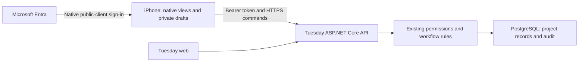

# Tuesday for iPhone — Product and implementation specification

| Field | Value |
|---|---|
| Version | 0.1 — proposed scope for review |
| Date | 2026-10-13 |
| Owner | Jay / Tuesday product owner |
| Requested outcome | Native Tuesday / PM-Tool iOS app informed by the Monday.com REA research |
| Primary audience | Engineering team members, technical reviewers, project managers and supervisors |
| Status | Proposed production contract; the synthetic simulator implementation and its separate evidence are tracked in [verification](verification.md) |
| Companion documents | [acceptance gate](acceptance-gate.md) |

## 1. Product decision

Tuesday for iPhone lets an engineering team member see what needs attention, inspect the engineering context, and record a small update while away from their desk. It uses the same projects, disciplines, deliverables, tasks, review rules, time entries and permissions as Tuesday on the web. A task updated on a phone must have the same meaning on a desktop.

**First-release workflow:** open My Work → choose a task or review request → inspect context → update, request review, comment or record time → see the server-confirmed result. Projects and My Week provide the context needed for those actions. PMs can inspect attention items and follow up; supervisors can inspect permitted weekly context. Complex staffing decisions remain in the web planner.

This is a new mobile scope requested by Jay. The previous web-only product scope does not establish native implementation. The design below is Tuesday's proposed design, informed by Monday's Android and web artifacts; no Monday iOS binary was inspected. Each research-derived choice is mapped in the evidence document.

### Specification authority and integration boundary

- This document owns the proposed iPhone experience; the maintained Tuesday `spec-parts/` owns shared business rules. The server owns their execution.
- Integration source inspected: local candidate `b83e9bd3` in `/Users/jaypatel/.codex/worktrees/d9b3/PM-Tool`. This establishes source behavior, not deployment or native interoperability.
- This clean worktree starts at `16399682`, an older specification-only snapshot. Its generated web specification is not the current implementation contract. Do not build the native API client from that snapshot alone.
- This draft deliberately has no numeric Spec Kit packet or global section number. Existing worktrees have conflicting packet 036 / §40 assignments. Assign a mobile packet and regenerate combined artifacts only after reconciling the integration baseline; do not overwrite either existing packet.
- Use `https://pm.engcalchub.com` for application URL planning. Hosting, DNS, production authentication, and associated-domain configuration remain unverified.

## 2. User problem, goals and scope

Tuesday already models engineering delivery, but work outside a desktop session still needs a short path to the relevant task and a trustworthy update. Mobile interruptions and unreliable connectivity can otherwise cause abandoned drafts, duplicate time entries, or stale workflow actions. This is a product hypothesis, not measured user-research evidence.

### Goals and proposed success targets

These are targets for the pilot, not existing results or external benchmarks. Measure with consented task observation and aggregate timings; never collect comment bodies or client documents for analytics.

| Outcome | Proposed target | Measurement |
|---|---|---|
| Find the next relevant work item | At least 90% of assigned pilot scenarios reach the correct task within 30 seconds | Observe representative team-member and reviewer scenarios after sign-in |
| Record a routine update | At least 90% complete a status update or comment without coaching; median completion at most 45 seconds | From My Work, including task selection; exclude time reading technical documents |
| Trust saves across clients | Every scripted save, refusal and concurrency scenario reconciles with the web and database; zero duplicates in retry tests | Acceptance gate and API receipts |
| Return to the daily workflow | At least 60% of enrolled pilot users use My Work on 3 working days per week by pilot week 4 | Approved aggregate session counts; record denominator and absences |

No pilot size, release date, budget or measured business impact is assumed.

### P0 — first release

Corporate sign-in; My Work; task detail and guarded edits; request/start task review; comments and mentions; create a task in a permitted discipline; own task time entries; searchable project/task lists; project context; in-app Inbox; read-only My Week; native navigation; draft recovery and visible connectivity/save state.

### P1 — separate follow-up

APNs push notifications, a permission-aware persistent offline read cache, and an outbox for a small approved set of offline writes. Each needs its own delivery, data-handling and retry contract before inclusion. Full technical review disposition may follow once revision/finding workflows can be presented and verified on a phone.

### Non-goals

- Desktop parity: bulk import/export, a spreadsheet grid, Gantt editing, full planner allocation editing and administration stay on the web because they do not serve the short mobile workflow.
- Offline workflow transitions, automatic rescheduling, task deletion and blanket approval actions: the first release needs current server authorization and engineering context.
- CAD, drawing mark-up, engineering calculations and file synchronization: links open their existing tools; Tuesday does not certify documents.
- HR approval, leave balances or private leave reasons: HR remains the source of approved leave. My Week shows only permitted availability context.
- Monday's AI agents, formulas, telephony, arbitrary board builders, micro-frontends and embedded JavaScript engines: no identified Tuesday mobile requirement needs them.

## 3. Personas and stories

| Persona | Story | First-release action |
|---|---|---|
| Engineering team member | As a team member, I want to see my due work and blockers so I can choose the next useful action. | Inspect My Work, task details and dependency explanations |
| Engineering team member | As an assignee, I want to request the required technical review so delivery moves forward without bypassing QA. | Request review using server-provided transitions |
| Technical reviewer | As a reviewer, I want to find my review requests and their linked evidence so I can begin the correct review. | Inspect and start task review; open the full web review when needed |
| Engineering team member | As the person doing the work, I want to record my task hours so actual effort remains distinct from estimates and staffing plans. | Create and correct own time entries |
| PM or discipline lead | As a lead, I want to record a task or ask a scoped follow-up so ownership and project context survive the conversation. | Quick task capture; permitted edits; comments and mentions |
| Supervisor | As a supervisor, I want permitted weekly context so I can spot a concern and open the web planner to address it. | Read My Week and project context; no mobile publication of allocations |

## 4. Navigation and screen contract

Use a native SwiftUI tab bar with **My Work, Projects, Inbox, My Week**. Account, sign-out and connection details are reached from the account control. Search lives in relevant lists. There is no separate manager home or new task-management hierarchy.

| Screen | Content and default | Primary interaction | Required secondary states |
|---|---|---|---|
| Sign-in | Tuesday identity, corporate sign-in and actionable connection error | Authenticate, then load `/me` | Cancelled login, inactive account, expired session, unavailable API |
| My Work | Server sections for assigned/collaborating tasks, reviews and other owned work; preserve blocker context | Open task; show visible due/overdue markers without rearranging business priorities locally | No work, loading, failed refresh, stale in-session content |
| Task detail | Project number → discipline → deliverable/milestone; task key/name, status, due date, owner, reviewer, blockers, last update | Explicit action sheet for permitted transition or edit; comment; record time | Read-only, missing permission, conflict, missing reviewer, deleted/inaccessible item |
| Task capture sheet | Permitted project and discipline, title, owner, due date; optional existing deliverable | Create one task and open the returned entity | Required-field errors, failed save, connection loss, duplicate-risk resolution |
| Projects | Search and server-filtered permitted project list | Open project context and task list | Empty result, pagination, restricted/inaccessible project |
| Project context | Server health and attention explanations, disciplines, upcoming deliverables/milestones and permitted document links | Drill into a task or open the matching web view | Partial scope, unknown freshness, read-only project, unsupported web-only action |
| Inbox | In-app notification list and unread count | Open target; explicit Mark read or Mark all read | Revoked target access, paged items, mark-read failure |
| My Week | Signed-in person's published/permitted plans, weekly hours, confidence, availability and source freshness | Change week; open permitted work or web planner | Partial visibility, stale leave source, unknown capacity, no plan |
| Time sheet | Task, work date, decimal hours and optional note; own day total when available | Save and inspect returned entry | Validation error, daily cap, concurrent correction, save outcome unknown |

My Work items unsupported natively, such as deliverable review disposition, decisions or meeting actions, retain their meaningful context and offer **Open in Tuesday web**. They must not disappear from the server-provided work sections or appear to be completed on the phone.

Task rows show a compact two-line identity and only the context that helps choose work: project/discipline, due date, labelled status and blocker/review indicator. Details disclose the hierarchy. Do not squeeze a desktop table onto an iPhone or hide ownership behind decorative cards. A trailing menu can expose shortcuts; every action remains reachable without a swipe gesture.

### Visual and accessibility direction

Keep Tuesday's calm neutral workspace and labelled amber/purple/red/green status accents. Use system type, native sheets, date pickers, focus and back navigation. Honour light/dark appearance, Reduce Motion and Differentiate Without Color. No global brand redesign is implied.

Every interactive target has a minimum 44 × 44 pt hit area as a Tuesday requirement. Support all Dynamic Type sizes, VoiceOver labels/actions and logical focus order; allow names, explanations and validation messages to wrap. Verify portrait layouts on the smallest supported iPhone and a large iPhone, with the keyboard and maximum accessibility text size. This direction follows [Apple accessibility guidance](https://developer.apple.com/design/human-interface-guidelines/accessibility) and [Larger Text evaluation criteria](https://developer.apple.com/help/app-store-connect/manage-app-accessibility/larger-text-evaluation-criteria).

## 5. First-release requirements

All requirements below are P0. Their independently runnable scenarios are in the acceptance gate; the gate is part of the contract.

| ID | Requirement | Acceptance |
|---|---|---|
| FR-IOS-01 | Sign in through the approved Microsoft Entra native public-client flow. Resolve `/me` before presenting project data. Keep environments, accounts and token caches distinct; block inactive users. Production must not use development identity headers or review-cookie credentials. | AC-IOS-01, AC-IOS-02 |
| FR-IOS-02 | Present My Work from the server, including task reviews and blockers. Preserve project scope and distinguish assignment from review responsibility. Show last successful fetch time; a failed request is not an empty list. | AC-IOS-03 |
| FR-IOS-03 | Show engineering hierarchy and server-supplied permissions in task detail. Fetch current detail before mutation. Never derive allowed transitions, readiness, health or review independence from Swift role-name checks. | AC-IOS-04, AC-IOS-05 |
| FR-IOS-04 | Support permitted task owner/due-date/priority/progress edits and workflow actions with expected row version, required reasons and reviewer selection. Request or start task review; offer full web review for formal disposition. Never turn Requires Review into one-tap Complete. | AC-IOS-04, AC-IOS-05, AC-IOS-06 |
| FR-IOS-05 | Create one task in an explicitly selected permitted project/discipline. Use current reference data and existing task validation. Retain entered values on a failed save; acknowledge only the returned task identity. | AC-IOS-07, AC-IOS-08 |
| FR-IOS-06 | Read and post task comments; select mention recipients from the existing permitted people flow. Preserve the server mention representation and deleted-comment visibility. Validate limits on the server; show permission failures without discarding a recoverable draft. | AC-IOS-08, AC-IOS-09 |
| FR-IOS-07 | Create/correct own task time entries using decimal hours with at most two fractional digits, `0 < hours ≤ 24`, and the server's combined daily cap. Use organisation-local work dates and server edit rights. Distinguish actual hours from planned/estimated hours. No timer is required. | AC-IOS-08, AC-IOS-10, AC-IOS-11 |
| FR-IOS-08 | Search and page permitted projects/tasks using existing server filters and sort. A scope change invalidates old responses; a late response must not repopulate the new scope. Unsupported saved-view predicates cannot silently broaden a list. Saved-view creation is outside v1. | AC-IOS-12 |
| FR-IOS-09 | Inbox counts and items come from server visibility checks. Open targets through a permission-checked fetch. Opening does not silently mark read; persist explicit mark-read commands only after acknowledgment. Refresh on foreground return and after relevant writes. | AC-IOS-13 |
| FR-IOS-10 | My Week displays server-authorized planning and availability results, with week, hours, confidence, visibility/freshness explanations and partial-view warnings. Unknown capacity remains unknown. Do not recompute capacity or expose another manager's private drafts. | AC-IOS-11, AC-IOS-14 |
| FR-IOS-11 | Separate Draft, Saving, Saved, Failed, Conflict and Outcome unknown. Retain unsent task/comment/time input in protected storage for the same account and environment until sent, explicitly discarded or signed out. Allow stale content already loaded in the current foreground session with a visible timestamp; require online revalidation after relaunch/foreground before showing protected entities or enabling writes. | AC-IOS-02, AC-IOS-06, AC-IOS-08, AC-IOS-15 |
| FR-IOS-12 | Use native navigation and accessible controls. Support approved project/task HTTPS links, validate host/path/identifiers and recheck access before rendering. Preserve the intended destination across sign-in and safely fall back to the web for unsupported entities. | AC-IOS-16, AC-IOS-17 |

## 6. Save, connectivity and privacy behavior

**Draft → Saving → Saved** is the happy path. Draft/Failed are editable and unsent. Saved means the server acknowledged the action and a refetch confirms the persisted result; a spinner ending is not sufficient. After an acknowledgment with a failed refetch, say **Saved; refresh unavailable**, preserving the acknowledged identity.

On timeout after submission, enter **Outcome unknown**. Keep the original request bytes, identity, path and idempotency key; prevent a new submission with a fresh key until the original outcome is resolved. Retry only after the prior request has finished and only within the supported deduplication window. After that window, show the current records and require explicit resolution; do not claim identical text/hours proves that a write is absent. No autonomous background queue in v1.

On a row-version conflict, show the new server state alongside the intended change, retain the draft and require an explicit retry with current permissions/version. Never silently replay a due-date change or review transition. Respect 429 `Retry-After`, cancel obsolete read requests, and use bounded backoff for reads. Do not loop sign-in or mutation retries.

Persist only minimal input drafts and unresolved save receipts, separated by environment and signed-in user; do not persist full project lists, client files, HR reasons or private planner data. Protect draft/receipt files with platform file protection, exclude them from backup, and use Keychain-backed authentication storage. Hide protected UI in the app-switcher snapshot. Clear local protected state on explicit sign-out/account change; warn about unsent drafts before a deliberate sign-out. An expired session locks drafts until the same identity reauthenticates; a known revoked/inactive identity purges them. IT must approve these draft-retention rules before any real company-data pilot.

The initial app requests no camera, microphone, contacts, location or notification permission. Document links open the existing approved document application/browser. Unsupported network-share links produce an explanation and a web handoff; do not present a non-working link as a mobile attachment viewer.

## 7. Implementation shape and API integration

**Proposed platform baseline:** iPhone, SwiftUI, minimum iOS 17, English UI with locale-aware numbers and server-configured date semantics. Confirm device coverage before adopting this minimum. An iPad-specific workspace, widgets, watch app and App Intents are separate scope.

One native app target, native screen state and a small HTTP client using `URLSession`/`Codable`. Use MSAL for Entra authentication. Do not add a mobile backend, GraphQL gateway, generic workflow framework or shared JavaScript runtime. Share correctness through existing API DTOs, server-calculated fields, permission responses and contract fixtures. Keep HTTP DTOs close to the API; add only the mapping needed to display them.

### Routes verified in the inspected local source

Paths below are relative to `/api/v1`. Endpoint existence does not establish hosted availability; freeze request/response fixtures from the selected integration baseline before implementing DTOs.

| Need | Existing route / contract | Source owner |
|---|---|---|
| Identity and organisation date settings | `GET /me` | `Features/Me.cs`, `Infrastructure/Auth.cs` |
| Personal work and reviews | `GET /me/work` | `Features/MyWork.cs`; aggregate response, not a generic paged task list |
| Project lists/context | `GET /projects`, `/projects/{id}`, `/projects/{id}/dashboard` | `Features/Projects.cs`, `Features/Dashboard.cs` |
| Task lists/detail | `GET /tasks`, `/projects/{id}/tasks`, `/tasks/{id}` | `Features/Tasks.cs`, `Features/TaskQueries.cs` |
| Create/edit/transition task | `POST /projects/{id}/tasks`, `PATCH /tasks/{id}`, `POST /tasks/{id}/transition` | `Features/Tasks.cs`; detail exposes permissions and transition reasons |
| Comments and activity | `GET/POST /items/Task/{id}/comments`, `GET /items/Task/{id}/activity` | `Features/Comments.cs`, `Features/Activity.cs`; comment response shape is not generic pagination |
| Time entries | `GET/POST /time`, `PATCH /time/{id}` | `Features/Time.cs`; list includes summaries and per-entry edit rights |
| Inbox | `GET /me/notifications`, `/me/notifications/unread-count`; `POST /me/notifications/read` | `Features/Notifications.cs` |
| Week context | `GET /planning/cells/{personId}/{week}`, `/planning/entries`; `GET /calendar` where needed | `Features/Planning.cs`, `Features/Calendar.cs`; use current user's permitted scope |

### Shared wire rules

- Use server GUIDs as identities, human-readable project/task keys as labels. API JSON is camelCase. Verify nullability and each endpoint's actual shape, rather than assuming all responses match the list convention.
- Send calendar dates as `yyyy-MM-dd` in the organisation's timezone from `/me`; timestamps are UTC ISO 8601. A travelling user's phone timezone must not move a due/work date by one day.
- Mutable task/time commands carry the current `rowVersion` through the existing `If-Match`/body contract. Status uses the transition command, never a generic PATCH.
- Each logical POST uses a stable `Idempotency-Key` and immutable payload. One request in flight per logical action. Safe server deduplication under overlap, refusal of changed-payload key reuse, and current authorization before receipt replay are pilot prerequisites, not features already proved by the middleware.
- Render problem-detail field errors. Handle 401 session recovery, 403 permission loss, 404 missing/inaccessible, 409 conflict, 422 business refusal, 428 missing version and 429 throttling distinctly. Do not leak raw exceptions or tokens into UI/logs.
- Refresh affected detail/list/count/week data after writes and on foreground return; pull-to-refresh is always available. Pusher/WebSockets are not required for v1, and the UI must not claim continuous live synchronization.
- Unsupported fields/enums produce a safe read-only state and explicit upgrade guidance, not a default transition or a substituted status. Obtain filtered, paged lists from the server; never download every project to search locally.

### Authentication and link configuration

Production uses an Entra native public-client registration with the existing API audience/scope and no client secret in the app. Bundle ID, tenant/client IDs and signing team remain to be supplied. Configure the native callback using MSAL's registered bundle-ID scheme, distinct from the web callback; [Microsoft documents this format](https://learn.microsoft.com/en-us/entra/msal/objc/redirect-uris-ios). Do not assume that a web registration or the staging LocalPassword cookie works for the native app.

For project/task handoff, support the existing `https://pm.engcalchub.com/projects/...` web links and their `panel=Task:{id}` targets. The Associated Domains entitlement and matching association file must be configured and device-tested, as described by [Apple's associated-domain guidance](https://developer.apple.com/documentation/xcode/supporting-associated-domains). The hostname decision alone does not prove universal links work. Reject arbitrary redirect hosts and never put access tokens or confidential task text in a URL.

## 8. Known integration gaps and decisions

| Item | Evidence / impact | Resolution owner and gate |
|---|---|---|
| General POST deduplication is not atomic | `Infrastructure/Idempotency.cs` runs the handler before storing the receipt; its comment acknowledges overlapping identical requests can both execute. General receipts bind key/path without payload equality. Task/comment/time retry safety therefore remains unproved. | Backend engineering: fix the shared deduplication boundary, bind receipts to immutable payloads, recheck access before replay, and pass concurrent/lost-acknowledgment tests before a write-enabled pilot |
| Saved-view filters can be silently omitted | `Features/Views.cs` filters definitions through its key whitelist. The newer workspace has predicates outside that whitelist. A phone must not present a broadened result as the saved view. | Backend/web engineering: reconcile supported predicates before offering saved views; v1 uses explicit supported filters |
| Production native sign-in is unverified | Source supports Entra bearer auth plus separately gated development/review authentication. Registration, tenant policy and native token acceptance were not exercised. | IT + engineering: choose an approved environment and pass real-device corporate sign-in before company-data pilot |
| My Work is an aggregate and comments are unpaged | Source shapes differ from the generic pagination reference. Large personal work/comment histories need measurement before any endpoint change. | Engineering: freeze fixtures, benchmark representative fixtures, add bounded server paging only if a measured requirement fails |
| Numbered product packets diverge | Daily-workspace and staffing drafts both use 036 / §40 in different worktrees. | Product/integration owner: reconcile before assigning this mobile scope a packet |
| On-device draft policy and distribution | Protected local drafts, supported devices and internal distribution need company decisions. | IT + Jay: approve handling, minimum OS/device list and internal pilot distribution before use with company data |

These do not prevent building a synthetic-data prototype from this spec. They do prevent treating that prototype as a production-ready mobile client.

## 9. Delivery sequence and acceptance

1. **Contract and native shell:** select integration revision, record endpoint fixtures, implement approved auth/navigation and read-only My Work/task/project/My Week screens with labelled synthetic data. Check organization-date behavior and accessibility early.
2. **Guarded daily actions:** complete shared deduplication prerequisite, then task edit/create, review request/start, comments, mentions and own time entry. Exercise concurrency, missing permission, timeout and draft recovery using the real API path.
3. **Internal pilot:** establish approved HTTPS environment and native identity; configure link association; complete the [acceptance gate](acceptance-gate.md) on real iPhones and the web. Obtain human workflow acceptance before expanding scope.
4. **Follow-ups only after evidence:** choose push or a bounded offline outbox if observed pilot needs justify it. Do not silently include either in the first-release acceptance claim.

Proposed performance budget: after successful authentication, p95 first useful My Work content within 3 seconds on the agreed reference device/network; p95 task detail within 2 seconds; visible saving/error feedback within 200 ms of action. Test at least 30 measured runs and record device, OS, build, dataset, network latency and cache state. Use a synthetic fixture of 1,000 permitted tasks across 20 projects, 100 review requests and a 500-comment task for stress checks; these are test inputs, not product usage claims. Keep scrolling and typing responsive while requests run. Revise budgets explicitly if pilot evidence shows the reference conditions were wrong.

No implementation estimates or release dates are committed. Specification checks, native implementation, API verification, hosted readiness, real-device acceptance and human acceptance are separate verdicts.
